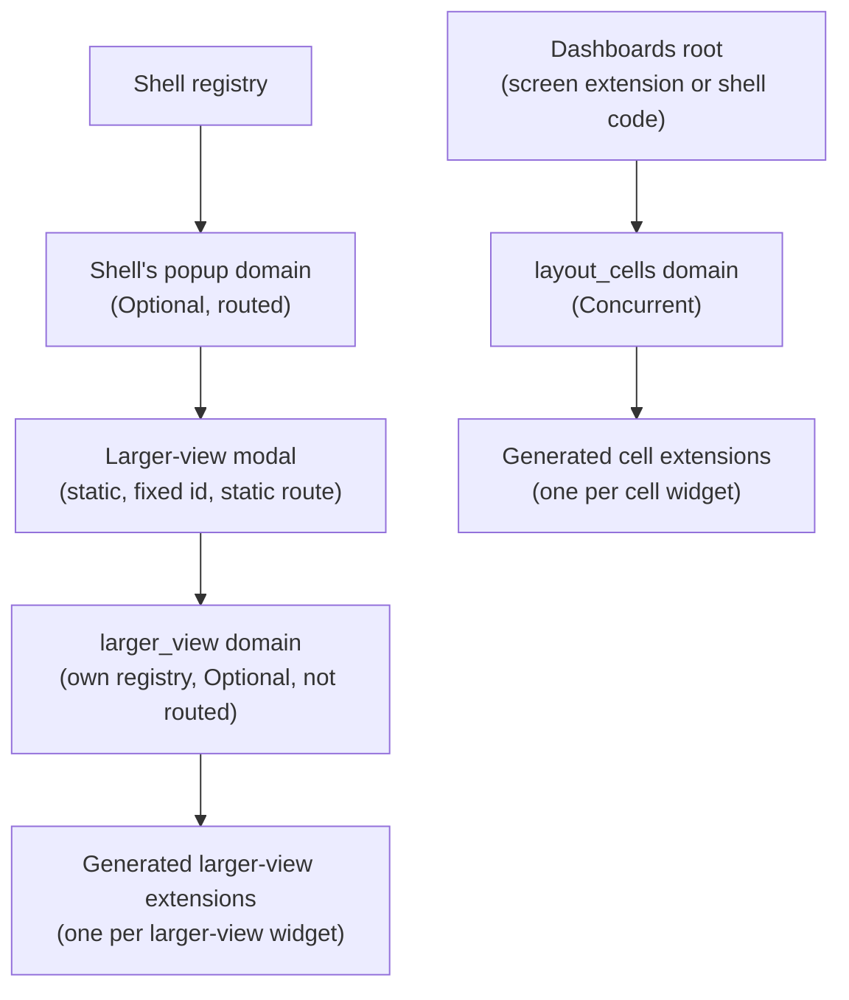
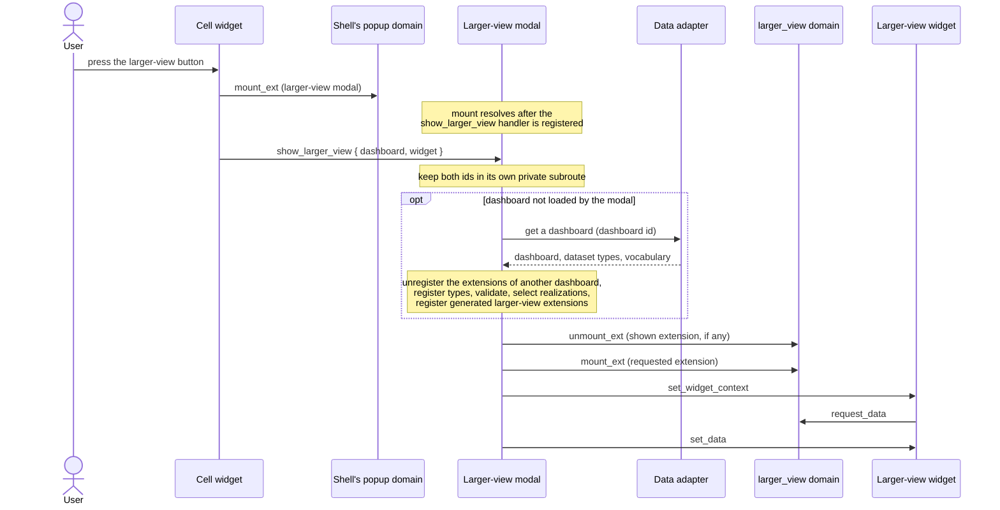

# ADR-0007: Extension domains, actions and the larger-view modal

**ID**: `cpt-frontx-dashboard-adr-extension-domain-taxonomy`

<!-- toc -->

- [Context and Problem Statement](#context-and-problem-statement)
- [Decision Drivers](#decision-drivers)
- [Considered Options](#considered-options)
- [Decision Outcome](#decision-outcome)
  - [Extension domains](#extension-domains)
  - [Actions](#actions)
  - [Generated extensions and their ids](#generated-extensions-and-their-ids)
  - [Larger view](#larger-view)
  - [Flows](#flows)
  - [Declarations and admission](#declarations-and-admission)
  - [Consequences](#consequences)
  - [Confirmation](#confirmation)
- [Pros and Cons of the Options](#pros-and-cons-of-the-options)
  - [Static larger-view modal with a nested `larger_view` domain](#static-larger-view-modal-with-a-nested-larger_view-domain)
  - [Modal extension per larger-view widget in the shell's `popup` domain](#modal-extension-per-larger-view-widget-in-the-shells-popup-domain)
  - [Routed larger-view extensions](#routed-larger-view-extensions)
  - [Larger view inside the dashboards root](#larger-view-inside-the-dashboards-root)
- [More Information](#more-information)
- [Traceability](#traceability)

<!-- /toc -->

## Context and Problem Statement

A dashboard shows widgets in layout cells. A cell may also define a larger view: a second widget that opens in a modal window when the user presses the button on the cell widget. Widgets are MFE instances, and FrontX isolates each instance. Widgets are passive renderers: they send a data request to the extension domain they sit in, and the owner of that domain answers with data from the product's data adapter ([ADR-0011](0011-data-adapter-v1.md)).

The **dashboards root** is whatever hosts the dashboards: a screen extension, or code copied into the shell of a single-page application that has no screen domain. This record stays abstract about which. The **larger-view modal** is the static, routed modal window extension of the shell's `popup` domain that shows larger views.

FrontX sets firm rules. An extension can be registered only through the registry that holds its domain. A child's bridge offers only `executeActionsChain`, `subscribeToProperty`, `getProperty` and `registerActionHandler`, so a child cannot register anything into an ancestor's registry (FrontX ADR-0008). FrontX keeps per-extension state, such as the extension's bridge and link, across unmounting and unregistration, so an extension id is never fully released (FrontX ADR-0007, FrontX ADR-0008). Target ids are unique in the whole tree (FrontX ADR-0007). Every domain picks a mount strategy, and its declared actions must fit that strategy (FrontX ADR-0009). An MFE entry is admitted into a domain by the subset rules of FrontX ADR-0010. FrontX routing restores, after a page refresh, only those extensions that are registered when their domain takes its first resolution (FrontX ADR-0036, status proposed).

Which extension domains and actions does the template define, who registers which extensions and when, how does a widget reach its data and its larger view, and how does an open larger view survive a page refresh?

## Decision Drivers

* **FrontX registration rules.** Every extension is registered through the registry that holds its domain. No template part needs a FrontX change.
* **Same widget behavior in both places.** A widget receives its context and its data with the same actions in a cell and in the larger view, so one MFE entry per widget type can serve both ([ADR-0008](0008-widget-type-and-mfe-realization-v1.md)).
* **No relays.** Action delivery is FrontX's concern. The template adds no part that passes actions on.
* **Nothing registered into the shell or an ancestor.** Nothing is ever registered into the shell's registry or any ancestor's registry. The larger-view modal registers its generated extensions in its own registry when it loads a dashboard; reopening a larger view of a dashboard it has already loaded registers nothing.
* **Stable extension ids.** FrontX keeps per-extension state by id, so loading the same dashboard again must reuse the same ids rather than add new ones.
* **The larger view survives a refresh.** An open larger view stays open after a page refresh (`cpt-frontx-dashboard-fr-widget-modal`).
* **Host modal area.** The larger view appears in the shell's modal area, through the shell's `popup` domain, with the shell's modal chrome, not inside the dashboards root (`cpt-frontx-dashboard-contract-host-areas`).
* **Hosting stays abstract.** The design works whether the dashboards root is a screen extension or code in the shell.

## Considered Options

* **Static larger-view modal with a nested `larger_view` domain** — one static, routed extension of the shell's `popup` domain implements its own `larger_view` domain, generates one extension per larger-view widget into it, and keeps the shown larger view in its own private subroute.
* **Modal extension per larger-view widget in the shell's `popup` domain** — one modal window extension per larger-view widget is registered directly into the shell's `popup` domain and mounted there.
* **Routed larger-view extensions** — the larger-view modal's nested domain is routed, and FrontX routing restores the shown larger-view extension after a refresh.
* **Larger view inside the dashboards root** — the dashboards root implements a second domain of its own with modal chrome and shows larger-view widgets there.

## Decision Outcome

Chosen option: "Static larger-view modal with a nested `larger_view` domain", because it is the only option that registers every extension in the registry that holds its domain, wherever the dashboards root runs, shows the larger view in the shell's modal area, and restores an open larger view after a page refresh. It needs no FrontX change.

### Extension domains

| Domain | Owner and implementer | Strategy | Extensions | Handles |
|---|---|---|---|---|
| `layout_cells` | the dashboards root, in the registry it runs in | Concurrent | one generated cell extension per cell widget | `request_data` |
| the shell's `popup` domain | the shell | Optional | the larger-view modal: one static extension with a fixed id and a static route | FrontX lifecycle actions only |
| `larger_view` | the larger-view modal, in its own registry | Optional | one generated extension per larger-view widget of the loaded dashboard; at most one mounted; not routed | `request_data` |

The template defines `layout_cells` and `larger_view` and their extension types in package `dashboard_v` ([ADR-0003](0003-shared-data-types-and-schemas-v1.md)). Both domains share theme and language with their extensions ([ADR-0006](0006-theme-distribution-v1.md)). The shell's `popup` domain belongs to the shell, which already registers it with the Optional strategy, theme and language shared properties, and `mount_ext` and `unmount_ext`; what the template needs from the shell around it is part of the host contract ([ADR-0010](0010-template-packages-and-host-contract-v1.md)).

The larger-view modal owns a nested domain because a child cannot register into an ancestor's registry. When the dashboards root is a screen extension, it cannot register anything into the shell's `popup` domain. The larger-view modal is itself an extension of the `popup` domain, so it builds its own registry, synchronously in its first mount (FrontX ADR-0008), and registers `larger_view` and its generated extensions there.

### Actions

| Action | Target | Sent by | Payload |
|---|---|---|---|
| `set_widget_context` | a widget extension (cell or larger view) | the dashboards root to cell widgets; the larger-view modal to larger-view widgets | `widget`: the widget instance. For a data widget: `data_shape` and `fill` from the widget type's traits ([ADR-0009](0009-subject-agnostic-widget-catalog-v1.md)), and `members`: the metadata (`id`, `title`, `value_type`, `unit`) of every member in its query ([ADR-0012](0012-query-vocabulary-and-datasets-v1.md)). For a cell widget with a larger view: the `larger_view` field (not the `larger_view` domain) with the dashboard id and the larger-view widget id. |
| `request_data` | the extension domain the widget sits in (`layout_cells` or `larger_view`) | a data widget | `{ data, data_shape, fill, reply_to, timestamp }`; semantics in [ADR-0011](0011-data-adapter-v1.md) |
| `set_data` | the requesting widget extension (`reply_to`) | the owner of that domain | `{ data, timestamp }`; semantics in [ADR-0011](0011-data-adapter-v1.md) |
| `show_larger_view` | the larger-view modal | the cell widget's actions chain, after `mount_ext` of the larger-view modal | `{ dashboard, widget }`: the dashboard id and the larger-view widget id |
| `mount_ext` / `unmount_ext` (FrontX) | `layout_cells` | the dashboards root | a generated cell extension id |
| `mount_ext` / `unmount_ext` (FrontX) | the shell's `popup` domain | the cell widget's actions chain (open); the larger-view modal's close button or the modal container of the shell's `popup` domain on a click outside (close); every such chain carries `history: "none"` | the larger-view modal's extension id |
| `mount_ext` / `unmount_ext` (FrontX) | `larger_view` | the larger-view modal | a generated larger-view extension id |

`set_widget_context` carries no data endpoint and no widget data. Everything a widget needs to render and to ask for its data reaches it in this one action, in a cell and in the larger view alike.

`request_data` and `set_data` are single actions for all widget types. Their payloads are typed by base types: the query by the base query type, and the data by the base data-shape type. GTS validates each embedded instance against the derived type named by its own id, so one action type per direction serves every data widget type and every data shape ([ADR-0003](0003-shared-data-types-and-schemas-v1.md)). The action types live in package `dashboard_v`.

**Delivery.** Action delivery is FrontX's concern. A widget sends `request_data` to the extension domain it sits in, which it reads from its bridge's `extDomainId`. FrontX delivers each action to the handler that its target registered, wherever the target sits in the tree (FrontX ADR-0007). This holds for `set_data` from a domain's owner to a widget in its domain, and for `show_larger_view` from a cell widget to the larger-view modal. No template part passes actions on.

**Handlers resolve on acceptance.** FrontX ends an action's step in its actions chain when the handler's promise settles, and the action's timeout, or the domain's default timeout, covers only that time. The `request_data` handlers of `layout_cells` and `larger_view` therefore resolve as soon as they have taken the request. They then call the data adapter without holding the chain, and they send `set_data` as their own actions chain, after the request's chain ends. A slow data adapter never reaches the action timeout. The `show_larger_view` handler of the larger-view modal follows the same rule: it takes the ids and resolves, and loading the dashboard runs after the handler resolves.

### Generated extensions and their ids

The dashboards root registers one cell extension per cell widget in `layout_cells`. The larger-view modal registers one extension per larger-view widget of the dashboard it loaded in `larger_view`. Each widget id appears once in a dashboard, in a cell or as a larger-view widget, because every GTS instance id is unique and the layout checks reject a repeated id ([ADR-0002](0002-dashboard-layout-grid-v1.md)); so every generated extension belongs to exactly one widget instance. The `entry` of each generated extension comes from the winning widget realization of its widget type: the realization's entry for a cell, and its separate larger-view entry for a larger view when it names one ([ADR-0008](0008-widget-type-and-mfe-realization-v1.md)).

Generated extensions have deterministic ids, because FrontX extensions are never fully destroyed. Loading the same dashboard again, in the dashboards root or in the larger-view modal, uses exactly the same extensions with the same ids for the same widgets. What FrontX keeps per extension id is reused, not piled up. Each id is the extension type chain of its domain followed by a UUIDv5, derived under a fixed template namespace from three inputs:

* the widget's full id (type chain and UUID);
* its role: cell or larger view;
* the entry of its widget realization.

So an id always names the same declaration. The role keeps a cell extension and a larger-view extension of the same widget apart under the tree-wide uniqueness of target ids. The entry gives a new id when a different realization wins, so FrontX never reuses one id for different code. Everything that may differ while the widget id stays the same, such as presentation fields, the query or member metadata, reaches the widget in `set_widget_context`, never in the extension declaration.

Registration happens only when an owner loads a dashboard. The dashboards root unregisters its generated extensions when it loads another dashboard and when it goes away. The larger-view modal keeps the dashboard it loaded and its generated extensions while it is closed, because its nested registry and its registrations survive an unmount (FrontX ADR-0008), and it unregisters them only when it loads a different dashboard. Registering them again reuses the same ids. When the user returns to a dashboard that the dashboards root has already loaded, it mounts the same cell extensions again, with the same ids, instead of creating them anew. The larger-view modal itself is static and always has the same id. Since `layout_cells` and `larger_view` have fixed ids, one dashboards root and one larger-view modal exist per application tree.

### Larger view

The larger view is just another widget, shown by the larger-view modal. A larger-view widget has its own settings and its own data, and it is not connected to the cell widget. If it should look the same, the dashboard definition names a second widget instance with the same settings. The dashboards root never renders a larger view. A cell with no larger-view widget hides its button, so a cell widget shows the button only when its `set_widget_context` carries `larger_view`.

The larger-view modal survives a page refresh through its own private subroute, not through extension routing. It is a routed extension of the shell's `popup` domain with a static route, so FrontX routing restores it. It keeps the dashboard id and the shown larger-view widget id as parameters of its own private subroute, which only its own runtime reads and writes. The extensions it generates in `larger_view` are not routed. They are not known before the larger-view modal loads the dashboard, and FrontX routing restores only extensions that are registered when their domain takes its first resolution.

### Flows

**Open a dashboard.**

1. The dashboards root gets the dashboard from the data adapter, registers the delivered types, validates the dashboard and selects widget realizations ([ADR-0011](0011-data-adapter-v1.md)).
2. It registers all its generated cell extensions in `layout_cells`, with the ids above.
3. For each cell widget, it sends one actions chain: `mount_ext` of the cell extension, then `set_widget_context`.
4. Each data widget sends `request_data` to `layout_cells`, and the dashboards root answers with `set_data` ([ADR-0011](0011-data-adapter-v1.md)).

**Open the larger view.**

1. The user presses the button on a cell widget. The cell widget sends one actions chain: `mount_ext` of the larger-view modal in the shell's `popup` domain with `history: "none"`, then `show_larger_view { dashboard, widget }` with the ids from its `set_widget_context`. The cell widget takes the `popup` domain id from the host contract ([ADR-0010](0010-template-packages-and-host-contract-v1.md)) and the larger-view modal's fixed extension id from the template.
2. The larger-view modal keeps `dashboard` and `widget` as parameters of its own private subroute.
3. If it has not loaded that dashboard, the larger-view modal unregisters the generated extensions of the dashboard it had loaded, if any, and shows a loader. It then gets the dashboard from the data adapter, registers the delivered types, validates each larger-view widget, selects realizations and registers one generated extension per larger-view widget in `larger_view`.
4. It sends one actions chain: `unmount_ext` of the shown larger-view extension, which does nothing when none is shown, then `mount_ext` of the requested one, then `set_widget_context`. Every larger-view widget thus starts from a fresh mount followed by its context. A widget that failed its checks, or a requested larger-view widget id that is not in the dashboard, gets the cannot-show state in the modal instead ([ADR-0011](0011-data-adapter-v1.md)).
5. A data widget sends `request_data` to `larger_view`, and the larger-view modal answers with `set_data`.

**Refresh with the larger view open.**

1. FrontX routing restores the dashboards root and the larger-view modal, each in its own domain. The larger-view modal is registered statically with its route, so the shell's `popup` domain resolves it in its first resolution.
2. Once FrontX routing gives the larger-view modal its entry back, with the parameters of the route the page was loaded with, the larger-view modal reads `dashboard` and `widget` from its own private subroute. These ids are untrusted input from the page address. The larger-view modal gets the dashboard only through the data adapter, which owns access ([ADR-0011](0011-data-adapter-v1.md)). An id that is not in that dashboard shows the modal's cannot-show state, the widget-level trigger "the requested larger-view widget id is not in the dashboard" of [ADR-0011](0011-data-adapter-v1.md), and a dashboard the data adapter does not return leaves the modal's loader, as [ADR-0011](0011-data-adapter-v1.md) defines.
3. It continues from step 3 of "Open the larger view". `larger_view` has no route, so nothing in it depends on what was registered when the page loaded.

**Close the larger view.** The larger-view modal's close button sends `unmount_ext` of the larger-view modal to the shell's `popup` domain with `history: "none"`. A click outside the modal is handled by the modal container, the shell's `popup` domain's container implementation, which unmounts the larger-view modal with `unmount_ext`. Opening and closing the larger view therefore never pushes browser history; the route follows from the executed actions, and the restore reads the modal's own private subroute parameters. The larger-view modal's subroute leaves the route with it. It keeps the loaded dashboard and its generated extensions, so the next opening of the same dashboard goes straight to the `unmount_ext`, `mount_ext` and `set_widget_context` step. While the larger view is open, the user reaches no other part of the page, so the dashboards root never closes it.

**Teardown.** When the user leaves the dashboard or opens another one, the dashboards root unmounts all its cell extensions. When it loads another dashboard, and when it goes away itself, it unregisters the generated cell extensions of the dashboard it had loaded.

### Declarations and admission

* **Entries list what they handle.** Every widget entry lists `set_widget_context` and `set_data` in its `actions`, also `markdown_card`, which never receives `set_data`. The larger-view modal's entry lists `show_larger_view` in its `actions`. Every widget entry lists `request_data` in its `domainActions`. Lifecycle actions (`load_ext`, `mount_ext`, `unmount_ext`) are not listed in `domainActions`: FrontX admission exempts them, so the cell widget's `mount_ext` and the modal's `unmount_ext` on the shell's `popup` domain need no declaration. FrontX rejects an action whose target entry does not list it.
* **Domains require what they send.** The `extensionsActions` of `layout_cells` and of `larger_view` require `set_widget_context` and `set_data`, so only entries that handle both are admitted (FrontX ADR-0010). One entry per widget type therefore fits both domains.
* **Domains declare what they handle.** `layout_cells` and `larger_view` list `request_data` in their `actions`, next to the lifecycle actions that their strategy requires (FrontX ADR-0009). Each registers its `request_data` handler while it builds the domain. FrontX accepts a domain only when every listed action has a handler and every handler is listed. A widget entry that sends `request_data` lists it among its `domainActions`, which both domains support.
* **Handlers exist before they are needed.** A domain's `request_data` handler is registered when the domain is registered, so before any extension in it mounts. Under the FrontX MFE entry contract, an entry's `mount` resolves only after the entry has registered its action handlers, and the next step of a chain runs only after the mount resolves. So a widget's `set_data` handler exists before its first `request_data`, and the larger-view modal's `show_larger_view` handler exists before the `show_larger_view` step of the cell widget's chain runs.

### Consequences

* Good, because every extension is registered in the registry that holds its domain, whether the dashboards root is a screen extension or code in the shell, with no FrontX change.
* Good, because nothing is registered into the shell's registry or an ancestor's registry: the larger-view modal is static, it registers its generated extensions in its own registry when it loads a dashboard, and reopening a larger view of a dashboard it has already loaded registers nothing.
* Good, because an open larger view survives a page refresh, through the larger-view modal's static route and its own private subroute.
* Good, because a widget receives its context and its data through the same actions in a cell and in the larger view, so one entry per widget type serves both.
* Good, because two action types carry the data of every data widget type, typed by base types and validated by GTS against the exact derived types.
* Good, because deterministic ids make loading the same dashboard again reuse what FrontX keeps per extension id.
* Good, because no template part relays actions; FrontX delivers each action to its target.
* Neutral, because the larger-view modal loads the dashboard on its own, in its own runtime, so a dashboard is requested by the dashboards root and, the first time a larger view of it is opened and after a refresh, once by the larger-view modal.
* Bad, because the larger view depends on the shell rendering a modal container for its `popup` domain that keeps keyboard focus inside the modal while it is open and unmounts its occupant on a click outside. The shell registers the `popup` domain already (Optional strategy, routed, theme and language shared properties, `mount_ext` and `unmount_ext`); the container is a prerequisite in the shell, stated in the host contract ([ADR-0010](0010-template-packages-and-host-contract-v1.md)). Without it, no larger view can be shown, while the rest of the dashboard works.
* Bad, because an actions chain reports nothing back to its sender (FrontX ADR-0007): when an opening fails, the cell widget does not learn of it, and the next button press starts a new opening.
* Bad, because every `request_data` and `show_larger_view` handler must resolve once it has taken the action and continue its work outside the chain. A handler that waits for the data adapter would run into the action timeout.
* Bad, because fixed domain ids allow only one dashboards root and one larger-view modal per application tree.

### Confirmation

* A domain registration test checks that `layout_cells` and `larger_view` are accepted with their strategies, that each lists `request_data` in its `actions` with a handler, and that leaving out the handler or the listing is rejected.
* An admission test checks that a widget entry that lists `set_widget_context` and `set_data` is admitted into both domains, that an entry missing either is rejected, and that the larger-view modal's entry is admitted into the shell's `popup` domain.
* An integration test opens a dashboard and checks that the dashboards root registers exactly one cell extension per cell widget, with the deterministic id, and that every cell widget receives `set_widget_context` after its mount and before any `set_data`.
* A test loads the same dashboard twice, and loads another dashboard in between, and checks that the generated ids are equal for the same widget, role and entry, that the extensions of the first dashboard are unregistered before the second is registered, and that no collision diagnostic is logged.
* A test lets the data adapter answer after longer than the domain's default action timeout and checks that the `request_data` chain completes without a timeout and that `set_data` reaches the widget.
* A test opens a larger view and checks the chain `mount_ext` of the larger-view modal, then `show_larger_view`; that nothing is registered in the shell's registry; that the requested larger-view widget is mounted in `larger_view` and receives `set_widget_context`; and that opening a larger view of the same dashboard again registers nothing.
* A test reloads the page with a larger view open and checks that the same larger-view widget is shown again.
* A test closes the larger view with its close button and with a click outside, and checks that the larger-view modal is unmounted, that its generated extensions stay registered while it loads no different dashboard, and that the dashboard stays as it was.
* A test checks that a cell without a larger-view widget shows no larger-view button.
* A test reloads the page with a larger-view widget id that is not in the dashboard and checks that the larger-view modal shows its cannot-show state.
* A test checks that a dashboard that repeats a widget id is rejected by the layout checks, so no generated extension is shared by two cells.
* Design review confirms that no template part relays actions and that nothing is registered into the shell's registry or an ancestor's registry.

## Pros and Cons of the Options

### Static larger-view modal with a nested `larger_view` domain

One static, routed extension of the shell's `popup` domain. It implements its own `larger_view` domain, loads the dashboard through the data adapter, registers one extension per larger-view widget in its own registry and shows one at a time. It keeps the dashboard id and the larger-view widget id in its own private subroute.

* Good, because every registration happens in the registry that holds the domain, wherever the dashboards root runs.
* Good, because the larger view appears in the shell's modal area with the shell's modal chrome.
* Good, because the larger-view modal is registered statically with its route, so FrontX routing restores it, and its own subroute restores the shown larger view.
* Neutral, because the larger-view modal loads the dashboard itself, which costs one more dashboard request.
* Bad, because the template ships and maintains one more part, the larger-view modal, with its own data adapter calls and its own cannot-show state.

### Modal extension per larger-view widget in the shell's `popup` domain

For each larger-view widget, one modal window extension is registered in the shell's `popup` domain, and the cell widget's chain mounts it there.

* Good, because the larger-view widget sits directly in the shell's `popup` domain, with no nested domain in between.
* Bad, because the extensions would be registered into the shell's registry, which a dashboards root that is a screen extension cannot do: a child cannot register into an ancestor's registry (FrontX ADR-0008).
* Bad, because the answer to `request_data` from a widget in the shell's `popup` domain would have to come from the shell, which holds no data adapter.
* Bad, because these extensions are not known before a dashboard loads, so FrontX routing cannot restore them after a refresh (see the routed option below).

### Routed larger-view extensions

The larger-view modal's `larger_view` domain is routed, and FrontX routing restores the shown generated extension after a refresh, with no subroute of the larger-view modal's own.

* Good, because the template would rely on FrontX routing alone, with no parameters of its own.
* Bad, because the generated extensions are registered only after the larger-view modal loads the dashboard, so they are not registered when `larger_view` takes its first resolution, and the deep link is lost on a refresh.
* Bad, because registering them earlier would mean registering every possible larger-view extension before any dashboard is known, which deterministic ids from the loaded dashboard cannot provide.

### Larger view inside the dashboards root

The dashboards root implements a second domain of its own, with modal chrome, focus trap and dismissal, next to `layout_cells`, and shows larger-view widgets there.

* Good, because the dashboards root could register larger-view extensions in its own registry and would need nothing from the shell's `popup` domain.
* Bad, because the larger view would render inside the dashboards root's area, not in the shell's modal area.
* Bad, because the template would own a second modal surface next to the shell's, duplicating modal chrome, focus trap and dismissal.
* Bad, because restoring an open larger view after a refresh would need its own subroute in the dashboards root, so it saves no work over the chosen option.

## More Information

**FrontX behavior this decision relies on.** A domain implementation registers a handler for any action type that the domain lists in its `actions`, including a template action such as `request_data`, while FrontX builds the domain. FrontX delivers an action targeted at a domain to that handler. A step of an actions chain ends when its handler's promise settles. A `set_data` that the domain's owner sends as its own actions chain, after the request's chain ends, is independent of the request's chain.

**Review trigger.** Revisit if FrontX lets a child register an extension in an ancestor's registry; if FrontX routing can restore extensions registered after their domain's first resolution; if the shell's `popup` domain uses another strategy, stops being routed or stops sharing theme and language; if FrontX changes how a step of an actions chain ends; or if more than one dashboards root per application tree becomes a requirement.

**Scope.** This record decides the template's extension domains and their owners; the actions `set_widget_context`, `request_data`, `set_data` and `show_larger_view`, with their targets, senders and payloads; that action delivery is FrontX's concern with no relays; the larger-view modal and its nested `larger_view` domain; the generated extensions, their deterministic ids, and when they are registered and unregistered; how the larger view opens, survives a refresh and closes; and the declarations that make admission work. It does not decide:

* the data adapter, what `request_data` and `set_data` mean and how the domain's owners answer them ([ADR-0011](0011-data-adapter-v1.md));
* GTS conventions, packages and polymorphic validation ([ADR-0003](0003-shared-data-types-and-schemas-v1.md));
* data widget types, data shapes and fill modes ([ADR-0009](0009-subject-agnostic-widget-catalog-v1.md));
* the widget realization, its precedence and one entry per widget type ([ADR-0008](0008-widget-type-and-mfe-realization-v1.md));
* the query vocabulary and the member metadata it defines ([ADR-0012](0012-query-vocabulary-and-datasets-v1.md));
* the packages and the host contract, including the shell's `popup` domain requirements ([ADR-0010](0010-template-packages-and-host-contract-v1.md));
* theme and language ([ADR-0006](0006-theme-distribution-v1.md)).

**Checklist applicability.** ARCH applicable and addressed above. PERF applicable: reopening a larger view of an already loaded dashboard registers nothing, and `request_data` handlers resolve on acceptance so no chain waits for the backend. SEC applicable only for the ids read from the larger-view modal's own subroute, which are untrusted input from the page address and are checked against what the data adapter returns; the data adapter owns access (ADR-0011), and isolation of MFE instances is FrontX's. REL applicable: a failed opening leaves the dashboard unchanged, handlers never hit the action timeout while the data adapter works, and the larger view survives a refresh. DATA applicable for the action payload contracts and the inputs of id derivation decided here; no persistent store is decided, and payload types are decided in ADR-0003, ADR-0009 and ADR-0012. INT applicable: the shell's `popup` domain requirements form a documented coupling with the shell. OPS not applicable because no operational procedure is governed. MAINT applicable: deterministic ids and the declaration rules keep generated extensions predictable. TEST applicable: the Confirmation tests cover registration, admission, ids, timing, opening, refresh and closing. COMPL not applicable because no regulatory obligation is involved. UX applicable: the larger view uses the shell's modal chrome; as a shell requirement, keyboard focus stays inside the modal while it is open; it closes by its close button or a click outside and stays open after a refresh. BIZ not applicable because no business rule is decided.

**Related FrontX decisions.** FrontX ADR-0007 (action dispatch and chaining), FrontX ADR-0008 (child MFE access to the host and nested registries), FrontX ADR-0009 (extension domain occupancy), FrontX ADR-0010 (domain and extension compatibility), FrontX ADR-0036 (extension routing, status proposed). These are upstream FrontX records, not this template's ADRs of the same numbers.

## Traceability

- **PRD**: [PRD.md](../PRD.md)
- **DESIGN**: [DESIGN.md](../DESIGN.md)

This decision directly addresses the following requirements or design elements:

* `cpt-frontx-dashboard-fr-widget-modal` — the larger view is its own widget shown by the larger-view modal; the button is hidden without one; as a shell requirement, keyboard focus stays inside the modal while it is open; it closes by its close button or a click outside and stays open after a refresh.
* `cpt-frontx-dashboard-fr-replacement-widget` — a replacement widget entry is admitted by listing `set_widget_context` and `set_data` and receives the same actions as the template's widget.
* `cpt-frontx-dashboard-fr-domain-model` — `request_data` and `set_data` carry typed queries and data shapes, typed by base types.
* `cpt-frontx-dashboard-contract-host-areas` — the larger view appears in the shell's modal area through the shell's `popup` domain.
* `cpt-frontx-dashboard-usecase-view-dashboard` — the dashboard viewer sees cell widgets in `layout_cells` and opens a larger view in the shell's modal area.
* `cpt-frontx-dashboard-interface-template-domains` — the `layout_cells` and `larger_view` domains, their owners, strategies and declarations.
* `cpt-frontx-dashboard-interface-host-actions` — `set_widget_context`, `request_data`, `set_data` and `show_larger_view`, with their targets, senders and payloads.
* `cpt-frontx-dashboard-interface-widget-realization` — the winning realization gives the entry of each generated extension, and the entry is one input of its id.
* `cpt-frontx-dashboard-principle-own-registry-registration` — cell extensions are registered in the dashboards root's registry and larger-view extensions in the larger-view modal's registry, only when a dashboard loads.
* `cpt-frontx-dashboard-principle-per-instance-isolation` — each widget is its own extension, and deterministic ids keep what FrontX holds per extension from piling up.
* `cpt-frontx-dashboard-constraint-shell-only-dependency` — the shell's `popup` domain is the one shell capability the larger view requires.
* `cpt-frontx-dashboard-constraint-role-based-host-ids` — the shell's `popup` domain is named by role, and its id comes from the host contract.
* `cpt-frontx-dashboard-seq-initial-load` — registration of cell extensions, then `mount_ext` and `set_widget_context` per cell.
* `cpt-frontx-dashboard-seq-widget-modal-open` — the opening sequence of the larger view.
* `cpt-frontx-dashboard-seq-teardown` — unmounting cell extensions and unregistering them when the dashboards root loads another dashboard or goes away.
* `cpt-frontx-dashboard-feature-extension-domain-catalog` — the domains, action types and generated extensions specified in detail.
* `cpt-frontx-dashboard-feature-mfe-entries` — the widget entries and the larger-view modal entry with their declared actions.
