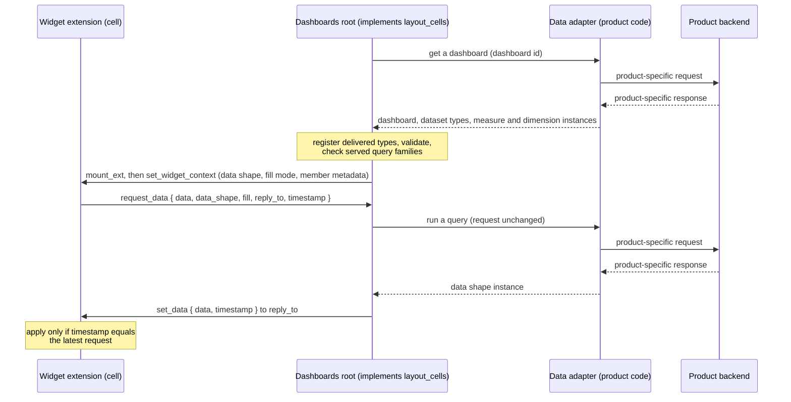

# ADR-0011: Data adapter as product code behind a template interface

**ID**: `cpt-frontx-dashboard-adr-data-adapter`

<!-- toc -->

- [Context and Problem Statement](#context-and-problem-statement)
- [Decision Drivers](#decision-drivers)
- [Considered Options](#considered-options)
- [Decision Outcome](#decision-outcome)
  - [Consequences](#consequences)
  - [Confirmation](#confirmation)
- [Pros and Cons of the Options](#pros-and-cons-of-the-options)
  - [Data adapter as code called by the domain owners](#data-adapter-as-code-called-by-the-domain-owners)
  - [Provider extension per widget instance](#provider-extension-per-widget-instance)
  - [Provider extension per provider type](#provider-extension-per-provider-type)
- [More Information](#more-information)
- [Traceability](#traceability)

<!-- /toc -->

## Context and Problem Statement

A dashboard shows widgets in layout cells, and a cell may also define a larger view that opens in a modal window. Most widgets need data. The template is a blueprint: a consuming product copies it into its project and changes it there. Each consuming product has its own backend, with its own API, its own vocabulary and its own errors. The template must work with any of them and must not depend on one.

Two rules shape the answer. Widget MFEs make no API calls to get their data and depend on no backend API. Each data widget type declares the data shape it needs, one schema per data widget type ([ADR-0009](0009-subject-agnostic-widget-catalog-v1.md)). Dashboards are written by hand or generated by a language model, so a definition must be checkable before anything mounts.

FrontX sets the frame. Widgets are MFE instances, and FrontX isolates each instance. The dashboards root implements the `layout_cells` extension domain. The larger-view modal implements the nested `larger_view` extension domain ([ADR-0007](0007-extension-domain-taxonomy-v1.md)). Here, the **dashboards root** is whatever hosts the dashboards: a screen extension, or code copied into the shell of a single-page application that has no screen domain. The **larger-view modal** is the static, routed modal window extension of the shell's `popup` domain that shows larger views ([ADR-0007](0007-extension-domain-taxonomy-v1.md)). FrontX delivers actions to their targets, across nesting layers, by itself.

Where does the code that talks to the backend live, how does each widget get its data, and what does the user see when a dashboard or a widget cannot be shown or its data does not arrive?

## Decision Drivers

Listed by priority.

* **Backend-agnostic template.** The template ships contracts and data shapes and no backend access of its own. Only product code talks to a backend (`cpt-frontx-dashboard-fr-backend-source`).
* **Passive widgets.** A widget renders what it is given. It holds no backend knowledge, no data-request code and no error handling for backend failures.
* **No new product code for common changes.** A consuming product supports a new dataset, a new dashboard or a new template widget type that reuses a fill mode without writing new data-access code. A fill mode is a template-defined rule for filling a data shape from a query result ([ADR-0009](0009-subject-agnostic-widget-catalog-v1.md)).
* **Few moving parts.** Every extra extension domain, runtime instance, selection rule or lifecycle rule is more product work and more ways to fail. Fewer is better.
* **Typed contracts.** Queries and data shapes stay GTS-typed, so FrontX validates them like any other action payload (`cpt-frontx-dashboard-fr-domain-model`).
* **Failures stay local.** A widget that cannot be shown affects only its own cell or its own larger view, and every failure the template detects has one visible place (`cpt-frontx-dashboard-fr-loading-error-states`).
* **Efficient backend use.** The product may group the requests of several widgets into one backend call, and may cache identical requests.
* **Isolation of product code.** Product code should run apart from template code where possible. This driver ranks last: the template is copied and changed by the product anyway.

## Considered Options

* **Data adapter as code called by the domain owners** — the product implements one data adapter, a code interface the template defines. The owner of each extension domain that holds widgets calls it: the dashboards root for `layout_cells`, the larger-view modal for `larger_view`.
* **Provider extension per widget instance** — the product ships a provider MFE entry. For each data widget, one provider extension is mounted in a non-visual extension domain. It answers that widget's requests.
* **Provider extension per provider type** — the product ships one provider MFE entry per provider type. One long-lived provider extension per type is mounted in a non-visual extension domain and answers the requests of many widgets.

## Decision Outcome

Chosen option: "Data adapter as code called by the domain owners", because it is the only option that adds no extension domain, no runtime instance and no selection rule, keeps all product code in one implementation, and lets the product group requests into one backend call. Its weakness, product code that runs in the runtime of a domain owner, matters least: the product owns its copy of the template, including the dashboards root and the larger-view modal.

**The data adapter.** The data adapter is product code in the product's copy of the template. It sits behind an interface that the template defines, and the dashboards root and the larger-view modal call it. The interface has two operations and one declaration:

* **Get a dashboard.** Given a dashboard id, return the dashboard instance together with the dataset types and the measure and dimension instances it uses. What these are, and how they are registered, is decided in [ADR-0012](0012-query-vocabulary-and-datasets-v1.md).
* **Run a query.** Given a widget's request (its query, the requested data shape id and the requested fill mode with its fields), return one instance of that data shape, filled by that fill mode. The data instance carries a combined id: the data shape type followed by a UUID that the data adapter generates ([ADR-0003](0003-shared-data-types-and-schemas-v1.md)).
* **Served query families.** The data adapter declares the query families it serves and returns their family type schemas. A query family is a product query type that groups the product's datasets by how they bind to its backend ([ADR-0012](0012-query-vocabulary-and-datasets-v1.md)).

The interface is template code, not a GTS type. The data adapter is not a FrontX extension: it has no MFE entry, no extension and no extension domain. One data adapter serves every widget of every dashboard, in the dashboards root and in the larger-view modal. No code is written or generated per widget instance for data. The dashboard request also goes through the data adapter, so template code makes no backend call of its own. The data adapter reads a dataset's binding from its type traits. The template's trait helper, which the data adapter may use, does this ([ADR-0003](0003-shared-data-types-and-schemas-v1.md)). The data adapter implements every fill mode of the template's closed set, so it can produce any data shape for any query family it serves. The data adapter also owns everything about the backend: errors, access checks (not found, not permitted) and the session.

**Served query families.** The dashboards root and the larger-view modal register the family type schemas that the served-families declaration returns when they start. At dashboard load, each of them checks every data widget it shows. The widget's query family is found in the type chain of the widget's query id. A data widget whose query family is not served gets the cannot-show state.

**How a widget gets its data.** Widgets are passive renderers. FrontX action types, domains and their declarations belong to [ADR-0007](0007-extension-domain-taxonomy-v1.md); this record decides who sends what and who answers.

1. The domain's owner sends the widget `set_widget_context`. For a data widget it carries the data shape id and the fill mode, both taken from the widget type's traits ([ADR-0009](0009-subject-agnostic-widget-catalog-v1.md)), and the member metadata; the payload is decided in [ADR-0007](0007-extension-domain-taxonomy-v1.md).
2. The widget registers its `set_data` handler, then sends `request_data` to the extension domain it sits in: `layout_cells` or `larger_view`. The request is self-contained: `{ data, data_shape, fill, reply_to, timestamp }`. Here `data` is the widget's current query, `reply_to` is the widget's own extension id, and `timestamp` comes from a monotonic clock, so it is unique per widget.
3. The domain's owner hands the request to the data adapter unchanged and answers `set_data { data, timestamp }` to `reply_to`, with the timestamp copied from the request.
4. The widget applies an answer only when its timestamp equals that of the widget's latest request. Answers to its older requests are dropped.

The first request carries the query as the dashboard defines it. The widget sends a new request whenever an interaction changes its query, such as grid sorting, paging or a new page size. It changes only its local copy of the query, which is never saved. An interaction that changes only presentation fields, such as resizing a grid column, redraws locally and sends no request. The domain's owner keeps no widget data between requests. A backend call is asynchronous: while one widget waits, the owner keeps answering the others.

The larger view follows the same request and answer steps. The larger-view modal takes the place of the dashboards root, and `larger_view` takes the place of `layout_cells`. It gets the dashboard from the data adapter only when it has not loaded that dashboard, and it checks only the larger-view widgets.

**What the user sees.** There is no Retry, no failure class and no wait time. Widgets are passive renderers, the data adapter owns backend errors and access, and the template is render-only, so the template has nothing to retry, classify or time.

* A data widget shows a loader before the first `set_data`. On a repeated request it keeps its current data and shows a busy indicator. Valid data with no rows shows the widget type's empty state.
* A widget type without data, such as `markdown_card`, sends no `request_data` and renders right after `set_widget_context`.
* **Dashboard-level cannot-show.** The dashboard area shows one static "cannot be shown" placeholder when the owner's domain registration fails at start, when the delivered types cannot be registered, when a GTS validation failure lies outside every cell's `widget` and `larger_view` path, or when the layout fails its checks. In the larger-view modal, the modal shows it.
* **Widget-level cannot-show.** A cell, or the modal of a larger view, shows the placeholder when its widget fails GTS validation under its own path or the cross-checks that the domain owner runs at load (grid cross-checks in [ADR-0005](0005-data-grid-library-v1.md), member-kind checks in [ADR-0009](0009-subject-agnostic-widget-catalog-v1.md)), when its query family is not served, when no widget realization wins, when its extension fails to mount, or, in the larger-view modal, when the requested larger-view widget id is not in the dashboard. The domain owner, the dashboards root or the larger-view modal, shows the placeholder. Schema validation is done only by GTS, next to the listed cross-checks, and the owner attributes each failure by its instance path, so a failure belongs to its own cell or larger view.

**Data that never arrives.** When the data adapter returns no dashboard, the dashboard area keeps its loader. When it never answers a `request_data`, that widget keeps its loader. FrontX validates a `set_data` instance against the shape its own id names, and the owner drops an instance whose shape differs from the request's `data_shape`. A rejected or dropped `set_data` counts as an answer that never arrives: the widget keeps its loader, and producing valid data is the data adapter's responsibility. The template shows no error message and has no Retry and no timeout. This is a documented limitation and a risk that the PRD states: the product's data adapter is responsible for answering.

**The consuming product is a test case.** A product's data adapter is never part of template-dashboard. The design passes when a product can support a new dataset, a new dashboard or a new template widget type that reuses a fill mode without writing new data adapter code. A new fill mode is a template change, which every data adapter then implements once.

### Consequences

* Good, because the template has no backend access, and widget MFEs contain no data-request code and no backend error handling.
* Good, because the product writes one implementation of one interface; nothing is selected, generated or mounted per widget for data.
* Good, because no extension domain, MFE entry, runtime instance or lifecycle rule is added for data.
* Good, because the data adapter sees every request of a domain owner, so it can group several widgets into one backend call. Whether identical queries give identical backend requests, so that a cache can absorb duplicates, follows from the query vocabulary in [ADR-0012](0012-query-vocabulary-and-datasets-v1.md).
* Good, because a widget that cannot be shown affects only its own cell or its own larger view, and the rest of the dashboard renders.
* Good, because new datasets, dashboards and template widget types that reuse a fill mode need no new product code.
* Neutral, because the larger-view modal and the dashboards root call the data adapter separately, each in its own runtime, so a cell and its larger view may each cause a backend call.
* Bad, because product code runs in the runtime of the dashboards root and of the larger-view modal, not isolated from them. The product's backend client is bundled with them and counts outside the template's budgets.
* Bad, because data that never arrives leaves a loader with no message. Mitigation: the PRD states the limitation and the risk, and the data adapter owns backend errors, access and the session.
* Bad, because every data adapter must implement every fill mode, so a new fill mode is a change in every consuming product.
* Bad, because every `request_data` handler of a domain owner must resolve as soon as it takes the request and send `set_data` as its own actions chain, after the request's chain ends (the rule is decided in [ADR-0007](0007-extension-domain-taxonomy-v1.md)). A handler that waited for the data adapter would hit the action timeout.

### Confirmation

* A build check and a code review confirm that no template package makes a backend call, that widget entries contain no API-package code, and that the data adapter interface is the only place where product code is called.
* An integration test with a test data adapter that names no backend opens a dashboard. It checks that the dashboards root calls "get a dashboard" once, that each data widget sends one `request_data` to `layout_cells` after `set_widget_context`, that the data adapter receives each request unchanged, and that `set_data` reaches `reply_to` with the copied timestamp.
* The same test opens a larger view and checks that the larger-view modal answers `request_data` from `larger_view` through the same data adapter interface.
* A test answers two requests of one widget out of order and checks that the older answer is dropped.
* A test sorts and pages a grid and checks that each change sends one new `request_data`; resizing a column sends none.
* A test checks that `markdown_card` sends no `request_data` and renders without a loader.
* Tests cover cannot-show at both levels: an invalid dashboard root or layout shows the dashboard-level placeholder; an invalid widget, an unserved query family, a missing widget realization and a failed mount each show the placeholder in that cell or larger view only, and a requested larger-view widget id that is not in the dashboard shows it in the modal.
* A test lets the data adapter never answer and checks that the loader stays, with no error message, no Retry and no timeout.
* A test answers a request with a `set_data` whose data does not match the requested data shape and checks that FrontX validation rejects it or the owner drops it, and the widget keeps its loader.
* The test case passes: a test data adapter supports a new dataset, a new dashboard and a new template widget type that reuses a fill mode with no change to its code.

## Pros and Cons of the Options

### Data adapter as code called by the domain owners

One implementation of the template's interface in the product's copy of the template. The widget sends `request_data` to its own domain; the domain's owner calls the data adapter in code and answers `set_data`. The data adapter lives as long as the dashboards root and the larger-view modal.

* Good, because the product writes one implementation and no MFE entry or widget realization.
* Good, because it adds no extension domain and no runtime instance.
* Good, because nothing is selected: one data adapter declares the query families it serves.
* Good, because several widgets can be grouped into one backend call.
* Neutral, because its lifecycle is that of the dashboards root and the larger-view modal, so it needs no rule of its own.
* Bad, because product code runs in the runtime of the dashboards root and of the larger-view modal, not in its own.
* Bad, because every `request_data` handler must resolve on acceptance and send `set_data` as its own actions chain, or it would hit the action timeout.
* Bad, because a new fill mode reaches every product's data adapter.

### Provider extension per widget instance

A product provider MFE entry with its widget realizations. For each data widget, one provider extension is mounted in a non-visual extension domain with a hidden root element, before its widget. It receives that widget's `request_data` and sends `set_data`.

* Good, because product code runs in its own runtime, one per widget.
* Good, because each provider serves one widget, so its contract is the simplest: one request in, one answer out.
* Bad, because it adds a non-visual extension domain and one runtime instance per data widget.
* Bad, because the product writes an MFE entry and realizations, and a provider must be selected per widget by query family and output, with weights.
* Bad, because the provider must be mounted before its widget, which adds a lifecycle rule.
* Bad, because each widget has its own provider, so several widgets cannot be grouped into one backend call.

### Provider extension per provider type

A product provider MFE entry and one realization per provider type. A few long-lived provider extensions are mounted in a non-visual extension domain. Each receives requests from many widgets and tags each answer with the widget it belongs to.

* Good, because product code runs in its own runtime, one per provider type.
* Good, because only a few runtime instances are added, and several widgets can be grouped into one backend call.
* Bad, because it adds a non-visual extension domain with a hidden root element.
* Bad, because the product writes an MFE entry and a realization, and a provider must be selected by query family and output, with weights.
* Bad, because a long-lived provider needs its own unmount rule.

## More Information

**Review trigger.** Revisit if product code must run isolated from the domain owners; if FrontX stops letting a domain handler resolve on acceptance; or if a product cannot express a needed backend through one data adapter that implements every fill mode.

**Scope.** This record decides that the template ships no backend access; that a consuming product implements one data adapter behind a template interface (get a dashboard, run a query, served query families); that the dashboards root and the larger-view modal call it and are not joined by any data extension; that the dashboard request goes through it; that widgets request their own data with a self-contained `request_data` and the domain's owner answers `set_data` with timestamp matching; the loader, busy and empty states; cannot-show at two levels; that data that never arrives is a documented limitation; and that the consuming product is a test case. It does not decide:

* the action types, the extension domains, the larger-view modal and how the larger view opens ([ADR-0007](0007-extension-domain-taxonomy-v1.md));
* GTS conventions, polymorphic validation, the trait helper and the GTS version the template requires ([ADR-0003](0003-shared-data-types-and-schemas-v1.md));
* the query vocabulary, datasets, measures and dimensions, and how product data is delivered and registered ([ADR-0012](0012-query-vocabulary-and-datasets-v1.md));
* data widget types, data shapes and fill modes ([ADR-0009](0009-subject-agnostic-widget-catalog-v1.md));
* grid paging and grid features ([ADR-0005](0005-data-grid-library-v1.md));
* where the interface and the template's entries are packaged ([ADR-0010](0010-template-packages-and-host-contract-v1.md)).

How a product implements its data adapter, and which backend it uses, belongs to the product.

**Checklist applicability.** ARCH applicable: where backend access lives and how the work splits between widgets, domain owners and product code. PERF applicable: one dashboard request, one request per data widget and per query change, possible grouping and caching in the data adapter, and no extra runtime instances. REL applicable: two-level cannot-show, failures confined to a cell or larger view, and data that never arrives as a stated limitation. DATA applicable: typed requests and typed data shapes validated by FrontX. INT applicable: the data adapter interface is the integration point with the consuming product. SEC applicable to the extent that backend access, the session and access checks belong to the data adapter; the template adds no access path of its own. MAINT applicable: one product implementation, no per-widget code. TEST applicable: the Confirmation tests and the test case. UX applicable: loader, busy, empty and cannot-show states, with no error messages or Retry. OPS, COMPL and BIZ not applicable because no operational procedure, regulated processing or business rule is decided.

## Traceability

- **PRD**: [PRD.md](../PRD.md)
- **DESIGN**: [DESIGN.md](../DESIGN.md)

This decision directly addresses the following requirements or design elements:

* `cpt-frontx-dashboard-fr-backend-source` — data reaches the template only through the product's data adapter; template code makes no backend call.
* `cpt-frontx-dashboard-fr-loading-error-states` — loader, busy and empty states; cannot-show at dashboard level and at widget level; no failure classes, no Retry, no wait time.
* `cpt-frontx-dashboard-fr-widget-modal` — the larger-view modal gets larger-view data through the same data adapter, answering requests from `larger_view`.
* `cpt-frontx-dashboard-fr-domain-model` — requests carry a typed query and answers carry a typed data shape instance.
* `cpt-frontx-dashboard-fr-replacement-widget` — a replacement widget receives the same `set_widget_context` and sends the same `request_data` as the template's widget.
* `cpt-frontx-dashboard-contract-consuming-backend` — the consuming product meets the template through its data adapter and owns its backend, its errors and its access checks.
* `cpt-frontx-dashboard-actor-consuming-backend` — the product backend is reached only by the product's data adapter.
* `cpt-frontx-dashboard-actor-template-consumer` — the developer who implements the data adapter.
* `cpt-frontx-dashboard-nfr-initial-render` — first render is one dashboard request plus one request per data widget, answered asynchronously.
* `cpt-frontx-dashboard-usecase-provide-dashboard` — a consuming product provides dashboards and their data through its data adapter.
* `cpt-frontx-dashboard-usecase-view-dashboard` — the dashboard viewer sees loaders, data, empty and cannot-show states per cell.
* `cpt-frontx-dashboard-component-widget-library` — widget entries are passive renderers that send `request_data` and render `set_data`.
* `cpt-frontx-dashboard-interface-host-actions` — `set_widget_context` carries, for a data widget, the data shape, the fill mode and the member metadata; `request_data` and `set_data` carry the query and the data.
* `cpt-frontx-dashboard-interface-template-domains` — `layout_cells` and `larger_view` handle `request_data` through their owners.
* `cpt-frontx-dashboard-seq-initial-load` — dashboard through the data adapter, then one request per data widget after `set_widget_context`.
* `cpt-frontx-dashboard-seq-widget-modal-open` — the larger-view widget requests its own data from `larger_view`.
* `cpt-frontx-dashboard-seq-teardown` — the domain's owner keeps no widget data between requests, so leaving a dashboard involves no data held by the owner.
* `cpt-frontx-dashboard-principle-per-instance-isolation` — each widget instance holds only the data it was last sent.
* `cpt-frontx-dashboard-principle-gts-contracts` — queries and data shapes stay GTS-typed and are validated by FrontX.
