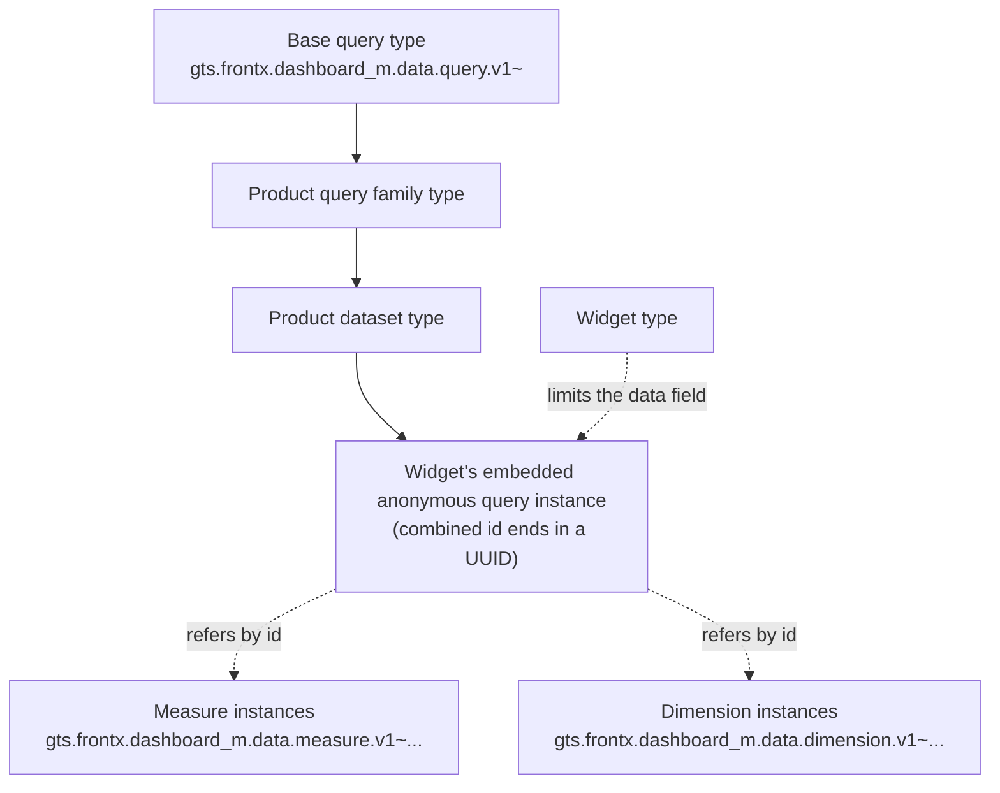

# ADR-0012: Dataset-typed embedded query in a subset of the Cube query format

**ID**: `cpt-frontx-dashboard-adr-query-vocabulary-and-datasets`

<!-- toc -->

- [Context and Problem Statement](#context-and-problem-statement)
- [Decision Drivers](#decision-drivers)
- [Considered Options](#considered-options)
- [Decision Outcome](#decision-outcome)
  - [Consequences](#consequences)
  - [Confirmation](#confirmation)
- [Pros and Cons of the Options](#pros-and-cons-of-the-options)
  - [Where the data definition lives](#where-the-data-definition-lives)
  - [Query language](#query-language)
- [More Information](#more-information)
- [Traceability](#traceability)

<!-- /toc -->

## Context and Problem Statement

A data widget shows data that a consuming product's backend provides. The template reaches that backend only through the product's data adapter ([ADR-0011](0011-data-adapter-v1.md)), so the widget must say what data it wants in a form that any data adapter can turn into backend calls. Dashboards are written by hand or generated by a language model. A definition must therefore be easy to generate correctly and checkable before anything mounts.

Checking early matters. A widget waits for its data with a loader and has no error state for backend failures ([ADR-0011](0011-data-adapter-v1.md)). A request that names a metric the backend does not know may never be answered, and the user sees an endless loader. Mistakes such as an unknown measure, a misspelled field or a member the dataset does not offer must be caught by validation at dashboard load, where the failing widget shows the cannot-show state in its own cell.

Every data adapter must also read a query the same way. A query language needs a precise meaning for each field and operator: how a date range resolves and whether its ends are included, in which time zone dates are local, when a week starts, which order applies when none is given, and whether a filter applies before or after aggregation. Without one published definition, the template would have to specify all of these itself, and data adapters over different backends could still diverge.

The template types live in GTS, the type system FrontX uses, and the template targets GTS v0.17 ([ADR-0003](0003-shared-data-types-and-schemas-v1.md)).

This record answers two questions. Where does a widget's data definition live, how does a product describe what its backend can answer, and how do the product's types reach the type system before validation? And in which query language is the definition written? Both questions share one record because the dataset types narrow the query language's own fields, at five narrowing positions. The dataset design and the language are therefore decided together.

## Decision Drivers

Each list serves one of the two decisions and is ordered by priority.

Where the data definition lives:

* **One place for data.** Everything that affects a widget's data is in one place in the widget. Presentation fields never reach the data adapter.
* **Standard validation catches mistakes at load.** One standard GTS validation of a widget checks its query, including which members the dataset allows. No custom membership check is written (`cpt-frontx-dashboard-fr-domain-model`).
* **Independent limits.** A widget type limits the form of its query ([ADR-0009](0009-subject-agnostic-widget-catalog-v1.md)) and a dataset limits its members. The two limits must combine without a type per pair.
* **Datasets as data.** A product adds a dataset with data only: no code and no release. One dataset serves every combination of its members.
* **Shared, described vocabulary.** Measure and dimension names are unique across products, a dimension can be shared by several datasets, and each carries metadata for default titles and formats.
* **Easy to generate.** A language model can write a widget's query from the dataset's JSON Schema enums and the product's catalog of datasets and vocabulary.

Query language:

* **Complete, published semantics.** Every field and operator has one documented meaning, so data adapters for different backends read a query alike, and the template documents only what it narrows.
* **Checkable members.** Members sit where GTS checks references and where a dataset can narrow them with enums: string values and array items.
* **Widely documented.** Language models and data adapter authors can draw on outside documentation and examples of the query format.
* **Backend-agnostic, thin translation.** The language is not tied to one product's backend. It follows the semantic-layer model of measures, dimensions and filters, so a data adapter over an existing semantic layer is a thin translator.
* **A stable reference.** The definition of the query language can be pinned to a dated source and reviewed when that source moves.

## Considered Options

Where the data definition lives:

* **Inline product source field** — the widget holds an opaque, product-defined `source` field that the template passes to the data adapter.
* **Embedded query typed by its dataset** — the widget embeds one query object; its type is a product dataset type derived from a template-owned base query type.
* **Data source reference plus a separate query** — the widget holds a reference to a product data source instance plus a separate `data_settings` query.
* **Dataset settings types limited per widget type** — each dataset is a derived `data_settings` type, and the query limits of each widget type sit in the same type chain.
* **Dataset specs written alongside the dashboard** — a language model writes declarative dataset specs together with the dashboard, and widgets query those datasets.

The second, third and fourth options share one approach: a catalog of product datasets queried with a template-owned query. They differ in how a widget expresses its query.

Query language:

* **Own template vocabulary** — the template defines its own query fields, operators and time forms, and specifies their meaning.
* **Cube REST query format** — the JSON query format of Cube, an open-source semantic layer, with its published semantics.
* **OData v4 Data Aggregation** — the `$apply` system query option of the OASIS OData v4 Data Aggregation extension.
* **Text query language** — a subset of SQL, or Malloy, or PRQL.
* **dbt MetricFlow query parameters** — the query parameters of the dbt Semantic Layer (metrics, group-by, where, order-by, limit).
* **Open Semantic Interchange** — the shared semantic-model specification that several vendors announced in 2025.

## Decision Outcome

Chosen options: "Embedded query typed by its dataset" for where the data definition lives, and "Cube REST query format" for the query language.

The embedded query is chosen because it is the only option that meets **Standard validation catches mistakes at load** and **Independent limits** together. One standard GTS validation checks both the widget type's limits and the dataset's allowed members, without a type per widget-type and dataset pair. It also meets **One place for data**: one object holds everything about the widget's data. It meets **Easy to generate**, because a language model writes against plain JSON Schema enums. It meets **Datasets as data**, because a product adds a dataset type with data only. Measures and dimensions as GTS instances meet **Shared, described vocabulary**.

The Cube REST query format is chosen because it is the only JSON option that meets **Complete, published semantics**: every field and operator has a published meaning. Being JSON, it meets **Checkable members**: its members sit at string values and array items, so dataset enums narrow them and one GTS validation checks them. It meets **Backend-agnostic, thin translation**: it follows the semantic-layer model of measures, dimensions and filters, and a product whose backend is Cube needs almost no translation. It meets **Widely documented**, because Cube is widely used and documented. It meets **A stable reference** through the pinned references with a retrieval date and a review trigger in More Information. The template therefore documents narrowing rules only, not a language of its own.

**The query in the widget.** A data widget instance has its presentation fields and one embedded **query** in its `data` field. Everything that affects the widget's data is in the query, and presentation fields never reach the data adapter. There is no opaque source field and no separate reference to a data adapter.

The query is an **embedded anonymous GTS instance** with its own combined id: the dataset type chain followed by a UUID. The query's type is never stored apart from its id. The query base's `id` field uses the literal base operand `gts.frontx.dashboard_m.data.query.v1~` in `x-gts-instance-ref`; member references use the literal operands of the measure and dimension bases. The general rule for embedded ids is decided in [ADR-0003](0003-shared-data-types-and-schemas-v1.md). Whoever writes the dashboard, a product or a language model, generates the UUID, as for widget ids.

The query is embedded, not registered as a separate instance, for four reasons. The template already embeds (dashboard, layout, cell, widget). The query instance itself needs no registration before validation, and nothing refers to it from outside the widget. Dashboard validation runs with reference-existence lookup off, so whether the referenced members exist is enforced by the owner's load-time cross-check ([ADR-0003](0003-shared-data-types-and-schemas-v1.md)). Widgets rarely share an identical query, and sharing already happens one level up, in the dataset type. A language model writes one self-contained widget.

**The query language.** Every query the template sends is a valid Cube query and means what Cube's published semantics say. Template rules only narrow what an author may write. The one deviation: members are GTS instance ids. Cube's default and maximum row limits are server configuration, not query meaning; how the data adapter answers a query without `limit` is stated under "Order, limit, offset and total" below. The data adapter maps each id to a backend member name through the dataset's binding traits and drops the template-only `id` field. Results do not use Cube's result format: each data widget type has its own data shape, filled by a fill mode ([ADR-0009](0009-subject-agnostic-widget-catalog-v1.md)). The pinned Cube references and a field-by-field mapping are in More Information.

A query looks like this (the `acme.example` vendor is illustrative):

```json
{
  "id": "gts.frontx.dashboard_m.data.query.v1~acme.example.data.metric_query.v1~acme.example.data.activity.v1~b81d4c07-2e6a-4f39-9c15-7a0e3d5f8b42",
  "measures":   ["gts.frontx.dashboard_m.data.measure.v1~acme.example.metrics.loc.v1"],
  "dimensions": ["gts.frontx.dashboard_m.data.dimension.v1~acme.example.metrics.author.v1"],
  "timeDimensions": [
    { "dimension": "gts.frontx.dashboard_m.data.dimension.v1~acme.example.metrics.day.v1", "dateRange": "last 30 days" }
  ],
  "filters": [
    { "member": "gts.frontx.dashboard_m.data.dimension.v1~acme.example.metrics.project.v1", "operator": "equals", "values": ["web", "mobile"] }
  ],
  "order": [["gts.frontx.dashboard_m.data.measure.v1~acme.example.metrics.loc.v1", "desc"]],
  "limit": 10
}
```

**The subset.** The template owns the abstract, closed base query type `gts.frontx.dashboard_m.data.query.v1~`. An author may write these fields:

* `id` — the combined query id;
* `measures` and `dimensions` — lists of measure and dimension instance ids; a query has at least one of the two, and the time dimension is never listed in `dimensions`;
* `timeDimensions` — exactly one entry when present;
* `filters` — a top-level list of filters, all of which must hold;
* `order`, `limit`, `offset` and `total`.

Cube's other query features are outside the subset: segments, `and` and `or` filter groups, ungrouped queries, join hints, arrays of queries, the `measureFilter` operator and the `onTheDate` operator. The base is closed, so a misspelled field or a field outside the subset fails validation. Datasets only narrow existing properties, so the closed base stays compatible with derivation. The query only chooses, groups, filters, orders and slices. Complex logic, such as ratios, running totals or "other" buckets, lives in the product's measure definitions.

**Filters.** A filter has a `member`, an `operator` and, for most operators, `values`. The operators are `equals`, `notEquals`, `gt`, `gte`, `lt`, `lte`, `set`, `notSet`, `inDateRange`, `notInDateRange`, `beforeDate`, `beforeOrOnDate`, `afterDate`, `afterOrOnDate`, `contains`, `notContains`, `startsWith`, `notStartsWith`, `endsWith` and `notEndsWith`. Their meaning is Cube's, including how several values combine and how null values are treated. Local execution by the data adapter reproduces these operator semantics, with the rules that `cpt-frontx-dashboard-feature-data-adapter-contract` lists for cases the published semantics leave open. The base schema checks the number of values: `set` and `notSet` take none; `inDateRange` and `notInDateRange` take one or two (one value is either exactly that timestamp or one relative string, two values are a range); `beforeDate`, `beforeOrOnDate`, `afterDate` and `afterOrOnDate` take exactly one; every other operator takes one or more. Values are strings, as in Cube. Whether an operator fits its member's kind cannot be written in JSON Schema, so the domain owner cross-checks it against the member instance at load: the `contains` family applies only to string dimensions, `gt`, `gte`, `lt` and `lte` only to measures and number dimensions, and the date operators only to time dimensions. A filter on a dimension applies to rows before aggregation; a filter on a measure applies to the aggregated values, after aggregation, as an SQL `HAVING` clause does.

**Time.** The single `timeDimensions` entry has a `dimension` and optional `granularity`, `dateRange` and `compareDateRange`:

* `granularity` is one of `day`, `week`, `month`, `quarter` and `year`. Weeks start on Monday. Without `granularity`, the entry limits the period and does not group.
* `dateRange` is either a pair `[start, end]` or one relative string. Each end of a pair is a date (`YYYY-MM-DD`) or a date-time with seconds (`YYYY-MM-DDThh:mm:ss`, optional fraction) and no offset. Both ends are included, and a date-only end covers its whole day. A relative string comes from a closed set: `today`, `yesterday`, `this` or `last` followed by `week`, `month`, `quarter` or `year`, `last N days`, `last N weeks`, `last N months`, and `from N days ago to now`, `from N weeks ago to now`, `from N months ago to now`. Each resolves as Cube defines it; for example `last 6 months` does not include the current date, while `from 7 days ago to now` does. The base type enforces both forms with patterns from the GTS safe regular-expression profile.
* `compareDateRange` holds exactly 2 ranges, each in a `dateRange` form, and excludes `dateRange`. The previous period is written out, for example `["this month", "last month"]`. Which widget types allow it is decided in [ADR-0009](0009-subject-agnostic-widget-catalog-v1.md).

**Time zone.** An authored query has no `timezone`: the widget's `data` field rejects it. The data widget sets `timezone` to the viewer's time zone in the query it sends with `request_data`, so the base query type declares the field for the sent query. The field keeps Cube's meaning. Dates in `dateRange`, relative strings and granularity buckets resolve in that time zone, and the data adapter passes the field through to a backend that understands it.

**Order, limit, offset and total.** `order` is a list of ordered pairs `[member, "asc"|"desc"]`, Cube's array form, because GTS ids are never object keys ([ADR-0003](0003-shared-data-types-and-schemas-v1.md)). Cube's object form, keyed by member, is not used. Each pair is checked with `prefixItems`. The first element of each pair must be a result column, that is a member named in `measures` or `dimensions`, or the time dimension with a `granularity`; the domain owner cross-checks this at load. When `order` is absent, Cube's default order applies: the time dimension ascending when it has a `granularity`, else the first measure descending, else the first dimension ascending. An empty `order` asks for no order. `limit` and `offset` slice the result. `measures`, `dimensions`, `filters` and `order` have no duplicate items, `limit` is at least 1 and `offset` is at least 0. A query without `limit` stays a valid Cube query. The data adapter must answer it with the complete result: it applies no cap of its own and reads past its backend's row limits, for example by paging. When it pages past a backend's row limit, it adds the remaining result columns, ascending, as a tiebreak so pages neither repeat nor drop rows, and the result order the widget sees stays the query's. `total` asks for the row count that ignores `limit` and `offset`. Which widget types require or forbid `total` is decided in [ADR-0009](0009-subject-agnostic-widget-catalog-v1.md) and [ADR-0005](0005-data-grid-library-v1.md).

**Query member.** A query member is any measure or dimension instance that a query names: in `measures`, in `dimensions`, as `timeDimensions[0].dimension`, as a `filters[].member`, and as the first item of each `order` pair.

**Canonical member order.** The canonical member order is a separate notion. It orders the result columns, not all query members: the dimensions in query order, then the time dimension when it has a `granularity`, then the measures in query order. A time dimension without a `granularity` is a query member but gives no column. With a `granularity`, the time dimension gives a result column, so it can appear in `order` and in grid columns. Data shapes with positional rows and the template's cross-checks use this order.

**Datasets are derived query types.** A **dataset** is a query type written by the product and derived from the base. It narrows members with enums at five positions: `measures.items`, `dimensions.items`, `timeDimensions.items.properties.dimension`, `filters.items.properties.member` and `order.items.prefixItems[0]`. It carries its backend binding as GTS type traits (`x-gts-traits`). An intermediate product **query family** type sits between the base and the datasets and declares the binding's shape (`x-gts-traits-schema`). The binding maps each member to its backend name and states how each measure aggregates, so the data adapter knows which measures it may add up when it executes a query locally ([ADR-0011](0011-data-adapter-v1.md)). Aggregation belongs to the binding, not to the measure base. The data adapter declares the query families it serves ([ADR-0011](0011-data-adapter-v1.md)) and reads the binding values, for example with the template's trait helper ([ADR-0003](0003-shared-data-types-and-schemas-v1.md)). One dataset serves every combination of its members.

A widget's query id therefore names three things in one chain: the template base, the product's query family and the product's dataset. The widget type limits the form of `data` (for example, one measure and one dimension), and the dataset limits the members. Both limits apply to the same query instance, so no type per widget type and dataset pair is needed.



**Measures and dimensions are GTS well-known instances.** Measures are instances of `gts.frontx.dashboard_m.data.measure.v1~` with `id`, `title`, `value_type` and an optional `unit`. The set of `value_type` values is closed: number, percent and duration. A `percent` value is a ratio, where 1 means 100%, and a `duration` measure requires `unit`. Dimensions are instances of `gts.frontx.dashboard_m.data.dimension.v1~` with `id`, `title` and `value_type` (string, time or number). The two bases are plain types, not abstract, and the product delivers their well-known instances. Queries and datasets refer to them by instance id. Ids are unique across products, a dimension can be shared by several datasets, and the metadata gives widgets default titles and formats. The cost is long ids, which authors and language models copy from the product's catalog.

**Product data arrives with the dashboard.** The data adapter returns a dashboard together with the dataset types and the measure and dimension instances it uses. Whichever part loads the dashboard, the dashboards root or the larger-view modal, registers them before it validates the dashboard: the measure and dimension instances first, then the dataset types, whose enums refer to them. The template expects the FrontX type store to keep the first registration of an id, because the specification leaves mutability to the implementation (GTS specification v0.17, sections 4.2 and 6), so a dataset, measure or dimension whose content differs gets another version id. The safety does not depend on that: before it registers a delivery, the owner rejects any delivered type id that equals a template type id, as a dashboard-level failure. To discover datasets and vocabulary, a language model uses the product's own catalog; FrontX offers no registry listing.

**Validation.** Validating a widget also validates its `data` against the dataset type that `data.id` names: the dataset's enums, the closed base, the value counts of filters and the date patterns. This polymorphic validation is decided in [ADR-0003](0003-shared-data-types-and-schemas-v1.md), together with the GTS v0.17 prerequisite. A query that fails, or fails a cross-check of its domain owner, gives its widget the cannot-show state at load ([ADR-0011](0011-data-adapter-v1.md)).

### Consequences

* Good, because an unknown member, a member the dataset does not offer, a misspelled field or a field outside the subset fails standard validation at load and shows cannot-show in its own cell, instead of an endless loader.
* Good, because no custom membership check exists: the dataset's enums and the closed base do the work.
* Good, because every field and operator has Cube's published meaning, so the template documents narrowing rules only, and data adapters over different backends read a query alike.
* Good, because a language model generates a widget from the dataset's JSON Schema, the vocabulary catalog and a widely documented query format, and its output is checked before it mounts.
* Good, because a data adapter over a semantic layer is a thin translator, and over Cube it maps member ids and drops `id`.
* Good, because a dataset is data delivered with the dashboard: no product code and no release.
* Good, because widget type limits and dataset limits combine on the instance, with no type per pair.
* Neutral, because identical queries, ignoring their UUIDs and with the same `timezone`, give identical backend requests, so a data adapter can cache them; relative date ranges resolve against the current date, so cached entries expire.
* Bad, because definitions carry long GTS ids for every member, which authors copy from the catalog, and the data adapter must always map them to backend names.
* Bad, because the subset is a fixed grammar: logic beyond choosing, grouping, filtering, ordering and slicing must live in the product's measure definitions, and widening the subset is a template change that every data adapter must then translate.
* Bad, because one company controls the Cube query format, which is a de facto format and not a formal standard; its published semantics may change. Pinned references with a retrieval date and a review trigger contain this risk (More Information).
* Bad, because a dataset or vocabulary entry whose content differs needs another version id, since the template expects the type store to keep the first registration of an id.
* Bad, because a query without `limit` returns one row per combination of its groups, however many there are. Only `grid` requires `limit`, and the list cards may set one. `summary_card`, `metric_card`, `pie_chart`, `cartesian_chart` and `heatmap` have no row bound. The data adapter and the backend carry that load. Authors bound the rows through the dataset's members, through filters, or with a `limit` where the widget type allows it.
* Bad, because the design relies on the GTS v0.17 prerequisite and its open questions ([ADR-0003](0003-shared-data-types-and-schemas-v1.md)), including whether the FrontX plugin applies reference keywords inside the ordered pairs of `order` (`prefixItems`). The specification requires it (GTS specification v0.17, section 9.6.3), so this is a plugin conformance test. The dataset enum at `order.items.prefixItems[0]`, which is plain JSON Schema, and the domain owner's cross-check are a second layer for membership in `order` pairs.

### Confirmation

* A schema review confirms that the base query type is abstract and closed, that it uses literal base operands for its `id` and member references, and that the sample dataset types only narrow existing properties at the five narrowing positions.
* A review checks each base field and operator against the mapping table in More Information and the pinned Cube references. Sample queries of every data widget type, translated by mapping member ids to member names and dropping `id`, are valid Cube queries. The oracle is the published Cube query format at the pinned references, checked at schema level: field names, operators and value counts.
* Validation tests at dashboard load check that a query fails, and its widget shows cannot-show in its own cell, when it:
  * names a measure or dimension outside the dataset's enums, or uses a time dimension, filter member or `order` member the dataset does not allow;
  * has a misspelled field, or a field outside the subset such as `segments`, `ungrouped` or an authored `timezone`;
  * has two `timeDimensions` entries, or a `granularity` of `hour`;
  * has a `dateRange` pair with an offset, or a relative string outside the closed set, such as `next week` or `last 6 hours`;
  * has a `compareDateRange` of 3 ranges, or one next to a `dateRange`;
  * has a `set` filter with `values`, a `beforeDate` filter with 2 values, an `equals` filter without `values`, or a number in `values`;
  * has an `order` item of 3 elements, a direction other than `asc` or `desc`, or `order` as an object keyed by member.
* Cross-check tests at load check that `contains` on a measure, `gt` on a string dimension, `inDateRange` on a non-time member, and an `order` member that is not a result column each give the widget the cannot-show state.
* On the GTS v0.17 plugin, a test validates a query whose `order` pair starts with an id that the dataset enum allows but that is not a registered instance. The query is rejected, and the test records whether GTS or the owner's cross-check rejects it.
* A test checks that the query a data widget sends with `request_data` carries the viewer's time zone in `timezone`, and that the authored query in its `data` field has none.
* A test registers the delivered measure and dimension instances, then the dataset types, before validation, and checks that a valid dashboard renders.
* A test delivers a dataset with different content under an already registered id and checks that the first registration stays in effect; the consumer guide requires another version id. A second test delivers a type id equal to a template type id and checks that the owner rejects the delivery before it registers anything.
* The test case passes: a dataset with measures of its own is added as data only, with no change to the data adapter.

## Pros and Cons of the Options

### Where the data definition lives

**Inline product source field**

The widget holds an opaque `source` object whose schema the product defines. The template passes it to the data adapter unchanged.

* Good, because the product has full freedom over what the field holds.
* Good, because the template defines no vocabulary.
* Bad, because the field is a black box in the widget schema: the template cannot check what it holds.
* Bad, because an invented metric or mapping is found only when the data adapter runs, which leaves an endless loader.
* Bad, because a language model needs the product's `source` schema plus knowledge of its backend.

**Embedded query typed by its dataset**

The widget embeds one query object. The query's id names a product dataset type derived from the template's base query type. The dataset carries the allowed members and the binding.

* Good, because one object holds everything about the widget's data.
* Good, because standard polymorphic GTS validation checks the dataset's members, with no custom check.
* Good, because a language model generates against the dataset's JSON Schema enums.
* Good, because widget type limits and dataset limits meet on the instance.
* Bad, because every member is a long GTS id.
* Bad, because the query follows a fixed grammar.
* Bad, because a dataset or vocabulary entry whose content differs needs another version id (the template expects the type store to keep the first registration).
* Bad, because the design relies on GTS v0.17 keywords (open questions in [ADR-0003](0003-shared-data-types-and-schemas-v1.md), More Information).

**Data source reference plus a separate query**

The widget references a product data source instance and holds a separate `data_settings` query.

* Good, because several widgets could reference the same data source instance.
* Bad, because one concern sits in two places in the widget.
* Bad, because checking that the query's members belong to the data source needs a custom membership check.

**Dataset settings types limited per widget type**

Each dataset is a derived `data_settings` type, and each widget type's query limits sit in the same type chain.

* Good, because one type chain would carry both the dataset's members and the widget type's limits.
* Bad, because widget types and datasets are two independent axes, so this needs a type for every widget type and dataset pair.

**Dataset specs written alongside the dashboard**

A language model writes declarative dataset specs together with the dashboard, and widgets query those datasets. The product's data adapter interprets the specs.

* Good, because adding a dataset needs no product release.
* Neutral, because it is compatible with the chosen option: a product can use such specs to define its own datasets, and the template is unaffected.
* Bad, because a language model needs the product's spec schema plus knowledge of its backend.
* Bad, because safety needs an allowlist of backend calls, sandboxed non-script expressions and row and step limits, which is product work.

### Query language

**Own template vocabulary**

The template defines its own JSON fields, operators and time forms, and writes down what each means.

* Good, because the template controls every name and form and can fit them to its widget types.
* Good, because no outside project can change the language.
* Bad, because every meaning must be invented, specified and kept consistent by the template: range resolution and inclusivity, the time zone of dates, the week start, the default order, null handling in filters, and filtering before or after aggregation.
* Bad, because no backend speaks the language, so every data adapter translates a grammar that exists only in this template.
* Bad, because language models and adapter authors have no outside documentation or examples to draw on.

**Cube REST query format**

Cube is an open-source semantic layer whose REST query format is a JSON object of measures, dimensions, time dimensions, filters, order, limit and offset, with published semantics. The template uses a subset, with GTS ids as members.

* Good, because each field and operator has a published, complete meaning, so the template specifies only its narrowing.
* Good, because the format is JSON and its members sit at string values and array items, so GTS checks the references and dataset enums narrow them.
* Good, because Cube is widely used and documented, which helps language models and data adapter authors.
* Good, because a data adapter over Cube is close to a pass-through, and over another semantic layer a thin translation of the same model.
* Bad, because it is a de facto format controlled by one company, not a formal standard, so its semantics may change; the template pins its references and reviews them.
* Bad, because members as GTS ids differ from Cube member names, so every data adapter maps them.
* Bad, because a Cube server applies a configured default and maximum row limit, so a data adapter over Cube must read past them, for example by paging, to answer a query without `limit` with the complete result.
* Bad, because the array form of `order` puts members inside ordered pairs, where the plugin's reference check is a conformance test; the dataset enum and the owner's cross-check are a second layer for membership there ([ADR-0003](0003-shared-data-types-and-schemas-v1.md)).

**OData v4 Data Aggregation**

The OASIS OData v4 Data Aggregation extension adds the `$apply` query option, a pipeline of transformations such as `filter`, `groupby` and `aggregate`.

* Good, because it is a formal standard from a standards body, with a published specification and server-side implementations.
* Good, because `$apply` gives filter, group-by and aggregate transformations, and the standard `$orderby`, `$top` and `$skip` options give ordering and paging alongside it.
* Bad, because a query is one string in a URL expression syntax, so a JSON Schema cannot narrow its members with enums, and checking it needs a parser in the template.
* Bad, because nested expression strings are hard for a language model to write correctly.
* Bad, because the query states how measures aggregate, while the template keeps aggregation in the product's measure definitions and binding.

**Text query language**

A query is text: a subset of SQL, or Malloy, or PRQL.

* Good, because these languages are expressive, and SQL is widely known.
* Good, because Malloy and PRQL compose queries from reusable parts.
* Bad, because GTS cannot validate text: members cannot be narrowed with dataset enums, and every check needs a parser for the chosen language.
* Bad, because a subset of SQL still needs the template to define the subset's meaning, and Malloy and PRQL tie data adapters to their compilers.
* Bad, because free text sent towards a backend widens what a data adapter must guard against.

**dbt MetricFlow query parameters**

The dbt Semantic Layer queries metrics with group-by dimensions, a `where` filter, order-by and limit.

* Good, because it is a published semantic-layer interface with metrics and dimensions.
* Good, because a product already on dbt translates with little effort.
* Bad, because `where` filters are text with dbt's own template syntax for members, which a JSON Schema cannot narrow or check.
* Bad, because the parameters follow dbt's conventions and tooling, which binds the language to one ecosystem.

**Open Semantic Interchange**

A shared specification for semantic models (metrics, dimensions, relationships), which several vendors announced in 2025.

* Good, because it aims to be vendor-neutral and shared across tools.
* Neutral, because a product could later generate its dataset types and measure and dimension instances from such a model.
* Bad, because it describes semantic models, not queries, so it cannot be the language of a widget's query.
* Bad, because the specification is young, and its scope and adoption are still forming.

## More Information

**Field-by-field mapping to the Cube query format.** Each row maps a field or operator of the base query type to its Cube counterpart. Every field and operator keeps Cube's meaning. The narrowing rules are stated once, in Decision Outcome; the last column points to the paragraph that holds them.

| Template field or operator | Cube field or operator | Correspondence |
|---|---|---|
| `id` | none | Template-only. See "The query in the widget". |
| `measures` | `measures` | Measure instance ids in place of member names. See "The subset". |
| `dimensions` | `dimensions` | Dimension instance ids in place of member names. See "The subset". |
| `timeDimensions` | `timeDimensions` | Narrowed. See "The subset". |
| `timeDimensions[0].dimension` | `timeDimensions[].dimension` | A dimension instance id in place of a member name. |
| `timeDimensions[0].granularity` | `timeDimensions[].granularity` | Narrowed. See "Time". |
| `timeDimensions[0].dateRange` as a pair | `timeDimensions[].dateRange` as a pair | Narrowed. See "Time" and "Time zone". |
| `timeDimensions[0].dateRange` as a string | `timeDimensions[].dateRange` as a relative string | Narrowed. See "Time". |
| `timeDimensions[0].compareDateRange` | `timeDimensions[].compareDateRange` | Narrowed. See "Time". |
| `filters` | `filters` | Narrowed. See "The subset". |
| `filters[].member` | `filters[].member` | A measure or dimension instance id in place of a member name. |
| `filters[].operator` | `filters[].operator` | Narrowed. See "Filters". |
| `filters[].values` | `filters[].values` | Narrowed. See "Filters". |
| `order` | `order` in its array form | Member instance ids in place of member names. See "Order, limit, offset and total". |
| `limit` | `limit` | Same field. See "Order, limit, offset and total". |
| `offset` | `offset` | Same field. |
| `total` | `total` | Same field. See "Order, limit, offset and total". |
| `timezone` (sent query only) | `timezone` | Same field. See "Time zone". |
| not available | `segments`, `ungrouped`, `joinHints`, arrays of queries, `and` and `or` groups, `measureFilter`, `onTheDate` | Outside the subset. See "The subset". |
| not used | Cube's result format | Results use per-type data shapes and fill modes ([ADR-0009](0009-subject-agnostic-widget-catalog-v1.md)). |

**Pinned references.** The semantics this record relies on are those published at these addresses, retrieved 2026-10-30:

* Cube REST API query format: <https://docs.cube.dev/reference/core-data-apis/rest-api/query-format>
* Cube queries (default order, time zone, relative date ranges, row limits): <https://docs.cube.dev/reference/core-data-apis/queries>
* Cube dimension granularities (week start): <https://docs.cube.dev/reference/data-modeling/dimensions#granularities>

The options not chosen were assessed against these sources, retrieved 2026-10-30:

* OData v4 Data Aggregation extension (OASIS): <https://docs.oasis-open.org/odata/odata-data-aggregation-ext/v4.0/odata-data-aggregation-ext-v4.0.html>
* dbt Semantic Layer query parameters (metrics, group-by, where, order-by, limit): <https://docs.getdbt.com/docs/dbt-apis/sl-jdbc>
* Open Semantic Interchange specification, maintained as Apache Ossie: <https://github.com/apache/ossie>
* Malloy: <https://docs.malloydata.dev/documentation/>
* PRQL: <https://prql-lang.org/book/>

**Review trigger.** Revisit if Cube changes its published semantics for any field or operator in the subset; if GTS v0.17 cannot check member references inside the ordered pairs of `order`, because the `order` form would then need another decision; if dashboard-wide filters that the user changes come into scope; or if products regularly need query logic that the subset cannot express. Review triggers about the GTS v0.17 plugin are in [ADR-0003](0003-shared-data-types-and-schemas-v1.md).

**Scope.** This record decides the embedded anonymous query in the widget's `data` field and its combined id; the query language as a subset of the Cube REST query format, with GTS ids as members; the template-owned, closed, abstract base query type with its fields, operators, time forms, time zone rule, order, limit and total rules and the canonical member order; datasets as product query types derived through a product query family, with enums at five narrowing positions and binding traits that include measure aggregation; measures and dimensions as GTS well-known instances; and product data delivered with the dashboard and registered before validation, instances before dataset types. It does not decide:

* GTS conventions, packages, polymorphic validation, the general literal-operand rule, ids as object keys, the trait helper and the GTS v0.17 prerequisite ([ADR-0003](0003-shared-data-types-and-schemas-v1.md));
* data widget types, their limits on `data` (including `compareDateRange` and `total`), data shapes and fill modes ([ADR-0009](0009-subject-agnostic-widget-catalog-v1.md));
* the data adapter, served query families, local execution and how widgets request data ([ADR-0011](0011-data-adapter-v1.md));
* grid paging, sorting and grid columns ([ADR-0005](0005-data-grid-library-v1.md)).

Which datasets, measures and dimensions a product offers, and how its query families bind to its backend, belong to the product.

**Checklist applicability.** ARCH applicable: where a widget's data definition lives, and the choice of query language. DATA applicable: the query base, dataset derivation, vocabulary instances and their delivery. INT applicable: datasets, vocabulary and the Cube-based query are the integration surface with the consuming product's data adapter, and the pinned references fix the external contract. MAINT applicable: a fixed subset, versioned product types, and the dependency on an outside format with a review trigger. TEST applicable: the Confirmation tests and the test case. SEC applicable to the extent that delivered types are input from the product's data adapter and cannot take the place of template types already registered, and that the query is structured JSON, not free text sent towards a backend. PERF applicable to the extent that identical queries allow caching in the data adapter, and that a query without `limit` returns one row per combination of its groups, a load the data adapter and the backend carry; authors bound the rows through the dataset's members, filters or a `limit` where the widget type allows it (Consequences). REL applicable: invalid queries fail at load instead of leaving a loader. UX not applicable because no visible behavior is decided here. OPS, COMPL and BIZ not applicable because no operational procedure, regulated processing or business rule is decided.

## Traceability

- **PRD**: [PRD.md](../PRD.md)
- **DESIGN**: [DESIGN.md](../DESIGN.md)

This decision directly addresses the following requirements or design elements:

* `cpt-frontx-dashboard-fr-domain-model` — the query, datasets, measures and dimensions are part of the domain model, so written and generated dashboards are validated before they mount.
* `cpt-frontx-dashboard-fr-backend-source` — a widget's query is the only thing that decides its data, a query without `limit` is answered with the complete result, and only the data adapter turns the query into backend calls.
* `cpt-frontx-dashboard-fr-data-adapter` — the data adapter receives a standard query with published semantics and maps its members through the dataset's binding.
* `cpt-frontx-dashboard-fr-grid-sort-page` — sorting and paging are expressed with `order` pairs, `limit`, `offset` and `total`.
* `cpt-frontx-dashboard-fr-widget-catalog` — data widget types limit the form of their queries against the shared vocabulary.
* `cpt-frontx-dashboard-contract-consuming-backend` — the product supplies dataset types and vocabulary instances with each dashboard.
* `cpt-frontx-dashboard-actor-template-consumer` — the developer who describes datasets, query families and vocabulary.
* `cpt-frontx-dashboard-usecase-provide-dashboard` — a product provides dashboards whose widgets query its datasets.
* `cpt-frontx-dashboard-nfr-consumer-docs` — the consumer guide describes the query subset, datasets, query families, vocabulary and versioning of entries whose content differs.
* `cpt-frontx-dashboard-interface-domain-model` — the base query type and the measure and dimension base types in package `dashboard_m`.
* `cpt-frontx-dashboard-principle-gts-contracts` — the query and the product's datasets and vocabulary are GTS types and instances.
* `cpt-frontx-dashboard-constraint-gts-id-convention` — the query's combined anonymous id, members as GTS ids, and the well-known instance ids of measures and dimensions.
* `cpt-frontx-dashboard-seq-consumer-generation` — a generated dashboard writes queries against the product's datasets and vocabulary.
* `cpt-frontx-dashboard-feature-query-vocabulary` — the base query type, its narrowing rules and the canonical member order.
* `cpt-frontx-dashboard-feature-widget-catalog` — widget types place their limits on the `data` field.
* `cpt-frontx-dashboard-feature-data-adapter-contract` — the data adapter maps members, drops `id`, passes `timezone` through and returns complete results when `limit` is absent.
* `cpt-frontx-dashboard-feature-dashboard-root-types` — the dashboard is delivered with its dataset types and vocabulary instances, registered instances first.
