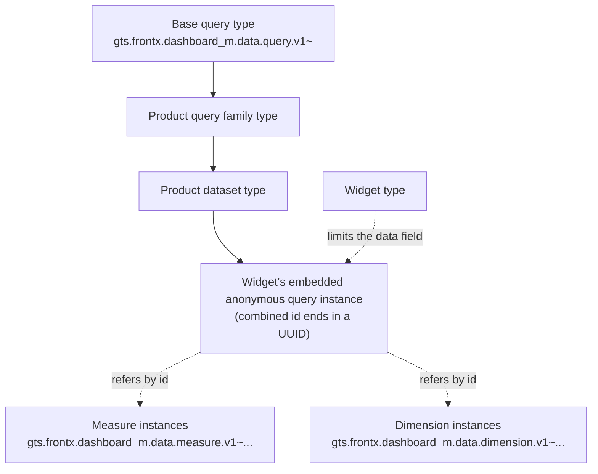

# ADR-0012: Template-owned query vocabulary with product datasets

**ID**: `cpt-frontx-dashboard-adr-query-vocabulary-and-datasets`

<!-- toc -->

- [Context and Problem Statement](#context-and-problem-statement)
- [Decision Drivers](#decision-drivers)
- [Considered Options](#considered-options)
- [Decision Outcome](#decision-outcome)
  - [Consequences](#consequences)
  - [Confirmation](#confirmation)
- [Pros and Cons of the Options](#pros-and-cons-of-the-options)
  - [Inline product source field](#inline-product-source-field)
  - [Embedded query typed by its dataset](#embedded-query-typed-by-its-dataset)
  - [Data source reference plus a separate query](#data-source-reference-plus-a-separate-query)
  - [Dataset settings types limited per widget type](#dataset-settings-types-limited-per-widget-type)
  - [Dataset specs written alongside the dashboard](#dataset-specs-written-alongside-the-dashboard)
- [More Information](#more-information)
- [Traceability](#traceability)

<!-- /toc -->

## Context and Problem Statement

A data widget shows data that a consuming product's backend provides. The template reaches that backend only through the product's data adapter ([ADR-0011](0011-data-adapter-v1.md)), so the widget must say what data it wants in a form that any data adapter can turn into backend calls. Dashboards are written by hand or generated by a language model. A definition must therefore be easy to generate correctly and checkable before anything mounts.

Checking early matters. A widget waits for its data with a loader and has no error state for backend failures ([ADR-0011](0011-data-adapter-v1.md)). A request that names a metric the backend does not know may never be answered, and the user sees an endless loader. Mistakes such as an unknown measure, a misspelled field or a member the dataset does not offer must be caught by validation at dashboard load, where the failing widget shows the cannot-show state in its own cell.

The template types live in GTS, the type system FrontX uses, and the template targets GTS v0.17 ([ADR-0003](0003-shared-data-types-and-schemas-v1.md)).

Where does a widget's data definition live, who owns its vocabulary, how does a product describe what its backend can answer, and how do the product's types reach the type system before validation?

## Decision Drivers

Listed by priority.

* **One place for data.** Everything that affects a widget's data is in one place in the widget. Presentation fields never reach the data adapter.
* **Standard validation catches mistakes at load.** One standard GTS validation of a widget checks its query, including which members the dataset allows. No custom membership check is written (`cpt-frontx-dashboard-fr-domain-model`).
* **Easy to generate.** A language model can write a widget's query from the dataset's JSON Schema enums and the product's catalog of datasets and vocabulary.
* **Backend-agnostic vocabulary.** The vocabulary is not tied to one backend. It follows the widely known semantic-layer query format of measures, dimensions and filters, so a data adapter over an existing semantic layer is a thin translator.
* **New datasets as data.** A product adds a dataset with data only: no code and no release. One dataset serves every combination of its members.
* **Independent limits.** A widget type limits the form of its query ([ADR-0009](0009-subject-agnostic-widget-catalog-v1.md)) and a dataset limits its members. The two limits must combine without a type per pair.
* **Shared, described vocabulary.** Measure and dimension names are unique across products, a dimension can be shared by several datasets, and each carries metadata for default titles and formats.

## Considered Options

* **Inline product source field** — the widget holds an opaque, product-defined `source` field that the template passes to the data adapter.
* **Embedded query typed by its dataset** — the widget embeds one query object; its type is a product dataset type derived from a template-owned base query type.
* **Data source reference plus a separate query** — the widget holds a reference to a product data source instance plus a separate `data_settings` query.
* **Dataset settings types limited per widget type** — each dataset is a derived `data_settings` type, and the query limits of each widget type sit in the same type chain.
* **Dataset specs written alongside the dashboard** — a language model writes declarative dataset specs together with the dashboard, and widgets query those datasets.

The second, third and fourth options share one approach: a catalog of product datasets queried with a template-owned query. They differ in how a widget expresses its query.

## Decision Outcome

Chosen option: "Embedded query typed by its dataset", because it is the only option that checks both the widget type's limits and the dataset's allowed members with one standard GTS validation without a type per widget-type and dataset pair, while one object holds everything about the widget's data and a language model generates against plain JSON Schema enums. It keeps the template's vocabulary backend-agnostic and lets a product add datasets as data.

**The query in the widget.** A data widget instance has its presentation fields and one embedded **query** in its `data` field. Everything that affects the widget's data is in the query, and presentation fields never reach the data adapter. There is no opaque source field and no separate reference to a data adapter.

The query is an **embedded anonymous GTS instance** with its own combined id: the dataset type chain followed by a UUID. The query's type is never stored apart from its id. The query base's `id` field uses the literal base operand `gts.frontx.dashboard_m.data.query.v1~` in `x-gts-instance-ref`; the general rule for embedded ids is decided in [ADR-0003](0003-shared-data-types-and-schemas-v1.md). Whoever writes the dashboard, a product or a language model, generates the UUID, as for widget ids. A query looks like this (the `acme.example` vendor is illustrative):

```json
{
  "id": "gts.frontx.dashboard_m.data.query.v1~acme.example.data.metric_query.v1~acme.example.data.activity.v1~b81d4c07-2e6a-4f39-9c15-7a0e3d5f8b42",
  "measures":   ["gts.frontx.dashboard_m.data.measure.v1~acme.example.metrics.loc.v1"],
  "dimensions": ["gts.frontx.dashboard_m.data.dimension.v1~acme.example.metrics.author.v1"],
  "time":  { "dimension": "gts.frontx.dashboard_m.data.dimension.v1~acme.example.metrics.day.v1", "range": "P30D" },
  "order": [{ "member": "gts.frontx.dashboard_m.data.measure.v1~acme.example.metrics.loc.v1", "dir": "desc" }],
  "limit": 10
}
```

The query is embedded, not registered as a separate instance, for four reasons. The template already embeds (dashboard, layout, cell, widget). The query instance itself needs no registration before validation, and no separate query reference can dangle; whether the referenced members exist depends on the lookup mode (open question in [ADR-0003](0003-shared-data-types-and-schemas-v1.md), More Information). Widgets rarely share an identical query, and sharing already happens one level up, in the dataset type. A language model writes one self-contained widget.

**The template owns the vocabulary.** The abstract, closed base query type `gts.frontx.dashboard_m.data.query.v1~` belongs to the template. It has these fields:

* `id` — the combined query id;
* `measures` and `dimensions` — lists of measure and dimension instance ids; a query has at least one of the two;
* `time` — a time `dimension`, an optional `granularity` (day, week or month), an optional `range`, and an optional `compare: previous_period`, which needs a `range` and computes the measure also over the period of the same length just before it;
* `filters` — a `member`, an operator (`eq`, `neq`, `in`, `gt`, `lt`, `between`) and `values`;
* `order` — a `member` and a direction (`asc`, `desc`);
* `limit` and `offset` — for paging and top-N.

`range` takes three forms: a relative ISO 8601 duration back from now (such as `P30D`), an absolute ISO 8601 interval, or a calendar token (such as `this_month` or `previous_quarter`). Each form is enforced by a pattern or an enum in the base type. The patterns use only the GTS safe regular-expression profile. The data adapter resolves calendar tokens in the user's time zone and week convention. For a calendar token, `previous_period` means the previous calendar unit. `time` without `granularity` only limits the period; it does not group.

The base is closed: a misspelled field fails validation. Datasets only narrow existing properties, so the closed base stays compatible with derivation. The query only chooses, groups, filters, orders and slices. Complex logic, such as ratios, running totals or "other" buckets, lives in the product's measure definitions. The filter grammar is the small operator list above, not an expression language. The **canonical member order** is the dimensions in query order, then the time dimension when `granularity` is set, then the measures in query order. Data shapes with positional rows and the template's cross-checks use this order.

**Datasets are derived query types.** A **dataset** is a query type written by the product and derived from the base. It narrows the vocabulary with enums to the members it supports: measures, dimensions, the time dimension, and filter and order members. It carries its backend binding as GTS type traits (`x-gts-traits`). An intermediate product **query family** type sits between the base and the datasets and declares the binding's shape (`x-gts-traits-schema`). The data adapter declares the query families it serves ([ADR-0011](0011-data-adapter-v1.md)). The binding values are read by the data adapter, which may use the template's trait helper ([ADR-0003](0003-shared-data-types-and-schemas-v1.md)). One dataset serves every combination of its members.

A widget's query id therefore names three things in one chain: the template base, the product's query family and the product's dataset. The widget type limits the form of `data` (for example, one measure and one dimension), and the dataset limits the members. Both limits apply to the same query instance, so no type per widget type and dataset pair is needed.



**Measures and dimensions are GTS well-known instances.** Measures are instances of `gts.frontx.dashboard_m.data.measure.v1~` with `id`, `title`, `value_type` and an optional `unit`. The set of `value_type` values is closed: number, percent and duration. A `percent` value is a ratio, where 1 means 100%, and a `duration` measure requires `unit`. Dimensions are instances of `gts.frontx.dashboard_m.data.dimension.v1~` with `id`, `title` and `value_type` (string, time or number). Queries and datasets refer to them by instance id. Ids are unique across products, a dimension can be shared by several datasets, and the metadata gives widgets default titles and formats. The cost is long ids, which authors and language models copy from the product's catalog.

**Product data arrives with the dashboard.** The data adapter returns a dashboard together with the dataset types and the measure and dimension instances it uses. Whichever part loads the dashboard, the dashboards root or the larger-view modal, registers them before it validates the dashboard. GTS keeps the first registration of an id, so a dataset, measure or dimension with new content gets a new version id. Template types are registered before any dashboard loads, so a delivered type cannot replace them. To discover datasets and vocabulary, a language model uses the product's own catalog; FrontX offers no registry listing.

**Validation.** Validating a widget also validates its `data` against the dataset type that `data.id` names: the dataset's enums, the closed base and the range patterns. This polymorphic validation is decided in [ADR-0003](0003-shared-data-types-and-schemas-v1.md), together with the GTS v0.17 prerequisite. A query that fails gives its widget the cannot-show state at load ([ADR-0011](0011-data-adapter-v1.md)).

### Consequences

* Good, because an unknown member, a member the dataset does not offer or a misspelled field fails standard validation at load and shows cannot-show in its own cell, instead of an endless loader.
* Good, because no custom membership check exists: the dataset's enums and the closed base do the work.
* Good, because a language model generates a widget from the dataset's JSON Schema and the vocabulary catalog, and its output is checked before it mounts.
* Good, because a new dataset is data delivered with the dashboard: no product code and no release.
* Good, because the vocabulary follows a widely known semantic-layer format, so data adapters over different backends translate the same small grammar.
* Good, because widget type limits and dataset limits combine on the instance, with no type per pair.
* Neutral, because identical queries (ignoring their UUIDs) give identical backend requests, provided the data adapter resolves relative ranges against a rounded "now"; a data adapter can cache such requests.
* Bad, because definitions carry long GTS ids for every member, which authors copy from the catalog.
* Bad, because the vocabulary is a fixed grammar: logic beyond choosing, grouping, filtering, ordering and slicing must live in the product's measure definitions, and a new query field is a template change that every data adapter must then translate.
* Bad, because a dataset or vocabulary entry with new content needs a new version id, since the first registration of an id wins.
* Bad, because the design relies on the GTS v0.17 prerequisite and its open questions ([ADR-0003](0003-shared-data-types-and-schemas-v1.md)).

### Confirmation

* A schema review confirms that the base query type is abstract and closed, that it uses literal base operands for its `id` and member references, and that the sample dataset types only narrow existing properties.
* Validation tests at dashboard load check that a query fails, and its widget shows cannot-show in its own cell, when it names a measure or dimension outside the dataset's enums, uses a misspelled field, uses a time dimension the dataset does not allow, or has a `range` of `P` or `PT` or a `compare` without a `range`.
* A test registers the delivered dataset types and vocabulary instances before validation and checks that a valid dashboard renders.
* A test delivers a dataset with new content under an already registered id and checks that the first registration stays in effect; the consumer guide requires a new version id.
* The test case passes: a new dataset with new measures is added as data only, with no change to the data adapter.

## Pros and Cons of the Options

### Inline product source field

The widget holds an opaque `source` object whose schema the product defines. The template passes it to the data adapter unchanged.

* Good, because the product has full freedom over what the field holds.
* Good, because the template defines no vocabulary.
* Bad, because the field is a black box in the widget schema: the template cannot check what it holds.
* Bad, because an invented metric or mapping is found only when the data adapter runs, which leaves an endless loader.
* Bad, because a language model needs the product's `source` schema plus knowledge of its backend.

### Embedded query typed by its dataset

The widget embeds one query object. The query's id names a product dataset type derived from the template's base query type. The dataset carries the allowed members and the binding.

* Good, because one object holds everything about the widget's data.
* Good, because standard polymorphic GTS validation checks the dataset's members, with no custom check.
* Good, because a language model generates against the dataset's JSON Schema enums.
* Good, because widget type limits and dataset limits meet on the instance.
* Bad, because every member is a long GTS id.
* Bad, because the vocabulary is a fixed grammar.
* Bad, because a dataset or vocabulary entry with new content needs a new version id (the first registration wins).
* Bad, because the design relies on GTS v0.17 keywords (open questions in [ADR-0003](0003-shared-data-types-and-schemas-v1.md), More Information).

### Data source reference plus a separate query

The widget references a product data source instance and holds a separate `data_settings` query.

* Good, because several widgets could reference the same data source instance.
* Bad, because one concern sits in two places in the widget.
* Bad, because checking that the query's members belong to the data source needs a custom membership check.

### Dataset settings types limited per widget type

Each dataset is a derived `data_settings` type, and each widget type's query limits sit in the same type chain.

* Good, because one type chain would carry both the dataset's members and the widget type's limits.
* Bad, because widget types and datasets are two independent axes, so this needs a type for every widget type and dataset pair.

### Dataset specs written alongside the dashboard

A language model writes declarative dataset specs together with the dashboard, and widgets query those datasets. The product's data adapter interprets the specs.

* Good, because new datasets need no product release.
* Neutral, because it is compatible with the chosen option: a product can use such specs to define its own datasets, and the template is unaffected.
* Bad, because a language model needs the product's spec schema plus knowledge of its backend.
* Bad, because safety needs an allowlist of backend calls, sandboxed non-script expressions and row and step limits, which is product work.

## More Information

**Review trigger.** Revisit if dashboard-wide filters that the user changes come into scope; or if products regularly need query logic that the vocabulary cannot express. Review triggers about the GTS v0.17 plugin are in [ADR-0003](0003-shared-data-types-and-schemas-v1.md).

**Scope.** This record decides the embedded anonymous query in the widget's `data` field and its combined id; the template-owned, closed, abstract base query type and its vocabulary, including the range forms, `compare` and the canonical member order; datasets as product query types derived through a product query family, with enums and binding traits; measures and dimensions as GTS well-known instances; and product data delivered with the dashboard and registered before validation. It does not decide:

* GTS conventions, packages, polymorphic validation, the general literal-operand rule, ids as object keys, the trait helper and the GTS v0.17 prerequisite ([ADR-0003](0003-shared-data-types-and-schemas-v1.md));
* data widget types, their limits on `data`, data shapes and fill modes ([ADR-0009](0009-subject-agnostic-widget-catalog-v1.md));
* the data adapter, served query families and how widgets request data ([ADR-0011](0011-data-adapter-v1.md));
* grid paging and grid columns ([ADR-0005](0005-data-grid-library-v1.md)).

Which datasets, measures and dimensions a product offers, and how its query families bind to its backend, belong to the product.

**Checklist applicability.** ARCH applicable: where a widget's data definition lives and who owns the vocabulary. DATA applicable: the query base, dataset derivation, vocabulary instances and their delivery. INT applicable: datasets and vocabulary are the integration surface with the consuming product. MAINT applicable: a fixed template grammar and versioned product types. TEST applicable: the Confirmation tests and the test case. SEC applicable to the extent that delivered types are input from the product's data adapter and cannot replace template types already registered. PERF applicable to the extent that identical queries allow caching in the data adapter (see the Neutral consequence on identical queries). REL applicable: invalid queries fail at load instead of leaving a loader. UX not applicable because no visible behavior is decided here. OPS, COMPL and BIZ not applicable because no operational procedure, regulated processing or business rule is decided.

## Traceability

- **PRD**: [PRD.md](../PRD.md)
- **DESIGN**: [DESIGN.md](../DESIGN.md)

This decision directly addresses the following requirements or design elements:

* `cpt-frontx-dashboard-fr-domain-model` — the query, datasets, measures and dimensions are part of the domain model, so written and generated dashboards are validated before they mount.
* `cpt-frontx-dashboard-fr-backend-source` — a widget's query is the only thing that decides its data, and only the data adapter turns it into backend calls.
* `cpt-frontx-dashboard-fr-widget-catalog` — data widget types limit the form of their queries against the shared vocabulary.
* `cpt-frontx-dashboard-contract-consuming-backend` — the product supplies dataset types and vocabulary instances with each dashboard.
* `cpt-frontx-dashboard-actor-template-consumer` — the developer who describes datasets, query families and vocabulary.
* `cpt-frontx-dashboard-usecase-provide-dashboard` — a product provides dashboards whose widgets query its datasets.
* `cpt-frontx-dashboard-nfr-consumer-docs` — the consumer guide describes datasets, query families, vocabulary and versioning of entries with new content.
* `cpt-frontx-dashboard-interface-domain-model` — the base query type and the measure and dimension base types in package `dashboard_m`.
* `cpt-frontx-dashboard-principle-gts-contracts` — the query and the product's datasets and vocabulary are GTS types and instances.
* `cpt-frontx-dashboard-constraint-gts-id-convention` — the query's combined anonymous id and the well-known instance ids of measures and dimensions.
* `cpt-frontx-dashboard-seq-consumer-generation` — a generated dashboard writes queries against the product's datasets and vocabulary.
* `cpt-frontx-dashboard-feature-widget-catalog` — widget types place their limits on the `data` field.
* `cpt-frontx-dashboard-feature-dashboard-root-types` — the dashboard is delivered with its dataset types and vocabulary instances.
