# Technical Design — FrontX Dashboard Template

This design describes how `template-dashboard` shows dashboards on FrontX. It covers the GTS domain model; GTS, the Global Type System, provides typed, versioned JSON schemas and identifiers. It covers the dashboards root, which loads one dashboard through the consuming product's data adapter and mounts its widgets, and the larger-view modal, which shows larger-view widgets in the shell's `popup` domain. It also covers the 9 template widget types, which render what they are sent. The data adapter interface, the actions, the host contract with `template-shell`, the main runtime sequences, and the budgets complete it.

- [ ] `p1` - **ID**: `cpt-frontx-dashboard-design-dashboard-template`

<!-- toc -->

- [1. Architecture Overview](#1-architecture-overview)
  - [1.1 Architectural Vision](#11-architectural-vision)
  - [1.2 Architecture Drivers](#12-architecture-drivers)
  - [1.3 Architecture Layers](#13-architecture-layers)
- [2. Principles & Constraints](#2-principles--constraints)
  - [2.1 Design Principles](#21-design-principles)
  - [2.2 Constraints](#22-constraints)
- [3. Technical Architecture](#3-technical-architecture)
  - [3.1 Domain Model](#31-domain-model)
  - [3.2 Component Model](#32-component-model)
  - [3.3 API Contracts](#33-api-contracts)
  - [3.4 Internal Dependencies](#34-internal-dependencies)
  - [3.5 External Dependencies](#35-external-dependencies)
  - [3.6 Interactions & Sequences](#36-interactions--sequences)
  - [3.7 Database schemas & tables](#37-database-schemas--tables)
  - [3.8 Deployment Topology](#38-deployment-topology)
  - [3.9 Budgets and NFR Realization](#39-budgets-and-nfr-realization)
- [4. Additional context](#4-additional-context)
- [5. Traceability](#5-traceability)

<!-- /toc -->

## 1. Architecture Overview

### 1.1 Architectural Vision

`template-dashboard` is a render-only dashboards root on FrontX. The template has no backend access of its own. A consuming product copies the template into its project and supplies one **data adapter**: product code behind an interface that the template defines. The data adapter gets dashboards and runs queries against the product's backend. It is the only part that talks to a backend, and it is not part of the template (`cpt-frontx-dashboard-adr-data-adapter`).

A dashboard is one GTS instance with an `id`, a `name`, an optional `description` and an embedded `layout`. Each layout cell embeds one widget and may embed a second widget for its larger view. A data widget carries one embedded **query** in its `data` field. The query says which measures and dimensions the widget shows, over which time range, filtered, ordered and paged how. It is written in the query format of `cpt-frontx-dashboard-adr-query-vocabulary-and-datasets`, whose members are GTS instance ids. The query is typed by a product **dataset**, a query type that the product derives from the template's closed base query type. Measures and dimensions are GTS well-known instances. The data adapter returns the dataset types and the measure and dimension instances together with the dashboard (`cpt-frontx-dashboard-adr-query-vocabulary-and-datasets`). The PRD calls a widget's query its **data definition**; this design uses "query" throughout.

The architecture has two domain owners. The **dashboards root** is whatever hosts the dashboards in the product: a screen extension, or code copied into the shell of a single-page application that has no screen domain. This design stays abstract about which. The dashboards root implements the `layout_cells` extension domain. It gets the dashboard from the data adapter, registers the delivered types, and validates the dashboard. It then picks a widget realization per widget, registers one generated cell extension per cell widget, mounts it, and sends it `set_widget_context`. The **larger-view modal** is one static, routed extension of the shell's `popup` domain. It implements its own nested `larger_view` domain and does the same for larger-view widgets. Each owner answers the `request_data` actions sent from its domain, through the data adapter, with `set_data` (`cpt-frontx-dashboard-adr-extension-domain-taxonomy`).

Widgets are passive renderers. A data widget sends `request_data` to the extension domain it sits in, shows a loader, and renders the typed data shape that arrives in `set_data`. Each data widget type declares one data shape and one fill mode from a closed set of five, so one data adapter fills every widget type without code per widget (`cpt-frontx-dashboard-adr-subject-agnostic-widget-catalog`). The grid sorts and pages by changing its local copy of the query and asking again. Everything is validated before it mounts: one standard, polymorphic GTS validation per widget checks the widget, its presentation fields and its query against the dataset. A failure shows a static "cannot be shown" placeholder at dashboard level or in one cell or larger view. Data that never arrives keeps the loader; there is no error state for data and no timeout.

Some FrontX terms recur. An **occupant** is an extension that is mounted in an extension domain. Each domain has a named **mount strategy**: **Concurrent** allows many occupants side by side; **Optional** allows zero or one occupant, and a new mount displaces the old one; **Exclusive** keeps exactly one occupant and has no explicit unmount (FrontX ADR-0009). A **bridge** is the channel between a mounted MFE (micro-frontend) and the registry that mounted it. An **actions chain** is a FrontX action with an optional `next` and `fallback`; FrontX delivers each action to the handler that its target registered, wherever the target sits (FrontX ADR-0007). A **domain owner** is the part that implements a template domain: the dashboards root for `layout_cells`, the larger-view modal for `larger_view`.

### 1.2 Architecture Drivers

The drivers are the PRD requirements and the template's twelve ADRs. Each table below maps a driver to the design element that answers it.

**ADRs**: `cpt-frontx-dashboard-adr-frontend-framework`, `cpt-frontx-dashboard-adr-dashboard-layout-grid`, `cpt-frontx-dashboard-adr-shared-data-types-and-schemas`, `cpt-frontx-dashboard-adr-charting-library`, `cpt-frontx-dashboard-adr-data-grid-library`, `cpt-frontx-dashboard-adr-theme-distribution`, `cpt-frontx-dashboard-adr-extension-domain-taxonomy`, `cpt-frontx-dashboard-adr-widget-type-and-mfe-realization`, `cpt-frontx-dashboard-adr-subject-agnostic-widget-catalog`, `cpt-frontx-dashboard-adr-template-packages-and-host-contract`, `cpt-frontx-dashboard-adr-data-adapter`, `cpt-frontx-dashboard-adr-query-vocabulary-and-datasets`

#### Functional Drivers

| Requirement | Design Response |
|-------------|------------------|
| `cpt-frontx-dashboard-fr-dashboards-root` | The dashboards root is either a routed screen extension, whose route carries the dashboard's GTS identifier, or code in the shell that takes the identifier from the host's address. It gets that dashboard from the data adapter, validates it, and mounts one generated cell extension per cell widget in `layout_cells`. Each open dashboard runs in its own application instance and keeps only its own loaded dashboard (`cpt-frontx-dashboard-component-dashboards-root`, `cpt-frontx-dashboard-interface-template-domains`, `cpt-frontx-dashboard-principle-own-registry-registration`, `cpt-frontx-dashboard-constraint-one-dashboards-root-per-tree`). |
| `cpt-frontx-dashboard-fr-data-adapter` | The template defines one code interface with two operations, "get a dashboard" and "run a query", and one declaration, the query families the data adapter serves, which returns the family type schemas. The product implements it once in its copy of the template. The dashboards root and the larger-view modal call it for every widget of every dashboard. The data adapter implements the five fill modes, so a new dataset, dashboard or widget type that reuses a fill mode needs no new adapter code (`cpt-frontx-dashboard-interface-data-adapter`, `cpt-frontx-dashboard-component-data-adapter`). |
| `cpt-frontx-dashboard-fr-backend-source` | Template code makes no backend call. The dashboard and every data shape instance come from the data adapter. A widget's query is the only thing that decides its data, its limits and its paging, and presentation fields never reach the data adapter. A query without `limit` gets the complete result. Generated and written dashboards load the same way. A widget shows its delivered data in full; a markdown card shows typical markdown as formatted text and embedded HTML as plain text. A product checks a dashboard before it serves it with the same GTS types and checks that the domain owners use (`cpt-frontx-dashboard-principle-render-only-dashboards-root`, `cpt-frontx-dashboard-seq-initial-load`, `cpt-frontx-dashboard-seq-consumer-generation`). |
| `cpt-frontx-dashboard-fr-loading-error-states` | The dashboards root shows a loader in place of the dashboard while it waits for it. A data widget shows a loader before its first `set_data`, a busy indicator over its content on a repeated request, and an empty state for valid data with no rows; `markdown_card` renders at once. The domain owner shows a static "cannot be shown" placeholder at two levels: in place of the dashboard, or in one cell or larger view. There is no error message for data and no timeout (`cpt-frontx-dashboard-seq-cannot-show`, `cpt-frontx-dashboard-component-widget-library`). |
| `cpt-frontx-dashboard-fr-widget-catalog` | One `widgets` package ships 9 entries, one per subject-agnostic widget type, and the template's GTS file holds 9 widget realizations of weight 1. Eight data widget types each declare a data shape, a fill mode and limits on their query; `markdown_card` has no query. The ranked list card takes a secondary measure, the progress list card a target measure, the cartesian chart several measures, and the metric card a previous-period value for its trend. The grid has frozen columns, column groups, alignment, row colouring by member and local resizing (`cpt-frontx-dashboard-component-widget-library`, `cpt-frontx-dashboard-interface-widget-realization`). |
| `cpt-frontx-dashboard-fr-grid-sort-page` | The grid always pages, with `page_sizes` required and at most 500 rows per page, and its query always asks for `total`. Sorting, paging and a new page size change the widget's local copy of its query (`order` as a list holding one `[member, direction]` pair, `limit`, `offset`) and send a new `request_data`. The grid keeps its rows under a busy indicator and applies only the answer to its latest request (`cpt-frontx-dashboard-seq-query-change`, `cpt-frontx-dashboard-component-widget-library`). |
| `cpt-frontx-dashboard-fr-widget-modal` | A cell may embed a larger-view widget; without one the cell widget hides its button. The button runs one chain: `mount_ext` of the larger-view modal in the shell's `popup` domain with `history: "none"`, then `show_larger_view` with the dashboard id and the larger-view widget id. The larger-view modal loads that dashboard if needed, mounts the larger-view widget in `larger_view`, and answers its data requests. It closes with its own close button or a click outside, and it keeps both ids in its own private subroute, so it is open again after a page refresh (`cpt-frontx-dashboard-component-larger-view-modal`, `cpt-frontx-dashboard-seq-widget-modal-open`, `cpt-frontx-dashboard-seq-larger-view-refresh`, `cpt-frontx-dashboard-seq-larger-view-close`). |
| `cpt-frontx-dashboard-fr-theme` | The theme input is the host's theme shared property. The dashboards root publishes it unchanged on `layout_cells`. The larger-view modal receives it from the shell's `popup` domain and publishes it on `larger_view`. Every template MFE maps the host theme id to the light or dark scope of `@gears-frontx/ui-kit`, and chart widgets build their ECharts theme `frontx-dashboard` from kit tokens. A theme switch is a shared-property change only (`cpt-frontx-dashboard-seq-theme-switch`). |
| `cpt-frontx-dashboard-fr-replacement-widget` | A consuming product ships its own entry in its own package and adds a widget realization with a weight above 1 to its copy of the template's GTS file. The single highest-weight realization wins, so both domain owners mount the replacement for every widget of that type, in a cell and in the larger view. The replacement lists `set_widget_context` and `set_data` and sends `request_data` like a template widget (`cpt-frontx-dashboard-interface-widget-realization`, `cpt-frontx-dashboard-topology-overlay-packages`). |
| `cpt-frontx-dashboard-fr-domain-model` | GTS v0.17 types in the packages `dashboard_m` and `dashboard_v`: the dashboard with its embedded layout, the widget base, the abstract data widget, the 9 widget types, the closed base query type with the measure and dimension bases, the 8 data shapes, the 4 template actions, the 2 domains with their extension types, and the widget realization type. A product describes its datasets as query types derived from the base and its vocabulary as measure and dimension instances. It cannot add widget types or widget settings (section 3.1, `cpt-frontx-dashboard-constraint-gts-id-convention`). |

#### NFR Allocation

| NFR ID | NFR Summary | Allocated To | Design Response | Verification Approach |
|--------|-------------|--------------|-----------------|----------------------|
| `cpt-frontx-dashboard-nfr-visual-quality` | One consistent look in light and dark | `@gears-frontx/ui-kit` in every template MFE, chart widgets, grid shell | Every color, font and spacing value comes from ui-kit tokens in the light or dark scope that the host theme id maps to. Chart widgets build one ECharts theme from those tokens. Grid row colours are kit tokens. No widget carries manual styling. | Design inspection of all 9 widget types in both scopes, in a cell and in the larger view, against the design-system reference. |
| `cpt-frontx-dashboard-nfr-initial-render` | First full render p95 < 3 s (provisional), from opening the dashboard address to the moment every data widget shows its data | Dashboards root (one "get a dashboard" call, parallel mounts), widget library (one `request_data` per data widget), data adapter (answers asynchronously) | One dashboard load, then the cell extensions mount in parallel, and each data widget sends one request after its context. The `request_data` handler resolves when it accepts the request, so no chain waits for the data adapter. The budget includes the evaluation cost of every MFE and shared package. Reference conditions are in section 3.9. | Timed runs under the reference conditions with a test data adapter that names no backend; budget confirmed or revised from the results. |
| `cpt-frontx-dashboard-nfr-large-table` | A page of up to 500 rows renders and scrolls smoothly; the grid always pages | Widget library: the grid shell of the `grid` widget type | `page_sizes` is required and its largest value is at most 500, and `data.limit` is one of the `page_sizes` values. The grid shell renders the rows of a page virtualized, so only the rows in view are in the DOM. | Scrolling a 500-row page of the reference grid in a cell under the reference conditions of section 3.9, with the longest pause recorded against the provisional threshold. |
| `cpt-frontx-dashboard-nfr-compatibility` | Works on a FrontX version that supports GTS v0.17 and shares the GTS type store across the realm; depends on `template-shell` only | Packaging, host contract | Role-based host identifiers resolved from shell constants in code; manifest-declared extensions carry the current identifiers; FrontX packages pinned to exact published versions (section 3.5); no dependency on `template-mfe` or on any other template. The larger view additionally needs the modal container for the shell's `popup` domain (section 4, prerequisites). | A build on a `template-shell` project with FrontX on GTS v0.17 and a realm-shared type store (a check that a type registered by the shell validates in a nested owner), with a dependency check that finds only `template-shell` and the FrontX packages. |
| `cpt-frontx-dashboard-nfr-bundle-budget` | Download-size budget | Dashboards root, larger-view modal, every widget entry | Provisional figures from section 3.9, counted as transferred gzipped bytes on a cold load of the reference dashboard. The dashboards root stays under 500 KB, including the shared dependencies it fetches itself; the larger-view modal is counted by the same rule against the same figure. Each widget entry stays under 100 KB of its own code. Shared dependencies are counted once in an uncapped page total. The product's data adapter and backend client are outside the budget. | Transferred bytes measured on a cold load of the reference dashboard and on the first larger-view opening, against the provisional figures. |
| `cpt-frontx-dashboard-nfr-accessibility` | Host accessibility policy and keyboard operability | Widget chrome with the larger-view button, grid shell with sort, pager, page size and resize controls, larger-view modal with its close button, the shell's modal container | Every control follows the host policy. The grid shell exposes ARIA grid semantics, including row counts, positions and sort state for virtualized rows. All grid controls, the larger-view button and the close button work with the keyboard alone. The shell's modal container keeps keyboard focus inside the larger-view modal while it is open (section 4, prerequisites). No widget conveys meaning by color alone. | Host accessibility checks in both scopes and a keyboard-only walkthrough of the reference dashboard (section 3.9) that opens and closes every larger view and sorts, pages, resizes and changes the page size of every grid. |
| `cpt-frontx-dashboard-nfr-consumer-docs` | Shipped consumer guide | Consumer guide shipped with the template | The guide covers the data adapter interface and its obligations (the five fill modes, data instance ids, answering every request, owning backend errors, access and the session, member mapping through the binding and dropping `id`, the `timezone` pass-through, the default order, complete results with no cap, the limits on local execution and on local aggregation, the registry access and the trait helper signature it calls, and a new query family as data adapter work); the query subset; query families, datasets and the measure and dimension vocabulary, with a new version id for an entry with new content; checking a dashboard before serving it with the template types and checks; that every viewer who may see a dashboard must get the data of its widgets; the host requirements; replacement realizations in the product's copy of the template's GTS file; taking template changes by merging a template release; and that the product owns dashboard size and data size. | Walkthrough by a developer who did not build the template. |

#### Architecture Decision Records

| ADR | Effect on this design |
|-----|-----------------------|
| `cpt-frontx-dashboard-adr-frontend-framework` | FrontX with TypeScript and MFE packaging; per-instance isolation shapes every component boundary; the dashboards root, the larger-view modal and the widgets exchange typed FrontX actions. |
| `cpt-frontx-dashboard-adr-dashboard-layout-grid` | 60-column integer cells rendered with CSS Grid; a cell holds one widget and an optional larger-view widget; layout checks with no repair, including a repeated widget id; a failed layout check is the dashboard-level cannot-show state. |
| `cpt-frontx-dashboard-adr-shared-data-types-and-schemas` | GTS v0.17 as a prerequisite; packages `dashboard_m` and `dashboard_v` with a one-way dependency; literal base operands for id fields; one polymorphic validation per instance; arrays of objects or ordered pairs instead of id-keyed maps; the listed cross-checks that JSON Schema cannot express; registry access limited to what FrontX offers, with the template's GTS file and a template trait helper whose registry access is handed over per owner runtime; null measure and dimension values; data shape checking through FrontX's validation of `set_data`. |
| `cpt-frontx-dashboard-adr-charting-library` | ECharts in each chart widget, with an ECharts theme built from ui-kit tokens and registered per widget instance; `cartesian_chart` draws one or more measures as series. |
| `cpt-frontx-dashboard-adr-data-grid-library` | TanStack Table v8 behind one grid shell, for rendering and local column resizing only; the grid always pages with at most 500 rows per page; sorting and paging are query changes, with one `order` pair and `total: true` on every grid query; frozen columns, column groups, alignment and row colour keyed by query member; grid cross-checks run by the domain owner. |
| `cpt-frontx-dashboard-adr-theme-distribution` | The host's theme shared property, used unchanged; published by the dashboards root on `layout_cells` and by the larger-view modal on `larger_view`; the look comes from `@gears-frontx/ui-kit` in every template MFE. |
| `cpt-frontx-dashboard-adr-extension-domain-taxonomy` | Domains `layout_cells` (Concurrent, dashboards root) and `larger_view` (Optional, larger-view modal); actions `set_widget_context`, `request_data`, `set_data` and `show_larger_view`; no relays; handlers that resolve on acceptance; generated extensions with deterministic ids registered only when an owner loads a dashboard; the larger view restored after a refresh from the larger-view modal's own subroute. |
| `cpt-frontx-dashboard-adr-widget-type-and-mfe-realization` | Widget realizations in `dashboard_v` link widget types to plain FrontX MFE entries; one entry per widget type serves a cell and the larger view, with an optional `larger_view_entry`; the single highest-weight realization wins. |
| `cpt-frontx-dashboard-adr-subject-agnostic-widget-catalog` | Widget base, abstract data widget with the traits `data_shape`, `fill` and `member_kinds`, 8 data widget types and `markdown_card`; 8 data shapes, whose measure and dimension values may be null; 5 fill modes and their `from` grammar; per-type query limits, with `compareDateRange` on `metric_card` only, `total` on `grid` only and no authored `timezone`; multi-measure types; closed presentation fields. |
| `cpt-frontx-dashboard-adr-template-packages-and-host-contract` | Two packages, `dashboard` and `widgets`, on `template-shell`; hosting of the dashboards root left to the product; no backend configuration; the template's GTS file; shared dependencies by manifest `shared` array and `contentHash`; the shell's `popup` domain and its modal container in the host contract; the trait helper offered to the data adapter with a stable signature; template changes reach a product's copy by merging a template release, whose release notes list the contract changes. |
| `cpt-frontx-dashboard-adr-data-adapter` | The data adapter as product code behind a template interface, called by the dashboards root and the larger-view modal; self-contained `request_data` answered with `set_data` and timestamp matching; the data adapter's duties: member mapping through the binding, `timezone` passed through, the default order, complete results with no cap, local execution only over complete results, with local aggregation only of measures the binding declares re-aggregatable; a new query family as data adapter work; registry access handed over per owner runtime; loader, busy and empty states; cannot-show at two levels; data that never arrives as a stated limitation. |
| `cpt-frontx-dashboard-adr-query-vocabulary-and-datasets` | Two decisions. Where the data definition lives: one embedded anonymous query per data widget, typed by a dataset; datasets as product query types derived through a query family, narrowing members at five positions and carrying the backend binding, with measure aggregation, as traits; measures and dimensions as GTS well-known instances; product types delivered with the dashboard and registered before validation, instances before dataset types. The query language: a subset of a published query format, used with its published semantics, whose members are GTS instance ids; the closed base query type with its subset, filter operators, time forms, time zone rule, `order` pairs, `limit`, `offset` and `total` rules, and the canonical member order. |

### 1.3 Architecture Layers

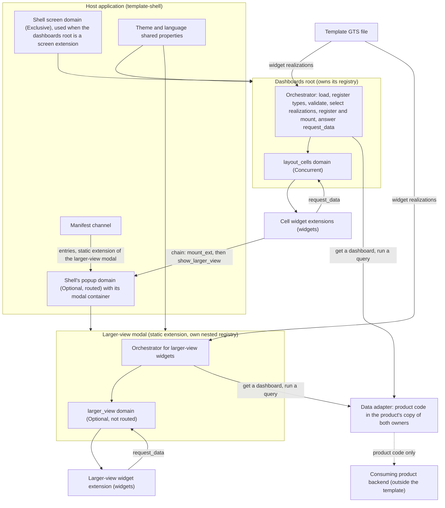

- [ ] `p2` - **ID**: `cpt-frontx-dashboard-tech-frontx-stack`

| Layer | Responsibility | Technology |
|-------|---------------|------------|
| Host | Screen domain when the dashboards root is a screen extension, the `popup` domain with its modal container, manifest channel, theme and language shared properties | `template-shell` on FrontX with GTS v0.17 |
| Presentation | Layout grid, widget presentation, larger-view button and close button, loader, busy and empty states, the "cannot be shown" placeholder, grid sort, pager, page size and resize controls | React, `@gears-frontx/ui-kit`, CSS Grid, ECharts with echarts-for-react, TanStack Table v8 with the TanStack virtualizer |
| Orchestration | Template GTS file load, dashboard load through the data adapter, registration of delivered types, validation and cross-checks, realization choice, registration of generated extensions, mount chains, `set_widget_context`, answers to `request_data` | Dashboards root and larger-view modal (TypeScript strict), FrontX registry, actions chains and routing, the template's trait helper |
| Data access | Get a dashboard with its dataset types and vocabulary instances; run a query and fill the requested data shape by the requested fill mode | The data adapter: product code behind the template's interface, in the product's copy of the dashboards root and the larger-view modal. It is outside the template's scope and is the only part that reaches a backend. |
| Contracts | Types and instances for dashboards, embedded layouts, widgets, queries, the measure and dimension bases, data shapes, actions, domains, extension types and widget realizations | GTS v0.17 types under the `frontx.dashboard_m` and `frontx.dashboard_v` packages on `gts.frontx.mfes.*` bases, validated through the FrontX gts-plugin |

## 2. Principles & Constraints

### 2.1 Design Principles

When two principles conflict, the one earlier in this order wins: render-only dashboards root, per-instance isolation, registration only in the own registry, contracts as GTS data, and orchestration by the domain owners last.

#### Render-Only Dashboards Root

- [ ] `p1` - **ID**: `cpt-frontx-dashboard-principle-render-only-dashboards-root`

The template shows what the product's data adapter delivers and nothing more. The dashboard carries its embedded layout and every widget with its presentation fields and, for a data widget, its query. Each data widget's data is one instance of its widget type's data shape, filled by the data adapter from the query. The widget shows it as delivered: it does not aggregate, narrow, hide or cut off any part of it. A widget only formats values for the host language from the member metadata, and the metric card computes its trend from the two values it is sent. A markdown card shows typical markdown (CommonMark, including links and images) as formatted text; embedded HTML in it is shown as plain text, never rendered.

The layout, with the widget instances it embeds, fully defines how the widgets are composed and presented. The dashboards root lays it out as given and moves nothing. There is no dashboard-wide filter, no dashboard-wide time range and no refresh while the dashboard is open. The viewer can sort and page a grid and change its page size; each of these changes the widget's local copy of its query, which is never saved, and asks the data adapter again. Resizing a grid column redraws locally and asks nothing. The domain owners keep no widget data between requests.

**PRD**: `cpt-frontx-dashboard-fr-backend-source`, `cpt-frontx-dashboard-fr-dashboards-root`, `cpt-frontx-dashboard-fr-grid-sort-page`

**ADRs**: `cpt-frontx-dashboard-adr-data-adapter`, `cpt-frontx-dashboard-adr-subject-agnostic-widget-catalog`, `cpt-frontx-dashboard-adr-data-grid-library`

#### Per-Instance Isolation

- [ ] `p1` - **ID**: `cpt-frontx-dashboard-principle-per-instance-isolation`

FrontX isolates every MFE instance: each instance evaluates its own copy of its code (FrontX ADR-0011). No library, store or theme object of the template is held in common between MFE instances. Each open dashboard holds its own loaded dashboard. Each chart widget registers its own ECharts theme. Each widget holds only the data it was last sent and its own local copy of its query.

Every template MFE lists its packages in the `shared` array of its manifest, so each is built as a shared dependency. Its source text is fetched once per realm only when every template MFE publishes the same `contentHash` for it (FrontX ADR-0034, FrontX ADR-0035). Each instance still evaluates its own copy, so source reuse saves fetches, not evaluation (section 3.9). Per-instance memory is held per extension id for the life of the page (FrontX ADR-0011). Deterministic ids of generated extensions keep it bounded: loading the same dashboard again reuses the same ids.

The template relies on the realm-shared GTS type store of FrontX gts-plugin ADR-0001, a prerequisite of section 4, and adds no shared state of its own: the types that a domain owner registers are known to the FrontX validation of every action that carries them.

**PRD**: `cpt-frontx-dashboard-fr-dashboards-root`, `cpt-frontx-dashboard-fr-loading-error-states`, `cpt-frontx-dashboard-nfr-initial-render`, `cpt-frontx-dashboard-nfr-bundle-budget`

**ADRs**: `cpt-frontx-dashboard-adr-frontend-framework`, `cpt-frontx-dashboard-adr-template-packages-and-host-contract`, `cpt-frontx-dashboard-adr-widget-type-and-mfe-realization`, `cpt-frontx-dashboard-adr-extension-domain-taxonomy`

#### Each Domain Owner Registers Only in Its Own Registry

- [ ] `p1` - **ID**: `cpt-frontx-dashboard-principle-own-registry-registration`

FrontX admits an extension only through `registerExtension` on the registry that holds the extension's domain. A child's bridge offers only `executeActionsChain`, `subscribeToProperty`, `getProperty` and `registerActionHandler`, so a child cannot register anything into an ancestor's registry (FrontX ADR-0008). The template follows this as a principle:

- The dashboards root registers the generated cell extensions in `layout_cells`, in its own registry: its nested registry when it is a screen extension, or the shell's registry when it is code in the shell.
- The larger-view modal registers the generated larger-view extensions in `larger_view`, in its own nested registry.
- Nothing is ever registered into an ancestor's registry. The larger-view modal itself is static: the shell's bootstrap registers it from the `dashboard` package manifest.

An owner registers generated extensions only when it loads a dashboard, never on a click. FrontX keeps per-extension state, such as the extension's bridge, across unmounting and unregistration, so an extension id is never fully released. Generated ids are therefore deterministic: each is a UUIDv5 derived from the widget's full id, its role (cell or larger view) and the entry of its winning realization. Loading the same dashboard again uses the same ids. The dashboards root unregisters its generated extensions when it loads another dashboard and when it goes away. The larger-view modal keeps the dashboard it loaded, and its generated extensions, while it is closed, and unregisters them only when it loads a different dashboard.

**PRD**: `cpt-frontx-dashboard-fr-dashboards-root`, `cpt-frontx-dashboard-fr-widget-modal`, `cpt-frontx-dashboard-contract-host-areas`

**ADRs**: `cpt-frontx-dashboard-adr-extension-domain-taxonomy`, `cpt-frontx-dashboard-adr-widget-type-and-mfe-realization`, `cpt-frontx-dashboard-adr-template-packages-and-host-contract`

#### Contracts Are GTS Data

- [ ] `p2` - **ID**: `cpt-frontx-dashboard-principle-gts-contracts`

Dashboards with their embedded layouts and widgets, queries, the measure and dimension bases, data shapes, actions, domains, extension types and widget realizations are GTS v0.17 types chained from FrontX bases. The product's query families and datasets are GTS types derived from the template's base query type, and its measures and dimensions are GTS instances. One standard GTS validation per instance checks everything embedded in it, because the FrontX GTS plugin validates each embedded instance against the derived type named by its own id. The specification does not require this; the template requires it of the plugin (section 4, prerequisite (e)). The template writes no validation code of its own, except the cross-checks that JSON Schema cannot express (section 3.1). FrontX validates every action instance, so the data in `set_data` is checked against the exact data shape that its id names. The owner drops an answer whose shape differs from the request's `data_shape`; widgets never compare shapes.

Because dashboards are GTS-typed, a product adds a dashboard or a dataset as data, written or generated, and checks it against the registered types before it serves it. The widget realizations travel as GTS instances in the template's GTS file. The data adapter interface stays a TypeScript interface, because it is called inside one runtime and carries GTS-typed values only.

**PRD**: `cpt-frontx-dashboard-fr-domain-model`, `cpt-frontx-dashboard-contract-consuming-backend`

**ADRs**: `cpt-frontx-dashboard-adr-shared-data-types-and-schemas`, `cpt-frontx-dashboard-adr-query-vocabulary-and-datasets`, `cpt-frontx-dashboard-adr-subject-agnostic-widget-catalog`, `cpt-frontx-dashboard-adr-widget-type-and-mfe-realization`

#### Domain Owners Orchestrate, Widgets Render

- [ ] `p1` - **ID**: `cpt-frontx-dashboard-principle-dashboards-root-orchestration`

The dashboards root orchestrates the dashboard, and the larger-view modal does the same for larger-view widgets. Each owner gets the dashboard from the data adapter, registers the delivered types, validates and cross-checks the widgets of its domain, picks their realizations, registers and mounts their extensions, and sends each widget `set_widget_context`. Each owner answers every `request_data` from its domain through the data adapter with `set_data`, and keeps no widget data between requests.

A widget renders its presentation fields and the data it is sent. A data widget asks for its data only with `request_data` to the domain it sits in, first with the query as the dashboard defines it and then after each interaction that changes the query. A widget never calls a backend, never reaches into an owner, and never sees the data adapter. Action delivery is FrontX's concern: no template part passes actions on.

**PRD**: `cpt-frontx-dashboard-fr-dashboards-root`, `cpt-frontx-dashboard-fr-data-adapter`, `cpt-frontx-dashboard-fr-loading-error-states`

**ADRs**: `cpt-frontx-dashboard-adr-data-adapter`, `cpt-frontx-dashboard-adr-extension-domain-taxonomy`

### 2.2 Constraints

#### Dependency on `template-shell` Only

- [ ] `p1` - **ID**: `cpt-frontx-dashboard-constraint-shell-only-dependency`

The template depends on `template-shell` and on the FrontX packages it pins to exact published versions, and on nothing else. It takes nothing from `template-mfe` or from any other template. The prerequisites of section 4 lie outside the template. Those that bear on packaging are:

- **FrontX on GTS v0.17.** The template relies on `x-gts-instance-ref`, `x-gts-type-ref`, `x-gts-abstract` and traits as GTS v0.17 defines them, and on FrontX's own base schemas using the v0.17 reference keywords. A FrontX gts-plugin on an older GTS version does not apply these keywords, and a dashboard cannot be validated end to end. The template targets v0.17 without interim workarounds.
- **A realm-shared GTS type store.** The FrontX release must share registered type definitions across the realm (section 4, prerequisite (b)). Without it, nested owners cannot validate chains that reference the shell's definitions.
- **A modal container for the shell's `popup` domain.** `template-shell` registers the `popup` domain with the Optional strategy, routing, the theme and language shared properties, and `mount_ext` and `unmount_ext`, but renders no container for it. The shell must render one that shows the occupant in the shell's modal area, keeps keyboard focus inside it while it is open, and unmounts the occupant on a click outside it. Without it, no larger view can be shown, while the rest of the dashboard works.

**ADRs**: `cpt-frontx-dashboard-adr-template-packages-and-host-contract`, `cpt-frontx-dashboard-adr-frontend-framework`, `cpt-frontx-dashboard-adr-shared-data-types-and-schemas`

#### Host Identifiers by Role

- [ ] `p1` - **ID**: `cpt-frontx-dashboard-constraint-role-based-host-ids`

Documents name shell domains by role. The **shell screen domain** is the domain in which full screens are mounted; the dashboards root uses it only when it is a screen extension. The **shell's `popup` domain** is the domain in which one modal occupant is mounted; with its modal container it realizes the PRD's host modal window. TypeScript code resolves their current identifiers from `template-shell` framework constants and never writes them as literals. This includes the cell widget, which resolves the `popup` domain id by role to open the larger view. Manifest-declared extensions in `mfe.json`, such as the larger-view modal's static extension and, when used, the dashboards root's routed extension, are data. They carry the current identifiers, or are generated from the constants at build time. The host contract table in section 3.5 is the single place that maps roles to current identifiers.

**ADRs**: `cpt-frontx-dashboard-adr-template-packages-and-host-contract`, `cpt-frontx-dashboard-adr-extension-domain-taxonomy`

#### GTS Identifier Form and Freeze

- [ ] `p1` - **ID**: `cpt-frontx-dashboard-constraint-gts-id-convention`

The template targets GTS specification v0.17. Type identifiers end with `~` and instance identifiers do not. An instance identifier always carries its type chain and is never split into parts. A well-known instance ends in a named segment, such as a measure or a widget realization. A combined anonymous instance ends in a UUID. Combined anonymous ids are an optional capability of a GTS service (GTS specification v0.17, section 3.7), which the template requires of the FrontX GTS plugin (section 4, prerequisite (h)). The UUIDs are random (version 4) by the template's choice and are valid under the identifier grammar. a dashboard, a widget and a query take a UUID from whoever writes the dashboard, a data instance takes one from the data adapter, and a generated extension takes a UUIDv5 from its domain owner. No instance carries a separate `type` field.

The template's own types use vendor `frontx` and two GTS packages. `dashboard_m` is the model: the dashboard, the layout, the widgets, the query vocabulary and the data shapes. `dashboard_v` is the view: the actions, the domains, the extension types and the widget realizations. Identifiers look like `gts.frontx.dashboard_m.*` and `gts.frontx.dashboard_v.*`, with chained segments for derived types. `dashboard_v` refers to `dashboard_m` types only; `dashboard_m` never refers to `dashboard_v`.

A field that holds an identifier is constrained with `x-gts-type-ref`, `x-gts-instance-ref` or `x-gts-pattern-ref`, by whether it holds a type, an instance or a pattern. An id field names its base type as a literal operand, such as `gts.frontx.dashboard_m.widget.widget.v1~`, so it holds wherever the type is embedded; no id field refers to the schema's own identifier. GTS ids are never object keys where they need validating: such collections are arrays of objects, or ordered pairs for the query's `order`. Every identifier starts at `v1` and is frozen from the first non-alpha release; an incompatible change after the freeze ships as a new version.

**ADRs**: `cpt-frontx-dashboard-adr-shared-data-types-and-schemas`, `cpt-frontx-dashboard-adr-query-vocabulary-and-datasets`

#### Fixed 60-Column Layout

- [ ] `p2` - **ID**: `cpt-frontx-dashboard-constraint-sixty-column-grid`

The layout embedded in each dashboard uses 60 columns with integer cell coordinates `x`, `y`, `w`, `h`. Each cell embeds one widget and may embed one larger-view widget. The dashboards root repairs nothing at run time. A layout with out-of-range or overlapping cells, or a dashboard that repeats a widget id, in a cell or as a larger-view widget, fails the layout checks and is the dashboard-level cannot-show state.

**ADRs**: `cpt-frontx-dashboard-adr-dashboard-layout-grid`

#### One Dashboards Root per Application Tree

- [ ] `p2` - **ID**: `cpt-frontx-dashboard-constraint-one-dashboards-root-per-tree`

The `layout_cells` and `larger_view` domain identifiers and the larger-view modal's extension identifier are fixed, and target identifiers are unique in the whole tree (FrontX ADR-0007). The supported topology is therefore one dashboards root and one larger-view modal per application tree. Switching dashboards happens through the dashboards root's address. Dashboards open at the same time run in separate application instances, such as two browser tabs, each with its own dashboards root and larger-view modal.

**ADRs**: `cpt-frontx-dashboard-adr-extension-domain-taxonomy`, `cpt-frontx-dashboard-adr-template-packages-and-host-contract`

#### Licensing, Compliance, and Resource Dispositions

- [ ] `p2` - **ID**: `cpt-frontx-dashboard-constraint-licensing-compliance-resources`

- **Regulatory and privacy**: not applicable because the template is a read-only information UI that stores nothing. The dashboard and the widget data stay in browser memory while the dashboard is open. Processing of personal data belongs to the consuming product and its data adapter (PRD section 6.2).
- **Data residency**: not applicable because the template stores no data, runs no service and reaches no backend. Only the product's data adapter reaches the product's backend, whose residency the product owns.
- **Licensing**: every third-party runtime library must carry a permissive license that allows distribution as source inside a consuming product, Apache-2.0 or MIT, as listed in section 3.5. The package-wide license check verifies every package that a template MFE lists, shared or not.
- **Resource constraints**: the browser lays out and presents data; the product's data adapter and backend compute every value. Dashboard size and data size are the product's concern, and the grid holds at most one page of 500 rows. Only `grid` always has `limit`. A query of another data widget type without `limit` has no row bound: its result has one row per combination of its groups. Authors and products bound the rows through the dataset's members, through filters, or with a `limit` where the widget type allows it. The result size of such a query is the product's responsibility. Download cost is bounded by the bundle budget, and evaluation cost by the initial-render budget, both in section 3.9. The template provisions no server, storage or network resource.
- **Legacy integration**: the template integrates with `template-shell` as it is and changes nothing in it. The prerequisites of section 4 (GTS v0.17, the realm-shared GTS type store, the modal container for the shell's `popup` domain and data access for every viewer) are tracked outside the template (section 4).
- **Team and schedule**: not applicable because the template has no delivery schedule or team constraint of its own.

**ADRs**: `cpt-frontx-dashboard-adr-template-packages-and-host-contract`, `cpt-frontx-dashboard-adr-data-adapter`

## 3. Technical Architecture

### 3.1 Domain Model

**Technology**: GTS (Global Type System) specification v0.17 types and instances chained from the FrontX `gts.frontx.mfes.*` bases, validated through the FrontX gts-plugin.

**Location**: type files and the template's GTS file in `src-app/mfe_packages/dashboard/`; widget entries in `src-app/mfe_packages/widgets/`. The concrete types are specified in the domain-model FEATURE documents named in the parts table below.

**Instance source**: the dashboard, with its embedded layout and the widget instances embedded in its cells, comes from the product's data adapter. The data adapter returns it together with the dataset types and the measure and dimension instances that its queries use. Whoever writes the dashboard, the product or a language model, generates the UUIDs of the dashboard, widget and query identifiers. Each data instance comes from the data adapter's answer to one `request_data`. The widget realizations come from the template's GTS file. Package `mfe.json` files carry GTS types, MFE entries and static extensions only; no GTS instance and no dashboard content travels through them (section 3.5).

**Core Entities**:

| Entity | Description | Schema |
|--------|-------------|--------|
| Dashboard | Root: `id`, `name`, optional `description`, embedded `layout`; no widget data and no theme | `gts.frontx.dashboard_m.dashboard.dashboard.v1~` (FEATURE [dashboard-root-types](./features/feature-dashboard-root-types/FEATURE.md)) |
| Layout | Embedded object of the dashboard, without an identifier: `columns` (always 60) and an ordered list of cells | `gts.frontx.dashboard_m.layout.layout.v1~` (FEATURE [layout-types](./features/feature-layout-types/FEATURE.md)) |
| Layout cell | Embedded object of the layout: `x`, `y`, `w`, `h`, one embedded `widget`, and an optional embedded `larger_view` widget | `gts.frontx.dashboard_m.layout.cell.v1~` (FEATURE [layout-types](./features/feature-layout-types/FEATURE.md)) |
| Widget | Abstract base of every widget type: `id` and `title` | `gts.frontx.dashboard_m.widget.widget.v1~` (FEATURE [widget-catalog](./features/feature-widget-catalog/FEATURE.md)) |
| Data widget | Abstract intermediate type of the 8 data widget types: adds the required `data` field and the traits `data_shape`, `fill` and `member_kinds` | `gts.frontx.dashboard_m.widget.widget.v1~frontx.dashboard_m.widget.data_widget.v1~` (FEATURE [widget-catalog](./features/feature-widget-catalog/FEATURE.md)) |
| Widget type | One of the 9 concrete types: 8 data widget types and `markdown_card` | under the two types above (FEATURE [widget-catalog](./features/feature-widget-catalog/FEATURE.md)) |
| Query | The embedded anonymous instance in a data widget's `data` field, typed by a product dataset; the PRD's data definition | base `gts.frontx.dashboard_m.data.query.v1~` ([query vocabulary FEATURE](./features/feature-query-vocabulary/FEATURE.md)) |
| Query family | Product type between the base query and its datasets; declares the shape of the backend binding | product type derived from the query base |
| Dataset | Product query type; narrows the members it allows with enums and carries its backend binding as type traits | product type derived from a query family |
| Measure, dimension | Product vocabulary as GTS well-known instances with `title`, `value_type` and, for a measure, an optional `unit` | `gts.frontx.dashboard_m.data.measure.v1~`, `gts.frontx.dashboard_m.data.dimension.v1~` ([query vocabulary FEATURE](./features/feature-query-vocabulary/FEATURE.md)) |
| Data shape | Abstract base with `id`, and one derived shape per data widget type | `gts.frontx.dashboard_m.widget_data.widget_data.v1~` (FEATURE [widget-data-catalog](./features/feature-widget-data-catalog/FEATURE.md)) |
| Widget realization | Binds one widget type to its entry, an optional larger-view entry and a weight | `gts.frontx.dashboard_v.mfe.widget_realization.v1~` (FEATURE [mfe-entries](./features/feature-mfe-entries/FEATURE.md)) |
| Template actions | `set_widget_context`, `request_data`, `set_data`, `show_larger_view` | types under `gts.frontx.mfes.comm.action.v1~frontx.dashboard_v.mfe.*` (FEATURE [extension-domain-catalog](./features/feature-extension-domain-catalog/FEATURE.md)) |
| Domains and extension types | `layout_cells` and `larger_view`, each with the extension type of its generated extensions | instances of the FrontX domain base and types derived from the FrontX extension base (FEATURE [extension-domain-catalog](./features/feature-extension-domain-catalog/FEATURE.md)) |

**Relationships**:

- Dashboard → Layout → Layout cell → Widget: the dashboard embeds one layout, the layout embeds its cells, and each cell embeds one widget and optionally one larger-view widget. Layouts and cells have no identifier; widgets are never referenced by identifier.
- Widget → Widget type: the rightmost type of the widget's `id` chain is its widget type.
- Data widget → Query: containment in the `data` field. The widget type limits the form of the query; the dataset limits its members.
- Query → Dataset → Query family → Query base: the query's `id` chain names all three types.
- Query → Measure, Dimension: by instance id, in `measures`, `dimensions`, `timeDimensions[0].dimension` and `filters[].member`, and as the first item of each `order` pair.
- Data widget type → Data shape: by its `data_shape` trait, inside `dashboard_m`.
- Widget type → Widget realization: each of the 9 widget types is the `widget_type` of one template realization of weight 1; a product may add one with a higher weight.
- Widget realization → MFE entry: `entry` for a cell and for the larger view, or `larger_view_entry` for the larger view when it is named.
- Domain → Generated extension: `layout_cells` holds one generated extension per cell widget; `larger_view` holds one per larger-view widget of the loaded dashboard.

The diagram shows the template's GTS types by package, their type chains and the references between them. It draws the main fields by name; types and full schemas are in the FEATURE documents. Instances (generated extensions, data instances, the template's widget realizations) are described in the Relationships list and are not drawn.

Legend (Mermaid class diagrams have no native legend):

- A solid line with a filled diamond is an embedded object.
- A solid line with a hollow triangle is a derivation in the GTS type chain.
- A dotted line with a hollow triangle means the node is an instance of that type.
- A dotted arrow means the field names a type or an instance id, or carries a value checked against that type.
- `external` is a FrontX base type outside the template.
- `product` is a type the consuming product supplies.

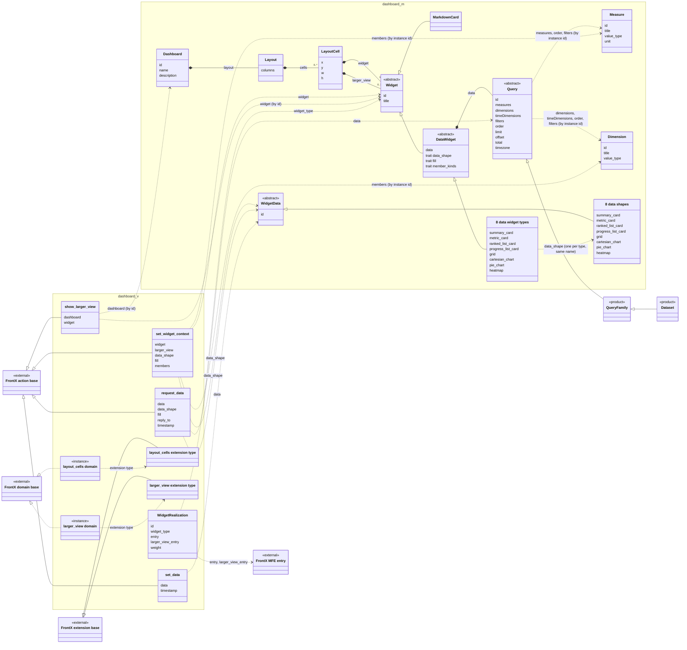

#### Packages, Namespaces, and the Model–View Split

The template's code ships in two template packages, `dashboard` and `widgets` (section 3.8). Its GTS types live in two GTS packages under vendor `frontx`, which are a separate notion: `dashboard_m` and `dashboard_v`. All types of both GTS packages are files of the `dashboard` template package.

- `dashboard_m` (model) holds what describes a dashboard and its data: the dashboard, the layout and the cell, the widget base, the data widget, the 9 widget types, the query base with the measure and dimension bases, and the data shape base with its 8 derived shapes.
- `dashboard_v` (view) holds what the runtime exchanges: the 4 action types, the 2 domains and their extension types, and the widget realization type.

The dependency runs from `dashboard_v` to `dashboard_m` only:

| From (`dashboard_v`) | To (`dashboard_m`) | Meaning |
|------|----|---------|
| Widget realization `widget_type` | widget base | A realization names the widget type it realizes; `x-gts-type-ref`. |
| `set_widget_context` `widget` | widget base | The payload carries the widget instance, validated against the type its own id names. |
| `request_data` `data` and `data_shape` | query base, data shape base | The request carries the widget's current query and the id of the data shape it needs. |
| `set_data` `data` | data shape base | The answer carries one data instance, validated against the shape its own id names. |

Data widget types reference their data shapes through the `data_shape` trait inside `dashboard_m`. Nothing in `dashboard_m` references `dashboard_v`, so dashboards can be written, generated and checked without any view type, and widget entries can be released and substituted apart from the dashboards that use them.

**ID-form convention.** Identifiers with a trailing `~` are types; identifiers without it are instances. Every instance identifier carries its type chain (GTS v0.17, sections 2 and 3.7). The vendor `acme.example` in the examples is illustrative. The following table fixes the form for every family:

| Family | Form | Example |
|--------|------|---------|
| Dashboard type | type | `gts.frontx.dashboard_m.dashboard.dashboard.v1~` |
| Dashboards | combined anonymous instance; UUID from the author | `gts.frontx.dashboard_m.dashboard.dashboard.v1~<uuid>` |
| Layout and cell | embedded object types; their objects carry no identifier | `gts.frontx.dashboard_m.layout.layout.v1~`, `gts.frontx.dashboard_m.layout.cell.v1~` |
| Widget base and data widget | abstract types | `gts.frontx.dashboard_m.widget.widget.v1~`, `gts.frontx.dashboard_m.widget.widget.v1~frontx.dashboard_m.widget.data_widget.v1~` |
| Data widget types (8) | types under the data widget | `gts.frontx.dashboard_m.widget.widget.v1~frontx.dashboard_m.widget.data_widget.v1~frontx.dashboard_m.widget.grid.v1~` |
| `markdown_card` | type directly under the widget base | `gts.frontx.dashboard_m.widget.widget.v1~frontx.dashboard_m.widget.markdown_card.v1~` |
| Widgets in a dashboard | combined anonymous instance of one of the 9 widget types; UUID from the author | `gts.frontx.dashboard_m.widget.widget.v1~frontx.dashboard_m.widget.data_widget.v1~frontx.dashboard_m.widget.grid.v1~<uuid>` |
| Query base | abstract, closed type | `gts.frontx.dashboard_m.data.query.v1~` |
| Query family | abstract product type | `gts.frontx.dashboard_m.data.query.v1~acme.example.data.metric_query.v1~` |
| Dataset | product type | `gts.frontx.dashboard_m.data.query.v1~acme.example.data.metric_query.v1~acme.example.data.activity.v1~` |
| Queries | combined anonymous instance of a dataset, embedded in a widget's `data`; UUID from the author | `gts.frontx.dashboard_m.data.query.v1~acme.example.data.metric_query.v1~acme.example.data.activity.v1~<uuid>` |
| Measure and dimension bases | plain types, not abstract; the product delivers their well-known instances | `gts.frontx.dashboard_m.data.measure.v1~`, `gts.frontx.dashboard_m.data.dimension.v1~` |
| Measures and dimensions | well-known product instances | `gts.frontx.dashboard_m.data.measure.v1~acme.example.metrics.loc.v1` |
| Data shape base and shapes (8) | abstract base and types | `gts.frontx.dashboard_m.widget_data.widget_data.v1~`, `gts.frontx.dashboard_m.widget_data.widget_data.v1~frontx.dashboard_m.widget_data.grid.v1~` |
| Data instances | combined anonymous instance of a data shape; UUID from the data adapter | `gts.frontx.dashboard_m.widget_data.widget_data.v1~frontx.dashboard_m.widget_data.grid.v1~<uuid>` |
| Template actions (4) | types derived from the FrontX action base | `gts.frontx.mfes.comm.action.v1~frontx.dashboard_v.mfe.request_data.v1~` |
| Domains (2) | instances of the FrontX domain base | `gts.frontx.mfes.ext.domain.v1~frontx.dashboard_v.layout.layout_cells.v1`, `gts.frontx.mfes.ext.domain.v1~frontx.dashboard_v.layout.larger_view.v1` |
| Extension types (2) | types derived from the FrontX extension base | `gts.frontx.mfes.ext.extension.v1~frontx.dashboard_v.layout.layout_cells.v1~`, `gts.frontx.mfes.ext.extension.v1~frontx.dashboard_v.layout.larger_view.v1~` |
| Generated extensions | combined anonymous instance of its domain's extension type; UUIDv5 from the domain owner | `gts.frontx.mfes.ext.extension.v1~frontx.dashboard_v.layout.layout_cells.v1~<uuidv5>` |
| Widget realization type | type | `gts.frontx.dashboard_v.mfe.widget_realization.v1~` |
| Widget realizations (9 in the template) | well-known instances in the template's GTS file | `gts.frontx.dashboard_v.mfe.widget_realization.v1~frontx.dashboard_v.mfe.grid.v1` |
| Widget entries (9) | instances of the FrontX MFE entry type | `gts.frontx.mfes.mfe.entry.v1~frontx.mfes.mfe.entry_mf.v1~frontx.dashboard_v.mfe.grid.v1` |
| Larger-view modal entry | instance of the FrontX MFE entry type | `gts.frontx.mfes.mfe.entry.v1~frontx.mfes.mfe.entry_mf.v1~frontx.dashboard_v.mfe.larger_view_modal.v1` |
| Larger-view modal extension | static, routed extension of the shell's `popup` domain with a fixed identifier; exact form in FEATURE `mfe-entries` | `gts.frontx.mfes.ext.extension.v1~frontx.dashboard_v.mfe.larger_view_modal.v1` |
| Dashboards root entry and routed extension | only when the dashboards root is a screen extension; instances of the FrontX MFE entry type and of the shell screen extension type | `gts.frontx.mfes.mfe.entry.v1~frontx.mfes.mfe.entry_mf.v1~frontx.dashboard_v.mfe.dashboards_root.v1`, `gts.frontx.mfes.ext.extension.v1~frontx.screensets.layout.screen.v1~frontx.dashboard_v.screens.dashboards_root.v1` |
| Manifests (2) | instances of the FrontX manifest type | `gts.frontx.mfes.mfe.mf_manifest.v1~frontx.dashboard_v.dashboard.manifest.v1`, `gts.frontx.mfes.mfe.mf_manifest.v1~frontx.dashboard_v.widgets.manifest.v1` |

#### Widgets, Queries, and Data Shapes

The DESIGN carries the base-level shape of each family that the component model depends on. Field-level schemas of concrete types are owned by the FEATURE documents.

**Widget base** `gts.frontx.dashboard_m.widget.widget.v1~`. It is abstract (`x-gts-abstract: true`), so every widget instance belongs to one of the 9 concrete widget types.

| Field | Required | Meaning |
|-------|----------|---------|
| `id` | yes | Combined anonymous instance identifier, constrained with `x-gts-instance-ref` to the literal base `gts.frontx.dashboard_m.widget.widget.v1~`. The rightmost type of the chain is the widget type. |
| `title` | yes | Display title of the widget, shown as delivered. |

Every GTS instance id is unique, so a dashboard never holds the same widget instance twice. Each cell widget and each larger-view widget has its own id, and a dashboard that repeats a widget id fails the layout checks. A larger-view widget that should look like its cell widget is a second widget instance with the same settings.

**Data widget** `gts.frontx.dashboard_m.widget.widget.v1~frontx.dashboard_m.widget.data_widget.v1~`. It is abstract and derives from the widget base. It adds the required field `data`, whose schema is the query base. The `data` field forbids `timezone`: an author never writes it, and the widget sets it in the query it sends. The data widget declares three traits:

| Trait | Required | Meaning |
|-------|----------|---------|
| `data_shape` | yes | The identifier of the data shape that the widget type needs, constrained with `x-gts-type-ref` to the data shape base. |
| `fill` | yes | The fill mode, one of the five below, and, for `rows_by_member` only, its `fields`: a list of `{field, from}`, where `from` is `dimensions[i]`, `measures[i]` or `timeDimensions[0]`. |
| `member_kinds` | no | The allowed `value_type` values of the query's measures and dimensions. The domain owner checks them against the member instances. |

Each data widget type sets `data_shape` and `fill`, limits the form of its query on its `data` field, and adds its presentation fields. `markdown_card` derives from the widget base directly: it has no `data`, no traits and no query, and it never requests data. Every concrete widget type ends with `unevaluatedProperties: false`, so a misspelled presentation field fails validation across the whole derivation chain.

**Nine widget types.** The domain owner passes `data_shape` and `fill` to the widget in `set_widget_context`, and the widget puts them unchanged into each `request_data`.

| Widget type | Query limits | Fill mode → data shape | Presentation notes |
|-------------|--------------|------------------------|--------------------|
| `summary_card` | 1 or more measures, no dimensions, no `granularity` | `row_per_measure` → `rows: [{key, value}]` | Titles and formats from the member metadata. |
| `metric_card` | 1 measure, no dimensions; optional `timeDimensions[0]` with `granularity` for the sparkline; optional `compareDateRange` with exactly 2 ranges for the trend, instead of `dateRange` | `scalar_with_series` → `{value, previous_value?, sparkline?}` | The widget computes the trend from `value` and `previous_value`; optional `value_label`, by default the measure's title. |
| `ranked_list_card` | 1 dimension, 1 to 2 measures, no `granularity`; `order` and `limit` optional | `rows_by_member` (label, value, secondary) → `rows: [{label, value, secondary?}]` | The second measure is the secondary value. |
| `progress_list_card` | 1 dimension, 2 measures, no `granularity`; `order` and `limit` optional | `rows_by_member` (label, current, target) → `rows: [{label, current, target}]` | The first measure is the current value, the second the target. |
| `pie_chart` | 1 dimension, 1 measure, no `granularity` | `rows_by_member` (label, value) → `rows: [{label, value}]` | |
| `cartesian_chart` | 1 measure: `timeDimensions[0]` with `granularity` and at most 1 dimension, or no `granularity` and 1 to 2 dimensions. Several measures: `timeDimensions[0]` with `granularity` and no dimension, or no `granularity` and 1 dimension | `x_series_value` → `rows: [{x, series?, value}]` | `series` is a list of `{member, type, y_axis, stack_group}`, at most one entry per measure; a measure with no entry is drawn as a bar on the primary axis. |
| `heatmap` | 2 dimensions, 1 measure, no `granularity` | `rows_by_member` (x, y, value) → `rows: [{x, y, value}]` | |
| `grid` | 1 or more members; `order`; paging by `limit` and `offset` (`offset` only on `grid`), with `limit` required and one of the `page_sizes` values; `total: true` required | `positional_table` → `rows: [[…]]`, `total` | `columns`, `page_sizes`, `frozen_columns`, `column_groups`, `row_color` (below). |
| `markdown_card` | not a data widget: no `data`, no traits | none | The body is a presentation field rendered as typical markdown (CommonMark, including links and images); embedded HTML is shown as plain text, never rendered. Renders right after `set_widget_context`. |

Only `metric_card` allows `compareDateRange`, and every other data widget type rejects it. Only `grid` requires `limit` and `total: true`, and every other data widget type forbids `total`. These limits are decided in [ADR-0009](ADR/0009-subject-agnostic-widget-catalog-v1.md).

**Five fill modes.** A fill mode is a template-defined rule that fills a data shape from a query result. The set is closed: `rows_by_member`, `x_series_value`, `row_per_measure`, `positional_table` and `scalar_with_series`. The data adapter implements all five, and a widget type that needs a new mode is a template change that every data adapter then implements. The rule of each mode is in [ADR-0009](ADR/0009-subject-agnostic-widget-catalog-v1.md) and is specified in the widget data catalog FEATURE.

**Data shapes** `gts.frontx.dashboard_m.widget_data.widget_data.v1~`. The base is abstract and carries `id`, constrained with `x-gts-instance-ref` to the literal base `gts.frontx.dashboard_m.widget_data.widget_data.v1~`. Each of the 8 data widget types has its own derived shape, even where two shapes are equal, so they can differ. A data instance carries a combined id, the data shape type followed by a UUID that the data adapter generates. FrontX validates every `set_data` action against its schema, and polymorphic validation applies the exact shape that the data instance's id names. The owner compares that shape with the `data_shape` of the request before it sends `set_data` and drops an instance whose shape differs. A widget never checks a shape itself. Measure values and dimension values in a data shape may be null. A widget shows a null measure value as a gap or an empty value, and a null dimension value as an empty label. For `metric_card`, a null `value` is the empty state. Grid rows are positional arrays in the canonical member order, because GTS ids are not used as object keys.

**Query vocabulary** `gts.frontx.dashboard_m.data.query.v1~`. A query is written in the query format of [ADR-0012](ADR/0012-query-vocabulary-and-datasets-v1.md): a subset of a published query format, used with its published semantics. The one deviation is that members are GTS instance ids. Every query the template sends is valid in that format, and template rules only narrow what an author may write. The base query type is abstract and closed, so a misspelled field or a field outside the subset fails validation. A query holds:

- its combined `id`, the dataset type chain followed by a UUID;
- `measures` and `dimensions`, lists of member ids, with at least one of the two; the time dimension is never listed in `dimensions`;
- at most one `timeDimensions` entry, with its `dimension`, an optional `granularity`, and an optional `dateRange` or `compareDateRange`;
- `filters`, a top-level list of filters that must all hold;
- `order`, a list of `[member, "asc"|"desc"]` pairs;
- `limit` and `offset` for paging and top-N, and `total` for the row count that ignores them;
- `timezone`, which the base declares so that the sent query validates. The widget's `data` field forbids it, so an authored query has none. The data widget sets it to the browser's resolved IANA time zone name in the query it sends.

A **query member** is any measure or dimension instance that the query names: in `measures`, in `dimensions`, as `timeDimensions[0].dimension`, as a `filters[].member`, and as the first item of each `order` pair. `set_widget_context` carries the metadata of every query member. The owner's registered-instance check covers every query member, and the operator-kind check covers every query member used in a filter.

The **canonical member order** is a separate notion. It orders the result columns, not all query members: the dimensions in query order, then the time dimension when it has a `granularity`, then the measures in query order. A time dimension without `granularity` is a query member but gives no column. Positional rows and the grid cross-checks use the canonical member order.

Dates, relative ranges and granularity buckets resolve in the sent `timezone`. When `order` is absent, the format's default order applies. A query without `limit` asks for the complete result. The subset, the filter operators, the time forms, the time zone rule, the rules for `order`, `limit`, `offset` and `total`, and the canonical member order are decided in [ADR-0012](ADR/0012-query-vocabulary-and-datasets-v1.md) and are specified in the query vocabulary FEATURE.

A **dataset** is a product query type that derives from a product **query family**, which derives from the base query (base query, query family, dataset). It narrows members with enums at five positions. Datasets are delivered with the dashboard, and the data adapter reads the binding they carry as type traits. The binding maps each member to its backend name and states how each measure aggregates; the template gives it no meaning. ADR-0012 owns the closed base, the narrowing rules, the traits and the measure and dimension fields.

**Measures and dimensions** are GTS well-known instances, which the product delivers, of `gts.frontx.dashboard_m.data.measure.v1~` (`id`, `title`, `value_type` one of `number`, `percent` or `duration`, optional `unit`; `percent` is a ratio, where 1 means 100%, and `duration` requires `unit`) and `gts.frontx.dashboard_m.data.dimension.v1~` (`id`, `title`, `value_type` of `string`, `time` or `number`). Both bases are plain types, not abstract, so their instances are valid. Their metadata reaches each widget in `set_widget_context` and gives it default titles and formats; presentation fields only override them.

**Grid presentation fields.** The grid's presentation fields (`columns`, `page_sizes`, `frozen_columns`, `column_groups`, `align`, `row_color`) and local column resizing are decided in ADR-0005 and specified in the widget catalog FEATURE.

**Validation and cross-checks.** Validation is GTS validation only, through the gts-plugin. The domain owner attributes each failure by its instance path: a failure under a cell's `widget` or `larger_view` path belongs to that cell or larger view, and any other failure is dashboard-level. The failures of one pass are collected:

| Question | Checked by |
|---|---|
| Does the widget match its type, does its query have the form the widget type needs, and does the dataset allow the chosen members? | One validation of the dashboard by the FrontX GTS plugin, which applies to each embedded instance the type its own id names (section 4, prerequisite (e)): each embedded widget against the type its `id` names (base fields, closed presentation fields, the widget type's limits on `data`), and its `data` against the dataset type that `data.id` names (enums, closed base, filter value counts, date patterns). |
| Are references well-formed, of the right kind and not abstract, and do their targets exist? | `x-gts-instance-ref`, `x-gts-type-ref` and `x-gts-abstract` under GTS v0.17. Dashboard validation runs with reference-existence lookup off, so GTS checks the form and kind of a reference but not that its target exists. The owner's load-time cross-check enforces that every member exists (section 4, prerequisite (f)); a widget whose id names an unknown type fails polymorphic validation. Reference keywords apply inside array-item schemas, including `prefixItems` (GTS specification v0.17, section 9.6.3), so the first item of an `order` pair is covered; a plugin conformance test confirms it, and the owner cross-check is a second layer. |
| Are the chosen members of the right kind? | The time dimension by the dataset's enum; other kinds by the owner: every query member names a registered instance, of the kind that the widget type's `member_kinds` trait asks for, checked against the member instance's `value_type`. |
| Cross-checks that JSON Schema cannot express | The widget catalog's load-time cross-checks, run by the owner: the query members each name a registered instance; the first item of every `order` pair is also named in `measures` or `dimensions`, or is the time dimension with a `granularity`. This owner check is the guaranteed layer for `order` pairs. Each filter operator fits its member's kind (rules in `cpt-frontx-dashboard-adr-query-vocabulary-and-datasets`). Date pairs: start not after end, and real calendar values. Filter value content: numbers for `gt`, `gte`, `lt` and `lte`; dates or allowed relative strings for date operators. The time dimension is time-valued. The grid cross-checks of [ADR-0005](ADR/0005-data-grid-library-v1.md) include that `limit` is one of the `page_sizes` values. With the member-kind check above, the layout checks, the served-family check and the shape comparison below, these are the only checks besides GTS validation. |
| Does the data adapter serve the query's family? | The owner, from the query family in the type chain of `data.id`. |
| Does the delivered data match the shape? | The FrontX GTS plugin's validation of each `set_data` action, polymorphic on `data.id`, validates the instance against the shape its own id names. The owner then drops an instance whose shape differs from the request's `data_shape`. |

The cross-checks are specified in FEATURE `widget-catalog`.

#### Layout, Dashboard, Realization, Actions, and Domains

**Layout and cell** `gts.frontx.dashboard_m.layout.layout.v1~` and `gts.frontx.dashboard_m.layout.cell.v1~`. Both are embedded object types without an identifier; no layout is stored or referenced on its own. A layout has `columns` (always 60) and ordered `cells`. A cell has integer coordinates `x`, `y`, `w`, `h`, one `widget`, and an optional `larger_view` widget. GTS validation checks the bounds of each coordinate. The layout checks then reject overlapping cells, `x + w` above 60 and a repeated widget id, in that order, and the failures of one pass are collected. The coordinate ranges, the checks and their order are specified in FEATURE `layout-types`.

**Dashboard** `gts.frontx.dashboard_m.dashboard.dashboard.v1~`. It has `id`, a combined anonymous instance identifier constrained with `x-gts-instance-ref` to its literal base, `name`, an optional `description`, and the embedded `layout`. It references no theme.

**Widget realization** `gts.frontx.dashboard_v.mfe.widget_realization.v1~`. It is closed:

| Field | Required | Meaning |
|-------|----------|---------|
| `id` | yes | Instance identifier of the realization. |
| `widget_type` | yes | The widget type it realizes, constrained with `x-gts-type-ref` to the widget base. |
| `entry` | yes | The entry that shows the widget in a cell and in the larger view, constrained with `x-gts-instance-ref` to the FrontX MFE entry type `gts.frontx.mfes.mfe.entry.v1~frontx.mfes.mfe.entry_mf.v1~`. |
| `larger_view_entry` | no | A separate entry for the larger view, named only when the widget type needs different code there; constrained like `entry`. |
| `weight` | no, default 1 | Integer of at least 1. For each widget type the single highest-weight realization wins (section 3.3). |

Widget entries are plain instances of the FrontX MFE entry type; the template adds no entry type and no field to entries.

**Template actions** derive from the FrontX action base `gts.frontx.mfes.comm.action.v1~`: `set_widget_context`, `request_data`, `set_data` and `show_larger_view`. Section 3.3 gives their targets, senders and payloads.

**Domains and extension types.** `layout_cells` and `larger_view` are instances of the FrontX domain base, so the template adds no domain type. Each has its own extension type, derived from the FrontX extension base without fields of its own. The larger-view modal's static extension is an extension of the shell's `popup` domain, which has no extension type constraint.

**Generated extensions.** A domain owner generates one extension per widget of its domain: an instance of the domain's extension type whose `entry` comes from the winning realization. Its id is the extension type chain followed by a UUIDv5, derived under a fixed template namespace from three inputs: the widget's full id, its role (cell or larger view), and the entry of the winning realization. The role keeps a cell extension and a larger-view extension of the same widget apart. The entry gives a new id when a different realization wins, so FrontX never reuses one id for different code. Everything that may differ while the widget id stays the same, such as presentation fields, the query or member metadata, reaches the widget in `set_widget_context`, never in the extension declaration.

**Theme.** The template defines no theme type and no theme instance. Its theme input is the host's theme shared property, whose value is the host theme id (section 3.5). Every template MFE maps that id to the light or dark scope of `@gears-frontx/ui-kit`.

#### Parts Summary and Ownership

The domain model (`cpt-frontx-dashboard-interface-domain-model`) has seven parts, each owned by one domain-model FEATURE. The [data adapter contract FEATURE](./features/feature-data-adapter-contract/FEATURE.md) specifies the data adapter interface and declares no type of its own.

| Package and namespace | Contents | Inline here | Owning FEATURE |
|-----------------------|----------|-------------|----------------|
| `frontx.dashboard_m.dashboard` | Dashboard with embedded layout | base shape | [dashboard-root-types](./features/feature-dashboard-root-types/FEATURE.md) |
| `frontx.dashboard_m.layout` | Layout and cell, both embedded object types | base shape | [layout-types](./features/feature-layout-types/FEATURE.md) |
| `frontx.dashboard_m.data` | Query base with its subset, filter operators, time forms, time zone rule and the rules for `order`, `limit`, `offset` and `total`; measure and dimension bases; the canonical member order; the rules for deriving query families and datasets | base shape | [query vocabulary FEATURE](./features/feature-query-vocabulary/FEATURE.md) |
| `frontx.dashboard_m.widget` | Widget base, data widget with its traits, the 9 widget types with their query limits, presentation fields and cross-checks | widget base and data widget | [widget-catalog](./features/feature-widget-catalog/FEATURE.md) |
| `frontx.dashboard_m.widget_data` | Data shape base, the 8 data shapes, and the 5 fill modes | base shape and fill modes | [widget-data-catalog](./features/feature-widget-data-catalog/FEATURE.md) |
| `frontx.dashboard_v.mfe`, `frontx.dashboard_v.layout` | 4 action types, 2 domains, 2 extension types, the id rule of generated extensions | base shape | [extension-domain-catalog](./features/feature-extension-domain-catalog/FEATURE.md) |
| `frontx.dashboard_v.mfe` | Widget realization type and the 9 template realizations, widget entries, the larger-view modal's entry and static extension, the dashboards root's entry and routed extension, manifests | widget realization | [mfe-entries](./features/feature-mfe-entries/FEATURE.md) |

### 3.2 Component Model

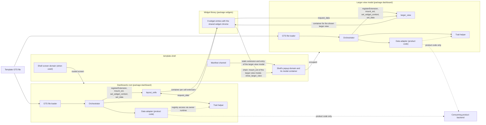

#### Dashboards Root

- [ ] `p1` - **ID**: `cpt-frontx-dashboard-component-dashboards-root`

##### Why this component exists

A dashboard needs one place that loads it, checks it, mounts each widget, and answers the widgets' data requests. The dashboards root is that place. It is whatever hosts the dashboards in the product: a screen extension, or code copied into the shell of a single-page application that has no screen domain. The product chooses the form and adapts its copy of the template to it.

##### Responsibility scope

- As a screen extension, mounts as a routed extension of the shell screen domain (FrontX ADR-0036), an instance of the shell's screen extension type whose route carries the dashboard's GTS identifier. It builds its own registry synchronously inside its first `mount` (FrontX ADR-0008). As code in the shell, it uses the shell's registry and takes the dashboard identifier from the host's address.
- Registers the `layout_cells` domain with the Concurrent strategy and the declarations of section 3.3, and registers its `request_data` handler while the domain is built, before any cell mounts. Publishes theme and language as shared properties of `layout_cells`, with the values it reads from its bridge or, as shell code, from the shell; on every mount it reads them again and republishes them before any cell mounts.
- At start, loads the template's GTS file through the GTS file loader and registers the family type schemas that the data adapter's served-families declaration returns, before any dashboard loads.
- When it is a screen extension, fetches the manifest channel and registers the `widgets` manifest and every manifest whose entries a registered realization names, consumer packages included, with their entries in its own registry, as the `template-mfe` nested-host reference does. As shell code, it relies on the entries that the shell's bootstrap registered.
- Shows a loader in place of the dashboard and calls "get a dashboard" on the data adapter with the dashboard identifier. Registers the measure and dimension instances delivered with it, then the dataset types, whose enums refer to them, and skips a dataset type of a query family the data adapter does not serve.
- Validates the dashboard by GTS validation alone and attributes each failure by its instance path: under a cell's `widget` path it belongs to that cell, under a `larger_view` path to that larger view, and any other failure is dashboard-level. Runs the layout checks. Then runs the cross-checks and member-kind checks of each cell widget that passed, using the trait helper for effective traits (section 3.1).
- For each cell widget, checks that the data adapter serves the query family of a data widget, reads the widget type from the rightmost type of the widget's `id`, and picks the single highest-weight realization (`cpt-frontx-dashboard-interface-widget-realization`).
- Registers one generated cell extension per cell widget that passed, with its deterministic id and `entry` from the winning realization, before it mounts any cell. When it loads another dashboard, it first unregisters the generated extensions of the one it had loaded.
- For each cell, runs one chain: `mount_ext` of the cell extension, then `set_widget_context` with the widget, and for a data widget its `data_shape`, `fill` and member metadata, and for a cell with a larger view the `larger_view` field with the dashboard id and the larger-view widget id. The Concurrent strategy creates a container, and the domain's mounter places it in the cell.
- Accepts each `request_data` from `layout_cells` and resolves its handler at once. It then hands the request unchanged to "run a query", checks the answered data against the request's `data_shape` and drops a mismatched answer (the widget then keeps its loader), and otherwise sends `set_data` with the returned data instance and the copied timestamp to `reply_to`, as its own actions chain.
- Places the cells on the 60-column grid with CSS Grid, at the positions the layout gives. FEATURE `layout-types` specifies the placement rule. The 60-column grid scales with the available width; device and screen-size support comes from the host application.
- Shows the static "cannot be shown" placeholder in place of the dashboard, or in one cell, for the triggers of section 3.6 (Cannot-Show States), and writes the diagnostic to the developer log. Its own chrome uses `@gears-frontx/ui-kit` in the scope the host theme id maps to, and localizes its own text for the host language.
- On leaving the dashboard, unmounts every cell extension; on loading another dashboard and when it goes away, unregisters its generated extensions. A mount of the dashboards root whose dashboard is already loaded mounts its cells again without loading (section 3.6, teardown).

##### Responsibility boundaries

- Makes no backend call; only the data adapter it calls does.
- Keeps no widget data between requests, and does not compute, aggregate, narrow or reorder data.
- Never renders a larger view and never closes the larger-view modal.
- Registers nothing outside its own registry, and nothing on a click.
- Does not present widget content or the loader, busy and empty states of a widget; widgets do.
- Does not import ECharts or register ECharts themes; chart widgets do.
- Does not write shell identifiers as literals in code.
- Does not persist anything; all state ends with the page.

##### Related components (by ID)

- `cpt-frontx-dashboard-component-widget-library` — generates cell extensions from widget realizations, mounts them in `layout_cells`, sends them `set_widget_context` and `set_data`, and receives their `request_data`.
- `cpt-frontx-dashboard-component-data-adapter` — calls it to get the dashboard and to run every query from `layout_cells`.
- `cpt-frontx-dashboard-component-trait-helper` — resolves effective traits of widget types; the data adapter uses it on datasets.
- `cpt-frontx-dashboard-component-gts-file-loader` — loads the template's GTS file at start.
- `cpt-frontx-dashboard-component-larger-view-modal` — receives `show_larger_view` from the cell widgets' chains; the dashboards root sends it nothing.

#### Larger-View Modal

- [ ] `p1` - **ID**: `cpt-frontx-dashboard-component-larger-view-modal`

##### Why this component exists: Larger-View Modal

A larger view must appear in the shell's modal area, and its widget extension must be registered in the registry that holds its domain. A child cannot register into an ancestor's registry (FrontX ADR-0008), so neither the dashboards root nor a widget can register anything into the shell's `popup` domain. The larger-view modal solves this: it is itself a static extension of the `popup` domain, and it owns a nested `larger_view` domain in its own registry, where it registers the larger-view extensions.

##### Responsibility scope: Larger-View Modal

- Is one static, routed extension of the shell's `popup` domain with a fixed identifier and a static route, declared in the `dashboard` package manifest and registered by the shell's bootstrap. FrontX routing restores it after a page refresh.
- Builds its own registry synchronously inside its first `mount`, registers the `larger_view` domain with the Optional strategy and its `request_data` handler, and publishes theme and language, received from the `popup` domain, on `larger_view`; on every mount it reads them again and republishes them before any extension mounts. Shows the occupant of `larger_view` in its own window, together with its own close button.
- At start, loads the template's GTS file through the GTS file loader, registers the family type schemas that the data adapter's served-families declaration returns, and registers the `widgets` manifest and every manifest whose entries a registered realization names, consumer packages included, with their entries in its own registry.
- Handles `show_larger_view { dashboard, widget }`: keeps both ids as parameters of its own private subroute, which no other runtime reads or writes, and resolves the handler at once. After a refresh it reads the same parameters from its subroute.
- When it has not loaded that dashboard, unregisters the generated extensions of the dashboard it had loaded, if any, shows a loader, and calls "get a dashboard" on the data adapter. It registers the delivered measure and dimension instances, then the dataset types, skipping a dataset type of an unserved query family, validates the dashboard by GTS validation alone and attributes each failure by its instance path, runs the layout checks, cross-checks each larger-view widget that passed, checks served query families, picks realizations, and registers one generated extension per larger-view widget in `larger_view`.
- Shows the requested larger-view widget with one chain: `unmount_ext` of the shown larger-view extension, which does nothing when none is shown, then `mount_ext` of the requested one, then `set_widget_context`. The extension's `entry` is the realization's `larger_view_entry` when it is named, and its `entry` otherwise.
- Answers each `request_data` from `larger_view` the same way as the dashboards root: it resolves the handler on acceptance, calls "run a query", checks the answer against the request's `data_shape` and drops a mismatched answer, and otherwise sends `set_data` to `reply_to` as its own chain.
- Shows the static "cannot be shown" placeholder in the modal for the dashboard-level and widget-level triggers of section 3.6, including a requested larger-view widget id that is not in the dashboard.
- Its close button sends `unmount_ext` of the larger-view modal to the `popup` domain with `history: "none"`. While closed, it keeps the loaded dashboard and its generated extensions, because its nested registry and registrations survive an unmount (FrontX ADR-0008).

##### Responsibility boundaries: Larger-View Modal

- Registers nothing into the shell's registry or any ancestor's registry.
- Makes no backend call; only the data adapter it calls does.
- Is not connected to the cell widget whose button opened it: the larger-view widget has its own settings and its own query.
- Does not render cells and does not touch `layout_cells`.
- Does not implement the modal frame, the focus rule or the click outside; the shell's modal container does (section 3.5).

##### Related components (by ID): Larger-View Modal

- `cpt-frontx-dashboard-component-widget-library` — generates larger-view extensions from widget realizations, mounts them in `larger_view`, sends them `set_widget_context` and `set_data`, and receives their `request_data`.
- `cpt-frontx-dashboard-component-data-adapter` — calls it to get the dashboard and to run every query from `larger_view`.
- `cpt-frontx-dashboard-component-trait-helper` — resolves effective traits of widget types; the data adapter uses it on datasets.
- `cpt-frontx-dashboard-component-gts-file-loader` — loads the template's GTS file at start.

#### Data Adapter

- [ ] `p1` - **ID**: `cpt-frontx-dashboard-component-data-adapter`

##### Why this component exists: Data Adapter

The template must work with any backend and depend on none. The data adapter is the single place where a consuming product connects its backend: product code in the product's copy of the template, behind an interface that the template defines (`cpt-frontx-dashboard-adr-data-adapter`). The template ships the interface only; it holds no implementation.

##### Responsibility scope: Data Adapter

- Implements "get a dashboard": given a dashboard id, returns the dashboard instance together with the dataset types and the measure and dimension instances it uses.
- Implements "run a query": given a widget's request, its query, the data shape id and the fill mode with its fields, returns one instance of that data shape, filled by that fill mode, whose measure and dimension values may be null, with a combined id that ends in a UUID it generates.
- Declares the query families it serves and returns their family type schemas, which the owners register at start.
- Implements all five fill modes, so it produces any data shape for any query family it serves.
- Reads each query as the query format of `cpt-frontx-dashboard-adr-query-vocabulary-and-datasets` defines it, under the obligations of section 3.3: it maps each member through the dataset's binding and drops `id`; passes `timezone` through; applies the default order when `order` is absent; answers a query without `limit` with the complete result; executes a query locally only over a complete result, and aggregates locally only measures that the product's binding declares re-aggregatable from grouped values; the meaning and vocabulary of that declaration are the product's; serves a new query family as data adapter work; and reaches the registry through the access of its owner runtime.
- Reads each dataset's backend binding from its type traits, for example with the trait helper, through the registry access that the data adapter interface hands it for its owner runtime.
- Owns everything about the backend: requests, errors, access checks such as not found and not permitted, and the session.
- Lives as long as the dashboards root and the larger-view modal; a copy runs in each of their runtimes. It may group several requests into one backend call, and may cache identical requests.

##### Responsibility boundaries: Data Adapter

- Is not a FrontX extension: it has no MFE entry, no extension and no extension domain.
- Is never part of `template-dashboard`; the template is complete without it and is tested with a test data adapter that names no backend.
- Does not validate dashboards, select realizations or mount widgets; the domain owners do.
- Never sees presentation fields of a widget; it receives only the request.
- Never caps the result of a query without `limit`.
- Never executes a query locally over a paged or limited result.
- Shows nothing to the user; data it never returns keeps the waiting loader (section 3.6).

##### Related components (by ID): Data Adapter

- `cpt-frontx-dashboard-component-dashboards-root` — calls it for the dashboard and for every query from `layout_cells`.
- `cpt-frontx-dashboard-component-larger-view-modal` — calls it for the dashboard and for every query from `larger_view`.
- `cpt-frontx-dashboard-component-trait-helper` — may use it on dataset types.

#### Widget Library

- [ ] `p1` - **ID**: `cpt-frontx-dashboard-component-widget-library`

##### Why this component exists: Widget Library

Dashboards need a fixed, subject-agnostic set of widgets that consuming products use without writing chart or grid code or any data loading. The template ships the 9 widget types as passive MFE entries that FrontX mounts in a layout cell and in the larger view.

##### Responsibility scope: Widget Library

- Ships one package, `widgets`, with one manifest `gts.frontx.mfes.mfe.mf_manifest.v1~frontx.dashboard_v.widgets.manifest.v1` that declares one entry per widget type, 9 in all, and the shared widget chrome.
- Every entry requires the theme and language shared properties, lists `set_widget_context` and `set_data` in its `actions` and `request_data` in its `domainActions`. `markdown_card` lists them too, although it never sends or receives data actions. The same entry is admitted into `layout_cells` and `larger_view`.
- Registers its action handlers before its `mount` resolves, so its `set_data` handler exists before its first `request_data`.
- On `set_widget_context`, a data widget keeps its query as a local copy, shows its loader, and sends `request_data { data, data_shape, fill, reply_to, timestamp }` to the domain it sits in, read from its bridge's `extDomainId`. `data` is its current query with `timezone` set to the browser's resolved IANA time zone name. `reply_to` is its own extension id, and `timestamp` comes from a monotonic clock, so it is unique per widget. `markdown_card` renders at once.
- On `set_data`, applies the answer only when its timestamp equals that of the latest request, and drops older answers. Valid data with no rows shows the widget type's empty state.
- On an interaction that changes the query, such as a grid sort, page or page size, updates the local copy, which is never saved, sends a new `request_data`, and shows a busy indicator over the current content. An interaction that changes only presentation, such as resizing a grid column, redraws locally and sends nothing.
- Shares one widget chrome across all widget types: the title, the loader, the busy indicator and the empty state. In a cell widget whose context carries `larger_view`, the chrome shows the larger-view button; in a cell without it, and in every larger-view widget, the button is hidden. The button runs the chain of section 3.6 (Larger View Open). It takes the `popup` domain id from the shell constants by role and the larger-view modal's fixed id from the template's identifiers.
- Formats values for the host language from the member metadata and the presentation fields, and localizes its own wording. Titles and labels from the dashboard are shown as delivered.
- Maps the host theme id to the light or dark scope of `@gears-frontx/ui-kit`, the same approach as `kitThemeScopeFor` in `template-mfe`, and styles everything with kit tokens.
- Chart widget types (`cartesian_chart`, `pie_chart`, `heatmap`) use ECharts through `echarts/core` imports. They build their ECharts theme `frontx-dashboard` from the kit tokens of the active scope and register it per instance, again on every theme change. `cartesian_chart` draws each measure as its `series` entry sets. `series` has at most one entry per measure, and a measure with no entry is drawn as a bar on the primary axis.
- The `grid` widget type uses one grid shell on TanStack Table v8 for rendering and column resizing only. It reads each column's value by position in the canonical member order, shows values as text, and keeps the delivered row order. It renders the rows of a page virtualized, shows frozen columns, grouped headings, alignment and row colours, and offers sort headers, a pager and a page-size choice with ARIA grid semantics and keyboard operation (`cpt-frontx-dashboard-adr-data-grid-library`).
- The `markdown_card` widget type renders its body as typical markdown (CommonMark, including links and images). Embedded HTML is shown as plain text, never rendered. Further rendering rules are specified in FEATURE `widget-catalog`.

##### Responsibility boundaries: Widget Library

- Has no data-request code beyond the `request_data` action, no backend knowledge, and no error chrome: no error message and no timeout.
- Does not show the "cannot be shown" placeholder; the domain owner shows it in the widget's cell or in the modal.
- Never aggregates, narrows, re-orders, groups, hides or truncates delivered data; the query and the presentation fields fix the presentation.
- Never checks the shape of the data it receives; FrontX's validation of `set_data` does.
- Keeps every widget type subject-agnostic.
- Relies on no template-owned state shared between instances (FrontX ADR-0011).
- Registers no extension; the domain owners register the generated extensions.

##### Related components (by ID): Widget Library

- `cpt-frontx-dashboard-component-dashboards-root` — mounts its entries as cell extensions, sends `set_widget_context` and `set_data`, and answers its `request_data` from `layout_cells`.
- `cpt-frontx-dashboard-component-larger-view-modal` — mounts its entries as larger-view extensions and answers its `request_data` from `larger_view`; receives `show_larger_view` from its cell widgets' chains.

#### Trait Helper

- [ ] `p2` - **ID**: `cpt-frontx-dashboard-component-trait-helper`

##### Why this component exists: Trait Helper

The FrontX type-system port offers register schema, get schema, register and validate instance, and type check, but no accessor for a type's effective traits (`cpt-frontx-dashboard-adr-shared-data-types-and-schemas`). The domain owners need the effective traits of widget types (`data_shape`, `fill`, `member_kinds`), and the data adapter needs those of datasets (the backend binding).

##### Responsibility scope: Trait Helper

- Resolves a type's effective traits: gets the schemas along the type's `$id` chain with `getSchema`, merges their `x-gts-traits` with RFC 7396, and fills in the `default` values of the effective trait schema (GTS specification v0.17, section 9.7.5).
- Is template code in the `dashboard` package, carried by the dashboards root and the larger-view modal.
- Is offered to the product's data adapter with a stable signature, because product data adapter code calls it (`cpt-frontx-dashboard-interface-trait-helper`, `cpt-frontx-dashboard-adr-template-packages-and-host-contract`).
- Uses the registry access of the owner runtime it runs in. The data adapter interface hands the data adapter that access, or a trait helper bound to it: one per owner runtime, for the dashboards root and for the larger-view modal (section 3.3).

##### Responsibility boundaries: Trait Helper

- Registers nothing, validates nothing, and keeps no state between calls.
- Holds no registry of its own and is never a global singleton: FrontX isolates each MFE instance, so each owner runtime has its own.
- Gives traits no meaning; its callers interpret them.

##### Related components (by ID): Trait Helper

- `cpt-frontx-dashboard-component-dashboards-root` — uses it for widget types.
- `cpt-frontx-dashboard-component-larger-view-modal` — uses it the same way.
- `cpt-frontx-dashboard-component-data-adapter` — may use it to read a dataset's binding, through the registry access of its owner runtime.

#### Template GTS File Loader

- [ ] `p2` - **ID**: `cpt-frontx-dashboard-component-gts-file-loader`

##### Why this component exists: Template GTS File Loader

The shell's manifest carries no GTS instances, and FrontX offers no registry listing, so the widget realizations must be delivered to the domain owners another way (`cpt-frontx-dashboard-adr-template-packages-and-host-contract`). The template serves its own JSON file of GTS types and instances that no MFE manifest carries, starting with the widget realizations.

##### Responsibility scope: Template GTS File Loader

- Fetches the template's GTS file at start, as if a backend returned it, and registers its types and instances before any dashboard loads. The dashboards root and the larger-view modal each run it in their own runtime.
- Reads the file that the product's copy of the template serves; a product adds or changes realizations, including replacement realizations, by editing its copy.
- Writes a diagnostic to the developer log when the file cannot be fetched or an entry is rejected. With no realization registered for a widget type, every widget of that type gets the widget-level cannot-show state.

##### Responsibility boundaries: Template GTS File Loader

- Loads no dashboard content and no product types; those come from the data adapter.
- A backend that returns the same GTS types and instances can take the file's place without a change to the dashboards root or the larger-view modal.

##### Related components (by ID): Template GTS File Loader

- `cpt-frontx-dashboard-component-dashboards-root` — runs it at start.
- `cpt-frontx-dashboard-component-larger-view-modal` — runs it at start.

### 3.3 API Contracts

The template exposes one public contract to consumers, its domain model (`cpt-frontx-dashboard-interface-domain-model`), with the seven parts listed in section 3.1. Two boundary contracts connect it to its surroundings. The first is the data adapter interface that the consuming product implements (`cpt-frontx-dashboard-interface-data-adapter`, below), which realizes the PRD contract `cpt-frontx-dashboard-contract-consuming-backend`. The second is the host contract (`cpt-frontx-dashboard-contract-host-areas`, section 3.5). The interfaces below give the architecture-level form of the data adapter interface, of the trait helper that data adapter code calls, of widget realizations, and of the template's actions and domains. Field-level schemas belong to the FEATURE documents.

#### Data Adapter Interface

- [ ] `p1` - **ID**: `cpt-frontx-dashboard-interface-data-adapter`

- **Contracts**: `cpt-frontx-dashboard-contract-consuming-backend`, `cpt-frontx-dashboard-fr-data-adapter`, `cpt-frontx-dashboard-interface-domain-model`
- **Technology**: a TypeScript interface, called in the runtime of the dashboards root and of the larger-view modal; every value it takes and returns is GTS-typed (`cpt-frontx-dashboard-adr-data-adapter`)
- **Location**: the interface in the `dashboard` package; the implementation in the product's copy of the template; exact specification and conformance cases in the [data adapter contract FEATURE](./features/feature-data-adapter-contract/FEATURE.md)

The consuming product implements this interface; the template only calls it. This section is the single statement of the interface; other sections refer to it.

| Operation | Input | Output | Called by |
|-----------|-------|--------|-----------|
| Get a dashboard | a dashboard id | the dashboard instance, the dataset types it uses, and the measure and dimension instances it uses | the dashboards root when it loads a dashboard; the larger-view modal when it has not loaded that dashboard |
| Run a query | one `request_data` payload, unchanged: `data` (the query, with `timezone` set by the widget), `data_shape`, `fill`, `reply_to`, `timestamp` | one instance of the requested data shape, filled by the requested fill mode, with a combined id that ends in a UUID the data adapter generates | the owner of the domain that received the request |
| Served query families | none | the family type schemas of the query families it serves | the dashboards root and the larger-view modal at start, which register the schemas |

**Obligations of an implementation.**

- It implements all five fill modes of section 3.1, so it can fill any data shape for any query family it serves.
- It returns delivered types and instances that the owner can register. The template expects the FrontX type store to keep the first registration of an id (the specification leaves mutability to the implementation, GTS specification v0.17, sections 4.2 and 6; section 4, prerequisite (g)), so a dataset, measure or dimension with new content gets a new version id. The safety does not depend on that behaviour: before it registers a delivery, the owner rejects any delivered type id that equals a template type id, as a dashboard-level failure. Template types are registered before any dashboard loads.
- It reads each query as the query format of `cpt-frontx-dashboard-adr-query-vocabulary-and-datasets` defines it. It maps each member id to a backend member name through the dataset's binding traits and drops the template-only `id`.
- It passes `timezone`, which the data widget set to the browser's resolved IANA time zone name, through to the backend, and dates resolve in that time zone. It may cache identical queries.
- When `order` is absent, it applies the format's default order. For an empty `order` list, it applies no order.
- A query without `limit` asks for the complete result. The data adapter applies no cap of its own and reads past any row limit of its backend, for example by paging.
- It may execute a query locally, grouping, filtering, ordering or paging, only over a complete, unpaged backend result, never over a slice that is already paged or limited. Local execution reproduces the operator semantics of the query format, with the rules `cpt-frontx-dashboard-feature-data-adapter-contract` lists for cases the published semantics leave open. It aggregates locally only measures that the product's binding declares re-aggregatable from grouped values; the meaning and vocabulary of that declaration are the product's, and takes every other total from the backend at the query's grain.
- When the data adapter needs a value of a measure that is not declared re-aggregatable and its backend cannot give it at the needed grain, it gives no answer, and a product does not offer that measure at that grain in a dataset.
- A new backend or endpoint family is a new query family type. Serving it is data adapter work, not a template change.
- It answers every call. Data that the owner never gets keeps the loader: the dashboard area for a missing dashboard, the widget for a missing answer. FrontX validates the instance against the shape its own id names, and the owner drops an instance whose shape differs from the request's `data_shape`; a dropped answer counts as an answer that never arrives.
- It owns backend errors, access checks and the session. The template shows no error message, classifies no failure and has no timeout.

**Asynchronous answers.** A call to "run a query" is asynchronous. The owner's `request_data` handler has already resolved, and while one widget waits, the owner keeps answering the others.

**Consistency.** Each data instance is an independent snapshot of the moment the data adapter fills it. There is no consistency guarantee across widgets. The dashboards root and the larger-view modal call the data adapter separately, each in its own runtime.

**Registry access.** The interface hands the data adapter the registry access of its owner runtime (get schema), or a trait helper bound to it. There is one per owner runtime, the dashboards root's and the larger-view modal's, and no global singleton, because FrontX isolates each MFE instance (`cpt-frontx-dashboard-principle-per-instance-isolation`).

**Delivered types.** The owner registers the vocabulary instances and dataset types that come with a dashboard before it validates the dashboard: the measure and dimension instances first, then the dataset types, whose enums refer to them. When they cannot be registered, the dashboard is in the dashboard-level cannot-show state (section 3.6). The exception is a delivered dataset type of a query family that the data adapter does not serve: the owner skips it and does not register it, and only the widgets whose data uses it are in the widget-level cannot-show state.

The stability class is given in the API Stability Classification below.

#### Trait Helper Interface

- [ ] `p2` - **ID**: `cpt-frontx-dashboard-interface-trait-helper`

- **Contracts**: `cpt-frontx-dashboard-interface-data-adapter`, `cpt-frontx-dashboard-interface-domain-model`
- **Technology**: a TypeScript function, bound to the registry access of one owner runtime (`cpt-frontx-dashboard-adr-shared-data-types-and-schemas`)
- **Location**: the `dashboard` package (`cpt-frontx-dashboard-component-trait-helper`); exact contract in the [query vocabulary FEATURE](./features/feature-query-vocabulary/FEATURE.md)

| Input | Output | Failure |
|-------|--------|---------|
| a type id | the effective traits of the type: the `x-gts-traits` of the schemas along its `$id` chain, merged with RFC 7396 from the base to the type, with the `default` values of the effective trait schema filled in for traits not set | a schema along the chain cannot be found: a failure, never a partial result |

The domain owners call it for widget types, and the data adapter may call it for datasets. Each owner runtime has its own, bound to that runtime's registry access; there is no global singleton. Its signature belongs to the data adapter row of the product-supplied implementations and has the same stability (API Stability Classification below).

#### Widget Realization

- [ ] `p1` - **ID**: `cpt-frontx-dashboard-interface-widget-realization`

- **Contracts**: `cpt-frontx-dashboard-interface-domain-model`
- **Technology**: GTS instances of `gts.frontx.dashboard_v.mfe.widget_realization.v1~` in the template's GTS file, registered by the GTS file loader of each domain owner
- **Location**: the template's 9 realizations in the template's GTS file in the `dashboard` package; the 9 entries in the `widgets` manifest; field-level schema in FEATURE `mfe-entries`

A widget realization tells a domain owner which entry shows a widget type in a cell, and which one in the larger view. Section 3.1 gives its fields.

**Precedence.** For each widget, the owner of its domain reads the widget type from the rightmost type of the widget's `id` chain. It considers the realizations registered in its registry whose `widget_type` names that type. The single realization with the highest `weight` wins. A tie at the highest weight, or no realization at all, gives the cannot-show state to that widget's cell, or to the modal for a larger-view widget; the diagnostic that names the widget type and the tied realizations goes to the developer log only. The template's 9 realizations have weight 1 and name no `larger_view_entry`.

**Consumer replacement.** A consuming product cannot add widget types, but it can replace how a template widget type is shown. It ships its own entry in its own package and adds a realization to its copy of the template's GTS file, with its own identifier, a `larger_view_entry` only if it needs one, and a weight above 1. The replacement wins for that widget type in both domains; the template's realization stays registered but unused. The replacement entry must list `set_widget_context` and `set_data` in `actions` and `request_data` in `domainActions`, so that both domains admit it, and it keeps the widget states, the theme mapping and the accessibility rules itself. A realization is a GTS instance, not an admitted extension, so registering it admits nothing; each owner registers the manifest that holds the replacement entry, because it registers every manifest whose entries a registered realization names, and registers the generated extensions itself.

**Example: from widget instance to mounted extension.**

1. The cell `layout.cells[2]` embeds a `grid` widget with id `gts.frontx.dashboard_m.widget.widget.v1~frontx.dashboard_m.widget.data_widget.v1~frontx.dashboard_m.widget.grid.v1~<uuid>`, the title "Activity by author", `columns` for an author dimension and a lines-of-code measure, `page_sizes` of 25, 50 and 100, and a query of a product dataset with `limit` 25 and `total: true`. The cell also embeds a `larger_view` widget.
2. The dashboards root validates the widget, which also validates its query against the dataset that `data.id` names. It runs the grid cross-checks and finds the query family in the type chain of `data.id` among the served ones.
3. The widget type is the rightmost type of the `id` chain. The winning realization for it, for example `gts.frontx.dashboard_v.mfe.widget_realization.v1~frontx.dashboard_v.mfe.grid.v1`, gives `entry`.
4. The dashboards root derives the UUIDv5 from the widget id, the role "cell" and that entry, and registers the extension `gts.frontx.mfes.ext.extension.v1~frontx.dashboard_v.layout.layout_cells.v1~<uuidv5>` in its own registry. It runs `mount_ext`; the Concurrent strategy creates a container, and the domain's mounter places it in cell 2.
5. The dashboards root sends `set_widget_context` with the widget, the grid's `data_shape` and `fill` from the widget type's traits, the metadata of the two members, and `larger_view` with the dashboard id and the larger-view widget id.
6. The widget sends `request_data` to `layout_cells`. The dashboards root accepts it, calls "run a query", and sends `set_data` with a `positional_table` instance of 25 rows and its `total`. The widget renders the page, with the larger-view button shown.

#### Template Actions

- [ ] `p1` - **ID**: `cpt-frontx-dashboard-interface-host-actions`

- **Contracts**: `cpt-frontx-dashboard-interface-domain-model`, `cpt-frontx-dashboard-contract-host-areas`
- **Technology**: FrontX actions chains (mediator keyed by target and action type, FrontX ADR-0007)
- **Location**: action types under `gts.frontx.mfes.comm.action.v1~frontx.dashboard_v.mfe.*` in the `dashboard` package

Every template action is a type derived from the FrontX action base. A chain carries an action, an optional `next` and an optional `fallback`; nothing comes back to the sender. FrontX validates every action instance against its schema, polymorphically on every embedded id.

| Action | Target | Sender → receiver | Payload (summary) | Stability |
|--------|--------|-------------------|-------------------|-----------|
| `set_widget_context` | a generated extension in `layout_cells` or `larger_view` | dashboards root → cell widget; larger-view modal → larger-view widget | `widget`: the widget instance. For a data widget: `data_shape` and `fill` from the widget type's traits, and `members`: `{id, title, value_type, unit}` for every query member (section 3.1), filter members and the time dimension included. For a cell widget with a larger view: `larger_view` with `dashboard`, the dashboard id, and `widget`, the larger-view widget id. | experimental |
| `request_data` | the domain the widget sits in: `layout_cells` or `larger_view` | data widget → domain owner | `data`: the widget's current query, typed by the query base, with `timezone` set to the browser's resolved IANA time zone name; `data_shape`; `fill`; `reply_to`: the widget's own extension id; `timestamp`: from a monotonic clock | experimental |
| `set_data` | the requesting widget extension (`reply_to`) | domain owner → data widget | `data`: one data instance, typed by the data shape base and carrying its combined id; `timestamp`: copied from the request | experimental |
| `show_larger_view` | the larger-view modal's extension | the cell widget's chain, after `mount_ext` of the larger-view modal | `dashboard`: the dashboard id; `widget`: the larger-view widget id | experimental |

The payloads are closed. `set_widget_context` carries no widget data and no backend detail: everything a widget needs to render and to ask for its data reaches it in this one action, in a cell and in the larger view alike. `request_data` and `set_data` are single actions for every data widget type, because the FrontX GTS plugin validates the embedded query and the embedded data instance against the derived types their own ids name (section 4, prerequisite (e)).

FrontX lifecycle actions on the template's domains and on the shell's `popup` domain:

| Action | Target | Sent by | Subject |
|--------|--------|---------|---------|
| `mount_ext` / `unmount_ext` | `layout_cells` | the dashboards root | a generated cell extension |
| `mount_ext` | the shell's `popup` domain | the cell widget's chain, to open, with `history: "none"` | the larger-view modal |
| `unmount_ext` | the shell's `popup` domain | the larger-view modal's close button with `history: "none"`, or the shell's modal container on a click outside | the larger-view modal |
| `mount_ext` / `unmount_ext` | `larger_view` | the larger-view modal | a generated larger-view extension |

Code takes the lifecycle action identifiers from the FrontX constants.

**Delivery.** Action delivery is FrontX's concern. FrontX delivers each action to the handler that its target registered, wherever the target sits in the tree (FrontX ADR-0007). This holds for `set_data` from a domain owner to a widget in its domain, and for `show_larger_view` from a cell widget in the dashboards root's registry to the larger-view modal in the shell's registry. No template part passes actions on.

**Handlers resolve on acceptance.** FrontX ends a step of an actions chain when its handler's promise settles, and the action's timeout, or the domain default of 30 000 ms, covers only that time. The `request_data` handlers of both domains resolve as soon as they take the request. The owner then calls the data adapter outside the chain and sends `set_data` as its own actions chain. The `show_larger_view` handler takes the ids and resolves; loading and showing run after it. A slow data adapter never reaches an action timeout.

**Declarations.** FrontX rejects an action whose target does not list it.

- Every widget entry lists `set_widget_context` and `set_data` in `actions` and `request_data` in `domainActions`, `markdown_card` included.
- The larger-view modal's entry lists `show_larger_view` in `actions` and nothing in `domainActions`. Lifecycle actions (`load_ext`, `mount_ext`, `unmount_ext`) are never listed in `domainActions`, because FrontX admission exempts them; this covers the cell widget's `mount_ext` and the modal's `unmount_ext` on the `popup` domain.
- `layout_cells` and `larger_view` list `request_data` in their `actions`, next to their lifecycle actions, and require `set_widget_context` and `set_data` in their `extensionsActions`.

**Handlers exist before they are needed.** A domain's `request_data` handler is registered when the domain is registered, before any extension in it mounts. Under the FrontX MFE entry contract, an entry's `mount` resolves only after the entry has registered its action handlers, and the next step of a chain runs only after the mount resolves. So a widget's `set_data` handler exists before its first `request_data`, and the larger-view modal's `show_larger_view` handler exists before the second step of the cell widget's chain.

#### Template Extension Domains

- [ ] `p1` - **ID**: `cpt-frontx-dashboard-interface-template-domains`

- **Contracts**: `cpt-frontx-dashboard-interface-domain-model`
- **Technology**: FrontX extension domains with named mount strategies (FrontX ADR-0009) and subset-rule admission (FrontX ADR-0010)
- **Location**: domain instances and extension types in the `dashboard` package

The template defines two extension domains. The larger-view modal is an extension of the shell's `popup` domain, which the shell implements (section 3.5).

| Property | `layout_cells` | `larger_view` |
|----------|----------------|---------------|
| Identifier | `gts.frontx.mfes.ext.domain.v1~frontx.dashboard_v.layout.layout_cells.v1` | `gts.frontx.mfes.ext.domain.v1~frontx.dashboard_v.layout.larger_view.v1` |
| Implemented by | the dashboards root, in its own registry | the larger-view modal, in its own nested registry |
| Mount strategy | Concurrent | Optional |
| Routed | no | no |
| Domain actions | `load_ext`, `mount_ext`, `unmount_ext`, `request_data` | `load_ext`, `mount_ext`, `unmount_ext`, `request_data` |
| Extension actions | `set_widget_context`, `set_data` | `set_widget_context`, `set_data` |
| Shared properties | theme and language, published unchanged | theme and language, published unchanged |
| Extension type | `gts.frontx.mfes.ext.extension.v1~frontx.dashboard_v.layout.layout_cells.v1~` | `gts.frontx.mfes.ext.extension.v1~frontx.dashboard_v.layout.larger_view.v1~` |
| Extensions registered | one per cell widget that passes its checks, when the dashboards root loads a dashboard | one per larger-view widget that passes its checks, when the larger-view modal loads a dashboard |
| Occupancy | one occupant per cell | at most one occupant, the shown larger-view widget |
| Domain lifecycle stages | `init` | `init` |
| Extension lifecycle stages | `init`, `activated`, `deactivated`, `destroyed` | `init`, `activated`, `deactivated`, `destroyed` |
| Default action timeout | 30 000 ms | 30 000 ms |

Each domain declares only the `init` stage for itself, because it lives as long as its registry. A layout with no cells, or a dashboard without larger-view widgets, registers nothing in the domain. The generation and registration process is specified in FEATURE `extension-domain-catalog`.

**Cardinality matrix check (FrontX ADR-0009).**

| Domain | Strategy | Requires | Declares | Result |
|--------|----------|----------|----------|--------|
| `layout_cells` | Concurrent | `mount_ext`, `unmount_ext` | `mount_ext`, `unmount_ext` | admitted |
| `larger_view` | Optional | `mount_ext`, `unmount_ext` | `mount_ext`, `unmount_ext` | admitted |

FrontX also accepts a domain only when every action it lists has a handler and every handler is listed, so each domain registers its `request_data` handler while it is built.

**Admission of entries (FrontX ADR-0010).** A widget entry requires theme and language, which both domains share. It supports `set_widget_context` and `set_data`, which cover both domains' extension actions, and its `request_data` is among both domains' actions. One entry per widget type therefore fits both domains. The larger-view modal's entry requires theme and language, which the `popup` domain shares. The `popup` domain declares no extension actions, so under the subset rule the modal's `show_larger_view` does not block its admission, and the `popup` domain supports the `unmount_ext` that the modal sends.

**Identifier uniqueness.** Target identifiers are unique in the whole tree (FrontX ADR-0007). The domain identifiers and the larger-view modal's identifier are fixed. Generated identifiers differ by widget id, by role and by entry, so a cell extension and a larger-view extension of the same widget never collide, and a repeated widget id is rejected by the layout checks before any extension is generated.

#### API Stability Classification

This design uses one stability vocabulary with three classes. `experimental` is the PRD label for the template's public contracts during alpha; these contracts become stable from the first non-alpha release and then follow the PRD breaking change policy. The `v1` freeze of `cpt-frontx-dashboard-constraint-gts-id-convention` implements that step. `internal` means TypeScript-internal and changeable in any release. `product-supplied implementation` means a contract that the consuming product implements, such as the data adapter or a replacement widget.

| Classification | Contracts | Policy |
|----------------|-----------|--------|
| Experimental (stable from the first non-alpha release) | the `gts.frontx.dashboard_m.*` and `gts.frontx.dashboard_v.*` types, including the query vocabulary, the data shapes, the fill modes, the 4 action types, the 2 domains and their extension types, and the widget realization type; the identifiers of the template's realizations, entries and the larger-view modal's extension | `v1` from the start; changes during alpha are listed in the release notes; frozen from the first non-alpha release; incompatible changes then ship as a new version |
| Internal | the id derivation of generated extensions, the GTS file loader, the timestamp clock, the cannot-show diagnostics | may change in any release; coordinated inside the owning package |
| Product-supplied implementations | the data adapter: its interface (`cpt-frontx-dashboard-interface-data-adapter`), with the registry access and the trait helper signature it calls (`cpt-frontx-dashboard-interface-trait-helper`), and the query families, datasets, measures and dimensions a product delivers; the replacement widget: realizations with a weight above 1 in the product's copy of the template's GTS file | added without changing the template's engine; during alpha, changes to the data adapter interface, with the trait helper signature it calls, are listed in the release notes, and from the first non-alpha release breaking changes are controlled and announced |

### 3.4 Internal Dependencies

| Dependency | Interface Used | Purpose |
|-------------------|----------------|----------|
| `dashboard` → FrontX runtime (`@gears-frontx/react`, `@gears-frontx/mfes`) | registry, extension domains, mount strategies, bridges, actions chains, routing | Nested registries of the dashboards root and the larger-view modal, `layout_cells` and `larger_view`, routed extensions, action delivery. |
| `dashboard` → FrontX gts-plugin | register schema, get schema, register and validate instance, type check | Register the template's GTS file, query families and delivered types; validate dashboards and widgets. |
| `dashboard` → `template-shell` framework constants | role constants listed in section 3.5 | Resolve shell identifiers without literals. |
| `dashboard` → host manifest channel | aggregated manifests fetched at run time | Register the `widgets` manifest and entries in the owners' own registries. |
| `dashboard` → template GTS file | JSON file fetched at run time | Register the widget realizations before any dashboard loads. |
| `dashboard` → `widgets` | widget realizations and entries resolved at run time | Generate and mount widget extensions; no build-time import. |
| `dashboard` → data adapter | the data adapter interface, called in-process | Get dashboards and run queries; the implementation is product code. |
| `dashboard`, `widgets` → `@gears-frontx/ui-kit` | components and tokens in a light or dark scope | All template UI. |
| `widgets` → `dashboard` GTS identifiers | type and instance identifiers only | Action types, and the larger-view modal's fixed identifier for the open chain. |
| `widgets` → `template-shell` framework constants | the `popup` domain constant | Target of the open chain. |
| `widgets` → ECharts, echarts-for-react | `echarts/core` with selected charts | Chart widget types. |
| `widgets` → TanStack Table v8, TanStack virtualizer | headless column and row model, column sizing, virtualized rows | `grid` widget type. |

**Dependency Rules** (per project conventions):

- No circular build-time dependencies: `widgets` depends only on identifiers of `dashboard`, on shell constants and on FrontX packages; `dashboard` reaches widgets only at run time.
- Widgets communicate with the domain owners only through FrontX actions and shared properties; they never import code of the dashboards root or the larger-view modal.
- No template package makes a backend call. Only the product's data adapter talks to a backend, and the template calls it only through its interface.
- Every template MFE lists its packages in the `shared` array of its manifest (section 3.9).
- No package depends on `template-mfe`.
- No credential is passed between template parts.

### 3.5 External Dependencies

#### Host Application (`template-shell`) and Host Contract

| Dependency | Interface Used | Purpose |
|-------------------|---------------|---------|
| `template-shell` | shell screen domain when used, the `popup` domain with its modal container, manifest channel, theme and language shared properties | Host the dashboards root and the larger-view modal; register the larger-view modal's static extension; provide theme and language. |

**Host contract.** The template refers to shell elements by role. The table maps each role to its current `template-shell` identifier and to the shell constant that code uses.

| Role | Current `template-shell` identifier | Resolved through | Requirement on the host |
|------|-------------------------------------|------------------|-------------------------|
| Shell screen domain | `gts.frontx.mfes.ext.domain.v1~frontx.screensets.layout.screen.v1` | `FRONTX_SCREEN_DOMAIN`, `screenDomain` | Needed only when the dashboards root is a screen extension. Shares theme and language; accepts routed extensions of the screen extension type; mounts one screen at a time (Exclusive strategy). |
| Screen extension type | `gts.frontx.mfes.ext.extension.v1~frontx.screensets.layout.screen.v1~` | `FRONTX_SCREEN_EXTENSION_TYPE` | Requires a `route` and a `presentation` label. |
| Shell's `popup` domain | `gts.frontx.mfes.ext.domain.v1~frontx.screensets.layout.popup.v1` | `FRONTX_POPUP_DOMAIN`, `popupDomain` | Registered with the Optional strategy, so it owns zero or one occupant; routed, so FrontX routing restores the larger-view modal after a refresh; shares theme and language with its occupant; declares `mount_ext` and `unmount_ext`; has no extension type constraint, so it admits the larger-view modal's static extension. |
| Modal container for the `popup` domain | no identifier; a rendering obligation of the host | none | Shows the occupant in the shell's modal area with the shell's modal chrome; keeps keyboard focus inside the modal while it is open; unmounts the occupant with `unmount_ext` on a click outside the modal. `template-shell` renders no such container; it is a prerequisite (section 4). |
| Manifest channel | the aggregated manifest file at the fixed location the shell bootstrap names | `MFE_MANIFESTS_URL`, a constant local to the shell bootstrap; owners with their own registry fetch the same location | Serves the aggregate built by `scripts/generate-mfe-manifests.ts` from every package's `mfe.json`; the shell bootstrap registers each package's schemas, manifest, domains, entries and extensions in that order. |
| Theme shared property | `gts.frontx.mfes.comm.shared_property.v1~frontx.mfes.comm.theme.v1~` | `FRONTX_SHARED_PROPERTY_THEME` | Is provided with the host theme id, a non-empty string, and updated on every theme change. The template uses this value unchanged as its only theme input. |
| Language shared property | `gts.frontx.mfes.comm.shared_property.v1~frontx.mfes.comm.language.v1~` | `FRONTX_SHARED_PROPERTY_LANGUAGE` | Is provided; the dashboards root publishes it on `layout_cells`, and the larger-view modal on `larger_view`. |
| MFE entry type | `gts.frontx.mfes.mfe.entry.v1~frontx.mfes.mfe.entry_mf.v1~` | `FRONTX_MFE_ENTRY_MF` | Type of every template entry. |
| Lifecycle actions | `load_ext`, `mount_ext`, `unmount_ext` under `gts.frontx.mfes.comm.action.v1~frontx.mfes.ext.*` | `FRONTX_ACTION_LOAD_EXT`, `FRONTX_ACTION_MOUNT_EXT`, `FRONTX_ACTION_UNMOUNT_EXT` | Supplied by the FrontX runtime. |

**Modal container prerequisite.** `template-shell` registers the `popup` domain in its MFE bootstrap but renders no container for it. On such a host, a mounted larger-view modal has no place on screen: opening a larger view shows nothing, and the dashboard is unchanged (section 3.6, Larger View Open). The cell's larger-view button is hidden only when the cell defines no larger-view widget. Providing the container is a `template-shell` change, tracked outside `template-dashboard` (section 4).

**Manifest channel.** The shell serves one aggregated manifest file, generated before each build from the `mfe.json` of every package. Each `mfe.json` carries GTS types, MFE entries and static extensions. The shell's manifest carries no GTS instances; the widget realizations travel in the template's GTS file, and dashboards never travel through manifests. The shell bootstrap registers the non-action schemas of all packages first, then per package its manifest, domains, entries and extensions. This registers the larger-view modal's static extension and entry from the `dashboard` manifest, the dashboards root's routed extension and entry when it is a screen extension, and the widget entries. The template's schemas are registered before any dashboard loads: through the `dashboard` package manifest when the dashboards root is a screen extension, and by the shell's own bootstrap otherwise. The template registers types, action types and extension types; each owner registers its own domain instance. Each owner registers the `widgets` manifest and every manifest whose entries a registered realization names, consumer packages included.

**Template's GTS file.** The template serves its GTS file itself; the shell does not serve it. Its location is part of the product's copy of the template, and each domain owner fetches it at start.

**Identifier changes.** A change to a shell identifier is absorbed by the constant lookup in TypeScript code. Manifest-declared extensions in `mfe.json` are data: they carry the current identifiers and follow the shell, unless they are generated from the constants at build time. A host that stops exposing these constants, stops serving the manifest channel, makes the `popup` domain unrouted or gives it another strategy breaks the contract.

#### FrontX Ecosystem

| Dependency | Interface Used | Purpose |
|-------------------|---------------|---------|
| `@gears-frontx/*` packages | MFE runtime, routing, gts-plugin, ui-kit | Runtime: loading and isolation (FrontX ADR-0011), action dispatch and chaining (FrontX ADR-0007), bridges and nested registries (FrontX ADR-0008). Domains: mount strategies and occupancy (FrontX ADR-0009), admission (FrontX ADR-0010), and extension routing (FrontX ADR-0036, status proposed). Packages: shared-dependency source reuse by content hash (FrontX ADR-0034) and its realm-wide reach (FrontX ADR-0035), validation and the type store through the gts-plugin, and the template's look through ui-kit. |

**GTS version.** The FrontX gts-plugin must run GTS v0.17 (section 4, prerequisites). The template uses no interim workaround for older GTS versions.

**Pin rule.** The template pins every `@gears-frontx/*` package it uses to an exact published version, on a FrontX release that runs GTS v0.17 and provides the realm-shared GTS type store (section 4, prerequisite (b)), with compatible provider copies in the shell, the dashboards root and the larger-view modal. The pinned versions live in the package manifests, not in this design, so a FrontX release changes no design text.

**FrontX behavior this design relies on.** A domain implementation registers a handler for every action its domain lists, including a template action such as `request_data`, while FrontX builds the domain. FrontX delivers an action targeted at a domain to that handler. A step of an actions chain ends when its handler's promise settles. A `set_data` that a domain owner sends as its own chain is independent of the request's chain. FrontX routing restores, after a page refresh, only the extensions that are registered when their domain takes its first resolution; the larger-view modal is one of them, and the generated larger-view extensions are not (FrontX ADR-0036).

#### Consuming Product and Its Data Adapter

| Dependency | Interface Used | Purpose |
|-------------------|---------------|---------|
| The product's data adapter | `cpt-frontx-dashboard-interface-data-adapter` (section 3.3), called by the dashboards root and the larger-view modal; decided in `cpt-frontx-dashboard-adr-data-adapter` | One dashboard per "get a dashboard" call, with its dataset types and vocabulary instances; one data instance per "run a query" call. |
| The product's query families, datasets and vocabulary | GTS types and instances derived from the template's query vocabulary; decided in `cpt-frontx-dashboard-adr-query-vocabulary-and-datasets` | Query families served by the data adapter, which returns their family type schemas; datasets, measures and dimensions delivered with each dashboard. |
| The consuming product backend | reached only by the data adapter, never by template code | Holds the dashboards and computes the data. |

**Consumer responsibilities.** The consuming product implements the data adapter and answers every call with valid data. It writes or generates dashboards, with the UUIDs of their dashboard, widget and query identifiers. It registers the template types in its own GTS registry and checks every dashboard before it serves it: the GTS validation (GTS OP#6 for instances), the layout checks and the cross-checks of section 3.1, and that its data adapter serves every query family. It gives a dataset, measure or dimension with new content a new version id. It lets every viewer who may see a dashboard get the data of its widgets (section 4, prerequisites). It owns backend errors, access and the session.

#### Third-Party Libraries

| Dependency | Interface Used | Purpose |
|-------------------|---------------|---------|
| React with React DOM (MIT) | component model and rendering | UI of the dashboards root, the larger-view modal and every widget entry. |
| Apache ECharts (Apache-2.0), echarts-for-react (MIT) | chart rendering, theme registration | Chart widget types. |
| TanStack Table v8 (MIT) | headless column and row model, column sizing | Grid shell. |
| TanStack virtualizer (MIT), chosen with TanStack Table in `cpt-frontx-dashboard-adr-data-grid-library` | virtualized row rendering | Grid shell. |
| gts-ts (Apache-2.0), the GTS community library under the FrontX gts-plugin | polymorphic resolution of embedded instances against their derived types | Validation of dashboards, widgets, queries and action payloads, reached only through the gts-plugin. |

The React and gts-ts licenses are the ones recorded for these packages in the `template-shell` lockfile. The package-wide license check covers every library above, and every MFE that uses a library lists it in its manifest's `shared` array (section 3.9).

**Dependency Rules** (per project conventions):

- Only the product's data adapter talks to the consuming product backend; template code makes no backend call.
- The template adds no runtime service, no server and no backend configuration of its own.
- In TypeScript code, shell identifiers come only from shell constants; manifest-declared extensions carry the current identifiers.

### 3.6 Interactions & Sequences

All sequences run inside one application instance. "Chain" means a FrontX actions chain whose steps run in order, with `next` on success and `fallback` on failure. A handler for `request_data` or `show_larger_view` resolves when it accepts the action; the work it starts runs outside the chain, and `set_data` is always its own chain.

#### Initial Load and Viewing

- [ ] `p1` - **ID**: `cpt-frontx-dashboard-seq-initial-load`

**Use cases**: `cpt-frontx-dashboard-usecase-view-dashboard`

**Actors**: `cpt-frontx-dashboard-actor-dashboard-viewer`, `cpt-frontx-dashboard-actor-host-application`, `cpt-frontx-dashboard-actor-consuming-backend`

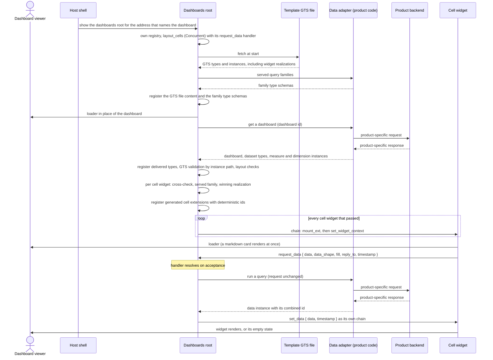

**Description**: The dashboard opens, the dashboards root loads it through the data adapter, every cell mounts its widget with its context, and every data widget asks for its data and renders it.

1. The host shows the dashboards root: as a routed screen extension for the route that names the dashboard, or as code in the shell with the dashboard identifier from the host's address. As a screen extension, the dashboards root builds its own registry in its first mount. It registers `layout_cells` with the Concurrent strategy, its `request_data` handler, and theme and language as shared properties.
2. At start it fetches the template's GTS file and registers its types and instances, including the widget realizations. It registers the family type schemas that the data adapter's served-families declaration returns. As a screen extension, it also registers the `widgets` manifest and every manifest whose entries a registered realization names, with their entries, from the manifest channel in its own registry.
3. It shows a loader in place of the dashboard and calls "get a dashboard". The data adapter returns the dashboard with its dataset types and measure and dimension instances. When the data adapter returns nothing, the loader stays.
4. It registers the delivered measure and dimension instances, then the dataset types. It validates the dashboard with GTS validation and attributes each failure by its instance path: a failure outside every cell's `widget` and `larger_view` path is dashboard-level. It then runs the layout checks, and the failures of one pass are collected. A dashboard-level failure is the dashboard-level cannot-show state (Cannot-Show States, below).
5. For each cell widget: a GTS failure under its `widget` path, which includes the check of its query against its dataset, gives the cell-level cannot-show state; otherwise it runs the member-kind checks and the cross-checks. For a data widget, it checks that the query family is served. It picks the winning realization. A widget that fails any of these steps gets the cell-level cannot-show state; the other cells continue.
6. It registers one generated cell extension per remaining cell widget, with its deterministic id and `entry` from the realization.
7. For each cell, it runs one chain: `mount_ext`, then `set_widget_context` with the widget, its `data_shape`, `fill` and member metadata for a data widget, and `larger_view` for a cell that defines one. The Concurrent strategy creates a container, and the domain's mounter places it in the cell. A failed mount or context gives that cell the cannot-show state.
8. A `markdown_card` renders at once. A data widget shows its loader and sends `request_data` to `layout_cells`. The dashboards root accepts it, calls "run a query" with the request unchanged, and sends `set_data` with the returned data instance and the copied timestamp to `reply_to`. FrontX validates the action against the data shape that the data instance's id names, and the owner drops an instance whose shape differs from the request's `data_shape`. The widget applies the answer when its timestamp equals that of its latest request, and renders its data or its empty state.
9. After that, nothing changes without the viewer. Nothing is refreshed in the background, and the widgets neither compute nor narrow their data.
10. When the dashboards root mounts and already holds that dashboard loaded, for example when the viewer returns to it, it runs only step 7 for its cells, without loading.

#### Query Change

- [ ] `p1` - **ID**: `cpt-frontx-dashboard-seq-query-change`

**Use cases**: `cpt-frontx-dashboard-usecase-view-dashboard`

**Actors**: `cpt-frontx-dashboard-actor-dashboard-viewer`, `cpt-frontx-dashboard-actor-consuming-backend`

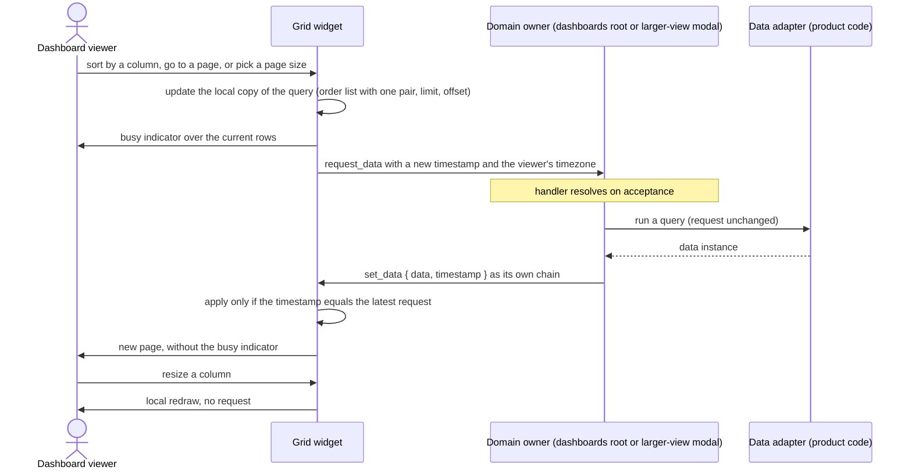

**Description**: An interaction that changes a widget's query asks for new data; an interaction that changes only presentation redraws locally.

1. The viewer clicks the header of a column whose `sortable` is set, uses the pager, or picks a page size from `page_sizes`.
2. The widget updates its local copy of the query, which is never saved, under the paging rules of [ADR-0005](ADR/0005-data-grid-library-v1.md). A sort sets `order` to a list holding one `[member, direction]` pair and resets `offset` to 0. A page control sets `offset`. A new page size sets `limit` and resets `offset` to 0. The query keeps `total: true`.
3. It sends `request_data` with a new timestamp, with `timezone` set to the browser's resolved IANA time zone name, and shows a busy indicator over the current rows, which stay visible.
4. The domain owner passes the request unchanged to the data adapter and answers `set_data` with the copied timestamp. The data adapter returns the page and `total` under the obligations of section 3.3. When it pages locally, it does so only over a complete, unpaged backend result.
5. The widget applies the answer only when its timestamp equals that of its latest request. An answer to an older request is dropped, so fast clicks show the result of the last one.
6. Resizing a column changes only the column width. The grid redraws locally, sends no request, and never saves the width.
7. The same rules hold for a grid in the larger view, with the larger-view modal as the domain owner.

#### Larger View Open

- [ ] `p1` - **ID**: `cpt-frontx-dashboard-seq-widget-modal-open`

**Use cases**: `cpt-frontx-dashboard-usecase-view-dashboard`

**Actors**: `cpt-frontx-dashboard-actor-dashboard-viewer`, `cpt-frontx-dashboard-actor-host-application`

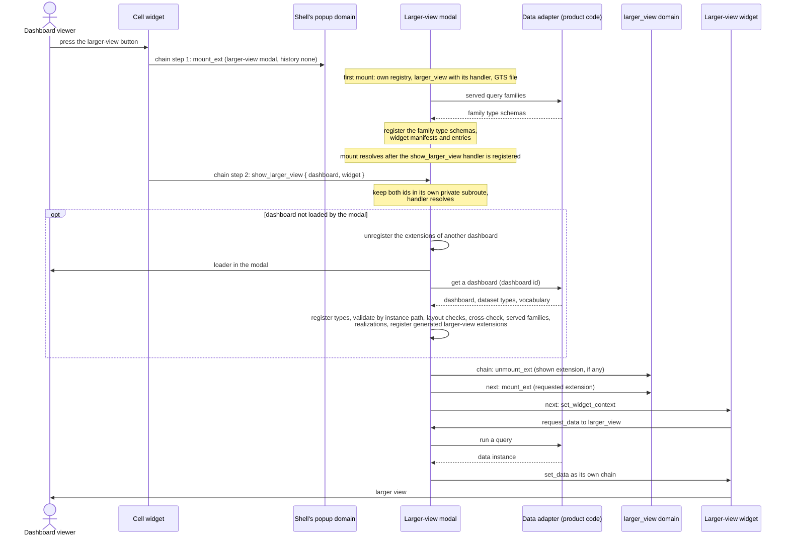

**Description**: The button of a cell widget opens that cell's larger-view widget in the larger-view modal. Nothing is registered into the shell's registry on the way.

1. The cell widget shows the button only when its `set_widget_context` carries `larger_view`. The viewer presses it.
2. The cell widget runs one chain: `mount_ext` of the larger-view modal in the shell's `popup` domain with `history: "none"`, then `show_larger_view` with the dashboard id and the larger-view widget id from its context. It takes the `popup` domain id from the shell constants by role, and the larger-view modal's fixed id from the template's identifiers. FrontX delivers both steps to their targets.
3. On its first mount, the larger-view modal builds its own registry, registers `larger_view` with the Optional strategy and its `request_data` handler, publishes theme and language on it, loads the template's GTS file, and registers the family type schemas and the manifests with the `widgets` entries. Its `mount` resolves only after its `show_larger_view` handler is registered. The shell's modal container shows it in the shell's modal area.
4. The `show_larger_view` handler keeps `dashboard` and `widget` as parameters of the modal's own private subroute and resolves.
5. When the modal has not loaded that dashboard, it unregisters the generated extensions of the dashboard it had loaded, if any, shows a loader, and calls "get a dashboard". It registers the delivered types, validates the dashboard with GTS validation by instance path, runs the layout checks, cross-checks each larger-view widget that passed, checks the served query families, picks realizations, and registers one generated extension per larger-view widget in `larger_view`. When it has loaded that dashboard, it registers nothing.
6. It runs one chain: `unmount_ext` of the shown larger-view extension, which does nothing when none is shown, then `mount_ext` of the requested one, then `set_widget_context`. Every larger-view widget therefore starts from a fresh mount followed by its context. A requested id that is not in the dashboard, or a widget that failed its checks, shows the cannot-show state in the modal instead.
7. A data widget sends `request_data` to `larger_view`, and the larger-view modal answers with `set_data` through the data adapter. A `markdown_card` renders at once. A grid in the larger view sorts and pages by the Query Change sequence.
8. Failure: if `mount_ext` of the larger-view modal fails, for example on a host without the modal container, no larger view appears and the dashboard is unchanged. A chain reports nothing to its sender (FrontX ADR-0007), so the cell widget is not notified; the next press starts a new opening.

#### Larger View Refresh

- [ ] `p2` - **ID**: `cpt-frontx-dashboard-seq-larger-view-refresh`

**Use cases**: `cpt-frontx-dashboard-usecase-view-dashboard`

**Actors**: `cpt-frontx-dashboard-actor-dashboard-viewer`, `cpt-frontx-dashboard-actor-host-application`

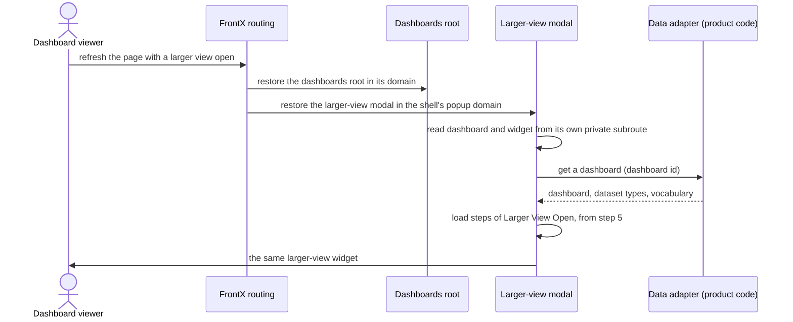

**Description**: An open larger view is open again after a page refresh, through the larger-view modal's static route and its own private subroute.

1. FrontX routing restores each routed extension that is registered when its domain takes its first resolution. The larger-view modal is registered statically with its route by the shell's bootstrap, so the shell's `popup` domain restores it. The dashboards root is restored by FrontX routing when it is a routed screen extension, and is shown by the shell as on every load when it is shell code; it runs Initial Load.
2. When FrontX routing gives the larger-view modal its entry back, with the parameters of the address the page was loaded with, the modal reads `dashboard` and `widget` from its own private subroute. No other runtime reads or writes that subroute.
3. These ids are untrusted input from the page address. The modal gets the dashboard only through the data adapter, which owns access. A dashboard that the data adapter does not return leaves the modal's loader; a widget id that is not in the dashboard shows the modal's cannot-show state.
4. The modal continues from step 5 of Larger View Open. `larger_view` has no route, so nothing in it depends on what was registered when the page loaded.

#### Larger View Close

- [ ] `p2` - **ID**: `cpt-frontx-dashboard-seq-larger-view-close`

**Use cases**: `cpt-frontx-dashboard-usecase-view-dashboard`

**Actors**: `cpt-frontx-dashboard-actor-dashboard-viewer`, `cpt-frontx-dashboard-actor-host-application`

```mermaid
sequenceDiagram
    actor U as Dashboard viewer
    participant M as Larger-view modal
    participant MC as Shell's modal container
    participant PD as Shell's popup domain

    alt close button
        U->>M: press the close button
        M->>PD: unmount_ext (the larger-view modal, history none)
    else click outside
        U->>MC: click outside the modal
        MC->>PD: unmount_ext (the occupant)
    end
    PD->>M: unmount
    Note over M: subroute leaves the address with it;<br/>keeps the loaded dashboard and its generated extensions
    U->>U: back on the unchanged dashboard
```

**Description**: The larger view closes by its own close button or by a click outside it, and the viewer returns to the unchanged dashboard.

1. The larger-view modal's close button sends `unmount_ext` of the larger-view modal to the shell's `popup` domain with `history: "none"`. A click outside the modal is handled by the shell's modal container, which unmounts the occupant with `unmount_ext`.
2. The larger-view modal's subroute leaves the address with it.
3. The larger-view modal keeps the loaded dashboard and its generated extensions, because its nested registry and its registrations survive an unmount (FrontX ADR-0008). The next opening of a larger view of the same dashboard registers nothing and goes straight to step 6 of Larger View Open.
4. While the larger view is open, the shell's modal container keeps keyboard focus inside it, so the viewer reaches no other part of the page, and the dashboards root never closes it.

#### Cannot-Show States

- [ ] `p1` - **ID**: `cpt-frontx-dashboard-seq-cannot-show`

**Use cases**: `cpt-frontx-dashboard-usecase-view-dashboard`, `cpt-frontx-dashboard-usecase-provide-dashboard`

**Actors**: `cpt-frontx-dashboard-actor-dashboard-viewer`, `cpt-frontx-dashboard-actor-consuming-backend`

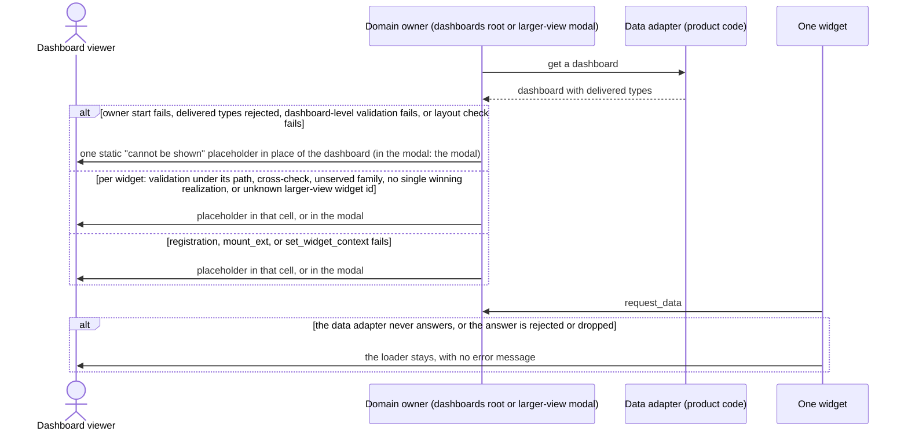

**Description**: Failures that the template detects show one static "cannot be shown" placeholder, at dashboard level or at widget level. The domain owner shows it, and writes a diagnostic to the developer log. There is no failure class and no error message. The diagram shows the paths one after another; each can occur on its own.

1. **Dashboard level.** The owner's domain registration fails at start, GTS rejects a delivered type (a dataset type whose query family is not served is skipped and is a widget-level case, item 2), a GTS validation failure lies outside every cell's `widget` and `larger_view` path, or the layout fails its checks (bounds through GTS validation, then overlap, `x + w` above 60, a repeated widget id; the failures of one pass are collected). The dashboards root shows the placeholder in place of the dashboard and mounts no cells. In the larger-view modal, the modal shows it.
2. **Widget level.** The triggers are: a GTS validation failure lies under a cell's `widget` or `larger_view` path, or a cell widget or a larger-view widget fails its cross-checks: the registered-instance check (a query member that names no registered instance), the member-kind check, the `order` member check, the operator-kind check, the date, filter value and time dimension checks, or the grid checks; its query family is not served, including a query that names a dataset type the owner skipped; a leading `unmount_ext` fails before a larger view is shown; no widget realization wins, because there is none or the highest weights tie; its extension fails to register or to mount; or `set_widget_context` fails. That cell, or the modal for a larger-view widget, shows the placeholder; the other cells are unaffected. Each widget is validated on its own, so a failure belongs to its own cell or larger view. Known limit: a FrontX mount timeout, or a queued action that FrontX replaces outside the owner's wrapper, leaves a cell empty without a placeholder.
3. **Unknown larger-view widget id.** In the larger-view modal, a requested larger-view widget id that is not in the loaded dashboard shows the placeholder in the modal.
4. **No template GTS file.** When the file cannot be fetched, no realization is registered, so every widget gets the widget-level placeholder because no realization wins. The diagnostic names the file.
5. **Data that never arrives is not a cannot-show state.** When the data adapter returns no dashboard, the dashboard area keeps its loader. When it never answers a `request_data`, that widget keeps its loader. The owner drops an answer whose shape differs from the request's `data_shape` before it sends `set_data`; FrontX validates the `set_data` against the shape that the instance's own `id` names and rejects a violation. Either counts as an answer that never arrives. The template shows no error message and has no timeout; the PRD states this limitation and its risk.
6. **Backend errors, access and the session** belong to the data adapter. What it does with them, for example returning no dashboard, decides what the viewer sees under item 5.

Every loader, busy, empty and cannot-show state has a default English wording, specified in FEATURE `widget-catalog`. The domain owners and every widget localize their own wording and value formatting for the host language.

#### Theme Switch

- [ ] `p2` - **ID**: `cpt-frontx-dashboard-seq-theme-switch`

**Use cases**: `cpt-frontx-dashboard-usecase-view-dashboard`

**Actors**: `cpt-frontx-dashboard-actor-dashboard-viewer`, `cpt-frontx-dashboard-actor-host-application`

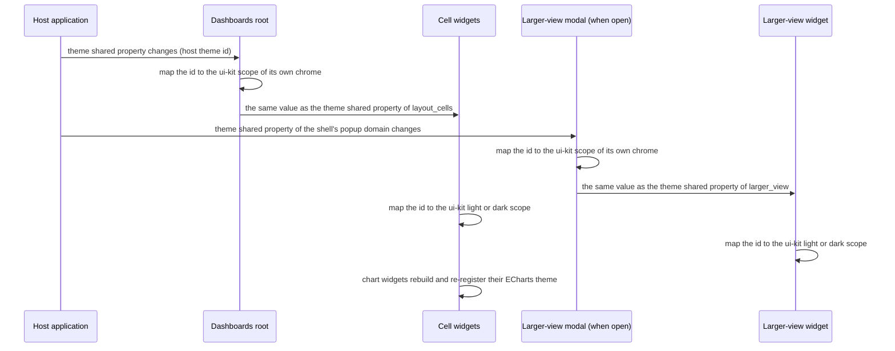

**Description**: A host theme change reaches the dashboards root, every mounted widget, and an open larger view as a shared-property change only, without a request.

1. The host updates its theme shared property with the new host theme id.
2. The dashboards root maps the id to the light or dark scope of `@gears-frontx/ui-kit` for its own chrome and publishes the same value, unchanged, as the theme shared property of `layout_cells`.
3. When a larger view is open, the larger-view modal receives the new value from the shell's `popup` domain, maps it for its own chrome, and publishes it unchanged on `larger_view`.
4. Each widget maps the id to the kit's light or dark scope, the way `template-mfe` does; the mapping is specified in FEATURE `widget-catalog` and FEATURE `mfe-entries`. Chart widgets rebuild their `frontx-dashboard` ECharts theme from the kit tokens and re-register it; grid row colours follow the kit tokens. Nothing is fetched, no widget sends `request_data`, no loader shows again, and nothing is remounted.

#### Dashboard Teardown

- [ ] `p2` - **ID**: `cpt-frontx-dashboard-seq-teardown`

**Use cases**: `cpt-frontx-dashboard-usecase-view-dashboard`

**Actors**: `cpt-frontx-dashboard-actor-dashboard-viewer`, `cpt-frontx-dashboard-actor-host-application`

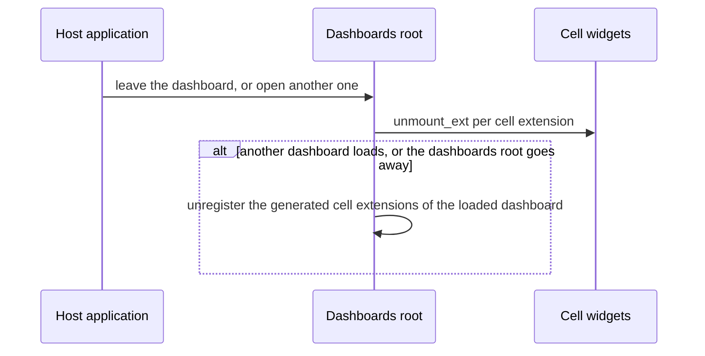

**Description**: Leaving a dashboard or opening another one releases what the dashboards root mounted.

1. When the viewer leaves the dashboard or opens another one, the dashboards root unmounts every cell extension with `unmount_ext`.
2. When it loads another dashboard, and when it goes away itself, it unregisters the generated cell extensions of the dashboard it had loaded. Loading the same dashboard again registers the same ids.
3. The dashboards root keeps no widget data between requests, so there is no data held by the owner to release. It sends `set_data` only to a widget extension that is still mounted; an answer for an unmounted widget is dropped, and the timestamp rule covers any answer that still arrives.
4. When the dashboards root mounts again and already holds that dashboard loaded, its generated extensions are still registered, so it mounts the cells again without loading. It runs only the mount chain of each cell.
5. The dashboards root sends nothing to the larger-view modal. The larger-view modal keeps its loaded dashboard and generated extensions while it is closed, and unregisters them only when it loads a different dashboard.

#### Consumer-Side Dashboard Generation (Context)

- [ ] `p2` - **ID**: `cpt-frontx-dashboard-seq-consumer-generation`

**Use cases**: `cpt-frontx-dashboard-usecase-provide-dashboard`, `cpt-frontx-dashboard-usecase-view-dashboard`

**Actors**: `cpt-frontx-dashboard-actor-template-consumer`, `cpt-frontx-dashboard-actor-consuming-backend`, `cpt-frontx-dashboard-actor-dashboard-viewer`

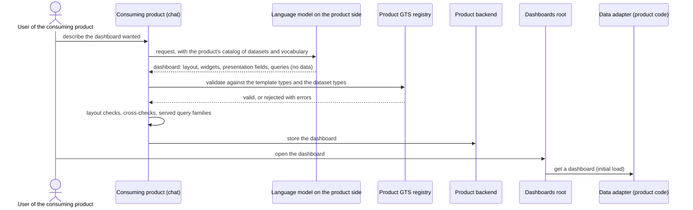

**Description**: This sequence runs outside the template and is shown only as context for what the template's types must support. A consuming product may generate dashboards, for example when a user types a request in a chat and a language model on the product side writes the dashboard. The model writes queries against the product's datasets, from their JSON Schema enums and the product's catalog of datasets and vocabulary; it never writes data. Generation belongs to the consuming product, not to the template.

1. The product has registered the template's GTS types, its query families and datasets, and its measure and dimension instances in its own GTS registry.
2. The generator writes one dashboard: an embedded layout whose cells embed widget instances of the 9 widget types, each with its presentation fields and, for a data widget, its query. It assigns the UUIDs of the dashboard, widget and query identifiers.
3. The product validates the dashboard against the registered types (GTS OP#6 for instances, with the abstract-type and reference rules); the one validation also checks each widget's query against its dataset. It runs the layout checks and the cross-checks of section 3.1 and checks that its data adapter serves every query family. It rejects a dashboard that fails.
4. The product stores the dashboard. It stores no data.
5. When a user opens the dashboard, Initial Load runs unchanged: the dashboards root cannot tell a generated dashboard from a written one.

### 3.7 Database schemas & tables

Not applicable. The template persists nothing: there is no database, no browser storage and no server component. State lives in browser memory only:

- The dashboards root holds its loaded dashboard and the generated extensions it registered, while the dashboard is open.
- The larger-view modal holds the dashboard it loaded and its generated extensions, also while it is closed, and releases them when it loads a different dashboard.
- Each widget holds the data it was last sent and its local copy of its query; neither is saved. A resized column width lasts while the dashboard is open.
- The FrontX GTS type store holds the registered types and instances: the template types, the template's GTS file, the query families, and the dataset types and vocabulary instances delivered with each dashboard. The store has no removal. Whether validating dashboards and actions also registers instances, so that the store grows with each load and each action, is an open question (section 4).

Their shapes are defined by the types of section 3.1.

### 3.8 Deployment Topology

- [ ] `p2` - **ID**: `cpt-frontx-dashboard-topology-overlay-packages`

The template ships as source, not as a service. A consuming product copies it into its FrontX application built on `template-shell` and adapts its copy, including where the dashboards root runs. Its code lives in two package subtrees:

| Subtree | Content |
|---------|---------|
| `src-app/mfe_packages/dashboard/` | The GTS types of `dashboard_m` and `dashboard_v`; the dashboards root code, with its entry and routed screen extension when it is a screen extension; the larger-view modal's entry and static extension; the code both owners carry: the data adapter interface, the trait helper, the GTS file loader and the "cannot be shown" placeholder; the template's GTS file with the 9 widget realizations; the package manifest. No data adapter implementation. |
| `src-app/mfe_packages/widgets/` | One manifest, 9 widget entries, and the shared widget chrome with the title, the larger-view button, the loader, the busy indicator and the empty state. No data-request code beyond the `request_data` action, and no error chrome. |

The product supplies its data adapter at one place: the dashboards root and the larger-view modal each create it through a single factory that the product provides in its own files, and product code lives outside template-owned files so that a release merge does not conflict. The product adds this product-supplied implementation to its copy of the template. A product that replaces how a widget type is shown adds its own package with its entry and a replacement realization in its copy of the template's GTS file (section 3.3). The template's consumer guide ships with its source (`cpt-frontx-dashboard-nfr-consumer-docs`). Template changes reach a product's copy when the product merges a template release. The release notes of each release list the changes to the contract: the query format, the data shapes, the fill modes, the data adapter interface and the trait helper. At run time, the shell bootstrap registers the larger-view modal's static extension, the entries, and, when it is a screen extension, the dashboards root's routed extension. Each domain owner fetches the template's GTS file at start and loads dashboards through the data adapter. The shell must render a modal container for its `popup` domain (section 3.5). Every template MFE lists its packages in its manifest's `shared` array (section 3.9). The documents under `template-dashboard/architecture/` are not shipped.

**Operations dispositions.** The template is source code with no service of its own, so the following are not applicable (PRD section 6.2):

- **Observability, SLOs and alerting**: not applicable because the template runs no service and has no availability target. It writes development diagnostics, including every cannot-show cause, to the browser console; the consuming product owns monitoring, telemetry and alerting.
- **Secret management**: not applicable because the template holds no secret and no backend configuration. The data adapter owns the session and any credential, inside the product's code.
- **Cost estimation**: not applicable because the template provisions no infrastructure. Its only costs are client-side download, memory and rendering, which the budgets in section 3.9 bound; serving dashboards and data is a cost of the consuming product.
- **Recovery and rollback**: not applicable because the template holds no state to recover. A consuming product rolls back by shipping its previous build, and opening a dashboard again restores the view.
- **Environment promotion and infrastructure as code**: not applicable because the template provisions no environment and no infrastructure. It ships as source inside the consuming product's build, which the consuming product promotes.

**Performance, integration and business dispositions.**

- **Scaling, latency allocation and content delivery network**: not applicable because the template runs no service and serves no files itself; it serves its GTS file as part of the product's build. The only latency budget is the end-to-end initial-render budget in the browser (section 3.9).
- **Event architecture**: not applicable because the template neither publishes nor consumes events. It uses FrontX actions and shared properties, and calls the data adapter in-process.
- **Interface versioning beyond section 3.3**: not applicable because the template defines no backend interface. The data adapter interface and the trait helper signature it calls are classed as product-supplied implementations, and their changes follow the API Stability Classification in section 3.3.
- **Time to market**: not applicable because the template has no release date or market commitment of its own; its consuming products set those.

**Security dispositions.** The template is browser code that presents what the product's data adapter returns. It has no sign-in or session flow.

- **Trust boundaries**: the browser, where the dashboards root, the larger-view modal and the widget extensions run inside the host application; the product's data adapter, which runs in the runtime of the domain owners and is the only path to a backend; and the host application, which owns the session. The template adds no boundary of its own.
- **Untrusted inputs**: the dashboard identifier in the address; the dashboard and larger-view widget ids in the larger-view modal's subroute; the dashboard, including a generated one; the dataset types and vocabulary instances delivered with it; and every data instance. The owner registers delivered types only after the template types, so a delivered type cannot take the place of a template type, and it validates the dashboard and each widget before anything mounts. FrontX validates every `set_data` against its data shape. Whatever fails is a cannot-show state or a kept loader (section 3.6).
- **Authorization**: the product's data adapter and backend authorize every dashboard and every query. The template makes no access decision, and an identifier is not an authorization: holding a dashboard id or a widget id grants no access.
- **Output safety**: `markdown_card` renders typical markdown (CommonMark, including links and images) and shows embedded HTML as plain text, never rendered, under the rules of FEATURE `widget-catalog`. Grid cells show values as text.
- **Supply chain**: third-party runtime libraries are limited to those listed in section 3.5 under the licensing constraint and pass the package-wide license check, and FrontX packages are pinned to exact published versions (section 3.5, pin rule).
- **Not applicable**, each for the reason given:
  - Authentication and session management, including multi-factor authentication, federated sign-in and session renewal: the template has no such flow; the host application and the data adapter own the session.
  - Service-to-service authentication and credential storage: the template runs no service and holds no credential.
  - Roles and a permission matrix: the template makes no access decision.
  - Encryption at rest, key management and secure disposal: the template stores nothing (section 3.7).
  - Encryption in transit, network segmentation, firewall rules and a CORS policy: template code sends no request to a backend; the data adapter's transport belongs to the product.
  - Data classification, personal data handling and masking: the template shows delivered data unchanged, and the data adapter decides what it delivers (`cpt-frontx-dashboard-constraint-licensing-compliance-resources`).
  - Audit logging, log retention, security monitoring and incident response: the template runs no service and writes only development diagnostics to the browser console.

### 3.9 Budgets and NFR Realization

**Reference dashboard.** One dashboard whose layout holds one widget of each of the 9 widget types, and in which every cell defines a larger-view widget. The grid's dataset spans many pages, and the grid offers a page size of 500. The chart widgets are sized to the largest expected charts. Its queries of the other widget types have bounded result sizes, an assumption of every budget below. It is used for the initial-render measurement, the bundle measurement, the large-grid check and the accessibility walkthrough. Provisional assumption, not sourced; fixed together with the first measurement.

**Test data adapter.** All measurements use a test data adapter that names no backend. It returns the reference dashboard, its dataset types and its vocabulary instances, and fills every query from fixtures in memory by the requested fill mode.

**Initial render (provisional).** The budget is p95 under 3 seconds from the moment the dashboard viewer opens the dashboard address to the moment every data widget presents its data. The template's GTS file, the dashboard load, every query, and the evaluation of every MFE and shared package are included. The reference conditions are:

| Condition | Value |
|-----------|-------|
| Reference device | Business laptop with 4 physical CPU cores and 16 GB of memory, latest stable Chromium-based browser, no CPU throttling |
| Network profile | Browser network emulation of 100 Mbit/s downstream, 20 Mbit/s upstream and 20 ms round-trip time, applied to the template's files |
| Data adapter response time | The test data adapter answers "get a dashboard" and every "run a query" after a fixed delay of 250 ms. Provisional assumption, not sourced; re-measured together with the provisional initial-render budget. |
| Load state | Template bundle files are already downloaded before the run; loading and evaluating each entry, the GTS file, the dashboard load and every query are inside the measured window. |
| Sample size | At least 30 runs per measurement; p95 is computed over those runs. Provisional assumption, not sourced; re-measured together with the provisional initial-render budget. |

The budget is re-measured under these conditions and then confirmed or revised. The product's data adapter and backend are outside it: in production, the product's answer time adds to the measured time. This includes the time the data adapter spends paging through backend results to complete a query without `limit`.

**Large grids.** The `grid` widget always pages, with at most 500 rows per page, and renders the rows of a page virtualized, so the DOM holds only the rows in view. Under the reference conditions, scrolling through a 500-row page of the reference grid, shown in its cell, is checked against `cpt-frontx-dashboard-nfr-large-table`: the view never stops responding for longer than 100 ms (provisional). The measured figures are recorded with the initial-render results. The 500-row bound applies to the grid only. Queries of other widget types without `limit` have no row bound, and their result size is the product's responsibility (section 2.2, resource constraints).

**Bundle budget (provisional).** The budget measures transferred gzipped bytes with an empty browser cache. Every figure is re-measured on production builds and confirmed or revised.

| Unit | Provisional budget | Counting rule |
|------|--------------------|---------------|
| Dashboards root | under 500 KB gzipped | Its own code plus every shared dependency it fetches itself, on a cold load of the reference dashboard. |
| Larger-view modal | under 500 KB gzipped | Its own code plus every shared dependency it fetches itself, on the first opening of a larger view after that load. |
| Each widget entry | under 100 KB gzipped | Its own code only, including the shared widget chrome it bundles; shared dependencies are excluded. |
| Page total | no cap | Every byte transferred on the cold load and the first opening; each shared dependency, such as ECharts, TanStack Table, the virtualizer, ui-kit and the FrontX packages, is counted once. Recorded with the results. |

The product's data adapter and its backend client are bundled with the domain owners but are product code, counted outside these figures. Evaluation cost is not part of the bundle budget. Each MFE instance evaluates its own copy of every package it uses, and that cost is covered by the initial-render budget.

**Dependency sharing rules.** Every template MFE, the dashboards root when it is a screen extension, the larger-view modal and every widget entry, lists its packages in the `shared` array of its manifest, so each is built as a shared dependency, one standalone chunk each. FrontX fetches the source text of a shared dependency once only when every template MFE publishes the same `contentHash` for it (FrontX ADR-0034), and that cache reaches the whole realm (FrontX ADR-0035). The template assumes equal content hashes, which holds when all its MFEs are built together from one pinned set of package versions. FrontX still gives every MFE instance its own evaluated copy (FrontX ADR-0011). Source reuse saves fetches, not evaluation, and is never counted as a reduction of per-instance cost. Every listed package passes the package-wide license check.

**Per-instance memory.** FrontX holds per-instance memory per extension id for the life of the page (FrontX ADR-0011). The deterministic ids of generated extensions keep it bounded by the number of distinct widgets and roles that the page has shown: loading the same dashboard again, in the dashboards root or in the larger-view modal, reuses the same ids.

**Visual quality.** All styling comes from `@gears-frontx/ui-kit` tokens in the light or dark scope that the host theme id maps to. Chart widgets build one ECharts theme from the same tokens, grid row colours use kit tokens, and no widget adds manual styling.

**Accessibility.** Every control follows the host accessibility policy. The larger-view button, the larger-view modal's close button, the grid's sort headers, pager, page-size choice and column resize handles are keyboard-operable. The grid shell exposes ARIA grid semantics, including row counts, positions and sort state for virtualized rows. No widget conveys meaning by color alone: grid row colours carry an icon with an accessible name (ADR-0005), and chart series are labelled or differ in another visible way. The modal frame, the focus rule and the click outside come from the shell's modal container, a host requirement that `template-shell` does not meet (section 4, prerequisites); the template does not supply them itself. The keyboard-only walkthrough uses the reference dashboard.

## 4. Additional context

**PRD open questions answered here.**

| Question | Resolution | Status |
|----------|------------|--------|
| Q1 download-size budget | Section 3.9 counting rule and provisional figures | open: measurement task (open question 1 below) |

**Prerequisites outside the template.** The owner of each is the template architect.

- **(a) FrontX on GTS v0.17.** The FrontX gts-plugin, and the `template-shell` build that uses it, must run GTS v0.17, so that `x-gts-instance-ref`, `x-gts-type-ref`, `x-gts-abstract` and traits apply as v0.17 defines them. FrontX's own base schemas (action, domain and extension bases) must use the v0.17 reference keywords (`x-gts-type-ref`, `x-gts-instance-ref`) before the template's derived types register. On an older GTS version a dashboard cannot be validated end to end. The template uses no interim workaround.
- **(b) A realm-shared GTS type store.** The FrontX release must provide the GTS type store that every runtime of a realm sees (FrontX gts-plugin ADR-0001). Nested owners validate chains that reference the shell's `popup` domain and the larger-view modal's static extension, which are registered in the shell's registry, so the type store must be shared. The store is shared among provider copies that agree on store format, GTS library line and built-in set, so the shell, the dashboards root and the larger-view modal must run such compatible copies, and none uses the isolation option. The template adds no shared state of its own.
- **(c) A modal container for the shell's `popup` domain.** `template-shell` must render a container for its `popup` domain that shows the occupant in the shell's modal area, keeps keyboard focus inside the modal while it is open, and unmounts the occupant with `unmount_ext` on a click outside it (section 3.5). Without it, no larger view can be shown, while the rest of the dashboard works.
- **(d) Data access for every viewer.** The consuming product's data adapter and backend must let every viewer who may see a dashboard get the data of its widgets. Without it, a viewer sees widgets that keep their loader, depending on what the data adapter does.
- **(e) Polymorphic validation of embedded instances.** The FrontX GTS plugin must validate each embedded instance against the type its own id names, even where the property's schema names a base type. The GTS specification does not state this as a rule; it is a capability the template requires of the plugin. Conformance test: an embedded widget whose id names a widget type is validated against that type's limits; an embedded query is validated against the enums of its dataset; an embedded id whose rightmost type is abstract is rejected (GTS specification v0.17, sections 3.7 and 9.11, where abstract types have no direct instances).
- **(f) Reference lookup off.** Dashboard validation runs with reference-existence lookup off. The specification suggests lookup modes such as none, any-present and any-valid as a policy. Under a lookup mode the anonymous combined ids of the dashboard, widget, query and data instance would be looked up and fail, because they are never registered. The plugin must let the owners select lookup off. Member existence is enforced by the owner's load-time cross-check; a widget whose id names an unknown type fails polymorphic validation.
- **(g) First registration of an id wins.** The template expects the FrontX type store to keep the first registration of an id, because the specification leaves mutability to the implementation (GTS specification v0.17, sections 4.2 and 6). Test: register a dataset type, register different content under the same id, and confirm that the first stays in effect. The template's safety does not depend on it: the owner rejects a delivered type id that equals a template type id before it registers a delivery.
- **(h) Combined anonymous instance ids.** The FrontX GTS plugin must accept a combined anonymous instance id, a type chain followed by a UUID, which the specification offers as an optional capability (GTS specification v0.17, section 3.7). Test: validate an instance whose id is a type chain followed by a random UUID.

**Handoffs to the FEATURE documents.**

- `dashboard-root-types`: the dashboard root with `id` (literal base operand), `name`, `description` and the embedded `layout`, without a theme; delivery of the dashboard together with its dataset types and vocabulary instances, and their registration before validation, the measure and dimension instances before the dataset types; the dashboard-level cannot-show triggers.
- `layout-types`: the layout and the cell as embedded object types without an identifier, with the cell's `widget` and optional `larger_view`; the coordinate bounds, the layout checks including a repeated widget id, and their order; the placement rule on the 60-column grid.
- `widget-catalog`: the widget base and the abstract data widget with `data` and the traits `data_shape`, `fill` and `member_kinds`; the 9 widget types with their query limits, including `compareDateRange` on `metric_card` only, `total` on `grid` only and no authored `timezone`, their presentation fields and `unevaluatedProperties: false`; the multi-measure types and the metric trend; the grid's `order` pairs; the grid's `columns`, `page_sizes`, `frozen_columns`, `column_groups`, `align`, `row_color` and local resizing; the cross-checks, including the `order` member check and the operator-kind check, and the member-kind check; the loader, busy, empty and cannot-show wordings; the empty label of a null dimension value; for `metric_card`, a null `value` is the empty state; the shared chrome with its larger-view button shown only with `larger_view`; the markdown rendering rules, with embedded HTML as plain text.
- `widget-data-catalog`: the data shape base with its literal base operand, the 8 data shapes with their combined instance ids, and the 5 fill modes with their exact rules, including the `from` grammar with `timeDimensions[0]`, omitted fields in `rows_by_member`, several measures in `x_series_value` and the two `compareDateRange` ranges in `scalar_with_series`; nullable measure and dimension fields.
- `extension-domain-catalog`: `layout_cells` (Concurrent) and `larger_view` (Optional) with their declarations and handlers; the 4 action types with their payloads, including which members' metadata `set_widget_context` carries (every query member); the larger-view modal and its nested domain; the UUIDv5 id rule of generated extensions; the algorithms that register generated extensions, answer a data request and tear down.
- `mfe-entries`: the widget realization type with `entry`, optional `larger_view_entry` and `weight`, and the 9 template realizations in the template's GTS file; the `widgets` manifest with 9 entries and their `actions` and `domainActions`; the larger-view modal's entry and static, routed extension; the dashboards root's entry and routed extension; the package contents of `dashboard`, with the data adapter interface, the trait helper and the GTS file loader; this FEATURE only packages the trait helper, whose contract the query vocabulary FEATURE owns; template changes by merging a release whose notes list the contract changes; the shared dependencies and the budget basis.
- The [query vocabulary FEATURE](./features/feature-query-vocabulary/FEATURE.md): the closed base query type with its subset, filter operators, time forms, time zone rule and the rules for `order`, `limit`, `offset` and `total`; the measure and dimension bases; the query members and the canonical member order; the rules for deriving query families and datasets with enums and traits; literal operands; no id-keyed maps; the trait helper contract (`cpt-frontx-dashboard-interface-trait-helper`), which this FEATURE owns.
- The [data adapter contract FEATURE](./features/feature-data-adapter-contract/FEATURE.md): the exact specification of `cpt-frontx-dashboard-interface-data-adapter`: its operations, the served query families, the fill-mode obligations, member mapping and the `timezone` pass-through, the default order, complete results with no cap, local execution and local aggregation, registry access per owner runtime, new query families as data adapter work, the return of the delivery set with the dashboard, under the rule of the dashboard-root-types FEATURE, the two-level cannot-show, data that never arrives, and the conformance cases.
- All domain-model FEATURE documents: every identifier-valued field uses `x-gts-type-ref`, `x-gts-instance-ref` or `x-gts-pattern-ref` (GTS v0.17) with a literal base operand where it names a base type; no separate `type` field; ids never as object keys; "widget type" as the only term for the 9 template widget types.

**Test approach.** The template adds no test infrastructure of its own; it uses the test tooling the repository already has. Every test that needs data uses a test data adapter that names no backend.

- **Schema tests**: for each data widget type, one accepted and one rejected query; misspelled presentation fields; `markdown_card` without `data`; queries outside the dataset's enums; invalid date ranges, filter value counts and `order` pairs; an authored `timezone`; literal base operands.
- **Unit tests per widget type**: rendering of each data shape, the loader, the busy indicator, the empty state, the timestamp rule, the metric trend, and markdown with embedded HTML; the sent query carries the viewer's `timezone` while the authored query has none; a null dimension value shows as an empty label.
- **Plugin conformance tests**: the tests of prerequisites (e) to (h) of section 4, and a reference keyword inside an `order` pair that names a wrong kind of id.
- **Trait helper tests**: the trait helper returns the RFC 7396 merge of the traits along the `$id` chain with the trait schema defaults filled in, and a failure with no partial result when a schema is missing.
- **Fill-mode conformance tests**: each fill mode produces the fields of section 3.1 from fixture results; an answer of another widget type's shape is dropped by the owner.
- **Integration tests of the domain owners with FrontX**: domain registration with `request_data` handlers; admission of widget entries into both domains; deterministic ids across repeated loads; unregistration on a different dashboard; handlers that resolve on acceptance with a slow data adapter; realization precedence; delivered measures and dimensions register before dataset types, and a changed dataset under the same id keeps the first registration; a delivery that holds a type id equal to a template type id is rejected before anything registers; an `order` pair whose first item is not a registered instance is rejected; both cannot-show levels; opening, closing and refreshing the larger view; nothing registered into the shell's registry.
- **Contract tests**: the data adapter interface against the conformance cases of the data adapter contract FEATURE.
- **End-to-end test data**: the reference dashboard of section 3.9.

**Open questions.** The owner of each is the template architect.

1. **Budget figures.** PRD Q1 and the provisional figures of section 3.9, including the initial-render budget, the bundle figures, the reference dashboard and the large-grid figure of `cpt-frontx-dashboard-nfr-large-table`: each is a measurement task under the conditions and counting rule of section 3.9.
2. **Reference existence (lookup mode).** The specification suggests a lookup mode (`none`, `any-present`, `any-valid`) as a policy for whether the target of a reference must exist. The template runs dashboard validation with lookup off, because the anonymous combined ids are never registered, and enforces member existence in the owner's cross-check. What remains open is whether the FrontX v0.17 gts-plugin lets the domain owners select lookup off (prerequisite (f); `cpt-frontx-dashboard-adr-shared-data-types-and-schemas`).
3. **Store growth.** If validation of dashboards and of every action registers instances in the GTS store, which has no removal, the store grows with each dashboard load and each action. This is checked with the v0.17 gts-plugin API.
4. **Layout details.** The row track size of the grid, which is the unit of `h`, and the reading and keyboard order of cells (`cpt-frontx-dashboard-adr-dashboard-layout-grid`).
5. **Chart details.** How a mounted chart re-themes on a scope switch, by a registered theme name per scope or by re-creating the instance; which ECharts specifiers are shared dependencies and which wrapper entry is used; and how charts meet the accessibility requirement through renderer choice, labelling and decals (`cpt-frontx-dashboard-adr-charting-library`).
6. **Routed extension details.** The route pattern and presentation label of the dashboards root's routed extension, the static route of the larger-view modal, and the form of the modal's private subroute parameters.
7. **Reference check inside `order` pairs.** The specification requires reference keywords to apply in array-item schemas, including `prefixItems` (GTS specification v0.17, section 9.6.3). Whether the FrontX v0.17 gts-plugin does so is a conformance test (`cpt-frontx-dashboard-adr-shared-data-types-and-schemas`, `cpt-frontx-dashboard-adr-query-vocabulary-and-datasets`). The dataset enum on the pair's first item and the owner's `order` member check enforce membership as a second layer.

**Risks.**

- **Unbounded query results.** A query without `limit` returns one row per combination of its groups, however many there are, and the data adapter and the backend carry that load (consequences of `cpt-frontx-dashboard-adr-query-vocabulary-and-datasets`). Authors and products bound the rows through the dataset's members, filters or a `limit` where the widget type allows it (section 2.2).

**Not covered by this design.**

- Consumer widget types and widget settings added by a consumer.
- Dashboard-wide filters that the viewer changes.
- Declarative dataset specs that a language model writes alongside a dashboard; a product may use them to define its own datasets without a template change.
- Running product code isolated from the domain owners (`cpt-frontx-dashboard-adr-data-adapter`, review trigger).
- Several dashboards roots in one application tree.
- A preset that bundles `template-shell` with the dashboard.

## 5. Traceability

- **PRD**: [PRD.md](./PRD.md)
- **ADRs**: [ADR/](./ADR/)
- **Decomposition**: [DECOMPOSITION.md](./DECOMPOSITION.md)
- **Features**: the FEATURE documents under [features/](./features/): the domain-model features `dashboard-root-types`, `layout-types`, `widget-catalog`, `widget-data-catalog`, `extension-domain-catalog` and `mfe-entries`, the [query vocabulary FEATURE](./features/feature-query-vocabulary/FEATURE.md), and the [data adapter contract FEATURE](./features/feature-data-adapter-contract/FEATURE.md).

**Allocation to features.** The DECOMPOSITION assigns the design elements of this document to the FEATURE documents. The dashboards root and the larger-view modal are shared by `extension-domain-catalog`, for the registration of generated extensions and the answers to data requests, and `mfe-entries`, for their entries, manifests and package contents. The data adapter interface is specified by the data adapter contract FEATURE, and the data adapter implementation belongs to no feature, because it is product code.

| Source ID | Realized in |
|-----------|-------------|
| `cpt-frontx-dashboard-fr-dashboards-root` | `cpt-frontx-dashboard-component-dashboards-root`, `cpt-frontx-dashboard-interface-template-domains`, `cpt-frontx-dashboard-interface-widget-realization`, `cpt-frontx-dashboard-principle-own-registry-registration`, `cpt-frontx-dashboard-principle-render-only-dashboards-root`, `cpt-frontx-dashboard-constraint-one-dashboards-root-per-tree`, `cpt-frontx-dashboard-seq-initial-load`, `cpt-frontx-dashboard-seq-teardown` |
| `cpt-frontx-dashboard-fr-data-adapter` | `cpt-frontx-dashboard-interface-data-adapter`, `cpt-frontx-dashboard-component-data-adapter`, `cpt-frontx-dashboard-principle-dashboards-root-orchestration`, `cpt-frontx-dashboard-seq-initial-load` |
| `cpt-frontx-dashboard-fr-backend-source` | `cpt-frontx-dashboard-interface-data-adapter`, `cpt-frontx-dashboard-component-dashboards-root`, `cpt-frontx-dashboard-component-larger-view-modal`, `cpt-frontx-dashboard-principle-render-only-dashboards-root`, `cpt-frontx-dashboard-seq-initial-load`, `cpt-frontx-dashboard-seq-consumer-generation`, section 3.5 |
| `cpt-frontx-dashboard-fr-loading-error-states` | `cpt-frontx-dashboard-seq-cannot-show`, `cpt-frontx-dashboard-seq-initial-load`, `cpt-frontx-dashboard-seq-query-change`, `cpt-frontx-dashboard-component-dashboards-root`, `cpt-frontx-dashboard-component-larger-view-modal`, `cpt-frontx-dashboard-component-widget-library` |
| `cpt-frontx-dashboard-fr-widget-catalog` | `cpt-frontx-dashboard-component-widget-library`, `cpt-frontx-dashboard-interface-widget-realization`, section 3.1 |
| `cpt-frontx-dashboard-fr-grid-sort-page` | `cpt-frontx-dashboard-seq-query-change`, `cpt-frontx-dashboard-component-widget-library`, section 3.1 (grid presentation fields) |
| `cpt-frontx-dashboard-nfr-large-table` | `cpt-frontx-dashboard-component-widget-library`, section 3.9 (Large grids) |
| `cpt-frontx-dashboard-fr-widget-modal` | `cpt-frontx-dashboard-component-larger-view-modal`, `cpt-frontx-dashboard-component-widget-library`, `cpt-frontx-dashboard-seq-widget-modal-open`, `cpt-frontx-dashboard-seq-larger-view-refresh`, `cpt-frontx-dashboard-seq-larger-view-close`, `cpt-frontx-dashboard-interface-host-actions`, `cpt-frontx-dashboard-interface-template-domains`, `cpt-frontx-dashboard-principle-own-registry-registration` |
| `cpt-frontx-dashboard-fr-theme`, `cpt-frontx-dashboard-nfr-visual-quality` | `cpt-frontx-dashboard-seq-theme-switch`, `cpt-frontx-dashboard-component-dashboards-root`, `cpt-frontx-dashboard-component-larger-view-modal`, `cpt-frontx-dashboard-component-widget-library`, section 3.9 (Visual quality) |
| `cpt-frontx-dashboard-fr-domain-model`, `cpt-frontx-dashboard-interface-domain-model` | Section 3.1, `cpt-frontx-dashboard-constraint-gts-id-convention`, `cpt-frontx-dashboard-principle-gts-contracts`, `cpt-frontx-dashboard-interface-widget-realization`, `cpt-frontx-dashboard-seq-consumer-generation` |
| `cpt-frontx-dashboard-fr-replacement-widget` | `cpt-frontx-dashboard-interface-widget-realization` (precedence and consumer replacement), `cpt-frontx-dashboard-component-gts-file-loader`, `cpt-frontx-dashboard-topology-overlay-packages` |
| `cpt-frontx-dashboard-contract-host-areas` | Host contract in section 3.5, `cpt-frontx-dashboard-constraint-role-based-host-ids`, `cpt-frontx-dashboard-constraint-shell-only-dependency` |
| `cpt-frontx-dashboard-contract-consuming-backend` | `cpt-frontx-dashboard-interface-data-adapter`, `cpt-frontx-dashboard-component-data-adapter`, section 3.5 (Consuming Product and Its Data Adapter) |
| `cpt-frontx-dashboard-nfr-compatibility` | `cpt-frontx-dashboard-constraint-shell-only-dependency`, `cpt-frontx-dashboard-constraint-role-based-host-ids`, `cpt-frontx-dashboard-topology-overlay-packages`, section 3.5 (pin rule), section 4 (prerequisites) |
| `cpt-frontx-dashboard-nfr-initial-render`, `cpt-frontx-dashboard-nfr-bundle-budget`, `cpt-frontx-dashboard-nfr-accessibility` | Section 3.9 |
| `cpt-frontx-dashboard-nfr-consumer-docs` | `cpt-frontx-dashboard-topology-overlay-packages` (consumer guide), `cpt-frontx-dashboard-interface-data-adapter` |
| `cpt-frontx-dashboard-adr-frontend-framework`, `cpt-frontx-dashboard-adr-template-packages-and-host-contract` | `cpt-frontx-dashboard-principle-per-instance-isolation`, `cpt-frontx-dashboard-principle-own-registry-registration`, `cpt-frontx-dashboard-constraint-shell-only-dependency`, `cpt-frontx-dashboard-topology-overlay-packages`, `cpt-frontx-dashboard-component-gts-file-loader`, `cpt-frontx-dashboard-component-trait-helper`, `cpt-frontx-dashboard-interface-trait-helper`, `cpt-frontx-dashboard-interface-data-adapter`, `cpt-frontx-dashboard-constraint-licensing-compliance-resources`, section 3.5 |
| `cpt-frontx-dashboard-adr-dashboard-layout-grid` | `cpt-frontx-dashboard-constraint-sixty-column-grid`, `cpt-frontx-dashboard-component-dashboards-root`, `cpt-frontx-dashboard-seq-cannot-show` |
| `cpt-frontx-dashboard-adr-shared-data-types-and-schemas` | Section 3.1, `cpt-frontx-dashboard-constraint-gts-id-convention`, `cpt-frontx-dashboard-principle-gts-contracts`, `cpt-frontx-dashboard-component-trait-helper`, `cpt-frontx-dashboard-interface-trait-helper`, `cpt-frontx-dashboard-component-gts-file-loader`, `cpt-frontx-dashboard-interface-data-adapter` (registry access) |
| `cpt-frontx-dashboard-adr-widget-type-and-mfe-realization`, `cpt-frontx-dashboard-adr-subject-agnostic-widget-catalog` | Section 3.1, `cpt-frontx-dashboard-interface-widget-realization`, `cpt-frontx-dashboard-component-widget-library` |
| `cpt-frontx-dashboard-adr-charting-library`, `cpt-frontx-dashboard-adr-data-grid-library` | `cpt-frontx-dashboard-component-widget-library`, `cpt-frontx-dashboard-seq-query-change`, section 3.9 |
| `cpt-frontx-dashboard-adr-theme-distribution` | `cpt-frontx-dashboard-seq-theme-switch`, `cpt-frontx-dashboard-component-dashboards-root`, `cpt-frontx-dashboard-component-larger-view-modal`, `cpt-frontx-dashboard-component-widget-library` |
| `cpt-frontx-dashboard-adr-extension-domain-taxonomy` | `cpt-frontx-dashboard-interface-template-domains`, `cpt-frontx-dashboard-interface-host-actions`, `cpt-frontx-dashboard-principle-own-registry-registration`, `cpt-frontx-dashboard-component-larger-view-modal`, `cpt-frontx-dashboard-seq-widget-modal-open`, `cpt-frontx-dashboard-seq-larger-view-refresh`, `cpt-frontx-dashboard-seq-larger-view-close`, `cpt-frontx-dashboard-seq-teardown` |
| `cpt-frontx-dashboard-adr-data-adapter` | `cpt-frontx-dashboard-interface-data-adapter`, `cpt-frontx-dashboard-component-data-adapter`, `cpt-frontx-dashboard-component-trait-helper`, `cpt-frontx-dashboard-interface-trait-helper`, `cpt-frontx-dashboard-component-dashboards-root`, `cpt-frontx-dashboard-component-larger-view-modal`, `cpt-frontx-dashboard-component-widget-library`, `cpt-frontx-dashboard-principle-render-only-dashboards-root`, `cpt-frontx-dashboard-principle-dashboards-root-orchestration`, `cpt-frontx-dashboard-seq-initial-load`, `cpt-frontx-dashboard-seq-query-change`, `cpt-frontx-dashboard-seq-cannot-show` |
| `cpt-frontx-dashboard-adr-query-vocabulary-and-datasets` | Section 3.1 (query vocabulary), `cpt-frontx-dashboard-principle-gts-contracts`, `cpt-frontx-dashboard-constraint-gts-id-convention`, `cpt-frontx-dashboard-interface-data-adapter`, `cpt-frontx-dashboard-component-data-adapter`, `cpt-frontx-dashboard-component-trait-helper`, `cpt-frontx-dashboard-interface-trait-helper`, `cpt-frontx-dashboard-seq-query-change`, `cpt-frontx-dashboard-seq-consumer-generation` |
