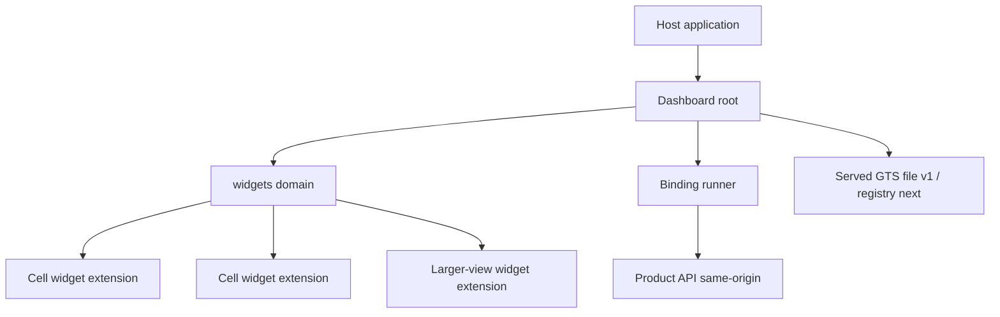
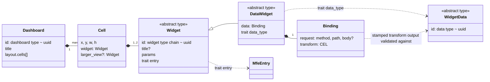
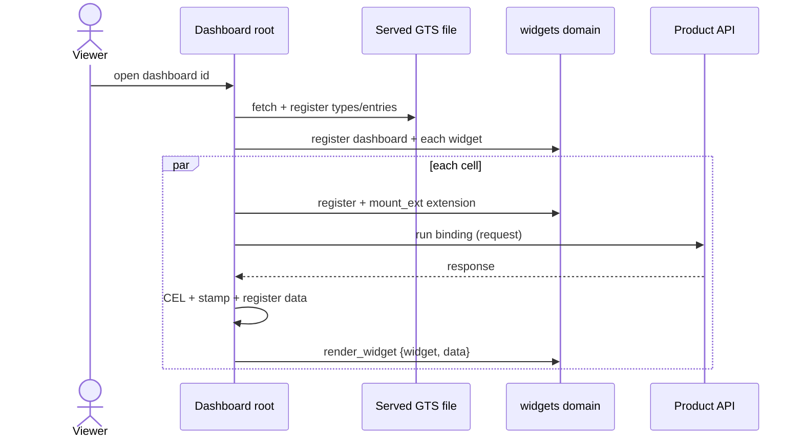

# Technical Design — Dashboard Template

- [ ] `p3` - **ID**: `cpt-frontx-dashboard-design-dashboard-template`

<!-- toc -->

- [1. Architecture Overview](#1-architecture-overview)
  - [1.1 Architectural Vision](#11-architectural-vision)
  - [1.2 Architecture Drivers](#12-architecture-drivers)
  - [1.3 Architecture Layers](#13-architecture-layers)
- [2. Principles & Constraints](#2-principles--constraints)
  - [2.1 Design Principles](#21-design-principles)
  - [2.2 Constraints](#22-constraints)
- [3. Technical Architecture](#3-technical-architecture)
  - [3.1 Domain Model](#31-domain-model)
  - [3.2 Component Model](#32-component-model)
  - [3.3 API Contracts](#33-api-contracts)
  - [3.4 Internal Dependencies](#34-internal-dependencies)
  - [3.5 External Dependencies](#35-external-dependencies)
  - [3.6 Interactions & Sequences](#36-interactions--sequences)
  - [3.7 Database schemas & tables](#37-database-schemas--tables)
- [4. Additional context](#4-additional-context)
  - [4.1 Budgets and NFR Realization](#41-budgets-and-nfr-realization)
  - [4.2 Operations, security and performance dispositions](#42-operations-security-and-performance-dispositions)
- [5. By Audience](#5-by-audience)
  - [5.1 Dashboard Author](#51-dashboard-author)
  - [5.2 Widget Author](#52-widget-author)
  - [5.3 Template Maintainer](#53-template-maintainer)
- [6. Worked Example (insight, example backend)](#6-worked-example-insight-example-backend)
  - [6.1 Types the example relies on](#61-types-the-example-relies-on)
  - [6.2 The dashboard instance](#62-the-dashboard-instance)
  - [6.3 What happens for the donut](#63-what-happens-for-the-donut)
- [7. Traceability](#7-traceability)

<!-- /toc -->

## 1. Architecture Overview

### 1.1 Architectural Vision

`template-dashboard` is a declarative, backend-agnostic dashboard template. A **dashboard author** writes one JSON per dashboard. A **widget author** adds or fixes a widget type at runtime, without a product redeploy. A **dashboard viewer** reads a dashboard whose widgets map data through a binding the author wrote. The product writes no data code: the dashboard root runs each widget's binding against the product's same-origin API.

The dashboard root renders a dashboard from its JSON, owns the `widgets` domain, generates one FrontX extension per cell (and per larger view), runs each binding, stamps and validates the result, and sends `render_widget {widget, data?}` to the widget. Widgets are passive renderers: they render `render_widget`, including their own empty state, and make no requests. The template is hosting-agnostic (D12): a product copies it into a single-page application or into a host that runs a screen, and it depends on FrontX packages only.

### 1.2 Architecture Drivers

**ADRs**: `cpt-frontx-dashboard-adr-frontend-framework`, `cpt-frontx-dashboard-adr-dashboard-layout-grid`, `cpt-frontx-dashboard-adr-shared-data-types-and-schemas`, `cpt-frontx-dashboard-adr-extension-domain-taxonomy`, `cpt-frontx-dashboard-adr-widget-type-and-mfe-realization`, `cpt-frontx-dashboard-adr-widget-data-binding`, `cpt-frontx-dashboard-adr-template-packages-and-host-contract`, `cpt-frontx-dashboard-adr-charting-library`, `cpt-frontx-dashboard-adr-data-grid-library`, `cpt-frontx-dashboard-adr-theme-distribution`, `cpt-frontx-dashboard-adr-subject-agnostic-widget-catalog`.

#### Functional Drivers

| Requirement | Design Response |
|-------------|------------------|
| `cpt-frontx-dashboard-fr-dashboard-root` | The root renders a dashboard from its JSON, owns the `widgets` domain, and generates one extension per cell/larger view. |
| `cpt-frontx-dashboard-fr-runtime-source` | Types and instances come from a served GTS file in v1 (D11); the bundle bases are registered first. |
| `cpt-frontx-dashboard-fr-per-cell-failure` | Each embedded widget and stamped data instance is registered on its own; a failure is attributed to its cell (D13). |
| `cpt-frontx-dashboard-fr-no-product-data-code` | The root runs each binding `{request, transform}` against the product's same-origin API (D2, D3). |
| `cpt-frontx-dashboard-fr-add-fix-widget` | A widget type points to its entry through the `entry` trait; a product changes the entry in its copy of the served file (D6). |
| `cpt-frontx-dashboard-fr-grid-sort-page` | The grid sorts and pages client-side over the rows the transform delivered (D15). |
| `cpt-frontx-dashboard-fr-larger-view` | The larger view is an overlay inside the root's own container (D8). |
| `cpt-frontx-dashboard-fr-theme` | The root publishes the host theme/language; a switch restyles only (D12). |
| `cpt-frontx-dashboard-fr-safe-mappings` | The transform sees only `response`; the root caps the response size (O11). |
| `cpt-frontx-dashboard-fr-states` | The root shows loading, empty, and cannot-be-shown states per cell and at the dashboard level (D7). |
| `cpt-frontx-dashboard-fr-widget-catalog` | The widget catalog ships 9 subject-agnostic types, each a GTS type, a data type, and an entry (ADR-0009). |
| `cpt-frontx-dashboard-fr-markdown-safety` | The `markdown_card` renders CommonMark with HTML as text and inactive script links (ADR-0009). |
| `cpt-frontx-dashboard-fr-accessibility` | Widgets are keyboard-operable and never convey meaning by colour alone (§5.2 Widget Author). |
| `cpt-frontx-dashboard-fr-isolation` | Each widget instance runs in its own isolated code (FrontX ADR-0011 (upstream)). |
| `cpt-frontx-dashboard-fr-dashboard-as-json` | A dashboard is one JSON of title, cells, and widget instances; the catalog documents each type (§5.1 Dashboard Author). |
| `cpt-frontx-dashboard-fr-same-origin-data` | Requests go to same-origin absolute paths with `GET` or `POST` only; the root rejects any other target (D17). |
| `cpt-frontx-dashboard-fr-author-guides` | §5 By Audience covers both author guides. |

#### NFR Allocation

| NFR ID | NFR Summary | Allocated To | Design Response | Verification |
|--------|-------------|--------------|-----------------|-------------|
| `cpt-frontx-dashboard-nfr-initial-render` | Under 3 s p95 | Binding runner, extension mount, evaluation | Parallel cells, deterministic ids reuse extensions, CEL parse/check before run | Measured on the reference dashboard |
| `cpt-frontx-dashboard-nfr-large-table` | No pause > 100 ms on a capped page | Grid widget, virtualizer | TanStack virtualizer renders only visible rows (ADR-0005) | Scrolling a capped page |
| `cpt-frontx-dashboard-nfr-bundle-budget` | Root < 500 KB, widget < 100 KB gzipped | Package split, shared deps | Shared deps fetched once by contentHash (ADR-0010) | Cold-load transfer measurement |
| `cpt-frontx-dashboard-nfr-visual-quality` | One look, both themes | ui-kit tokens per scope | Every widget styles itself with kit tokens (ADR-0006) | Design review in both scopes |
| `cpt-frontx-dashboard-nfr-no-persistence` | No browser storage, no server | Dashboard root, widgets | No storage use anywhere | Package inspection |

**Open-item references.** Inline `(O#)` markers refer to open items settled in the document named in each item's default column; `(D#)` markers refer to settled decisions. Both are resolved within this architecture tree.

### 1.3 Architecture Layers



- [ ] `p3` - **ID**: `cpt-frontx-dashboard-tech-dashboard-stack`

| Layer | Responsibility | Technology |
|-------|---------------|------------|
| Dashboard root | Render dashboard, own `widgets` domain, run bindings, cell frame, larger-view overlay | FrontX, TypeScript |
| Widget catalog | 9 widget types, each a GTS type + data type + entry | FrontX MFEs, ECharts, TanStack Table, CommonMark |
| Binding runner | Request via FrontX API package, CEL transform, stamp, validate | `@marcbachmann/cel-js` behind an internal interface |
| GTS source | Served JSON file of types and instances (v1); registry (next) | GTS v0.17, FrontX gts-plugin |

## 2. Principles & Constraints

### 2.1 Design Principles

#### Render-only root, passive widgets

- [ ] `p2` - **ID**: `cpt-frontx-dashboard-principle-render-only`

The dashboard root renders what the dashboard JSON declares and runs the bindings; widgets render `render_widget` and make no requests (D3). The root owns the cell frame (title, loader, error state, larger-view button); the widget owns its empty state (D7).

**ADRs**: `cpt-frontx-dashboard-adr-extension-domain-taxonomy`, `cpt-frontx-dashboard-adr-widget-data-binding`.

#### Per-instance isolation

- [ ] `p2` - **ID**: `cpt-frontx-dashboard-principle-per-instance-isolation`

Each widget instance runs in its own isolated code; widgets cannot couple through shared module state (FrontX ADR-0011 (upstream)). Isolation is per instance, not a sandbox.

**ADRs**: `cpt-frontx-dashboard-adr-frontend-framework`.

#### Open bases, closed leaves

- [ ] `p2` - **ID**: `cpt-frontx-dashboard-principle-open-bases-closed-leaves`

The widget base, `data_widget` and the widget-data base are abstract and open; every concrete type closes itself with `unevaluatedProperties: false`.

**ADRs**: `cpt-frontx-dashboard-adr-shared-data-types-and-schemas`.

### 2.2 Constraints

#### Sixty-column grid

- [ ] `p2` - **ID**: `cpt-frontx-dashboard-constraint-sixty-column-grid`

Layout is a fixed 60-column grid (`x` 0–59, `w` 1–60). The root checks bounds, overlaps, `x + w ≤ 60`, and unique widget ids. A failed check is a dashboard-level failure (D13, D14).

**ADRs**: `cpt-frontx-dashboard-adr-dashboard-layout-grid`.

#### Same-origin data, GET or POST only

- [ ] `p2` - **ID**: `cpt-frontx-dashboard-constraint-same-origin-data`

Requests go to same-origin absolute paths with `GET` or `POST` only; the root rejects any other target before sending (D17). Sign-in is out of scope (D4).

**ADRs**: `cpt-frontx-dashboard-adr-widget-data-binding`.

#### Hosting-agnostic, FrontX-only deps

- [ ] `p2` - **ID**: `cpt-frontx-dashboard-constraint-hosting-agnostic`

The template depends on FrontX packages only, never on a host or shell template (D12). The host supplies a container, a dashboard id, and the theme and language values.

**ADRs**: `cpt-frontx-dashboard-adr-template-packages-and-host-contract`.

#### One GTS package

- [ ] `p2` - **ID**: `cpt-frontx-dashboard-constraint-one-gts-package`

All template types live under one GTS package `dashboard` (D18).

**ADRs**: `cpt-frontx-dashboard-adr-shared-data-types-and-schemas`.

## 3. Technical Architecture

### 3.1 Domain Model



| Element | GTS form | Source |
|---|---|---|
| Dashboard | Type `…dashboard.dashboard.v1~`; instances `…~<uuid>`. Layout and cells are plain closed objects, no GTS types of their own. | Type: the root's bundle. Instances: the GTS file. |
| Widget base | Abstract `…widget.widget.v1~`: `id`, `title?`, `params`. Trait schema `entry`. | The root's bundle. |
| Data widget | Abstract `…widget.widget.v1~…widget.data_widget.v1~`. Required `data` (the binding), trait schema `data_type`. | The root's bundle. |
| Widget type | A closed derived type, e.g. `…data_widget.v1~…widget.pie_chart.v1~`. Narrows `params`, sets traits. | The GTS file. |
| Widget instance | Embedded in a cell, id `<widget type>~<uuid>`. Registered on its own. | The dashboard author. |
| Binding | A closed sub-schema of `data_widget`, not a GTS type. | The root's bundle. |
| Widget data type | Abstract `…widget_data.widget_data.v1~` plus one closed derived type per widget type. | Base: bundle. Derived: GTS file. |
| MFE entry | A plain FrontX instance of `…mfe.entry.v1~…mfe.entry_mf.v1~`, no derived type, no extra field. | The GTS file. |
| Widget extension | Generated per cell/larger view, an instance of the `widgets` extension type `gts.frontx.mfes.ext.extension.v1~frontx.dashboard.mfe.widget_ext.v1~`. That type is the domain's `extensionsTypeId` and fixes `domain`. | Generated by the root. |

The bundle also carries the `render_widget` action, the `widgets` domain and its extension type, and the theme and language shared-property types (registered under `gts.frontx.mfes.comm.shared_property.v1~frontx.mfes.comm.theme.v1~` and `…~frontx.mfes.comm.language.v1~`).

**GTS rules.** GTS v0.17; 2020-12 dialect; `$id` of `gts://<type id>`; derived types use `allOf` with `$ref`. Combined anonymous ids with lowercase UUIDs; no separate `type` field; embedded instances carry no `$schema`; no GTS ids as object keys; every id starts at `v1`. Embedded `id` fields use literal base operands, never `/$id` (it resolves to the type being validated). Open bases (`x-gts-abstract: true`), closed leaves (`unevaluatedProperties: false`). Traits: `entry` on the widget base (`x-gts-instance-ref`), `data_type` on `data_widget` (`x-gts-type-ref`); neither trait schema is closed; values in `x-gts-traits` on the concrete type; the spec combines along the chain, merges root to leaf (RFC 7396), fills defaults; FrontX exposes no traits API, so the root resolves effective traits in its own code. `default` documents a default and fills nothing; the widget applies its `params` defaults itself. Embedded instances are not validated against their own type by the spec or gts-ts, so the root registers each embedded widget instance and each stamped data instance on its own. Bundle-schema guard: a served type whose id equals a bundle base is rejected before anything registers (dashboard-level failure, D13). FrontX prerequisites (gts-plugin pins gts-ts 0.3.0): GTS v0.17 reference keywords; validation with reference lookup off, so the root cross-checks `entry` and `data_type` exist. The type store is shared across the realm, per compatible plugin copy.

### 3.2 Component Model

#### Dashboard root

- [ ] `p2` - **ID**: `cpt-frontx-dashboard-component-dashboard-root`

##### Why this component exists

It renders a dashboard from its JSON and owns the runtime: the `widgets` domain, the binding runner, the cell frame, the larger-view overlay, and failure attribution.

##### Responsibility scope

Register the bundle; register the `widgets` domain; load the served GTS file; register the dashboard instance and each embedded widget instance on its own; run the layout checks; for each cell, generate an extension, mount it, run the binding, stamp and register the result, send `render_widget`; own the larger-view overlay and its accessibility; publish theme and language; drop late results for unmounted extensions.

##### Responsibility boundaries

It does not author dashboards, does not sign in, does not carry credentials, and does not call third parties. Widgets make no requests.

##### Related components (by ID)

- `cpt-frontx-dashboard-component-binding-runner` — owns.
- `cpt-frontx-dashboard-component-widget-catalog` — renders types from.

#### Binding runner

- [ ] `p2` - **ID**: `cpt-frontx-dashboard-component-binding-runner`

##### Why this component exists

The product writes no data code; the runner turns a binding into validated widget data.

##### Responsibility scope

Run the request through the FrontX API package with a timeout of 30000 ms (D16, O9); enforce same-origin and GET/POST (D17); cap the response size (O11); evaluate the CEL transform on `response`; stamp the result with `<data type>~<UUIDv5(widget id | role)>` (D20); register it, which validates it (D13). Wrap the CEL library behind a small internal interface (parse, check, evaluate, convert to JSON).

##### Responsibility boundaries

It does not render, does not mount extensions, and does not expose the host, network, or shared state to the transform.

##### Related components (by ID)

- `cpt-frontx-dashboard-component-dashboard-root` — called by.

#### Widget catalog

- [ ] `p2` - **ID**: `cpt-frontx-dashboard-component-widget-catalog`

##### Why this component exists

The 9 widget types and their data types and entries, shipped ready to use.

##### Responsibility scope

The template's own widget types, data types, and MFE entries; the catalog widgets' libraries (ECharts via `echarts/core`, TanStack Table v8 + virtualizer, CommonMark); per-instance chart themes from ui-kit tokens; ARIA grid semantics; markdown safety.

##### Responsibility boundaries

It does not run bindings, does not own the cell frame, and does not define new types at runtime.

##### Related components (by ID)

- `cpt-frontx-dashboard-component-dashboard-root` — rendered by.

### 3.3 API Contracts

The template exposes one public surface, the dashboard and widget contract (`cpt-frontx-dashboard-interface-contract`), and one action, `render_widget`. The binding is the data contract a dashboard author writes; the `render_widget` action is the runtime contract between the root and a widget.

#### Binding

- [ ] `p2` - **ID**: `cpt-frontx-dashboard-interface-binding`

**Direction**: written by a dashboard author, run by the dashboard root.

**Protocol/Format**: JSON, part of the dashboard instance. A data widget's `data` is a binding `{request, transform}` (D2):

- `request.method`: `GET` or `POST`.
- `request.path`: an absolute same-origin path; the query string is part of the path.
- `request.body` (optional): JSON, allowed only with `POST` (a schema rule).
- `transform`: a CEL expression whose single variable is `response` (the parsed JSON body). JSON numbers arrive as CEL `double`; CEL never converts numbers implicitly, so authors write `r[1] + 1.0` or `int(r[1])`. A missing field is an error, so optional fields need `has()`.

The runner wraps `@marcbachmann/cel-js` (D21) behind a small internal interface (parse, check, evaluate, convert to JSON), pinned, with `homogeneousAggregateLiterals: false` and `unlistedVariablesAreDyn: true`. `env.check()` and its caret errors give authors feedback before anything runs.

#### render_widget action

- [ ] `p2` - **ID**: `cpt-frontx-dashboard-interface-render-widget`

**Direction**: sent by the dashboard root to a widget extension.

**Protocol/Format**: one FrontX action, `render_widget {widget, data?}`. The widget renders it, including its own empty state, and nothing more (D7). The payload is validated against its action type without polymorphism, so its `widget` and `data` fields reference the open bases. The root sends it once `mount_ext` has finished and the data is valid; a `markdown_card` cell gets `render_widget {widget}` at once, with no loader.

### 3.4 Internal Dependencies

| Dependency Module | Interface Used | Purpose |
|---|---|---|
| FrontX | FrontX packages (pinned) | MFE packaging, domains, actions, shared properties, gts-plugin |
| `@gears-frontx/ui-kit` | Shared dependency | Tokens and components, light/dark scopes |
| `@marcbachmann/cel-js` | Internal interface (parse/check/eval/toJSON) | The transform language (D21) |
| `echarts/core` | Shared dependency | Chart widget types (ADR-0004) |
| TanStack Table v8 + virtualizer | Shared dependency | The grid widget type (ADR-0005) |
| CommonMark | Shared dependency | `markdown_card` (ADR-0009) |
| GTS v0.17 | gts-ts via FrontX gts-plugin | Types, validation, registration (ADR-0003) |

Dependency rules: no circular dependencies; only the binding runner talks to the product API; widgets never make requests; no host or shell template dependency (D12).

### 3.5 External Dependencies

#### Product API

| Dependency Module | Interface Used | Purpose |
|---|---|---|
| Product API | Same-origin HTTP, `GET`/`POST` | Answers the requests a binding makes (D17) |

The product owns authentication, authorization, errors and access for every request (D4). The template carries no credentials. Requests go to same-origin absolute paths only; the root rejects any other target before sending.

### 3.6 Interactions & Sequences

#### Runtime flow

**ID**: `cpt-frontx-dashboard-seq-runtime-flow`

**Use cases**: `cpt-frontx-dashboard-usecase-view-dashboard`. **Actors**: `cpt-frontx-dashboard-actor-dashboard-viewer`, `cpt-frontx-dashboard-actor-host-application`, `cpt-frontx-dashboard-actor-consuming-backend`.

1. **Start.** The host gives the root a container, a dashboard id, and the theme and language values. The root registers its bundle schemas.
2. **Registry.** The root registers the `widgets` domain in a registry it can write to:
   - **In a single-page application:** the application's own registry.
   - **In an MFE:** a registry the root builds synchronously in its first mount with `createMfeRegistryFactory().build({typeSystem, mfeHandlers: [new MfeHandlerMF(<entry_mf type id>)]})`. The root's runtime builds it once.
     - A child cannot register into an ancestor's registry, but FrontX advertises the nested registry's domains and extensions upward.
     - The nested registry and its registrations survive an unmount.

   The domain declaration (`registerDomain` with a factory whose `build(ctx)` creates a `ConcurrentMountStrategy` and registers the handlers): `sharedProperties` theme and language; `actions` [`mount_ext`, `unmount_ext`]; `extensionsActions` [`render_widget`]; `extensionsTypeId` the `widgets` extension type; `defaultActionTimeout`; `lifecycleStages`: [] and `extensionsLifecycleStages`: []; no `route`. Every listed action has a handler; if the domain is rejected, the dashboard can't be shown.

   **Containers.** The root attaches the domain's one root element with `getMounter(widgets).attach(el)`. The domain's container hooks create each extension's container and append it under that root. Cell placement and the larger-view overlay are done by the hooks and CSS on those containers, never by mounting into arbitrary elements.
3. **Theme and language.** The root publishes them with `updateSharedProperty` on every mount, before any cell mounts, and republishes on change. Widgets read `getProperty` on mount. A theme change never re-runs a binding or remounts anything.
4. **Load.** The root fetches the served GTS file (the type registry in the next version), registers its types, manifests and entries, and keeps its own index. It registers the dashboard instance (validates it; embedded widgets checked only against the open widget base), then registers each embedded widget instance (`widget` and `larger_view`) on its own. It runs the layout checks. The dashboard can't be shown when the file can't be fetched, a type is rejected, the dashboard fails validation, or a layout check fails; a widget that fails its own registration gets a failed cell (D13). A load superseded by a new dashboard id is discarded.
5. **Each cell, in parallel.** Read the widget type and its effective traits `entry` and `data_type`. Register a generated extension in `widgets`, mount it with `mount_ext` (`history: "none"`); its container is placed into the cell and the frame shows a loader. The extension id is `<widgets extension type>~<UUIDv5(widget id|role|entry id)>`, role `cell` or `larger_view`; a reload reuses the ids. Run the binding (one request per widget, D9): request through the FrontX API package with a timeout (D16); CEL on `response`; stamp with `<data_type>~<UUIDv5(widget id|role)>` (D20); register it, which validates it. Send `render_widget {widget, data}` once `mount_ext` has finished and the data is valid. `executeActionsChain` returns nothing awaitable, so the root learns this from the chain's `next` or `fallback`; an entry's `mount` must resolve only after it has registered its handlers, a FrontX obligation on every entry. The handler resolves once the data is accepted, not after drawing. A failed request, timeout, CEL error, data validation error, rejected registration or failed mount shows the cell's error state; the diagnostic goes to the developer log, with dashboard id, widget id, widget type and the GTS message; the other cells are unaffected. Known limit: a FrontX failure outside the root's own handler stays invisible, and that cell stays empty. A `markdown_card` cell has no binding and gets `render_widget {widget}` at once, with no loader.
6. **Larger view.** The cell frame shows the button only when the cell has `larger_view`. A click opens the overlay inside the root's own container (D8), then runs step 5 for the `larger_view` widget in the same extension domain, with its own request. The cell and its larger view are independent snapshots. Closing the overlay unmounts that extension.
7. **Teardown.** On leaving, unmount every extension and keep the registrations. Before another dashboard loads, unregister the generated extensions. Drop any result for an extension no longer mounted; never send to an unmounted extension.

**States and wordings** (default English, localized): "Loading dashboard", "This dashboard cannot be shown", "Loading", "This widget cannot be shown". The widget owns "No data to show". Loaders are announced as a status. Empty but valid data shows the widget's empty state, never the error state.

#### Open a dashboard

**ID**: `cpt-frontx-dashboard-seq-open-dashboard`

**Use cases**: `cpt-frontx-dashboard-usecase-view-dashboard`. **Actors**: `cpt-frontx-dashboard-actor-dashboard-viewer`, `cpt-frontx-dashboard-actor-host-application`.



#### Open a larger view

**ID**: `cpt-frontx-dashboard-seq-open-larger-view`

**Use cases**: `cpt-frontx-dashboard-usecase-view-dashboard`. **Actors**: `cpt-frontx-dashboard-actor-dashboard-viewer`.

The viewer clicks the cell's larger-view button; the root opens the overlay in its own container, runs the cell flow for the `larger_view` widget with its own request, and closes on Escape, a click outside, or a page refresh (D8).

### 3.7 Database schemas & tables

- [ ] `p3` - **ID**: `cpt-frontx-dashboard-db-none`

The template has no database. It is a read-only frontend that persists nothing: no browser storage, no server (`cpt-frontx-dashboard-nfr-no-persistence`). Dashboards and widget data come from the served GTS file and the product's API; the template owns no data store.

## 4. Additional context

### 4.1 Budgets and NFR Realization

Provisional budgets (confirmed by measurement):

- Initial render under 3 s p95, including evaluation of every widget.
- Dashboard root under 500 KB gzipped, CEL library included.
- Each widget entry under 100 KB, own code only.
- No pause longer than 100 ms on a capped grid page.

Counting rule: transferred gzipped bytes on a cold load of the reference dashboard. The root with the shared dependencies it fetches; each widget entry with its own code only; each shared dependency once in the page total (source text fetched once when every template widget publishes the same `contentHash`, FrontX ADR-0034/0035). Each widget instance still evaluates its own copy (FrontX ADR-0011 (upstream)), so evaluation cost counts against the initial-render budget.

### 4.2 Operations, security and performance dispositions

- **Ops:** the template has no deployed service; the product owns release and monitoring. Nothing is persisted (no browser storage, no server).
- **Security:** dashboard sources are trusted and product-controlled (D17); requests same-origin, GET/POST only; the template carries no credentials (D4); the transform sees only `response`; the root caps the response size (O11); markdown HTML is shown as text, script links are inactive, links open with no opener.
- **Performance:** parallel cells; deterministic ids reuse extensions; CEL parse/check before run; virtualized grid rows; per-instance chart themes rebuilt only on theme change.
- **Reliability:** per-cell failure isolation (D13); a request that never answers times out at 30000 ms (D16, O9); failed requests are not retried; late results for unmounted extensions are dropped.
- **Testing:** covered by the FEATURE acceptance criteria and CDSL test scenarios; no separate test strategy is needed because the template is a read-only frontend.
- **Compliance/privacy:** not applicable — the template persists no data, processes no PII; only permissive licences (Apache-2.0 or MIT) are used.

## 5. By Audience

### 5.1 Dashboard Author

Write a dashboard instance: a title, cells on the 60-column grid, and in each cell a widget instance with `params` and, for data widgets, a `{request, transform}` binding. The widget catalog documents each type's `params` and data shape. That is the whole surface. A product that generates dashboards validates them against the registered types and the layout checks before serving them. The template treats generated and hand-written dashboards the same.

### 5.2 Widget Author

1. Define the widget type: derive from `data_widget` (or the widget base for a type with no data); write a closed `params` schema, including any value format and unit hints; set the traits `entry` and `data_type`.
2. Define its data type: derive a closed type from the widget-data base.
3. Build a FrontX MFE entry: a plain `entry_mf` instance with `requiredProperties` (theme and language), `actions` [`render_widget`], `domainActions` [], `manifest`, `exposedModule`, `exposeAssets`. Its `mount` resolves only after it has registered its `render_widget` handler. The entry renders `params` and `data` (including its own empty state), makes no requests, maps the host theme id to the ui-kit light or dark scope (unknown gives light), styles with ui-kit tokens only, formats numbers and dates for the host language, shows text never markup, never cuts content off, never conveys meaning by colour alone, and is keyboard-operable.
4. Build against the template's pinned dependency set; list packages in `shared`.
5. Publish: deploy the MFE, then add the types, the entry and the manifest to the served GTS file (v1) or the type registry (next). Existing dashboards can use a new type at once; a fix shows on the next page load (D5).

### 5.3 Template Maintainer

- The dashboard root: registry, `widgets` domain, extension type and admission; generated ids and lifecycle; the binding runner (FrontX API service, CEL evaluator, stamping and validation); the cell frame and the larger-view overlay; failure attribution and diagnostics.
- The widget catalog: the template's own widget types, data types and MFE entries.
- Dependencies: FrontX packages pinned to exact versions, moved only after the template validates against a new release. Permissive licences only (Apache-2.0 or MIT), checked package-wide, including the CEL library.
- Library choices for the catalog widgets only: ECharts through `echarts/core`, with a per-instance `frontx-dashboard` theme built from ui-kit tokens and rebuilt on every theme change; TanStack Table v8 with the virtualizer and ARIA grid semantics; CommonMark for `markdown_card` (HTML as text, script links inactive, links with no opener).
- Nothing is persisted. No browser storage, no server. Column widths are local only.

## 6. Worked Example (insight, example backend)

> The following is a worked example. The template is backend-agnostic; normative text describes shapes only. Insight v3 is an example backend.

The goal is "Repository activity": a donut of open PRs per repository and a line of commits per day over the last 30 days. Both come from insight v3 metric runs.

**Example backend: insight v3**

- `POST /v1/metrics/{id}/run` takes the body `{range?, bucket?}` and returns `{columns: string[], rows: any[][], …}` with positional rows.
- The endpoint is admin-only. Non-admin members run widgets stored in an insight dashboard through `POST /v1/dashboards/{id}/widgets/{widget_id}/run`, so a test as a member points `request.path` there.
- The metric ids below are illustrative. The `/api/insight` prefix depends on the deployment.

### 6.1 Types the example relies on

The bases, abridged (2020-12 dialect; top level open; all abstract):

- **Widget base** `gts://gts.frontx.dashboard.widget.widget.v1~`:
  - `"x-gts-abstract": true` and `required: ["id", "params"]`;
  - `id`: a string with `x-gts-instance-ref` `gts.frontx.dashboard.widget.widget.v1~`; `title`: a string; `params`: an open object;
  - trait schema: `{"type": "object", "required": ["entry"], "properties": {"entry": {"type": "string", "x-gts-instance-ref": "gts.frontx.mfes.mfe.entry.v1~frontx.mfes.mfe.entry_mf.v1~"}}}`.
- **`data_widget`**: abstract, with:
  - `allOf` `$ref` to the widget base;
  - a required `data` holding the closed binding;
  - the trait schema `{"type": "object", "required": ["data_type"], "properties": {"data_type": {"type": "string", "x-gts-type-ref": "gts.frontx.dashboard.widget_data.widget_data.v1~"}}}`.
- **Widget-data base**: abstract, `required: ["id"]`, and an `id` with `x-gts-instance-ref` `gts.frontx.dashboard.widget_data.widget_data.v1~`.

The pie_chart widget type:

```json
{
  "$schema": "https://json-schema.org/draft/2020-12/schema",
  "$id": "gts://gts.frontx.dashboard.widget.widget.v1~frontx.dashboard.widget.data_widget.v1~frontx.dashboard.widget.pie_chart.v1~",
  "type": "object",
  "allOf": [
    { "$ref": "gts://gts.frontx.dashboard.widget.widget.v1~frontx.dashboard.widget.data_widget.v1~" }
  ],
  "properties": {
    "id": {
      "type": "string",
      "x-gts-instance-ref": "gts.frontx.dashboard.widget.widget.v1~frontx.dashboard.widget.data_widget.v1~frontx.dashboard.widget.pie_chart.v1~"
    },
    "params": {
      "type": "object",
      "properties": {
        "donut": { "type": "boolean", "default": false },
        "legend": { "type": "string", "enum": ["right", "bottom", "none"], "default": "right" },
        "show_percent": { "type": "boolean", "default": true }
      },
      "unevaluatedProperties": false
    }
  },
  "unevaluatedProperties": false,
  "x-gts-traits": {
    "entry": "gts.frontx.mfes.mfe.entry.v1~frontx.mfes.mfe.entry_mf.v1~frontx.dashboard.mfe.pie_chart.v1",
    "data_type": "gts.frontx.dashboard.widget_data.widget_data.v1~frontx.dashboard.widget_data.pie_chart.v1~"
  }
}
```

The pie_chart data type:

```json
{
  "$schema": "https://json-schema.org/draft/2020-12/schema",
  "$id": "gts://gts.frontx.dashboard.widget_data.widget_data.v1~frontx.dashboard.widget_data.pie_chart.v1~",
  "type": "object",
  "allOf": [
    { "$ref": "gts://gts.frontx.dashboard.widget_data.widget_data.v1~" }
  ],
  "required": ["slices"],
  "properties": {
    "id": {
      "type": "string",
      "x-gts-instance-ref": "gts.frontx.dashboard.widget_data.widget_data.v1~frontx.dashboard.widget_data.pie_chart.v1~"
    },
    "slices": {
      "type": "array",
      "items": {
        "type": "object",
        "required": ["label", "value"],
        "properties": {
          "label": { "type": ["string", "null"] },
          "value": { "type": ["number", "null"] }
        },
        "additionalProperties": false
      }
    }
  },
  "unevaluatedProperties": false
}
```

In the dashboard type, `layout.cells[].widget` and `.larger_view` are `{"$ref": "gts://gts.frontx.dashboard.widget.widget.v1~"}`.

Cartesian chart:

- params: `{kind: line | bar | area, x_label?, y_label?, stacked?}`
- data: `{id, series: [{name, points: [{x, y}]}]}`

The final params of both types are catalog work (O3).

### 6.2 The dashboard instance

```json
{
  "id": "gts.frontx.dashboard.dashboard.dashboard.v1~7f3c2a10-5b8e-4d21-9c6f-2e4a8b1d0c35",
  "title": "Repository activity",
  "layout": {
    "cells": [
      {
        "x": 0, "y": 0, "w": 20, "h": 4,
        "widget": {
          "id": "gts.frontx.dashboard.widget.widget.v1~frontx.dashboard.widget.data_widget.v1~frontx.dashboard.widget.pie_chart.v1~0c9e4b72-3d1a-4f6e-8b25-91a7c4e0d6f3",
          "title": "Open PRs by repository",
          "params": { "donut": true, "legend": "right" },
          "data": {
            "request": { "method": "POST", "path": "/api/insight/v1/metrics/open_prs_by_repo/run", "body": { "range": "P30D" } },
            "transform": "{'slices': response.rows.map(r, {'label': string(r[0]), 'value': double(r[1])})}"
          }
        }
      },
      {
        "x": 20, "y": 0, "w": 40, "h": 4,
        "widget": {
          "id": "gts.frontx.dashboard.widget.widget.v1~frontx.dashboard.widget.data_widget.v1~frontx.dashboard.widget.cartesian_chart.v1~5a2d8e14-9f07-4c3b-a6d1-2e8f0b7c4a59",
          "title": "Commits per day",
          "params": { "kind": "line", "y_label": "Commits" },
          "data": {
            "request": { "method": "POST", "path": "/api/insight/v1/metrics/commits/run", "body": { "range": "P30D", "bucket": true } },
            "transform": "{'series': [{'name': 'Commits', 'points': response.rows.map(r, {'x': string(r[0]), 'y': double(r[1])})}]}"
          }
        }
      }
    ]
  }
}
```

### 6.3 What happens for the donut

1. The response is `{"columns": ["repo", "open_prs"], "rows": [["frontx", 12], ["gts-ts", 5], ["insight", 9]]}`.
2. The transform gives `{"slices": [{"label": "frontx", "value": 12.0}, {"label": "gts-ts", "value": 5.0}, {"label": "insight", "value": 9.0}]}`.
3. The root stamps it with `"id": "gts.frontx.dashboard.widget_data.widget_data.v1~frontx.dashboard.widget_data.pie_chart.v1~<UUIDv5(pie widget id | cell)>"` and registers it, which validates it. The next load reuses the same id and re-validates the new content.
4. The root sends `render_widget {widget: <the pie widget instance>, data: <the stamped slices>}` to the cell's extension. That extension was generated from the `pie_chart` entry named in the type's trait.
5. The `pie_chart` MFE draws a donut with the legend on the right.

The line widget works the same way. Note that `r[0]` assumes the bucket column comes first in the `commits` result, which depends on the metric. That is the case for a column-by-name helper (O1).

**What the author wrote: one JSON. What the product wrote: nothing.**

## 7. Traceability

- **PRD**: [PRD.md](./PRD.md)
- **ADRs**: [ADR/](./ADR/)
- **Features**: [features/](./features/)

This design realizes the following ADRs: `cpt-frontx-dashboard-adr-frontend-framework` (ADR-0001), `cpt-frontx-dashboard-adr-dashboard-layout-grid` (ADR-0002), `cpt-frontx-dashboard-adr-shared-data-types-and-schemas` (ADR-0003), `cpt-frontx-dashboard-adr-charting-library` (ADR-0004), `cpt-frontx-dashboard-adr-data-grid-library` (ADR-0005), `cpt-frontx-dashboard-adr-theme-distribution` (ADR-0006), `cpt-frontx-dashboard-adr-extension-domain-taxonomy` (ADR-0007), `cpt-frontx-dashboard-adr-widget-type-and-mfe-realization` (ADR-0008), `cpt-frontx-dashboard-adr-subject-agnostic-widget-catalog` (ADR-0009), `cpt-frontx-dashboard-adr-template-packages-and-host-contract` (ADR-0010), `cpt-frontx-dashboard-adr-widget-data-binding` (ADR-0011).
