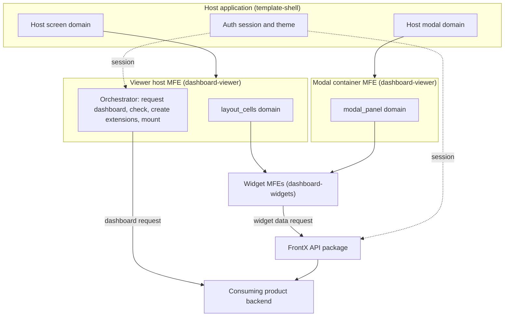
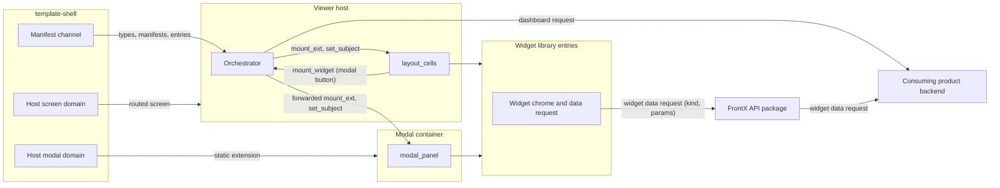
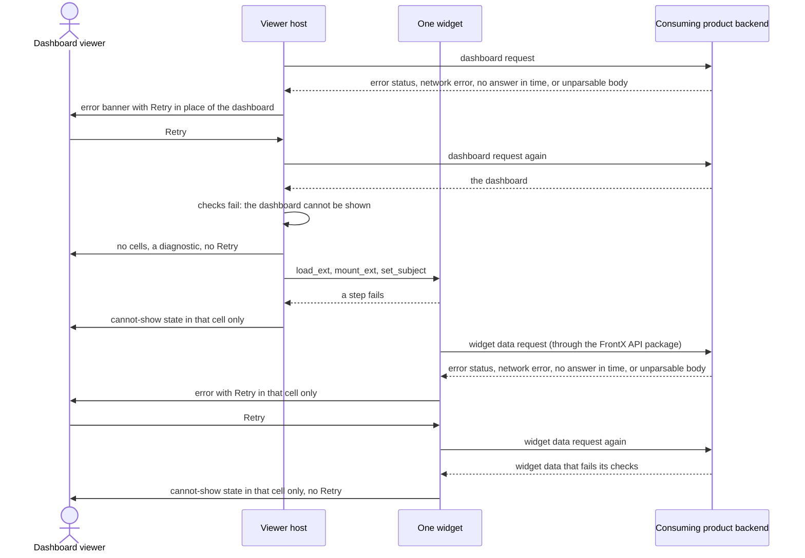
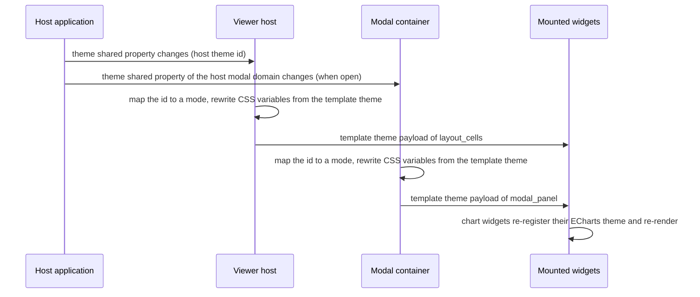
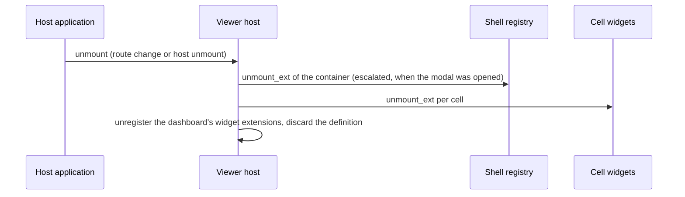
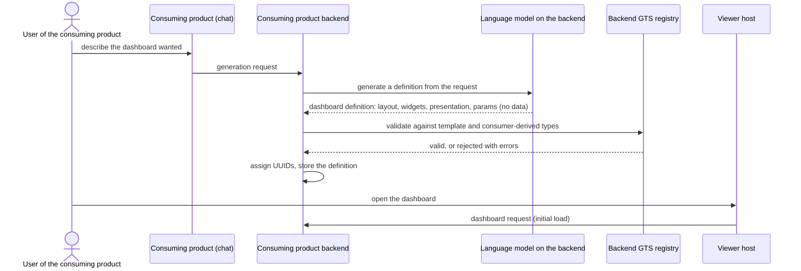

# Technical Design — FrontX Dashboard Template

This design describes how `template-dashboard` renders backend-delivered dashboards on FrontX: the GTS domain model, the Viewer host that requests one dashboard and renders it, the 9 widget MFEs that request their own data, the modal container that shows a widget's larger view, the backend interface, the host contract with `template-shell`, the main runtime sequences, and the budgets.

- [ ] `p1` - **ID**: `cpt-frontx-dashboard-design-dashboard-template`

<!-- toc -->

- [1. Architecture Overview](#1-architecture-overview)
  - [1.1 Architectural Vision](#11-architectural-vision)
  - [1.2 Architecture Drivers](#12-architecture-drivers)
  - [1.3 Architecture Layers](#13-architecture-layers)
- [2. Principles & Constraints](#2-principles--constraints)
  - [2.1 Design Principles](#21-design-principles)
  - [2.2 Constraints](#22-constraints)
- [3. Technical Architecture](#3-technical-architecture)
  - [3.1 Domain Model](#31-domain-model)
  - [3.2 Component Model](#32-component-model)
  - [3.3 API Contracts](#33-api-contracts)
  - [3.4 Internal Dependencies](#34-internal-dependencies)
  - [3.5 External Dependencies](#35-external-dependencies)
  - [3.6 Interactions & Sequences](#36-interactions--sequences)
  - [3.7 Database schemas & tables](#37-database-schemas--tables)
  - [3.8 Deployment Topology](#38-deployment-topology)
  - [3.9 Budgets and NFR Realisation](#39-budgets-and-nfr-realisation)
- [4. Additional context](#4-additional-context)
- [5. Traceability](#5-traceability)

<!-- /toc -->

## 1. Architecture Overview

### 1.1 Architectural Vision

`template-dashboard` is a render-only dashboard viewer on FrontX. The consuming product's backend is the only source of what a dashboard shows. It stores and returns only dashboard definitions: no stored queries and no pre-computed widget data. One definition is one GTS dashboard instance with an `id`, a `name`, a `description`, and an embedded `layout` whose `columns` and `cells` each embed one widget instance; a widget instance is its presentation configuration plus its `params`. The definition carries no widget data and no theme. A consuming product may write its dashboards or generate them, for example from a user's chat request through a language model on its backend; generation is the job of the consuming product backend, and the template supplies the GTS types that a generated definition is validated against (section 3.6, consumer-side generation). The template computes, aggregates, and narrows nothing, and once the widgets render, nothing changes until the dashboard is opened again. It adds no authoring, no generation pipeline, and no server component.

The architecture has one orchestrator. The **Viewer host** is a nested-host MFE (micro-frontend: an independently built and mounted UI unit) that the host application mounts as a routed screen. It requests the dashboard that its route names, once, by the dashboard identifier; checks it; creates the widget extensions of both template domains from the dashboard's widgets; mounts the layout cells; and sends each widget its instance with `set_subject`. The template ships one MFE per widget kind, 9 in all. Each widget instance requests its own data once, through the FrontX API package: it names its widget kind and sends its `params` to the consuming product backend, and receives one widget data instance of its kind's data type, which the backend computes from its own data for that request. Each widget shows its own loading skeleton, error, and Retry. After render, no request follows except Retry after a failure and a widget's own request for what its larger view needs. Section 3.3 describes this backend interface at architecture level, and `cpt-frontx-dashboard-feature-backend-contract` specifies it exactly.

Every widget carries one button that opens the widget in its larger view, in a modal. What the larger view shows, and its data, are that widget's own implementation detail; when the view needs data, the widget makes its own data request. The modal reuses the host's own modal domain. That domain gives its occupants no custom actions, so the template ships a static **modal container**. The container occupies the host modal domain and holds the widget's larger view in its own inner `modal_panel` domain, where the widget receives the same widget instance as its cell. The widget's modal extension is created and registered when the dashboard is resolved, so opening the larger view only mounts it, and the Viewer host reaches it through FrontX forwarding across nested hosts. The theme lives on the frontend: the template owns its theme instance, and the backend does not supply it. The host must render its modal domain through a domain slot with modal chrome, focus trap, and dismissal; current `template-shell` does not do this yet, so it is a prerequisite shell change tracked outside the template (section 3.5). Every FrontX mechanism the template uses is the smallest one that the FrontX rules (isolation, occupancy, forwarding) require.

### 1.2 Architecture Drivers

The drivers are the PRD requirements and the template's eleven ADRs. Each table below maps a driver to the design element that answers it.

**ADRs**: `cpt-frontx-dashboard-adr-frontend-framework`, `cpt-frontx-dashboard-adr-dashboard-layout-grid`, `cpt-frontx-dashboard-adr-shared-data-types-and-schemas`, `cpt-frontx-dashboard-adr-charting-library`, `cpt-frontx-dashboard-adr-data-grid-library`, `cpt-frontx-dashboard-adr-theme-distribution`, `cpt-frontx-dashboard-adr-extension-domain-taxonomy`, `cpt-frontx-dashboard-adr-widget-kind-and-mfe-realization`, `cpt-frontx-dashboard-adr-subject-agnostic-widget-catalog`, `cpt-frontx-dashboard-adr-template-packages-and-host-contract`, `cpt-frontx-dashboard-adr-backend-delivered-dashboard`

#### Functional Drivers

| Requirement | Design Response |
|-------------|------------------|
| `cpt-frontx-dashboard-fr-viewer-host` | The Viewer host is a routed extension in the host screen domain; the route carries the dashboard identifier; the Viewer host requests that dashboard once, checks it, and creates, for every cell's widget, one `layout_cells` extension and one `modal_panel` extension for the widget's larger view; each open dashboard keeps its own loaded definition (`cpt-frontx-dashboard-component-viewer-host`, `cpt-frontx-dashboard-interface-template-domains`). |
| `cpt-frontx-dashboard-fr-backend-source` | The Viewer host requests one GTS-typed dashboard by its identifier from the consuming product backend, written or generated by the consuming product, with its embedded layout and widget instances, and validates it against the registered types; each widget instance requests its own data once, naming its kind and sending its `params`, through the FrontX API package, and renders the returned widget data as delivered; the backend computes that data on the request from its own data and stores nothing but definitions (`cpt-frontx-dashboard-interface-dashboard-payload`, `cpt-frontx-dashboard-component-viewer-host`, `cpt-frontx-dashboard-component-backend-client`, `cpt-frontx-dashboard-seq-initial-load`, `cpt-frontx-dashboard-seq-consumer-generation`). |
| `cpt-frontx-dashboard-fr-loading-error-states` | Skeletons in place of the dashboard while it loads, a dashboard banner with Retry when the dashboard request fails, and no cells with a diagnostic when the dashboard cannot be shown; a cell whose widget kind has no single realizing entry, or whose widget fails to load or mount, shows its own cannot-show state; after the cells mount, each widget shows its own skeleton, its own error with Retry when its data request fails, and its cannot-show state when its data cannot be shown; a failing widget affects only its own cell (`cpt-frontx-dashboard-seq-failure-handling`). |
| `cpt-frontx-dashboard-fr-widget-catalog` | One widget-library package ships one `mf_manifest` and 9 MFE entries, one per subject-agnostic kind, each with `realizes:`; every entry requests its own data with its kind and its `params`; the `grid` kind renders frozen columns, grouped column headers, row tints from the theme, row groups, and up to 5,000 rows without paging, and `markdown_card` renders delivered markdown without raw HTML (`cpt-frontx-dashboard-component-widget-library`, `cpt-frontx-dashboard-component-backend-client`). |
| `cpt-frontx-dashboard-fr-widget-modal` | Shared widget chrome adds one button that opens the widget's larger view; the static modal container occupies the host modal domain, and the Viewer host mounts the widget's modal extension, created at dashboard resolve, in the container's `modal_panel` domain and sends it the same widget instance as its cell; what the larger view shows, and its data, are the widget's own detail, and the widget may make its own data request for it through the FrontX API package (`cpt-frontx-dashboard-component-modal-container`, `cpt-frontx-dashboard-interface-host-actions`, `cpt-frontx-dashboard-seq-widget-modal-open`). |
| `cpt-frontx-dashboard-fr-theme` | The template owns its theme instance on the frontend; the Viewer host and the modal container each map the host theme id to a mode through the template's theme-mode map, project the matching palette of that theme to CSS variables and the theme shared property of their domains; chart widgets register the ECharts theme `frontx-dashboard`, and the `grid` kind takes its row tints from the active palette (`cpt-frontx-dashboard-seq-theme-switch`). |
| `cpt-frontx-dashboard-fr-domain-model` | The `gts.frontx.v.*` and `gts.frontx.m.*` types on GTS v0.17: a dashboard root with an embedded layout, the abstract widget base with `params` and a `data_type` trait, and the abstract widget-data base with 9 derived data shapes; a consuming product backend validates the dashboards it writes or generates against these types, and a consuming product may derive widget types that close `params` (section 3.1, `cpt-frontx-dashboard-seq-consumer-generation`). |

#### NFR Allocation

| NFR ID | NFR Summary | Allocated To | Design Response | Verification Approach |
|--------|-------------|--------------|-----------------|----------------------|
| `cpt-frontx-dashboard-nfr-visual-quality` | One consistent look in light and dark | Viewer host theme projection, modal container, chart widgets, grid shell | Every color, font, and spacing value comes from the template's theme instance and the host design-system tokens; chart widgets use one ECharts theme builder; grid row tints come from the active palette; no widget carries manual styling. | Design inspection of all 9 kinds in both modes, in a cell and in the larger view, against the design-system reference. |
| `cpt-frontx-dashboard-nfr-initial-render` | First full render p95 < 3 s (provisional), from the dashboard request | Viewer host (dashboard request, parallel mount), widget library (parallel per-widget data requests) | One dashboard request per dashboard; after the dashboard resolves, the widget bundles load in parallel, one per cell, and each widget requests its data at once, in parallel with the others. Reference conditions, including the reference dashboard and its widget data responses, are fixed in section 3.9. | Timed runs under the reference conditions; budget confirmed or revised from the results. |
| `cpt-frontx-dashboard-nfr-large-table` | A grid of up to 5,000 rows stays responsive while scrolling, without paging | Widget library: the grid shell of the `grid` kind | The grid shell renders rows virtualized, so only the rows in view and the group heading rows among them are in the DOM, whatever the delivered row count; it offers no paging. | Scrolling the 5,000-row reference grid in a cell under the reference conditions of section 3.9, with the longest pause recorded against the provisional threshold. |
| `cpt-frontx-dashboard-nfr-compatibility` | Works with the current stable FrontX release, depends on `template-shell` only | Packaging, host contract | Role-based host identifiers resolved from shell constants in code; manifest-declared extensions carry the current identifiers; FrontX packages pinned to exact published versions (section 3.5); no dependency on `template-mfe` or on any other template. | A build on a `template-shell` project that provides the rendered modal-domain slot, with a dependency check that finds only `template-shell` and the FrontX packages. |
| `cpt-frontx-dashboard-nfr-bundle-budget` | Isolation-aware bundle budget | Viewer host entry, modal container entry, widget entries | Provisional figures from section 3.9; every MFE instance evaluates its own libraries (FrontX ADR-0011), so library evaluation counts per instance; a library's source counts once per realm only when the MFE build lists it as a shared dependency and emits its content hash (FrontX ADR-0034), and otherwise once per entry that bundles it; the modal container entry counted separately. | Measured production bundle sizes per entry, with download and per-instance evaluation recorded separately, against the provisional figures. |
| `cpt-frontx-dashboard-nfr-accessibility` | Host accessibility policy and keyboard operability | Widget chrome with modal button and Retry, grid shell, modal container, Viewer host chrome and Retry | Every control follows the host policy; the grid shell exposes ARIA grid semantics, also for virtualized rows and group heading rows; the modal button, Close, and both Retry actions are keyboard-operable; the host's modal-domain slot provides the focus trap and dismissal (host requirement in section 3.5). | Host accessibility checks in both themes and a keyboard-only walkthrough of the reference dashboard (section 3.9) that opens and closes the larger view of every widget. |
| `cpt-frontx-dashboard-nfr-consumer-docs` | Shipped consumer guide | Consumer guide shipped with the template | The template ships a guide for the backend interface that a consuming product backend implements (the dashboard request and the widget data request, `cpt-frontx-dashboard-feature-backend-contract`), the validation of written or generated dashboards against the template types, the derivation of widget types that close `params`, the host contract, and the theme instance with its theme-mode map. | Walkthrough by a developer who did not build the template. |

#### Architecture Decision Records

| ADR | Effect on this design |
|-----|-----------------------|
| `cpt-frontx-dashboard-adr-frontend-framework` | FrontX with TypeScript and MFE packaging; per-instance isolation shapes every component boundary. |
| `cpt-frontx-dashboard-adr-dashboard-layout-grid` | 60-column integer cells rendered with CSS Grid in the Viewer host; viewer-side layout checks with no repair. |
| `cpt-frontx-dashboard-adr-shared-data-types-and-schemas` | GTS v0.17 on FrontX bases, vendor `frontx`, packages `v` and `m`, the ID-form convention with combined instance identifiers, `x-gts-type-ref`, `x-gts-instance-ref`, and `x-gts-pattern-ref` references, abstract bases and traits, registry validation, and the `v1` freeze. |
| `cpt-frontx-dashboard-adr-charting-library` | ECharts in each chart widget, theme registered per widget instance, library evaluated per instance. |
| `cpt-frontx-dashboard-adr-data-grid-library` | TanStack Table behind one grid shell in the `grid` widget, used for rendering only, with virtualized row rendering for up to 5,000 rows and cell values shown as text; the grid shows the delivered rows and row groups as given, without search, filtering, sorting, grouping, or pagination in the browser. |
| `cpt-frontx-dashboard-adr-theme-distribution` | The theme lives on the frontend as the template's own theme instance; mode from the template's theme-id map; CSS variables plus the theme shared property, projected by the Viewer host for `layout_cells` and by the modal container for `modal_panel` from the same theme. |
| `cpt-frontx-dashboard-adr-extension-domain-taxonomy` | Two template domains (`layout_cells`, `modal_panel`), two host actions (`set_subject`, `mount_widget`), static modal container; every widget's cell extension and its modal extension for the larger view are created at dashboard resolve, and opening the larger view only mounts. |
| `cpt-frontx-dashboard-adr-widget-kind-and-mfe-realization` | Parallel `m` and `v` hierarchies joined by `realizes:`; one widget package with 9 entries. |
| `cpt-frontx-dashboard-adr-subject-agnostic-widget-catalog` | 9 rendering-primitive kinds, each tied to one widget data type through its `data_type` trait; `params` semantics belong to the consuming product, which may derive widget types that close the `params` schema; the backend supplies the data. |
| `cpt-frontx-dashboard-adr-template-packages-and-host-contract` | Two packages, `dashboard-viewer` and `dashboard-widgets`, on `template-shell`; host domains by role; a manifest channel that carries only GTS types and MFE entries; the rendered modal-domain slot as a host requirement. |
| `cpt-frontx-dashboard-adr-backend-delivered-dashboard` | The backend stores and returns only the dashboard definition, with the layout embedded, requested once by its identifier by the Viewer host; each widget MFE requests its own data once when it mounts, naming its kind and sending its `params`, and may make its own request for its larger view; no stored queries and no pre-computed data; nothing else is requested after render except Retry after a failure. |

### 1.3 Architecture Layers



- [ ] `p2` - **ID**: `cpt-frontx-dashboard-tech-frontx-stack`

| Layer | Responsibility | Technology |
|-------|---------------|------------|
| Host | Screen and modal domains with rendered slots, manifest channel, auth session, host theme and language | `template-shell` on the current stable FrontX release |
| Presentation | Layout grid, widget rendering, widget modal button, per-widget loading and error states, modal chrome | React, shadcn/ui, CSS Grid, ECharts with echarts-for-react, TanStack Table v8 with the TanStack virtualizer |
| Orchestration | Dashboard request, checks, instance and extension registration, mount chains, theme projection | Viewer host (TypeScript strict), FrontX actions chains |
| Data | One dashboard per dashboard request and one widget data response per widget data request, computed by the consuming product backend from a widget's kind and `params` | Same-origin HTTP requests under the host's session; widget data requests through the FrontX API package |
| Contracts | Types and instances for dashboards, embedded layouts, widgets, widget data, themes, domains, actions | GTS v0.17 on `gts.frontx.mfes.*` bases |

## 2. Principles & Constraints

### 2.1 Design Principles

#### Render-Only Viewer

- [ ] `p1` - **ID**: `cpt-frontx-dashboard-principle-render-only-viewer`

The template renders what the backend delivers and nothing more. The dashboard definition carries the dashboard, its embedded layout, and every widget's configuration with its `params`; each widget's data is the backend's response to that widget's own data request, computed from the backend's own data for the widget's kind and `params`, and the widget shows it as delivered: it does not compute, aggregate, narrow, hide, or cut off any part of it. The layout, with the widget configuration that each cell carries, fully defines how the widgets are composed and presented; the viewer renders it as given and does not sort, group, page, or otherwise re-arrange anything in the browser. After the widgets render, nothing changes: no request follows except Retry after a failure and a widget's own request for what its larger view needs, and no widget in a cell receives new data. What a widget's larger view shows, and its data, are that widget's own implementation detail. Interactive exploration is later-stage work and needs a new decision.

**ADRs**: `cpt-frontx-dashboard-adr-backend-delivered-dashboard`, `cpt-frontx-dashboard-adr-subject-agnostic-widget-catalog`

#### Per-Instance Isolation, No Shared Singletons

- [ ] `p1` - **ID**: `cpt-frontx-dashboard-principle-per-instance-isolation`

FrontX gives every MFE load its own module graph (FrontX ADR-0011), so no library, store, or theme object of the template is shared between MFE instances. Each open dashboard owns its own loaded definition. Each chart widget registers its own ECharts theme. Each widget requests its own data through the FrontX API package and holds the response itself. Reuse of a shared dependency's source text (FrontX ADR-0034) saves fetches and shares no evaluated module (section 3.9). That Module Federation serves only as the bundling format, with FrontX resolving dependencies itself, is a template assumption from the product owner, not a statement of a FrontX ADR.

**ADRs**: `cpt-frontx-dashboard-adr-frontend-framework`, `cpt-frontx-dashboard-adr-theme-distribution`, `cpt-frontx-dashboard-adr-backend-delivered-dashboard`

#### Extensions Are Registered Only at Dashboard Resolve

- [ ] `p1` - **ID**: `cpt-frontx-dashboard-principle-no-extension-on-click`

Extensions are registered at one moment: when the Viewer host resolves the dashboard. It then creates, for every cell's widget, one `layout_cells` extension and one `modal_panel` extension for the widget's larger view, both pointing to the entry that realizes the widget's kind. The modal container is a static extension declared in a manifest. Opening a larger view and every other click only mount, unmount, and configure extensions that already exist. The `modal_panel` half of this principle depends on the open modal extension registration path (section 4; FEATURE `extension-domain-catalog` section 6.11): `modal_panel` exists only after the container's first mount, and how the modal extensions reach it is not chosen yet.

**ADRs**: `cpt-frontx-dashboard-adr-extension-domain-taxonomy`, `cpt-frontx-dashboard-adr-backend-delivered-dashboard`

#### Viewer Host Orchestrates, Widgets Load and Render

- [ ] `p1` - **ID**: `cpt-frontx-dashboard-principle-viewer-host-orchestration`

The Viewer host requests the dashboard, checks and registers it, creates the widget extensions, and mounts and configures the widgets; it holds no widget data and runs no queries. A widget receives `set_subject` with its widget instance, requests its own data with its kind and the `params` from that instance, and renders the response. Widgets never request anything but their own data and never reach the Viewer host's internals.

**ADRs**: `cpt-frontx-dashboard-adr-backend-delivered-dashboard`, `cpt-frontx-dashboard-adr-extension-domain-taxonomy`

#### Contracts Are GTS Data

- [ ] `p2` - **ID**: `cpt-frontx-dashboard-principle-gts-contracts`

Dashboards with their embedded layouts, widgets, widget data, themes, and actions are GTS types chained from FrontX bases. The request forms of the backend interface are not GTS types; they are specified in `cpt-frontx-dashboard-feature-backend-contract`. Because dashboards and widgets are GTS-typed, a consuming product adds a dashboard as data, whether written or generated, and validates it against the registered template types before its backend serves it. Dashboards and widget data responses come from the consuming product backend; the Viewer host registers the dashboard's instances with the type system, and each widget checks its data response against its kind's `data_type`. The theme instance ships with the template. The manifest channel carries only types and MFE entries. Contracts that stay inside one runtime stay TypeScript-internal.

**ADRs**: `cpt-frontx-dashboard-adr-shared-data-types-and-schemas`, `cpt-frontx-dashboard-adr-widget-kind-and-mfe-realization`, `cpt-frontx-dashboard-adr-backend-delivered-dashboard`

### 2.2 Constraints

#### Dependency on `template-shell` Only

- [ ] `p1` - **ID**: `cpt-frontx-dashboard-constraint-shell-only-dependency`

The template depends on `template-shell` and on the FrontX packages it pins, and on nothing else: it takes nothing from `template-mfe` or from any other template. It requires one host capability that current `template-shell` lacks: a rendered slot for the host modal domain with modal chrome, focus trap, and dismissal (section 3.5). That capability is a prerequisite `template-shell` change, tracked outside `template-dashboard`. FrontX packages are pinned to exact published versions (section 3.5, FrontX Ecosystem).

**ADRs**: `cpt-frontx-dashboard-adr-template-packages-and-host-contract`, `cpt-frontx-dashboard-adr-frontend-framework`

#### Host Identifiers by Role

- [ ] `p1` - **ID**: `cpt-frontx-dashboard-constraint-role-based-host-ids`

Documents name host domains by role. The **host screen domain** is the host application's extension domain in which full screens are mounted; it realizes the PRD's host screen area. The **host modal domain** is the host application's extension domain in which a modal occupant is mounted; together with the host's rendered modal-domain slot it realizes the PRD's host modal area. TypeScript code resolves their current identifiers from `template-shell` framework constants and never writes them as literals. Manifest-declared extensions in `mfe.json`, such as the Viewer host's routed extension and the modal container's static extension, are data and carry the current identifiers, or are generated from the constants at build time. The host contract table in section 3.5 is the single place that maps roles to current identifiers.

**ADRs**: `cpt-frontx-dashboard-adr-template-packages-and-host-contract`

#### GTS Identifier Form and Freeze

- [ ] `p1` - **ID**: `cpt-frontx-dashboard-constraint-gts-id-convention`

The template targets GTS specification v0.17. Type identifiers end with `~` and instance identifiers do not. An instance identifier always carries its type chain: a well-known instance ends in a named segment, and a dashboard or widget instance uses the combined anonymous form, its type chain followed by a UUID that the consuming product backend generates; no instance carries a separate `type` field. A field that holds an identifier is constrained with `x-gts-type-ref`, `x-gts-instance-ref`, or `x-gts-pattern-ref`, according to whether it holds a type, an instance, or a pattern; `x-gts-ref` is not used. The template's own segments use vendor `frontx` and only the packages `v` and `m`. Every identifier starts at `v1` and is frozen from the first non-alpha release; after the freeze, an incompatible change ships as a new version.

**ADRs**: `cpt-frontx-dashboard-adr-shared-data-types-and-schemas`

#### Fixed 60-Column Layout

- [ ] `p2` - **ID**: `cpt-frontx-dashboard-constraint-sixty-column-grid`

The layout embedded in each dashboard uses 60 columns with integer cell coordinates `x`, `y`, `w`, `h` and one embedded widget per cell. The viewer repairs nothing at run time: a layout with out-of-range or overlapping cells makes the dashboard one that cannot be shown, with a diagnostic that names the failing cells.

**ADRs**: `cpt-frontx-dashboard-adr-dashboard-layout-grid`

#### One Viewer Host per Application Tree

- [ ] `p2` - **ID**: `cpt-frontx-dashboard-constraint-one-viewer-per-tree`

Template domain identifiers are fixed instance identifiers, and the FrontX collision guard is tree-global (FrontX ADR-0007). The template's consequence of that guard is its supported topology: one mounted Viewer host per application tree, which the exclusive host screen domain already guarantees. Switching dashboards happens through the Viewer host's route, and independent viewers run in separate application instances, such as two browser tabs.

**ADRs**: `cpt-frontx-dashboard-adr-extension-domain-taxonomy`, `cpt-frontx-dashboard-adr-template-packages-and-host-contract`

#### Licensing, Compliance, and Resource Dispositions

- [ ] `p2` - **ID**: `cpt-frontx-dashboard-constraint-licensing-compliance-resources`

- **Regulatory and privacy**: not applicable because the template is a read-only information UI that stores nothing. The dashboard definition and the widget data stay in browser memory while the dashboard is open and are released when it closes; processing of personal data belongs to the consuming product backend (PRD section 6.2).
- **Data residency**: not applicable because the template stores no data and runs no service. The Viewer host and the widgets read only from the consuming product's same-origin backend, whose residency the consuming product owns.
- **Licensing**: every third-party runtime library must carry a permissive license that allows distribution as source inside a consuming product, Apache-2.0 or MIT, as listed in section 3.5.
- **Resource constraints**: the browser only renders; the consuming product backend computes every value the widgets show, and response size is the backend's concern. Download and evaluation cost is bounded by the bundle budget in section 3.9. No server, storage, or network resource is provisioned by the template.

**ADRs**: `cpt-frontx-dashboard-adr-template-packages-and-host-contract`, `cpt-frontx-dashboard-adr-backend-delivered-dashboard`

## 3. Technical Architecture

### 3.1 Domain Model

**Technology**: GTS (Global Type System) specification v0.17 types and instances chained from the FrontX `gts.frontx.mfes.*` bases.

**Location**: type files in `src-app/mfe_packages/dashboard-viewer/` (engine `v` and `m` types, the template's theme instance, modal container) and `src-app/mfe_packages/dashboard-widgets/` (manifest and entries). The concrete types are specified in the domain-model FEATURE documents named below.

**Instance source**: the dashboard instance, with its embedded layout and the widget instances embedded in its cells, is the dashboard definition that the consuming product writes or generates and its backend returns for one dashboard request; the backend generates the UUIDs of the dashboard and widget identifiers. Each widget's data instance comes from the backend's response to that widget's own data request, computed for the widget's kind and `params` (`cpt-frontx-dashboard-fr-backend-source`, `cpt-frontx-dashboard-adr-backend-delivered-dashboard`). The theme instance is template-owned frontend content that ships in `dashboard-viewer`; the backend does not supply it. Package `mfe.json` files carry only GTS types and MFE entries, which reach every registry through the manifest channel (section 3.5); no content instance travels through them.

**Core Entities**:

| Entity | Description | Schema |
|--------|-------------|--------|
| Dashboard definition | One per dashboard, written or generated by the consuming product and returned by its backend for the dashboard request: one dashboard instance with its embedded layout and each widget instance embedded in a layout cell; no widget data and no theme | the dashboard instance below; interface `cpt-frontx-dashboard-interface-dashboard-payload` (section 3.3) |
| Dashboard | Root: `id`, `name`, `description`, embedded `layout` | `gts.frontx.m.dashboard.dashboard.v1~` (FEATURE `dashboard-root-types`) |
| Theme | Light and dark palettes, each with optional grid row tints; typography, chart defaults and spacing shared by both; one template-owned instance on the frontend | `gts.frontx.m.dashboard.theme.v1~` (FEATURE `dashboard-root-types`) |
| Layout | Embedded object of the dashboard, without an own identifier: `columns` (always 60) and an ordered list of cells | `gts.frontx.m.layout.layout.v1~` (FEATURE `layout-types`) |
| Layout cell | Embedded object of the layout: position `x`, `y`, `w`, `h` and one embedded widget instance | `gts.frontx.m.layout.cell.v1~` (FEATURE `layout-types`) |
| Widget | Abstract base of the 9 widget kinds: `id`, `title`, the open `params` object, the kind's presentation configuration, and the `data_type` trait that names the kind's widget data type | `gts.frontx.m.widget.widget.v1~` (inline below; kinds in FEATURE `widget-catalog`) |
| Widget data | Abstract base and one derived data type per widget kind, the response to a widget's data request | `gts.frontx.v.widget_data.widget_data.v1~` and `gts.frontx.v.widget_data.widget_data.v1~frontx.v.widget_data.<kind>.v1~` (FEATURE `widget-data-catalog`) |
| Host actions | Two template actions | `gts.frontx.mfes.comm.action.v1~frontx.v.mfe.<name>.v1~` (FEATURE `extension-domain-catalog`) |
| Domains and extension types | `layout_cells`, `modal_panel` | `gts.frontx.mfes.ext.domain.v1~frontx.v.layout.<name>.v1` (FEATURE `extension-domain-catalog`) |
| MFE entry | Entry type that adds `realizes:` | `gts.frontx.mfes.mfe.entry.v1~frontx.mfes.mfe.entry_mf.v1~frontx.v.mfe.entry.v1~` (FEATURE `mfe-entries`) |

**Relationships**:

- Dashboard definition → Dashboard, Layout, Widget: one definition is one dashboard instance with its embedded layout and every widget instance embedded in a cell. It carries no widget data and no theme.
- Dashboard → Layout: the dashboard embeds one layout object, which has no identifier of its own; the layout embeds its cells, and each cell embeds one widget instance.
- Widget → Widget data: each widget instance carries `params`; the widget names its kind and sends its `params` in its data request, and the response is one widget data instance, which must validate against the data type named by its kind's `data_type` trait.
- Widget kind → Widget data: each widget kind sets its `data_type` trait to one data type derived from the widget-data base.
- Consumer widget type → Widget kind: a consuming product may derive a widget type from a kind that closes or specifies the `params` schema, for example `gts.frontx.m.widget.widget.v1~frontx.m.widget.grid.v1~acme.gh.widget.pr_list.v1~`; a dashboard that uses it validates against it, and its instances keep the kind's presentation and `data_type`; the intended result is that the MFE of that kind renders them (section 3.3).
- MFE entry → Widget: each widget entry instance points with `realizes:` to one widget kind; dashboards carry widget instances, never entry identifiers.
- Domain → Widget: a domain mounts widget extensions whose entries realize widget kinds; theme is the only shared property of the template domains.
- Theme → Dashboard: none; the template applies its own theme instance to every dashboard.

#### Packages, Namespaces, and the Model–View Split

The template's own types sit in two packages under the `frontx` vendor. Package `m` (model) holds what describes a dashboard: dashboard, theme, layout, cell, and widget kinds. Package `v` (view runtime) holds what the runtime exchanges: widget data shapes, host actions, domains, extension types, and the MFE entry type.

The split keeps one deliberate reference from `m` into `v` and one from `v` into `m` (`cpt-frontx-dashboard-adr-widget-kind-and-mfe-realization`):

| From | To | Meaning |
|------|----|---------|
| `gts.frontx.m.widget.widget.v1~frontx.m.widget.<kind>.v1~` trait `data_type` (`m` → `v`) | `gts.frontx.v.widget_data.widget_data.v1~frontx.v.widget_data.<kind>.v1~` | Each kind names its one data type; the widget base declares the trait with `x-gts-type-ref` to the widget-data base. |
| `gts.frontx.mfes.mfe.entry.v1~frontx.mfes.mfe.entry_mf.v1~frontx.v.mfe.entry.v1~` field `realizes` (`v` → `m`) | `gts.frontx.m.widget.widget.v1~` | An MFE entry realizes one widget kind; the field holds a type identifier and uses `x-gts-type-ref`. |

The dashboard's embedded `layout` and the cell's embedded `widget` stay inside package `m`, so they are not cross-package references.

The split lets the widget MFEs be released independently of the dashboards that use them (`cpt-frontx-dashboard-adr-widget-kind-and-mfe-realization`).

**ID-form convention.** Identifiers with a trailing `~` are types; identifiers without it are instances. Every instance identifier carries its type chain (GTS v0.17, sections 2 and 3.7): a well-known instance ends in a named segment, and a combined anonymous instance ends in a UUID. The following table fixes the form for every family:

| Family | Form | Example |
|--------|------|---------|
| Host actions (2) | type, derived from the FrontX action base | `gts.frontx.mfes.comm.action.v1~frontx.v.mfe.set_subject.v1~` |
| Extension types | type | `gts.frontx.mfes.ext.extension.v1~frontx.v.layout.layout_cells.v1~` |
| MFE entry type | type | `gts.frontx.mfes.mfe.entry.v1~frontx.mfes.mfe.entry_mf.v1~frontx.v.mfe.entry.v1~` |
| Engine schemas | type | `gts.frontx.m.widget.widget.v1~frontx.m.widget.grid.v1~`, `gts.frontx.v.widget_data.widget_data.v1~frontx.v.widget_data.grid.v1~` |
| Consumer-derived widget types | type, derived from a template kind | `gts.frontx.m.widget.widget.v1~frontx.m.widget.grid.v1~acme.gh.widget.pr_list.v1~` |
| Dashboards | combined anonymous instance; UUID generated by the consuming product backend | `gts.frontx.m.dashboard.dashboard.v1~<uuid>` |
| Widgets embedded in a dashboard | combined anonymous instance of the kind or of a consumer-derived type; UUID generated by the consuming product backend | `gts.frontx.m.widget.widget.v1~frontx.m.widget.grid.v1~<uuid>` |
| Widget data | no identifier; validated against the `data_type` of the requesting widget's kind | none |
| Domains | instance | `gts.frontx.mfes.ext.domain.v1~frontx.v.layout.layout_cells.v1` |
| Widget MFE entries (9) | instance | `gts.frontx.mfes.mfe.entry.v1~frontx.mfes.mfe.entry_mf.v1~frontx.v.mfe.entry.v1~frontx.v.mfe.summary_card.v1` |
| Viewer and container entries | instance of the FrontX `entry_mf` type | `gts.frontx.mfes.mfe.entry.v1~frontx.mfes.mfe.entry_mf.v1~frontx.v.mfe.modal_container.v1` |
| Viewer host routed extension | instance of the shell screen extension type | `gts.frontx.mfes.ext.extension.v1~frontx.screensets.layout.screen.v1~frontx.v.screens.viewer.v1` |
| Modal container extension | instance of the FrontX extension base | `gts.frontx.mfes.ext.extension.v1~frontx.v.layout.modal_container.v1` |
| Viewer manifest | instance | `gts.frontx.mfes.mfe.mf_manifest.v1~frontx.v.viewer.manifest.v1` |
| Widget manifest | instance | `gts.frontx.mfes.mfe.mf_manifest.v1~frontx.v.widgets.manifest.v1` |
| Template theme | well-known instance of `gts.frontx.m.dashboard.theme.v1~` | its identifier carries that type chain and ends in a named segment under `frontx.m.dashboard`, fixed in `dashboard-viewer` |

#### Abstract Bases

The DESIGN carries the abstract widget base inline, plus the base-level shape of the other families that the component model depends on. Field-level schemas of concrete types are owned by the FEATURE documents.

**Widget base** `gts.frontx.m.widget.widget.v1~`. It is abstract (`x-gts-abstract: true`), so every widget instance belongs to a concrete kind, `gts.frontx.m.widget.widget.v1~frontx.m.widget.<kind>.v1~`, or to a type derived from one. Each widget instance carries its whole presentation configuration and its `params`; the data itself is not part of the definition.

| Field or keyword | Required | Meaning |
|------------------|----------|---------|
| `id` | yes | Combined anonymous instance identifier, constrained with `x-gts-instance-ref: "/$id"`, so it must be rooted at the widget's own type; the consuming product backend generates the UUID. |
| `title` | yes | Display title of the widget. |
| `params` | yes | Open object that the widget sends, with its kind, in its data request. Its meaning belongs to the consuming product; the template does not read it (`cpt-frontx-dashboard-adr-subject-agnostic-widget-catalog`). A consuming product may derive a widget type that closes or specifies its schema. |
| `x-gts-traits-schema` | type level | Declares the required trait `data_type`, a type identifier constrained with `x-gts-type-ref` to the widget-data base `gts.frontx.v.widget_data.widget_data.v1~`. Each kind sets it with `x-gts-traits`, so the registry rejects a concrete kind without a data type. |

The 9 kinds are `summary_card`, `metric_card`, `ranked_list_card`, `progress_list_card`, `grid`, `cartesian_chart`, `pie_chart`, `heatmap`, and `markdown_card`. The `grid` kind also carries presentation settings, such as its columns, frozen columns, grouped column headers, and row coloring from the theme's row tints; the layout fixes them, and they are not client-side operations on the rows. Two checks guard them: the Viewer host checks each `grid` widget's configuration together with the layout when it opens the dashboard, and the widget checks its delivered data against that configuration; a failure is a dashboard, or a widget's data, that cannot be shown (section 3.6, Failure Handling). The settings and both checks are specified in FEATURE `widget-catalog` section 6.5. Presentation keys must name fields that the data computed for the widget's `params` contains; keeping them consistent is the responsibility of whoever writes or generates the dashboard (section 4). The backend supplies exactly what each widget shows, and no kind hides or cuts off part of it. The modal button is part of the shared widget chrome of every kind, so the base declares no field for it.

**Widget data** `gts.frontx.v.widget_data.widget_data.v1~`. It is abstract (`x-gts-abstract: true`), and the 9 data types derive from it as `gts.frontx.v.widget_data.widget_data.v1~frontx.v.widget_data.<kind>.v1~`, one per kind. A data instance is what the consuming product backend computes for one widget's data request and what the widget renders, unchanged. It is computed per request, not stored, so it carries no identifier; the widget validates it against the data type named by its kind's `data_type` trait. The `grid` data type may carry its rows in labeled groups, which the grid renders in the supplied order; the shape is specified in FEATURE `widget-data-catalog` section 6.5.

**Layout and cell** `gts.frontx.m.layout.layout.v1~` and `gts.frontx.m.layout.cell.v1~`. Both are embedded object types: their objects live inside the dashboard and have no identifier of their own, and no layout is stored or referenced separately. A layout has `columns` (always 60) and ordered `cells`. A cell has integer coordinates `x`, `y`, `w`, `h` and one `widget` that embeds the cell's widget instance. Schema validation checks each coordinate, and the Viewer host runs the layout checks for bounds and overlap; a failing check makes the dashboard one that cannot be shown, with a diagnostic that names the failing cells. The coordinate ranges, the checks, and their diagnostics are specified in FEATURE `layout-types` sections 6.2 and 6.3.

**Dashboard root** `gts.frontx.m.dashboard.dashboard.v1~`. It has `id`, a combined anonymous instance identifier constrained with `x-gts-instance-ref: "/$id"` and generated by the consuming product backend, `name`, an optional `description`, and the embedded `layout`, and no other field. It references no theme. A consuming product may derive a subtype that adds fields.

**Theme** `gts.frontx.m.dashboard.theme.v1~`. It holds a light and a dark palette, each with its color roles, its chart color scales, and optional grid row tints, plus typography, chart defaults, and optional spacing shared by both. The row tints give the `grid` kind its row colors. The fields, including the row-tint families and their values, are specified in FEATURE `dashboard-root-types` section 6.2. The template owns one instance of the theme, which ships as frontend source in `dashboard-viewer` and is used by both the Viewer host and the modal container; a consuming product changes the look by editing that instance in its project. The active mode always follows the host: the host's theme shared property carries only the host theme id, and the template maps that id to `light` or `dark` through its theme-mode map (section 3.2, Viewer host). The template's theme instance supplies the palette for that mode.

**Host actions** derive from the FrontX action base `gts.frontx.mfes.comm.action.v1~`. Section 3.3 lists their targets and payloads.

**Theme shared-property payload.** All domains use the FrontX theme shared property `gts.frontx.mfes.comm.shared_property.v1~frontx.mfes.comm.theme.v1~`, whose value differs by publisher:

| Publisher | Domains | Value | Stability | Owning FEATURE |
|-----------|---------|-------|-----------|----------------|
| Host | host screen and modal domains | the host theme id only | not template-owned (host contract, section 3.5) | none (host contract, section 3.5) |
| Viewer host | `layout_cells` | the host theme id, the mode from the theme-mode map, and the active palette of the template's theme | stable | `extension-domain-catalog` |
| Modal container | `modal_panel` | the same shape: host theme id from the theme shared property of the host modal domain, the mode from the theme-mode map, and the active palette of the same template theme | stable | `extension-domain-catalog` |

Widgets read only the template payload; they never map a host theme id themselves.

**Extension types and domains.** `gts.frontx.mfes.ext.extension.v1~frontx.v.layout.layout_cells.v1~` and `gts.frontx.mfes.ext.extension.v1~frontx.v.layout.modal_panel.v1~` derive from the FrontX extension base and add no fields. Both domains are instances of the FrontX domain base, so the template adds no domain type. The modal container is an instance of the FrontX extension base, `gts.frontx.mfes.ext.extension.v1~frontx.v.layout.modal_container.v1`, because it carries no fields of its own.

**MFE entry** `gts.frontx.mfes.mfe.entry.v1~frontx.mfes.mfe.entry_mf.v1~frontx.v.mfe.entry.v1~`. It extends the FrontX Module Federation entry with one required field, `realizes:`, which holds a widget kind's type identifier (`x-gts-type-ref` to the widget base). The 9 widget entries are its instances. The viewer entry `gts.frontx.mfes.mfe.entry.v1~frontx.mfes.mfe.entry_mf.v1~frontx.v.mfe.viewer.v1` and the container entry `gts.frontx.mfes.mfe.entry.v1~frontx.mfes.mfe.entry_mf.v1~frontx.v.mfe.modal_container.v1` realize no widget kind, so they are plain FrontX entry instances.

#### Catalog Summary and Ownership

The domain model (`cpt-frontx-dashboard-interface-domain-model`) has six catalogs, each owned by one domain-model FEATURE. The requests and responses that carry these types are specified by `cpt-frontx-dashboard-feature-backend-contract`, which declares no type of its own.

| Package and namespace | Contents | Inline here | Owning FEATURE |
|-----------------------|----------|-------------|----------------|
| `frontx.m.dashboard` | Dashboard (with embedded layout), Theme | base shape | `dashboard-root-types` |
| `frontx.m.layout` | Layout, Cell, both embedded object types | base shape | `layout-types` |
| `frontx.m.widget` | Abstract widget base and 9 kinds | Widget base | `widget-catalog` |
| `frontx.v.widget_data` | Abstract widget-data base and 9 derived data types | base shape | `widget-data-catalog` |
| `frontx.v.mfe`, `frontx.v.layout` | 2 action types, 2 domains, 2 extension types, theme shared-property payload | base shape | `extension-domain-catalog` |
| `frontx.v.mfe` | MFE entry type, entries, manifests | base shape | `mfe-entries` |

### 3.2 Component Model



#### Viewer Host

- [ ] `p1` - **ID**: `cpt-frontx-dashboard-component-viewer-host`

##### Why this component exists

A dashboard needs one place that requests it, checks and registers what it contains, and mounts each widget with its configuration. The Viewer host is that place: a nested-host MFE inside the consuming product's shell, which renders what the backend delivers without computing anything.

##### Responsibility scope

- Mounts as a routed extension (FrontX ADR-0036) in the host screen domain. As template design, it is an instance of the shell's screen extension type that uses that type's `route` field, and its route carries the dashboard identifier.
- Builds its nested registry synchronously inside its first `mount` call (FrontX ADR-0008) and registers `layout_cells` there with the concurrent mount strategy and the actions listed in section 3.3, so the registry adopts the inbound bridge and advertises its domain to the shell.
- Fetches the aggregated manifests from the host's manifest channel, as the `template-mfe` nested-host reference does, and registers their schemas, manifests, and entries in its registry, so the widget entries and the domain model types are known (section 3.5, manifest channel).
- Requests the dashboard that its route names once, by the dashboard identifier, from the endpoint location in its dashboard request configuration (a TS-internal setting documented in the consumer guide), as a same-origin request (section 3.5, Auth session); again only when the user selects Retry after a failed request. Every failure of that request, whether an error status, a network error, no answer within the time it waits, or an unparsable body, is one failed dashboard request; no error status has a special meaning.
- Checks the dashboard. It registers the dashboard's GTS instances, so the type system validates the dashboard and each embedded widget against the type its `id` names, a template kind or a consumer widget type, under the GTS v0.17 rules for abstract types, traits, and references; whether embedded widgets are registered as instances of their own or validated in place, and how consumer widget types reach the browser, are open (section 4). It then runs the layout checks (bounds and `x + w` not greater than 60, then overlap) and the grid configuration checks of every `grid` widget (`columns` and `column_groups`, FEATURE `widget-catalog` section 6.5). When any check fails, the dashboard cannot be shown: the Viewer host renders no cells and shows a diagnostic naming the failing instances, cells, or grid columns and groups, with no Retry.
- Creates the widget extensions only when it resolves the dashboard, for both template domains: for every cell's widget, one `layout_cells` extension and one `modal_panel` extension for the widget's larger view, both pointing to the widget entry whose `realizes:` names the widget's kind, with identifiers derived from the cell's zero-based index (section 3.3, Identifier uniqueness). A cell whose kind no entry realizes, or more than one, or whose registration the FrontX registry rejects, keeps neither extension and shows its cannot-show state with a diagnostic and no Retry; the other cells are unaffected. How a consumer widget type resolves to the entry of the kind it derives from is open (FEATURE `mfe-entries` section 6.7), and how the modal extensions reach `modal_panel`, whose registry exists only after the container's first mount, is open (section 4). It never registers on a click or on a modal open.
- Mounts the cells and sends each widget `set_subject` with its widget instance from the dashboard. It sends no widget data; each widget requests its own. A cell whose `load_ext`, `mount_ext`, or `set_subject` fails shows its cannot-show state with a diagnostic, and the other cells are unaffected (section 3.6, Failure Handling).
- Keeps the loaded definition for the lifetime of the dashboard; each open dashboard keeps its own definition, and the definition is discarded when the dashboard closes.
- Handles `mount_widget` on `layout_cells`: resolves the origin to its cell; ignores, with a diagnostic, an origin that names no cell; opens nothing when the widget's modal extension is not registered; unmounts the current occupant first when a widget is already in the modal (how it knows the occupant is open, section 4); otherwise runs one `mount_ext` of the modal container into the host modal domain, then `mount_ext` of the widget's modal extension into `modal_panel` through FrontX forwarding, then sends that widget the same `set_subject` its cell received. It makes no request.
- Renders the layout as a CSS Grid with 60 equal columns; a cell spans the column range from `x + 1` over `w` columns and the row range from `y + 1` over `h` rows.
- Owns the theme-mode map: a table from host theme id to `light` or `dark`, with an unknown id resolving to `light`. A consuming product extends it at one documented extension point when it registers further host themes, the same approach as `kitThemeScope.ts` in `template-mfe`.
- Takes the mode from the theme-mode map, projects the matching palette of the template's theme instance to CSS variables on its root, and publishes the template theme payload as the theme shared property of `layout_cells`.
- Renders skeletons in place of the dashboard while it loads, the dashboard-level error banner with Retry when the dashboard request fails, and the cannot-show diagnostic in place of the cells when the dashboard cannot be shown.

##### Responsibility boundaries

- Does not request, hold, or deliver widget data; each widget requests its own.
- Does not compute, aggregate, or narrow widget data; the backend does.
- Makes no request after the dashboard renders, on a theme change, or when a widget's larger view opens.
- Does not render widget content or per-widget loading and error states; widgets do.
- Does not import ECharts or register ECharts themes; chart widgets do.
- Does not write host identifiers as literals in code.
- Does not register an extension on a click; it only mounts, unmounts, and configures registered extensions.
- Handles no credential (section 3.5, Auth session).
- Does not persist anything; all state ends with the dashboard session.

##### Related components (by ID)

- `cpt-frontx-dashboard-component-widget-library` — mounts its entries into `layout_cells` and, through forwarding, into `modal_panel`; receives on `layout_cells` the `mount_widget` that a widget's modal button sends.
- `cpt-frontx-dashboard-component-modal-container` — mounts it into the host modal domain and drives its `modal_panel` through forwarding.

#### Widget Data Request (inside Each Widget MFE)

- [ ] `p1` - **ID**: `cpt-frontx-dashboard-component-backend-client`

##### Why this component exists: Widget Data Request

Each widget gets its own data from the backend, so that it loads, fails, and retries on its own (`cpt-frontx-dashboard-adr-backend-delivered-dashboard`). Every widget MFE knows how to get its data: it asks the backend, through the FrontX API package, for the data of its kind and its `params`, and the backend computes that data from its own data on the request. This component is the data-request logic inside each of the 9 widget MFEs, shared through the widget chrome; it reports the result as either one widget data instance or one failed request. It is not a separate client module or service.

##### Responsibility scope: Widget Data Request

- Is part of every widget MFE of `dashboard-widgets`, used by the shared widget chrome of every kind; it is not an MFE of its own and is not mounted as an extension. Every widget MFE instance runs it for itself.
- Requests the widget's data once, when the widget in a cell has received its widget instance, and again only when the user selects Retry in that widget after a failure. The request names the widget's kind, taken from the type chain of its `id`, carries the `params` from the widget instance, and goes to the consuming product backend's widget data endpoint, whose location comes from configuration, like the dashboard endpoint; the path and request form are open (section 4).
- Sends the request that a widget's larger view makes when that view needs data. Which data the larger view requests is the widget's own detail; the request has the form of any widget data request.
- Sends every request through the FrontX API package, under the host session (section 3.5, Auth session).
- Maps every failure, whether an error status, a network error, no answer within the time it waits, or an unparsable body, to one failed request of that widget; no error status has a special meaning.
- Hands the response to the widget, which validates it against the data type named by its kind's `data_type` trait and against its kind-specific checks, such as the grid column-key check, and renders it, or shows its cannot-show state when a check fails.

##### Responsibility boundaries: Widget Data Request

- Makes no request on its own: it requests only when its widget has received its widget instance, when the user selects Retry in that widget, or when the widget's larger view needs data.
- Requests only its own widget's data; it never requests the dashboard and never data of another widget.
- Does not interpret, merge, or transform `params` or the response.
- Handles no credential (section 3.5, Auth session).
- Fixes no request or response shape of its own; the interface is `cpt-frontx-dashboard-interface-dashboard-payload`, specified in `cpt-frontx-dashboard-feature-backend-contract`.

##### Related components (by ID): Widget Data Request

- `cpt-frontx-dashboard-component-widget-library` — the widget MFEs that contain it, through the shared widget chrome.

#### Widget Library

- [ ] `p1` - **ID**: `cpt-frontx-dashboard-component-widget-library`

##### Why this component exists: Widget Library

Dashboards need a fixed, domain-neutral set of widgets that consuming products can use without writing chart or grid code or their own data loading. The template ships the 9 kinds as MFEs that mount the same way in a layout cell and in the modal and that each get their own data from the backend.

##### Responsibility scope: Widget Library

- Ships one package, `dashboard-widgets`, with one manifest `gts.frontx.mfes.mfe.mf_manifest.v1~frontx.v.widgets.manifest.v1` and 9 entry instances of the template entry type, one MFE per widget kind, each exposing its own module and carrying `realizes:` for its kind.
- Each entry requires only the theme shared property and receives `set_subject`.
- In a cell, on `set_subject`, stores the widget instance as its configuration and requests its data once through its data-request logic with its kind and the instance's `params`. It shows its own loading skeleton until the response arrives, then renders the delivered widget data unchanged. An instance of a consumer widget type is intended to be rendered by the MFE of the kind it derives from (section 3.3, Consumer widget types).
- In `modal_panel`, on `set_subject`, shows the widget's larger view. What that view shows, and the data it requests through the data-request logic, are each kind's own implementation detail.
- Shows per-widget states in the shared chrome: a skeleton while its data loads; an error with Retry when the data request fails, where Retry requests that widget's data again; and a cannot-show state with a diagnostic when the response does not validate against its kind's data type or fails a kind-specific check, such as the grid column-key check, where Retry does not apply. A widget in one of these states affects no other widget.
- Shares one widget chrome across all kinds. The chrome carries the widget title and one modal button that opens the widget's larger view; the button sends `mount_widget` to `layout_cells` and names the widget's own cell as the origin, using the extension identifier its bridge exposes (FrontX ADR-0008). `modal_panel` does not declare `mount_widget`, so a widget in the modal cannot open another modal; the chrome does not show the button there (`widget-catalog` FEATURE).
- Chart kinds (`cartesian_chart`, `pie_chart`, `heatmap`) use ECharts through `echarts/core` imports and register their own ECharts theme `frontx-dashboard` from the theme shared property, again on every change.
- The `grid` kind uses one grid shell on TanStack Table v8 for rendering only: columns with each cell's value as text, the first `frozen_columns` columns kept visible during horizontal scrolling, grouped column headers from `column_groups`, row tints from the active palette, one heading row per row group when the data carries `groups`, ARIA grid semantics, and keyboard operation. It renders rows virtualized, so only the rows in view are in the DOM and grids of up to 5,000 rows stay responsive without paging (`cpt-frontx-dashboard-adr-data-grid-library`, `cpt-frontx-dashboard-nfr-large-table`). It shows the delivered rows in the delivered order, without search, filtering, sorting, grouping, or pagination in the browser. FEATURE `widget-catalog` section 6.5 specifies these rules.
- The `markdown_card` kind renders delivered markdown safely, so that delivered content creates no HTML element, link, or image load beyond what FEATURE `widget-catalog` section 6.9 allows; that section specifies the rules.

##### Responsibility boundaries: Widget Library

- Requests only its own data, never reads the meaning of `params`, and never narrows, recomputes, aggregates, re-orders, groups, pages, hides, or truncates the delivered widget data; the layout and the widget configuration it carries fix the presentation in a cell.
- Keeps every kind subject-agnostic.
- Declares no shared singletons; each instance evaluates its own libraries (FrontX ADR-0011).
- Decides, per kind, what its larger view shows and which data it requests for it; the template fixes only that any such request is the widget's own.

##### Related components (by ID): Widget Library

- `cpt-frontx-dashboard-component-viewer-host` — mounts and configures the widgets in `layout_cells` and `modal_panel`; receives on `layout_cells` the `mount_widget` that the modal button sends.
- `cpt-frontx-dashboard-component-backend-client` — the data-request logic inside each widget MFE.
- `cpt-frontx-dashboard-component-modal-container` — hosts the widget's larger view in `modal_panel`.

#### Modal Container

- [ ] `p1` - **ID**: `cpt-frontx-dashboard-component-modal-container`

##### Why this component exists: Modal Container

The host modal domain declares no extension actions, so a widget mounted there could never receive `set_subject`. The container occupies the host modal domain as a plain extension and gives the widget's larger view a template-owned domain inside it. It needs no change to the host modal domain's declaration; it does need the host to render that domain through a modal slot (section 3.5).

##### Responsibility scope: Modal Container

- Is a static extension `gts.frontx.mfes.ext.extension.v1~frontx.v.layout.modal_container.v1` of the host modal domain, declared in the `dashboard-viewer` manifest. Its entry `gts.frontx.mfes.mfe.entry.v1~frontx.mfes.mfe.entry_mf.v1~frontx.v.mfe.modal_container.v1` exposes `./modal-container`, requires theme and language, and declares no custom actions.
- Builds its own registry synchronously inside its first `mount` call and registers `modal_panel` there, so `modal_panel` is advertised to the shell during that first mount (FrontX ADR-0008).
- Holds at most one widget in `modal_panel`: the larger view of the widget whose modal button was selected, mounted by the Viewer host through forwarding from the modal extension created for that widget at dashboard resolve, and sent the same widget instance as its cell. What the larger view shows, and its data, are that widget's own detail; the widget makes its own data request when the view needs data.
- Reads the host theme id through the theme shared property of the host modal domain, like any domain, maps it through the template's theme-mode map, takes the matching palette from the same template-owned theme instance that the Viewer host uses, projects it to CSS variables on its root, and publishes the template theme payload as the theme shared property of `modal_panel`, again on every theme change.
- Renders the modal content area: the title area and Close. Close sends `unmount_ext` of itself to the host modal domain, which unmounts its occupant, and leaves the dashboard unchanged.
- Closes itself when a later step of the open chain fails: every step after the container's mount carries the fallback `unmount_ext` of the container (section 3.6).

##### Responsibility boundaries: Modal Container

- Carries no per-widget data in its extension fields: no subject and no widget data.
- Never requests data itself; the widget in `modal_panel` requests its own when its larger view needs data.
- Registers no extension when the modal opens; the widget's modal extension is registered at dashboard resolve.
- Offers no navigation to other widgets or items.
- Does not provide the outer modal frame, focus trap, or dismissal; the host's modal-domain slot does.

##### Related components (by ID): Modal Container

- `cpt-frontx-dashboard-component-viewer-host` — mounts it and drives `modal_panel` through forwarding.
- `cpt-frontx-dashboard-component-widget-library` — the widget whose larger view is mounted in `modal_panel`.

### 3.3 API Contracts

The template exposes one public contract to consumers, its domain model (`cpt-frontx-dashboard-interface-domain-model`), with the six catalogs listed in section 3.1. Two boundary interfaces connect it to its surroundings: the backend interface that the consuming product backend implements (`cpt-frontx-dashboard-interface-dashboard-payload`, below, decided in `cpt-frontx-dashboard-adr-backend-delivered-dashboard`, and required by the PRD contract `cpt-frontx-dashboard-contract-consuming-backend`) and the host domains (`cpt-frontx-dashboard-contract-host-domains`, section 3.5). The interfaces below give the architecture-level form of the backend interface and of the template's internal action and domain contracts. Field-level schemas belong to the `extension-domain-catalog` and `mfe-entries` FEATURE documents.

#### Dashboard Definition and Widget Data

- [ ] `p1` - **ID**: `cpt-frontx-dashboard-interface-dashboard-payload`

- **Contracts**: `cpt-frontx-dashboard-fr-backend-source`, `cpt-frontx-dashboard-interface-domain-model`
- **Technology**: JSON documents of GTS instances over same-origin HTTP requests; widget data requests go through the FrontX API package (`cpt-frontx-dashboard-adr-backend-delivered-dashboard`)
- **Location**: the dashboard endpoint location from the Viewer host's configuration and the widget data endpoint location from the widget MFEs' configuration, both set by the consuming product (section 3.2); exact specification and conformance cases in `cpt-frontx-dashboard-feature-backend-contract`

The consuming product backend implements this interface; the template only consumes it. The backend stores, or generates, and returns only dashboard definitions; it keeps no stored queries and no pre-computed widget data. The interface has four parts.

**Dashboard request.** The Viewer host requests one dashboard by its identifier, the combined anonymous instance identifier that its route names, for example `gts.frontx.m.dashboard.dashboard.v1~<uuid>`. The response is that dashboard: one instance of the Dashboard root type with `id`, `name`, `description`, and the embedded `layout` with its `columns` and `cells`, each cell embedding one widget instance with its `id`, `title`, presentation configuration, and `params`; every typed object follows a type from section 3.1. It carries no widget data and no theme. The consuming product may write the dashboard or generate it; either way it validates against the template types and any consumer widget types it uses (`cpt-frontx-dashboard-seq-consumer-generation`). The Viewer host requests it once per open dashboard and again only on Retry after a failed request.

**Widget data request.** Each widget requests its own data through the FrontX API package, naming its kind, taken from the type chain of its `id`, and sending its `params`. The response is one widget data instance of the type that its kind names in its `data_type` trait, which the backend computes from its own data on that request; the widget validates it and renders it unchanged. Each widget in a cell requests once, when it mounts, and again only on Retry in that widget; widgets request in parallel and independently. A widget may also make its own data request for what its larger view needs; the backend answers it like any widget data request. What the larger view shows, and its data, are each widget's implementation detail.

**Failures and what the viewer shows.** No error status has a special meaning, and every failure has one visible place:

| Failure class | Meaning | What the viewer shows | Retry |
|---------------|---------|-----------------------|-------|
| Failed dashboard request | An error status, a network error, no answer within the time the viewer waits, or a body that does not parse | An error banner in place of the dashboard | Sends the dashboard request again |
| Dashboard that cannot be shown | The dashboard or an embedded widget does not validate against the type its `id` names, the layout fails a layout check, or a `grid` widget fails a grid configuration check; the Viewer host makes these checks | No cells and a diagnostic naming the failing instances, cells, or grid columns and groups | Not offered |
| Failed widget data request | As for the dashboard request, for one widget's data request | An error in that widget only | Sends that widget's data request again |
| Widget data that cannot be shown | The response does not validate against the widget data type of the widget's kind, or fails a kind-specific check such as the grid column-key check | A cannot-show state with a diagnostic in that widget only, rendering nothing of the response | Not offered |

The same wait applies to every request, and its value is not a contract term (`cpt-frontx-dashboard-feature-backend-contract` section 6.3); the value is open (section 4). The table lists the failures of the backend interface; a cell whose widget has no single realizing entry, or fails to load or mount, is a failure inside the viewer (section 3.6, Failure Handling).

**Consumer widget types.** A consuming product may derive a widget type from one of the 9 kinds to close or specify `params`, for example `gts.frontx.m.widget.widget.v1~frontx.m.widget.grid.v1~acme.gh.widget.pr_list.v1~`. A widget instance of it carries that full type chain in its `id`, validates against it, and takes data of its kind's widget data type. The type must be known to the viewer's type system in the browser before the viewer checks a dashboard that uses it; a dashboard whose widget names an unknown type cannot be shown. How such types reach the browser, and how the viewer resolves them to the MFE of their kind, are open (section 4).

Access to dashboards and data, the distribution of the types to the backend, limits, and versioning are outside this interface. The path and form of both requests are open (section 4). The stability class is given in the API Stability Classification below.

#### Host Actions

- [ ] `p1` - **ID**: `cpt-frontx-dashboard-interface-host-actions`

- **Contracts**: `cpt-frontx-dashboard-interface-domain-model`, `cpt-frontx-dashboard-contract-host-domains`
- **Technology**: FrontX actions chains (mediator keyed by target and action type, FrontX ADR-0007)
- **Location**: action types under `gts.frontx.mfes.comm.action.v1~frontx.v.mfe.*` in `dashboard-viewer`

Every action is a type derived from the FrontX action base. A chain carries an action, an optional `next`, and an optional `fallback`; nothing comes back to the sender. Each action's timeout is its own or the domain default of 30 000 ms. No action carries widget data; each widget requests its own.

| Action | Target | Sender → receiver | Payload (summary) | Stability |
|--------|--------|-------------------|-------------------|-----------|
| `gts.frontx.mfes.comm.action.v1~frontx.v.mfe.set_subject.v1~` | widget extension | Viewer host → widget | the widget instance, with its `id`, presentation configuration, and `params` | stable |
| `gts.frontx.mfes.comm.action.v1~frontx.v.mfe.mount_widget.v1~` | `layout_cells` domain | widget modal button → Viewer host | the origin cell, named by the extension identifier of the widget that sends it | stable |

`mount_widget` is declared on `layout_cells` only, because that domain lives in the Viewer host's own registry and always exists. `modal_panel` does not declare it, so a widget in the modal cannot open another modal. The Viewer host is therefore the single receiver of modal requests and answers each one by opening that widget's larger view in `modal_panel`. FrontX tracks no chain origin (FrontX ADR-0007), so the widget names itself as the origin, using the extension identifier its bridge exposes (FrontX ADR-0008).

#### Template Extension Domains

- [ ] `p1` - **ID**: `cpt-frontx-dashboard-interface-template-domains`

- **Contracts**: `cpt-frontx-dashboard-interface-domain-model`
- **Technology**: FrontX extension domains with named mount strategies (FrontX ADR-0009) and subset-rule admission (FrontX ADR-0010)
- **Location**: domain instances in `dashboard-viewer`

| Property | `layout_cells` | `modal_panel` |
|----------|----------------|---------------|
| Identifier | `gts.frontx.mfes.ext.domain.v1~frontx.v.layout.layout_cells.v1` | `gts.frontx.mfes.ext.domain.v1~frontx.v.layout.modal_panel.v1` |
| Registered by | Viewer host | modal container |
| Mount strategy | concurrent | concurrent |
| Domain actions | `load_ext`, `mount_ext`, `unmount_ext`, `mount_widget` | `load_ext`, `mount_ext`, `unmount_ext` |
| Extension actions | `set_subject` | `set_subject` |
| Shared properties | theme (template payload) | theme (template payload) |
| Extension type | `gts.frontx.mfes.ext.extension.v1~frontx.v.layout.layout_cells.v1~` | `gts.frontx.mfes.ext.extension.v1~frontx.v.layout.modal_panel.v1~` |
| Extensions created | one per cell's widget, at dashboard resolve | one per cell's widget, for its larger view, at dashboard resolve |
| Occupancy | one occupant per cell; `unmount_ext` only on dashboard teardown | at most one widget: the larger view shown in the open modal |
| Domain lifecycle stages | `init` | `init` |
| Extension lifecycle stages | `init`, `activated`, `deactivated`, `destroyed` | `init`, `activated`, `deactivated`, `destroyed` |
| Default action timeout | 30 000 ms | 30 000 ms |

The lifecycle actions are `gts.frontx.mfes.comm.action.v1~frontx.mfes.ext.load_ext.v1~`, `gts.frontx.mfes.comm.action.v1~frontx.mfes.ext.mount_ext.v1~`, and `gts.frontx.mfes.comm.action.v1~frontx.mfes.ext.unmount_ext.v1~`. Code takes them from the FrontX constants. Each domain declares only the `init` stage for itself, because a domain lives as long as its registry. Extensions in both domains declare `init`, `activated`, `deactivated`, and `destroyed`, because both domains unmount occupants: cells on teardown and the widget in the modal when the modal closes.

**Extension creation.** When the Viewer host resolves the dashboard, it takes each cell's widget kind from the type chain of the widget's `id` and resolves it to the one widget entry whose `realizes:` names it. For that cell it creates one extension of the `layout_cells` extension type and one of the `modal_panel` extension type, both with that entry. A cell whose kind has no realizing entry or more than one, or whose registration the FrontX registry rejects, keeps neither extension and shows its cannot-show state; a layout with no cells registers nothing. The `modal_panel` registration path is open (section 4). The processes are specified in FEATURE `extension-domain-catalog` section 3.

**Cardinality matrix check (FrontX ADR-0009).** The concurrent strategy requires both a mount and an unmount action in the domain declaration.

| Domain | Strategy | Requires | Declares | Result |
|--------|----------|----------|----------|--------|
| `layout_cells` | concurrent | `mount_ext`, `unmount_ext` | `mount_ext`, `unmount_ext` | admitted |
| `modal_panel` | concurrent | `mount_ext`, `unmount_ext` | `mount_ext`, `unmount_ext` | admitted |

**Admission of entries (FrontX ADR-0010).** A widget entry requires theme, which every template domain provides. It supports `set_subject`, which covers the extension actions of every template domain. It requires no domain actions. The container entry requires theme and language, which the host modal domain provides, and the host modal domain requires no extension actions.

**Identifier uniqueness.** The Viewer host generates widget extension identifiers deterministically from the surface and the zero-based cell index, under the template's `frontx.v.layout` namespace. `layout_cells` and `modal_panel` use disjoint identifier sets, so no advertisement trips the tree-global collision guard (FrontX ADR-0007), and each modal extension identifier maps to exactly one widget of the open dashboard. The exact identifier form is fixed in the `extension-domain-catalog` FEATURE.

#### API Stability Classification

This design uses one stability vocabulary with three classes. `stable` means experimental during alpha and stable from the first non-alpha release; it matches the PRD label "experimental" with its freeze policy. `internal` means TS-internal and changeable in any release. `extension point` means a contract consumers implement or add to.

| Classification | Contracts | Policy |
|----------------|-----------|--------|
| Stable (experimental during alpha, stable from the first non-alpha release) | `gts.frontx.m.*` types, the `gts.frontx.v.widget_data.*` base and data types, the two action types, the two domains, the two extension types, the template theme payload, the MFE entry type | `v1` from the start; changes during alpha are listed in the release notes; frozen from the first non-alpha release; incompatible changes then ship as a new version |
| Internal | the Viewer host's dashboard endpoint configuration, the widget data endpoint configuration and the data-request logic inside each widget MFE, the identifier generation rule | may change in any release; coordinated inside the owning package |
| Extension points | the dashboards and widget data a consuming product backend serves (`cpt-frontx-dashboard-interface-dashboard-payload`), consumer-derived widget types that close `params`, the theme-mode map, the template's theme instance, new widget kinds with entries in separate packages | added or edited without changing the template's engine; during alpha changes to the backend interface are listed in the release notes, and after the first stable release a change needs a major version bump |

### 3.4 Internal Dependencies

| Dependency Module | Interface Used | Purpose |
|-------------------|----------------|----------|
| `dashboard-viewer` → FrontX runtime (`@gears-frontx/react`, `@gears-frontx/mfes`) | registry, domains, mount strategies, bridge, actions chains | Nested host for widgets; routed screen; forwarding. |
| `dashboard-viewer` → `template-shell` framework constants | role constants listed in section 3.5 | Resolve host identifiers without literals. |
| `dashboard-viewer` → host manifest channel | `/generated-mfe-manifests.json` fetched at run time | Learn the domain model types, the widget entries, and their manifest. |
| `dashboard-viewer` → `dashboard-widgets` | MFE entries resolved through `realizes:` at run time | Create the widget extensions and mount widgets; no build-time import. |
| `dashboard-widgets` → FrontX API package | data requests | Request each widget's data, naming its kind and sending its `params`, and the requests a widget's larger view makes. |
| `dashboard-widgets` → ECharts, echarts-for-react | `echarts/core` with selected charts | Chart kinds. |
| `dashboard-widgets` → TanStack Table v8 | headless column and row model | `grid` kind. |
| `dashboard-widgets` → TanStack virtualizer | virtualized row rendering inside the grid shell (`cpt-frontx-dashboard-adr-data-grid-library`) | `grid` kind with up to 5,000 rows. |
| `dashboard-widgets` → `dashboard-viewer` GTS types | type and instance identifiers only | Check `set_subject` payloads and widget data responses. |
| `dashboard-widgets` → GTS v0.17 validation | validation of a widget data response against the data type its kind names | Each widget checks its own response before it renders; which validator the widget MFEs use, and how they obtain the data type schemas, is open (section 4). |

**Dependency Rules** (per project conventions):
- No circular build-time dependencies: `dashboard-widgets` depends only on GTS identifiers of `dashboard-viewer` and on the FrontX API package; `dashboard-viewer` reaches widgets only at run time.
- Widgets communicate with the Viewer host and the container only through FrontX actions; they never import Viewer host modules.
- Only two parts request dashboard content: the Viewer host requests the dashboard, and each widget MFE's data-request logic requests that widget's data. The Viewer host's fetch of the manifest channel loads types, manifests, and entries, not dashboard content.
- No package depends on `template-mfe`.
- No credential is passed between template parts (section 3.5, Auth session).

### 3.5 External Dependencies

#### Host Application (`template-shell`) and Host Contract

| Dependency Module | Interface Used | Purpose |
|-------------------|---------------|---------|
| `template-shell` | host screen domain, host modal domain and its rendered slot, manifest channel, theme and language shared properties, auth session | Mount the Viewer host and the modal container; learn types, entries, and extensions; read theme, language, and session. |

**Host contract.** The template refers to host elements by role. The table maps each role to its current `template-shell` identifier and to the shell constant that code uses.

| Role | Current `template-shell` identifier | Resolved through | Requirement on the host |
|------|-------------------------------------|------------------|-------------------------|
| Host screen domain | `gts.frontx.mfes.ext.domain.v1~frontx.screensets.layout.screen.v1` | `FRONTX_SCREEN_DOMAIN`, `screenDomain` | Shares theme and language; accepts routed extensions of the screen extension type; mounts one screen at a time (exclusive strategy); is rendered through an `ExtensionDomainSlot` (`MfeScreenContainer.tsx`). |
| Screen extension type | `gts.frontx.mfes.ext.extension.v1~frontx.screensets.layout.screen.v1~` | `FRONTX_SCREEN_EXTENSION_TYPE` | Requires a `route` and a `presentation` label. |
| Host modal domain | `gts.frontx.mfes.ext.domain.v1~frontx.screensets.layout.popup.v1` | `FRONTX_POPUP_DOMAIN`, `popupDomain` | Shares theme and language; declares `load_ext`, `mount_ext`, `unmount_ext`; has no extension type constraint, so it accepts plain extensions; is registered with `OptionalMountStrategy` (zero or one occupant). |
| Host modal-domain slot | no identifier; a rendering obligation of the host | none | Renders the host modal domain through a domain slot with modal chrome, a focus trap, and dismissal; dismissal runs `unmount_ext` of the occupant. **Not met by current `template-shell`** (see below). |
| Manifest channel | `/generated-mfe-manifests.json` | fixed URL (`MFE_MANIFESTS_URL`, module-local in the shell bootstrap; the nested-host reference uses the same path) | Serves the aggregate built by `scripts/generate-mfe-manifests.ts` from every package's `mfe.json`; registers each package's schemas, manifest, domains, entries, and extensions in that order. |
| Theme shared property | `gts.frontx.mfes.comm.shared_property.v1~frontx.mfes.comm.theme.v1~` | `FRONTX_SHARED_PROPERTY_THEME` | Is provided with the host theme id and updated on every theme change. The id is the only theme input; the template derives the mode from its own theme-mode map. |
| Language shared property | `gts.frontx.mfes.comm.shared_property.v1~frontx.mfes.comm.language.v1~` | `FRONTX_SHARED_PROPERTY_LANGUAGE` | Is provided; the Viewer host formats its own text, numbers, and dates for it. Whether widgets receive the host language is open (section 4). |
| Module Federation entry type | `gts.frontx.mfes.mfe.entry.v1~frontx.mfes.mfe.entry_mf.v1~` | `FRONTX_MFE_ENTRY_MF` | Base of all template entries. |
| Lifecycle actions | `load_ext`, `mount_ext`, `unmount_ext` under `gts.frontx.mfes.comm.action.v1~frontx.mfes.ext.*` | `FRONTX_ACTION_LOAD_EXT`, `FRONTX_ACTION_MOUNT_EXT`, `FRONTX_ACTION_UNMOUNT_EXT` | Supplied by the FrontX runtime. |
| Auth session | shell auth provider | none; the template does not call it | Offers a same-origin cookie session that the browser attaches to the Viewer host's dashboard request and to every widget data request. |

**Modal-domain slot prerequisite.** Current `template-shell` registers the host modal domain in its MFE bootstrap but renders no slot for it: the only rendered `ExtensionDomainSlot` is the screen domain's in `MfeScreenContainer.tsx`, and `Popup.tsx` renders a separate redux popup stack with no focus trap and no dismissal. Until `template-shell` renders the modal domain as required above, a mounted modal container has no place on screen. This is a prerequisite `template-shell` change, tracked outside `template-dashboard` (section 4).

**Manifest channel.** The shell serves one aggregated `/generated-mfe-manifests.json`, generated before each build from the `mfe.json` of every package. Each `mfe.json` carries only GTS types and MFE entries; dashboard content never travels through it. The shell bootstrap registers the non-action schemas of all packages first, then per package its manifest, domains, entries, and extensions; this registers the Viewer host's routed extension and the container's static extension. The Viewer host's nested registry fetches the same file, as the `template-mfe` nested-host reference does, and registers the schemas, manifests, and entries it needs, so it learns the domain model types, the widget entries, and their manifest. It registers its widget extensions only after its domain exists, the entries are registered, and the dashboard has been resolved.

**Identifier changes.** A change to a host identifier is absorbed by the constant lookup in TypeScript code. Manifest-declared extensions in `mfe.json` are data: they carry the current identifiers and are updated with the host, unless they are generated from the constants at build time. A host that stops exposing these constants, stops serving the manifest channel, or stops accepting plain extensions in its modal domain breaks the contract.

#### FrontX Ecosystem

| Dependency Module | Interface Used | Purpose |
|-------------------|---------------|---------|
| `@gears-frontx/*` packages | MFE runtime, type-system plugin, routing port, API package | Loading, isolation (FrontX ADR-0011), forwarding (FrontX ADR-0007 and FrontX ADR-0008), occupancy (FrontX ADR-0009), admission (FrontX ADR-0010), routing (FrontX ADR-0036), shared-dependency source reuse (FrontX ADR-0034), and each widget's data requests through the API package. |

**Pin rule.** The template works with the current stable FrontX release and pins every `@gears-frontx/*` package it uses to an exact published version. The pinned versions live in the package manifests, not in this design, so a FrontX release changes no design text.

#### Consuming Product Backend

| Dependency Module | Interface Used | Purpose |
|-------------------|---------------|---------|
| Backend dashboard endpoint | same-origin HTTPS request from the Viewer host, naming the dashboard identifier; endpoint location from the Viewer host's configuration; interface `cpt-frontx-dashboard-interface-dashboard-payload`, decided in `cpt-frontx-dashboard-adr-backend-delivered-dashboard` and specified in `cpt-frontx-dashboard-feature-backend-contract` | One GTS-typed dashboard per request, written or generated by the consuming product: the dashboard with its embedded layout and its widget instances with their presentation configurations and `params`. |
| Backend widget data endpoint | same-origin HTTPS request from each widget MFE through the FrontX API package, naming the widget's kind and carrying its `params`; endpoint location from the widget data endpoint configuration; same interface, decision, and specification | One widget data instance per request, of the kind's data type, computed by the backend from its own data. |

**Consumer responsibilities.** The consuming product backend generates the UUIDs of dashboard and widget identifiers; registers the template types and any widget types the consuming product derives in its own GTS registry; validates every dashboard it serves, written or generated, against those types (GTS OP#6 for instances, OP#13 for the traits of derived types); and keeps each widget's presentation keys, such as grid `columns[].key`, consistent with the data it computes for that widget's `params`. Whether the template offers a means to check that last point is open (section 4).

#### Third-Party Libraries

| Dependency Module | Interface Used | Purpose |
|-------------------|---------------|---------|
| Apache ECharts (Apache-2.0), echarts-for-react (MIT) | chart rendering, theme registration | Chart widget kinds. |
| TanStack Table v8 (MIT) | headless column and row model | Grid shell. |
| TanStack virtualizer, chosen with TanStack Table in `cpt-frontx-dashboard-adr-data-grid-library` | virtualized row rendering | Grid shell; its license check and bundle counting rule are open (section 4). |
| GTS v0.17 validator used by the widget MFEs | validation of widget data responses | Widget data checks; the validator, its license, and its bundle counting rule are open (section 4). |
| shadcn/ui on the host design system | components reading CSS variables | All template UI. |

**Dependency Rules** (per project conventions):
- Only the Viewer host and the widget MFEs talk to the consuming product backend: the Viewer host for the dashboard, each widget MFE for its own data.
- The template adds no runtime service and no endpoint of its own.
- In TypeScript code, host identifiers come only from shell constants; manifest-declared extensions carry the current identifiers.

### 3.6 Interactions & Sequences

All sequences run inside one open dashboard. "Chain" means a FrontX actions chain whose steps run in order, with `next` on success and `fallback` on failure. The dashboard is requested once per open dashboard, and each widget in a cell requests its data once; after the initial load, no sequence requests anything except Retry after a failed request and a widget's own request for what its larger view needs.

#### Initial Load and Viewing

- [ ] `p1` - **ID**: `cpt-frontx-dashboard-seq-initial-load`

**Use cases**: `cpt-frontx-dashboard-usecase-explore-dashboard`

**Actors**: `cpt-frontx-dashboard-actor-dashboard-viewer`, `cpt-frontx-dashboard-actor-host-application`, `cpt-frontx-dashboard-actor-consuming-backend`

```mermaid
sequenceDiagram
    actor U as Dashboard viewer
    participant SH as Host shell
    participant VH as Viewer host
    participant BE as Consuming product backend
    participant CW as Cell widgets
    participant API as FrontX API package

    SH->>VH: mount in the host screen domain (route names the dashboard)
    VH->>VH: build registry, register layout_cells
    VH->>SH: fetch the manifest channel; register schemas, manifests, entries
    VH->>U: skeletons in place of the dashboard
    VH->>BE: dashboard request, naming the dashboard identifier
    BE-->>VH: the dashboard (or a failed request, see failure handling)
    VH->>VH: validate instances, run layout and grid configuration checks
    VH->>VH: project the template theme
    VH->>VH: create and register cell and modal extensions (dashboard resolve)
    VH->>CW: load_ext, mount_ext per cell
    VH->>CW: set_subject per widget
    CW->>U: per-widget skeleton
    CW->>API: widget data request with kind and params (each widget, in parallel)
    API->>BE: widget data request
    BE-->>API: widget data computed for kind and params
    API-->>CW: widget data (or a failed request)
    CW->>U: rendered widget
```

**Description**: The dashboard opens, it is requested once, every cell mounts its widget with its configuration, and every widget requests its own data once and renders it.

1. The host bootstrap has registered the Viewer host's routed extension from the manifest channel. The host mounts the Viewer host in the host screen domain for the route that names the dashboard. In its first mount the Viewer host builds its registry synchronously and registers `layout_cells`.
2. The Viewer host fetches the manifest channel and registers the schemas, manifests, and entries it needs, including the widget entries and the domain model types. A failure of this step is open (section 4, Viewer startup failure).
3. It shows skeletons in place of the dashboard and sends the dashboard request once, naming the dashboard identifier. A failed request follows the failure-handling sequence.
4. It registers the dashboard's GTS instances: the dashboard with its embedded layout and the widget instances embedded in its cells, each validated against the type its `id` names. It then runs the layout checks and the grid configuration checks. When any of these fails, the dashboard cannot be shown: it shows a diagnostic in place of the cells and stops.
5. It takes the mode from the theme-mode map, projects the matching palette of the template's theme instance to CSS variables, and publishes the template theme payload on `layout_cells`.
6. It creates the widget extensions while it resolves the dashboard: for every cell's widget, one `layout_cells` extension and one `modal_panel` extension for the widget's larger view, both pointing to the entry whose `realizes:` names the widget's kind. A cell whose kind has no single realizing entry, or whose registration is rejected, gets no extension and shows its cannot-show state; the other cells continue. The `modal_panel` part of this step depends on the open modal extension registration path (section 4; FEATURE `extension-domain-catalog` section 6.11).
7. It runs `load_ext` and `mount_ext` for every cell that has its extension, then sends each widget `set_subject` with its widget instance. The dashboard skeletons are replaced by the cells. A cell whose `load_ext`, `mount_ext`, or `set_subject` fails shows its cannot-show state, and the other cells continue (failure handling, cell widget that fails to load or mount).
8. Each widget shows its own skeleton and requests its data once, naming its kind and sending its `params`, through the FrontX API package. The backend computes each response from its own data. The widgets request in parallel and independently. Each widget validates its response against its kind's data type and its kind-specific checks and renders it unchanged; a failed request or data that cannot be shown is handled in that cell only (failure handling).
9. After render nothing changes: neither the Viewer host nor any widget in a cell makes a further request except Retry after a failure, nothing is refreshed in the background, and the widgets neither compute nor narrow their data. A widget's own request for its larger view belongs to the widget-modal-open sequence.

#### Widget Modal Open

- [ ] `p1` - **ID**: `cpt-frontx-dashboard-seq-widget-modal-open`

**Use cases**: `cpt-frontx-dashboard-usecase-explore-dashboard`

**Actors**: `cpt-frontx-dashboard-actor-dashboard-viewer`, `cpt-frontx-dashboard-actor-host-application`

```mermaid
sequenceDiagram
    actor U as Dashboard viewer
    participant CW as Cell widget
    participant VH as Viewer host
    participant SH as Shell registry
    participant MC as Modal container registry
    participant MW as Widget in the larger view
    participant API as FrontX API package

    U->>CW: select the modal button
    CW->>VH: mount_widget to layout_cells (origin)
    VH->>VH: resolve the origin to its cell, take the widget instance from the loaded dashboard
    alt origin names no cell, or the widget's modal extension is not registered
        VH->>VH: open nothing (diagnostic for an unknown origin)
    else otherwise
        opt a widget is already in the modal
            VH->>SH: unmount_ext of the current occupant in modal_panel (escalated, handed down)
        end
        VH->>SH: chain escalated (later steps: fallback unmount_ext of the container)
        SH->>MC: mount_ext of the container in the host modal domain
        MC->>MC: first mount: build registry, register modal_panel, project the template theme
        SH->>MC: hand down the remaining steps
        MC->>MW: mount_ext of the widget's modal extension (created at dashboard resolve)
        MC->>MW: set_subject (same widget instance as its cell)
        opt the larger view needs data
            MW->>API: the widget's own data request
            API-->>MW: widget data (or a failed request)
        end
    end
    alt the container's mount fails
        SH->>SH: no modal appears; the dashboard is unchanged
    else a step after the container's mount fails
        MC->>SH: fallback unmount_ext of the container (escalated)
        SH->>MC: unmount; the modal closes
    end
```

**Description**: The modal button of a widget opens that widget's larger view in the modal container. What the larger view shows, and its data, are that widget's own implementation detail.

1. The user selects the modal button in a widget's chrome. The widget dispatches `mount_widget` to `layout_cells` and names its own extension identifier as the origin.
2. The Viewer host resolves the origin to its cell. An origin that names no cell is ignored with a diagnostic, and nothing is opened or changed. Otherwise the Viewer host takes that cell's widget instance from the loaded dashboard. It makes no request.
3. When the widget's modal extension is not registered, no modal appears and the dashboard is unchanged.
4. When a widget is already in the modal, the Viewer host unmounts that occupant first, so the modal holds at most one widget. How the Viewer host knows the current occupant of `modal_panel` is open (section 4, modal occupant).
5. It dispatches one chain. Every step after the container's mount carries the fallback `unmount_ext` of the container in the host modal domain. The chain escalates through the Viewer host's inbound bridge to the shell, where its first step runs: `mount_ext` of the container into the host modal domain. When the container is still mounted, that mount completes at once without change (FrontX ADR-0009).
6. The container's first mount builds its registry synchronously and registers `modal_panel`, so the registry is linked to the shell; a later open reuses the same runtime and registry (FrontX ADR-0008). When the container's registry admits `modal_panel` and its extensions, it advertises these targets upward through the container's inbound bridge, and the shell holds a downward forwarding entry for each of them (FrontX ADR-0007). The container reads the host theme id through the theme shared property of the host modal domain, maps it to a mode, takes the matching palette from the template's theme instance, and publishes the template theme payload on `modal_panel`.
7. The remaining steps have no handler in the Viewer host's registry, which is why the chain escalated. The shell hands them down along those forwarding entries to the container's registry, where they are admitted because `modal_panel` declares them, and that registry executes them; nothing comes back to the shell or the Viewer host (FrontX ADR-0007). The steps are `mount_ext` of the widget's modal extension into `modal_panel`, then `set_subject` with the same widget instance that its cell received. The modal extension was created when the dashboard resolved, so opening the larger view registers nothing.
8. The widget shows its larger view. When that view needs data, the widget makes its own data request through the FrontX API package, and the backend answers it like any widget data request. A failed request is a widget data failure; what the larger view then shows is the widget's own detail.
9. Failure: if the container's mount fails, no modal appears and the dashboard is unchanged. If a later step fails, the container's registry runs the fallback `unmount_ext` of the container, which escalates to the shell and closes the modal. The Viewer host is not notified, because a chain reports nothing to its sender (FrontX ADR-0007); the dashboard stays usable, and the next button selection starts a new open.
10. Close sends `unmount_ext` of the container to the host modal domain, which unmounts its occupant; the dashboard is unchanged. Who unmounts the widget in `modal_panel` on Close and on host dismissal is open (section 4, modal occupant). Closing deactivates the container's inbound bridge and keeps the forwarding entries; the next open reactivates the same bridge, and targets re-stated over that live edge do not trip the collision guard (FrontX ADR-0007).

#### Failure Handling

- [ ] `p1` - **ID**: `cpt-frontx-dashboard-seq-failure-handling`

**Use cases**: `cpt-frontx-dashboard-usecase-explore-dashboard`

**Actors**: `cpt-frontx-dashboard-actor-dashboard-viewer`, `cpt-frontx-dashboard-actor-consuming-backend`



**Description**: A failed dashboard request and a dashboard that cannot be shown affect the whole dashboard; a cell without a widget entry, a cell whose widget fails to load or mount, and every widget data failure stay in their own cell. Every failure has one visible place, except a failure of the Viewer host's startup, which is open (section 4), and no error status has a special meaning. The diagram shows the failure paths one after another; each can occur on its own.

1. **The dashboard request fails.** Every failure of the dashboard request, whether an error status, a network error, no answer within the time the viewer waits, or an unparsable body, is one failed request. The Viewer host shows a dashboard-level error banner with a Retry action in place of the dashboard. Retry sends the dashboard request again; success removes the banner and continues the initial load with the checks, and a further failure shows the banner again.
2. **The dashboard cannot be shown.** The response parses, but the dashboard or one of its embedded widgets fails validation against the type its `id` names, including a consumer widget type that the viewer does not know; or the layout fails a layout check; or a `grid` widget fails a grid configuration check. The Viewer host renders no cells and shows a diagnostic naming the failing instances, the failing cells by their zero-based index, or the failing grid columns and groups (`cpt-frontx-dashboard-adr-backend-delivered-dashboard`). Retry does not apply, because the same dashboard would fail again.
3. **A cell has no single realizing entry.** No widget entry, or more than one, realizes the kind of a cell's widget, or the FrontX registry rejects the registration of an extension of that cell. No extension of that cell stays registered; the Viewer host shows that cell's cannot-show state with a diagnostic and no Retry, and the other cells are unaffected.
4. **A cell's widget fails to load or mount.** The `load_ext`, `mount_ext`, or `set_subject` of a cell fails, for example because its widget bundle does not load. The Viewer host shows that cell's cannot-show state with a diagnostic, and the other cells are unaffected. Whether Retry applies, and what the cell shows before `set_subject`, are open (section 4).
5. **A widget's data request fails.** The widget's data-request logic maps every failure of that request to one failed request. The widget shows an error with a Retry action in its own cell; the other widgets are not affected. Retry sends that widget's data request again through the FrontX API package; success renders the widget, and a further failure shows the error with Retry again.
6. **A widget's data cannot be shown.** The response arrives but does not validate against the data type named by the widget kind's `data_type` trait, or fails a kind-specific check such as the grid column-key check. The widget shows a cannot-show state in its own cell, with a diagnostic, and renders nothing of the response; the other widgets are not affected. Retry does not apply, because the same response would fail again.
7. **Opening a larger view fails.** A `mount_widget` whose origin names no cell is ignored with a diagnostic. When the widget's modal extension is not registered, or the container's mount fails, no modal appears and the dashboard is unchanged. When a later chain step fails, its fallback `unmount_ext` of the container closes the modal, as described in the widget-modal-open sequence; the Viewer host is not notified and the dashboard stays unchanged. A failed data request of a larger view is a widget data failure, and what the larger view then shows is the widget's own detail.

Every loading, error, and cannot-show state has a default English wording, specified in `cpt-frontx-dashboard-feature-backend-contract` section 6.3. The Viewer host localizes its own wording through the host language; whether widgets receive the host language, so that their wording can be localized, is open (section 4).

#### Theme Switch

- [ ] `p2` - **ID**: `cpt-frontx-dashboard-seq-theme-switch`

**Use cases**: `cpt-frontx-dashboard-usecase-explore-dashboard`

**Actors**: `cpt-frontx-dashboard-actor-dashboard-viewer`, `cpt-frontx-dashboard-actor-host-application`



**Description**: A host theme change reaches the Viewer host, every mounted widget, and the open modal without a request.

1. The host updates its theme shared property with the new host theme id. The Viewer host looks the id up in the template's theme-mode map to get the new mode; an id that is not in the map resolves to `light` and surfaces a diagnostic.
2. It selects the palette for that mode from the template's theme instance, rewrites its CSS variables, and updates the template theme payload of `layout_cells`.
3. When the modal is open, the container receives the new host theme id through the theme shared property of the host modal domain, maps it through the theme-mode map, selects the palette for that mode from the same template theme instance, rewrites its CSS variables, and updates the template theme payload of `modal_panel`.
4. Each mounted chart widget registers its `frontx-dashboard` ECharts theme again and re-renders; grid row tints follow the new palette; other widgets follow the CSS variables. Nothing is fetched, and no widget requests its data again.

#### Dashboard Teardown

- [ ] `p2` - **ID**: `cpt-frontx-dashboard-seq-teardown`

**Use cases**: `cpt-frontx-dashboard-usecase-explore-dashboard`

**Actors**: `cpt-frontx-dashboard-actor-dashboard-viewer`, `cpt-frontx-dashboard-actor-host-application`



**Description**: Closing a dashboard, by route change or by unmount of the Viewer host, releases everything it holds. A route change to another dashboard tears the Viewer host down fully, and late responses of requests that the closed dashboard abandoned are discarded; the mechanism for both is open (section 4, abandoned requests).

1. First, in its unmount hook, the Viewer host dispatches `unmount_ext` of the container in the host modal domain, escalated to the shell, whenever it has opened the modal in this session. It does not await the chain, which reports nothing anyway; when the container is not mounted, the unmount succeeds without change.
2. It runs `unmount_ext` of every cell; this is the only use of `unmount_ext` in `layout_cells`. Each unmounted widget releases the data it holds.
3. It unregisters the dashboard's widget extensions, for the cells and for the larger views, and discards the loaded definition. Unregistering the modal extensions depends on the open modal extension registration path (section 4; FEATURE `extension-domain-catalog` section 6.11).
4. A modal that is still open after teardown, for example because the escalated unmount did not arrive, receives nothing further; Close and host dismissal still close it.

#### Consumer-Side Dashboard Generation (Context)

- [ ] `p2` - **ID**: `cpt-frontx-dashboard-seq-consumer-generation`

**Use cases**: `cpt-frontx-dashboard-usecase-explore-dashboard`

**Actors**: `cpt-frontx-dashboard-actor-consuming-backend`, `cpt-frontx-dashboard-actor-dashboard-viewer`



**Description**: This sequence runs outside the template and is shown only as context for what the template's types must support. A consuming product may generate dashboards, for example when a user types a request in a chat and a language model on the consuming product backend produces the dashboard definition: the layout and the widgets with their presentation configuration and `params`. The model never produces data. Generation belongs to the consuming product backend, not to the template.

1. The consuming product backend has registered the template's GTS types, and any widget types the consuming product derives from them to close `params`, in its own GTS registry.
2. The generator produces one definition: a dashboard with its embedded layout, whose cells embed widget instances of template kinds or consumer-derived types, each with its presentation configuration and `params`.
3. The backend validates the definition against the registered types (GTS OP#6 for instances, with the abstract-type and reference rules; OP#13 for the traits of derived types) and rejects a definition that fails. Whether each widget's presentation keys, such as grid `columns[].key`, match the data that its `params` produce is the consuming product's responsibility; whether the template offers a means to check it is open (section 4).
4. The backend assigns the UUIDs of the dashboard and widget identifiers and stores the definition. It stores no query and no data.
5. When a user opens the dashboard, the initial load runs unchanged (`cpt-frontx-dashboard-seq-initial-load`): the Viewer host cannot tell a generated dashboard from a written one, and each widget requests its data with its kind and `params`, which the backend computes from its own data.

### 3.7 Database schemas & tables

Not applicable. The template persists nothing: there is no database, no browser storage, and no server component. The Viewer host holds the loaded dashboard definition in memory for one dashboard session and releases it on teardown; each widget holds its own data while it is mounted. Their shapes are defined by the types of section 3.1.

### 3.8 Deployment Topology

- [ ] `p2` - **ID**: `cpt-frontx-dashboard-topology-overlay-packages`

The template ships as source, not as a service, into a consuming product's FrontX application built on `template-shell`. Its code lives in two package subtrees:

| Subtree | Content |
|---------|---------|
| `src-app/mfe_packages/dashboard-viewer/` | engine `v` and `m` types, the template's theme instance, viewer manifest, Viewer host entry and routed screen extension with its dashboard endpoint configuration, modal container entry and static extension |
| `src-app/mfe_packages/dashboard-widgets/` | one manifest, the 9 widget MFE entries, the shared widget chrome with the widget data request logic and its endpoint configuration |

The template's consumer guide ships with its source (`cpt-frontx-dashboard-nfr-consumer-docs`). At run time the host bootstrap fetches the manifest channel and registers the Viewer host's routed extension and the container's static extension. The Viewer host fetches the same channel for the widget entries and the domain model types and requests each open dashboard once; each mounted widget requests its own data through the FrontX API package. Both go to the consuming product backend. The host must render its modal domain through a modal slot (section 3.5). The documents under `template-dashboard/architecture/` are not shipped.

**Operations dispositions.** The template is source code with no service of its own, so the following are not applicable (PRD section 6.2):

- **Observability, SLOs, and alerting**: not applicable because the template runs no service and has no availability target. It writes development diagnostics to the browser console; the consuming product owns monitoring, telemetry, and alerting.
- **Secret management**: not applicable because the template holds no secret. The Viewer host and the widget MFEs rely on the same-origin session cookie that the browser attaches, and no credential appears in a configuration, an action, a widget configuration, or a document.
- **Cost estimation**: not applicable because the template provisions no infrastructure. Its only costs are client-side download, memory, and rendering, which the budgets in section 3.9 bound; computing and serving the dashboards and the widget data is a cost of the consuming product backend.

**Security dispositions.** The template is browser code that renders what the consuming product backend returns. The template has no sign-in or session-expiry flow.

- **Trust boundaries**: the browser, where the Viewer host, the modal container, and the widget MFEs run inside the host application; the host session, which the host application owns and the browser attaches to every request (section 3.5, Auth session); and the consuming product backend, which answers the dashboard request and every widget data request. The template adds no boundary of its own.
- **Untrusted inputs**: the dashboard identifier in the route, the dashboard definition, including a generated one, the `params` it carries, and every widget data response. The Viewer host validates the definition against the GTS types before it mounts any widget, and each widget validates its response against the data type of its kind before it renders; whatever fails is shown as a cannot-show state (section 3.6, Failure Handling). The template never interprets `params`; it only sends them back to the backend.
- **Authorization**: the consuming product backend authorizes every dashboard request and every widget data request. The template makes no access decision, and an identifier is not an authorization: holding a dashboard identifier or a widget's `params` grants no access.
- **Output safety**: `markdown_card` renders delivered markdown under the rules of FEATURE `widget-catalog` section 6.9.
- **Supply chain**: third-party runtime libraries are limited to those listed in section 3.5 under the licensing constraint, and FrontX packages are pinned to exact published versions (section 3.5, pin rule).
- **Not applicable**, each for the reason given:
  - Authentication and session management, including multi-factor authentication, federation, and session renewal: the template has no such flow; its requests run under the host session.
  - Service-to-service authentication and credential storage: the template runs no service and holds no credential (secret management above).
  - Roles and a permission matrix: the template makes no access decision.
  - Encryption at rest, key management, and secure disposal: the template stores nothing (section 3.7); the definition and the widget data stay in browser memory and are released on teardown.
  - Encryption in transit, network segmentation, firewall rules, and a CORS policy: the template sends only same-origin requests to the consuming product backend, whose transport and network the consuming product owns.
  - Data classification, personal data handling, and masking: the template shows delivered data unchanged, and the consuming product backend decides what it delivers (`cpt-frontx-dashboard-constraint-licensing-compliance-resources`).
  - Audit logging, log retention, security monitoring, and incident response: the template runs no service and writes only development diagnostics to the browser console.

### 3.9 Budgets and NFR Realisation

**Reference dashboard.** One dashboard whose layout holds one widget of each of the 9 kinds, with one widget data response per widget, sized to the largest expected grid and chart widgets, including a `grid` response of 5,000 rows. It is used for the initial-render measurement, the large-grid check, and the accessibility walkthrough. Provisional assumption, not sourced; fixed together with the first measurement.

**Initial render (provisional).** The budget is p95 under 3 seconds from the moment the Viewer host sends the dashboard request to the moment every visible cell shows its widget rendered from its widget data. The dashboard request and every visible widget's data request are included. The reference conditions are:

| Condition | Value |
|-----------|-------|
| Reference device | Business laptop with 4 physical CPU cores and 16 GB of memory, latest stable Chromium-based browser, no CPU throttling |
| Network profile | Browser network emulation of 100 Mbit/s downstream, 20 Mbit/s upstream, and 20 ms round-trip time |
| Reference responses | The reference dashboard and its widget data responses, served over HTTP by a local server. |
| Wire format | JSON with gzip content encoding; the measured response sizes and compression ratios are recorded with the results. |
| Backend response time | The endpoint answers the dashboard request and each widget data request with a server time to first byte of 250 ms, simulated by the local server. Provisional assumption, not sourced; re-measured together with the provisional initial-render budget. |
| Load state | Template bundles already downloaded before the run; the dashboard and its widget data are requested for the first time |
| Sample size | At least 30 runs per measurement; p95 is computed over those runs. Provisional assumption, not sourced; re-measured together with the provisional initial-render budget. |

The budget is re-measured under these conditions and then confirmed or revised.

**Large grids.** The `grid` widget renders rows virtualized, so the DOM holds only the rows in view and the group heading rows among them, whatever the delivered row count. Under the reference conditions, scrolling through all rows of the 5,000-row reference grid, shown in its cell, is checked against `cpt-frontx-dashboard-nfr-large-table`: the view never stops responding for longer than 100 ms (provisional). Keyboard operation of the grid is left to `cpt-frontx-dashboard-nfr-accessibility` (Accessibility, below). The measured figures are recorded with the initial-render results.

**Bundle budget (provisional).** Every figure is re-measured on production builds and confirmed or revised. The budget counts download and evaluation separately, because FrontX shares them differently.

| Unit | Provisional budget | Counting rule |
|------|--------------------|---------------|
| Viewer host MFE | under 500 KB gzipped | Includes the Viewer host entry, its dashboard request logic, and the template's theme instance. Excludes the modal container entry. |
| Modal container entry | counted separately; no provisional figure | Loads on demand at the first modal open, so it is measured and reported on its own and not added to the Viewer host figure. |
| Each widget MFE | under 100 KB gzipped | Includes the shared widget chrome and the data-request logic. Excludes ECharts and TanStack Table. |
| ECharts | about 300 KB minified and gzipped (size anchor from `cpt-frontx-dashboard-adr-charting-library`) | Download: once per realm for all chart entries when the build shares it under the rule below, otherwise once per chart entry that bundles it. Evaluation: once per chart widget instance in either case. |
| TanStack Table | about 15 KB gzipped (from `cpt-frontx-dashboard-adr-data-grid-library`) | Download: once per realm when the build shares it under the rule below, otherwise with the `grid` entry. Evaluation: once per `grid` instance in either case. |

**Dependency sharing rules.** FrontX gives every MFE load its own module graph (FrontX ADR-0011), so each instance evaluates its own copy of every library it uses, whether or not the library is shared. FrontX reuses the source text of a shared dependency across MFE loads by content hash (FrontX ADR-0034): a library's source is fetched once per realm only when the MFE build lists it as a shared dependency and emits its content hash; without both, each entry that bundles it fetches its own copy. Source reuse saves fetches, not evaluation, so it is never counted as a reduction of the per-instance figures. Rule for the template's build: ECharts and TanStack Table count as shared only if the template's MFE build lists them as shared dependencies and emits their content hashes; otherwise the budget counts their download per entry. Whether the build lists them is open (section 4).

**Visual quality.** All styling comes from the template's theme instance and the host design-system tokens through CSS variables and one ECharts theme builder; grid row tints come from the active palette; no widget adds manual styling.

**Accessibility.** Every control follows the host accessibility policy. The widget chrome with its modal button and its Retry, the grid shell with its virtualized rows and group heading rows, the dashboard error banner with Retry, and the modal chrome are keyboard-operable. Focus trap and dismissal of the modal come from the host's modal-domain slot, a host requirement that current `template-shell` does not meet yet (section 3.5); the template does not supply them itself. The keyboard-only walkthrough uses the reference dashboard.

## 4. Additional context

**PRD open questions answered here.**

| Question | Resolution | Status |
|----------|------------|--------|
| Q1 bundle budget | Section 3.9 table | provisional, re-measured |

The PRD tracks one question (Q1). Design-level questions are owned by this design and its FEATURE documents; the open ones are listed under "Remaining open items" below.

**Handoffs to the FEATURE documents.**

- `extension-domain-catalog`: the two domains `layout_cells` and `modal_panel`; the action types `set_subject` and `mount_widget`, with the `set_subject` payload carrying the widget instance with its `id`, presentation configuration, and `params`, and the `mount_widget` payload naming the origin cell; `modal_panel` without `mount_widget`; per-domain lifecycle stages; the template theme payload of the theme shared property, published by the Viewer host and the modal container from the same template theme; the container as an instance of the FrontX extension base with no derived type; the widget extension identifier rule; the creation of every widget's `layout_cells` and `modal_panel` extensions at dashboard resolve and the mounting of a widget's larger view, with the cases of a cell without a single realizing entry, an unknown origin, an unregistered modal extension, and an occupied modal; per-widget data load and failure in the action-chain summary.
- `widget-catalog`: the abstract widget base with `id` (`x-gts-instance-ref: "/$id"`), `title`, the open `params` object, and the required `data_type` trait (`x-gts-traits-schema` with `x-gts-type-ref` to the widget-data base), each kind setting `data_type` with `x-gts-traits`; how a consuming product derives a widget type that closes `params`; the `grid` kind's presentation settings as layout-defined configuration, with columns that show values as text, frozen columns, column groups, row coloring with the theme's row tints, row groups, up to 5,000 rows without paging (`cpt-frontx-dashboard-nfr-large-table`), the grid configuration checks and the column-key check, and no client-side sorting, grouping, or pagination; the rendering safety of `markdown_card`; no field that hides or cuts off delivered content; the shared chrome with its modal button, how the chrome presents the button inside `modal_panel`, and the per-widget loading, error, and cannot-show states.
- `widget-data-catalog`: the abstract widget-data base `gts.frontx.v.widget_data.widget_data.v1~` and the 9 data types derived from it as the response of a widget's data request, without an identifier, including the optional `groups` of the `grid` type.
- `dashboard-root-types`: the dashboard root with `id` (`x-gts-instance-ref: "/$id"`), `name`, `description`, and the embedded `layout`, without `theme`, and the theme type with its palettes, including `row_tints`, and its template-owned frontend instance.
- `mfe-entries`: the single widget manifest with the 9 template widget MFE entries, each of which requests its own data with its kind and `params`, `realizes:` with `x-gts-type-ref`, the viewer manifest, and the viewer and container entries.
- `layout-types`: the shapes summarized in section 3.1 as embedded object types without an own identifier, with the cell's widget instance embedded in the dashboard and no layout reference, and the layout checks with their diagnostics by cell index.
- All domain-model FEATURE documents: every identifier-valued field uses `x-gts-type-ref`, `x-gts-instance-ref`, or `x-gts-pattern-ref` (GTS v0.17); no `x-gts-ref` and no separate `type` field.
- `backend-contract`: the exact specification of `cpt-frontx-dashboard-interface-dashboard-payload`: the dashboard request and response, the widget data request and response including a widget's own request for its larger view, the failure classes with what the viewer shows, the consumer widget types, its open items, and the conformance cases.

**Prerequisites outside the template.**

- **Rendered modal-domain slot in `template-shell`.** The host must render the modal domain through a domain slot with modal chrome, focus trap, and dismissal (section 3.5). Current `template-shell` registers the domain but renders no slot for it, and `Popup.tsx` renders a separate redux stack. This `template-shell` change is tracked outside `template-dashboard`; until it lands, no widget's larger view can be shown, while the rest of the dashboard works.

**Remaining open items.** The owner of each is the template architect.

- **Backend interface open items.** Four items of `cpt-frontx-dashboard-interface-dashboard-payload` live in `cpt-frontx-dashboard-feature-backend-contract` section 6.5, which records what is decided for each:
  1. Request form: the path of each request, and the request and response form, including how the kind and `params` are encoded in a widget data request and which identifier names the kind for an instance of a consumer widget type.
  2. Validation of embedded widgets under GTS 0.17 `/$id`: whether embedded widgets are registered as instances of their own or validated in place inside the dashboard instance.
  3. Consumer widget types in the browser: how they reach the viewer's type system, and how the viewer resolves such a type to the MFE of the kind it derives from (FEATURE `mfe-entries` section 6.7).
  4. Presentation keys and `params`: whether the template offers any means to check that keys such as grid `columns[].key` can be produced from a widget's `params`.
- **Modal extension registration path** (FEATURE `extension-domain-catalog` section 6.11). Decided: the Viewer host creates each widget's modal extension when it resolves the dashboard, and opening the larger view only mounts (`cpt-frontx-dashboard-principle-no-extension-on-click`, `cpt-frontx-dashboard-seq-widget-modal-open`). Open: `modal_panel` exists only after the container's first mount, and, as the template reads the bridge methods of FrontX ADR-0008, FrontX offers no action that registers an extension in another registry, so how those registrations reach `modal_panel` is not chosen yet. Depending on it: `cpt-frontx-dashboard-principle-no-extension-on-click`, step 6 of `cpt-frontx-dashboard-seq-initial-load`, and step 3 of `cpt-frontx-dashboard-seq-teardown`.
- **Modal occupant** (`cpt-frontx-dashboard-seq-widget-modal-open`). Decided: the modal holds at most one widget, and Close and host dismissal run `unmount_ext` of the container in the host modal domain. Open: who unmounts the widget that occupies `modal_panel` on Close and on host dismissal, and how the Viewer host knows the current occupant of `modal_panel`, given that a chain reports nothing back to its sender (FrontX ADR-0007).
- **Abandoned requests** (`cpt-frontx-dashboard-seq-teardown`). Decided: a route change to another dashboard tears the Viewer host down fully, and late responses of requests that the closed dashboard abandoned are discarded. Open: the mechanism for both, for the dashboard request and for every widget data request.
- **Cell widget that fails to load or mount** (`cpt-frontx-dashboard-seq-failure-handling`). Decided: a cell whose `load_ext`, `mount_ext`, or `set_subject` fails shows its cannot-show state with a diagnostic, and the other cells are unaffected. Open: whether Retry applies to such a cell, and what the cell shows before `set_subject`.
- **Viewer startup failure** (`cpt-frontx-dashboard-seq-initial-load` step 2; `cpt-frontx-dashboard-seq-failure-handling`). Decided: nothing beyond what the sequence states. Open: what the user sees when the manifest fetch or the registration of schemas, manifests, or entries fails, and whether Retry applies.
- **Request wait time** (`cpt-frontx-dashboard-feature-backend-contract` section 6.3). Decided: one wait applies to the dashboard request and to every widget data request, no answer within it is a failed request, and its value is not a contract term. Open: the value, and whether widget data requests use the FrontX API package default.
- **Host language in widgets.** Decided: the Viewer host formats its own text for the host language; widget entries require only theme, and theme is the only shared property of the template domains. Open: whether widgets receive the host language, so that their wording and the values they format can be localized.
- **Virtualizer and GTS validator in the widgets.** Decided: the `grid` kind uses the TanStack virtualizer (`cpt-frontx-dashboard-adr-data-grid-library`), and each widget validates its data response against the data type of its kind. Open: no template ADR fixes the license check and the bundle counting rule of the virtualizer, or which GTS v0.17 validator the widget MFEs use, how they obtain the data type schemas, and that validator's license and bundle counting rule (sections 3.4, 3.5, and 3.9).
- **Shared chart and grid libraries.** `template-dashboard` has no MFE build configuration yet. Open: whether the template's MFE build lists ECharts and TanStack Table as shared dependencies and emits their content hashes; the counting rules of section 3.9 apply either way.
- The initial render budget, the bundle figures, the reference dashboard, and the large-grid figure of `cpt-frontx-dashboard-nfr-large-table` stay provisional until measured under the conditions in section 3.9.
- An integration test for the registry order: the Viewer host and the container build their registries and register their domains synchronously in the first mount, the domains are advertised to the shell before the manifest fetch completes, widget extensions are registered only after their entries, and the first modal open finds `modal_panel` and the widget's modal extension.
- The exact form of the Viewer host's dashboard endpoint configuration and of the widget data endpoint configuration, documented in the consumer guide.

**Later stages.**

- Behavior FEATURE documents for the Viewer host, the container, and the host integration.
- Several Viewer hosts in one application tree.
- A preset that bundles `template-shell` with the dashboard.

## 5. Traceability

- **PRD**: [PRD.md](./PRD.md)
- **ADRs**: [ADR/](./ADR/)
- **Decomposition**: [DECOMPOSITION.md](./DECOMPOSITION.md)
- **Features**: the seven FEATURE documents under [features/](./features/): the six domain-model features `dashboard-root-types`, `layout-types`, `widget-catalog`, `widget-data-catalog`, `extension-domain-catalog`, and `mfe-entries`, and `backend-contract`.

**Allocation to features.** The DECOMPOSITION assigns the design elements to the seven features. `cpt-frontx-dashboard-nfr-large-table` is covered by the widget catalog. `cpt-frontx-dashboard-fr-viewer-host` and `cpt-frontx-dashboard-component-viewer-host` are shared by the extension domain catalog, for the creation of the widget extensions at dashboard resolve, and the MFE entries, for the Viewer host entry and manifest; the backend contract covers the Viewer host's contract side. `cpt-frontx-dashboard-component-modal-container` is owned by the extension domain catalog and shared, for its entry and manifest, with the MFE entries. `cpt-frontx-dashboard-component-backend-client` is assigned to no feature: its runtime request logic inside each widget MFE is later behavior that relies on the backend contract.

| Source ID | Realized in |
|-----------|-------------|
| `cpt-frontx-dashboard-nfr-compatibility` | `cpt-frontx-dashboard-constraint-shell-only-dependency`, `cpt-frontx-dashboard-constraint-role-based-host-ids`, `cpt-frontx-dashboard-topology-overlay-packages`, section 3.5 (pin rule) |
| `cpt-frontx-dashboard-fr-viewer-host` | `cpt-frontx-dashboard-component-viewer-host`, `cpt-frontx-dashboard-interface-template-domains`, `cpt-frontx-dashboard-principle-no-extension-on-click`, `cpt-frontx-dashboard-principle-render-only-viewer`, `cpt-frontx-dashboard-seq-initial-load`, `cpt-frontx-dashboard-seq-teardown` |
| `cpt-frontx-dashboard-fr-backend-source` | `cpt-frontx-dashboard-interface-dashboard-payload`, `cpt-frontx-dashboard-feature-backend-contract`, `cpt-frontx-dashboard-component-viewer-host`, `cpt-frontx-dashboard-component-backend-client`, `cpt-frontx-dashboard-seq-initial-load`, `cpt-frontx-dashboard-seq-consumer-generation`, section 3.5 |
| `cpt-frontx-dashboard-fr-loading-error-states` | `cpt-frontx-dashboard-seq-failure-handling`, `cpt-frontx-dashboard-seq-initial-load`, `cpt-frontx-dashboard-component-viewer-host`, `cpt-frontx-dashboard-component-widget-library`, `cpt-frontx-dashboard-interface-dashboard-payload` |
| `cpt-frontx-dashboard-fr-widget-catalog` | `cpt-frontx-dashboard-component-widget-library`, `cpt-frontx-dashboard-component-backend-client` |
| `cpt-frontx-dashboard-nfr-large-table` | `cpt-frontx-dashboard-component-widget-library`, section 3.9 (Large grids) |
| `cpt-frontx-dashboard-fr-widget-modal` | `cpt-frontx-dashboard-component-modal-container`, `cpt-frontx-dashboard-seq-widget-modal-open`, `cpt-frontx-dashboard-interface-host-actions`, `cpt-frontx-dashboard-interface-template-domains`, `cpt-frontx-dashboard-principle-no-extension-on-click`, `cpt-frontx-dashboard-interface-dashboard-payload` (a widget's own request for its larger view) |
| `cpt-frontx-dashboard-fr-theme`, `cpt-frontx-dashboard-nfr-visual-quality` | `cpt-frontx-dashboard-seq-theme-switch`, `cpt-frontx-dashboard-component-viewer-host`, `cpt-frontx-dashboard-component-modal-container` |
| `cpt-frontx-dashboard-fr-domain-model`, `cpt-frontx-dashboard-interface-domain-model` | Section 3.1, `cpt-frontx-dashboard-constraint-gts-id-convention`, `cpt-frontx-dashboard-seq-consumer-generation` |
| `cpt-frontx-dashboard-contract-host-domains` | Host contract in section 3.5, `cpt-frontx-dashboard-constraint-role-based-host-ids` |
| `cpt-frontx-dashboard-contract-consuming-backend` | `cpt-frontx-dashboard-interface-dashboard-payload`, `cpt-frontx-dashboard-feature-backend-contract`, section 3.3 |
| `cpt-frontx-dashboard-nfr-initial-render`, `cpt-frontx-dashboard-nfr-bundle-budget`, `cpt-frontx-dashboard-nfr-accessibility` | Section 3.9 |
| `cpt-frontx-dashboard-nfr-consumer-docs` | `cpt-frontx-dashboard-topology-overlay-packages` (consumer guide) |
| `cpt-frontx-dashboard-adr-frontend-framework`, `cpt-frontx-dashboard-adr-template-packages-and-host-contract` | `cpt-frontx-dashboard-principle-per-instance-isolation`, `cpt-frontx-dashboard-constraint-shell-only-dependency`, `cpt-frontx-dashboard-topology-overlay-packages`, `cpt-frontx-dashboard-constraint-licensing-compliance-resources`, section 3.5 |
| `cpt-frontx-dashboard-adr-dashboard-layout-grid` | `cpt-frontx-dashboard-constraint-sixty-column-grid`, `cpt-frontx-dashboard-component-viewer-host` |
| `cpt-frontx-dashboard-adr-shared-data-types-and-schemas`, `cpt-frontx-dashboard-adr-widget-kind-and-mfe-realization`, `cpt-frontx-dashboard-adr-subject-agnostic-widget-catalog` | Section 3.1, `cpt-frontx-dashboard-component-widget-library` |
| `cpt-frontx-dashboard-adr-charting-library`, `cpt-frontx-dashboard-adr-data-grid-library` | `cpt-frontx-dashboard-component-widget-library`, section 3.9 |
| `cpt-frontx-dashboard-adr-theme-distribution` | `cpt-frontx-dashboard-seq-theme-switch`, `cpt-frontx-dashboard-component-viewer-host`, `cpt-frontx-dashboard-component-modal-container` |
| `cpt-frontx-dashboard-adr-extension-domain-taxonomy` | `cpt-frontx-dashboard-interface-template-domains`, `cpt-frontx-dashboard-interface-host-actions`, `cpt-frontx-dashboard-component-modal-container`, `cpt-frontx-dashboard-seq-widget-modal-open` |
| `cpt-frontx-dashboard-adr-backend-delivered-dashboard` | `cpt-frontx-dashboard-interface-dashboard-payload`, `cpt-frontx-dashboard-component-backend-client`, `cpt-frontx-dashboard-component-viewer-host`, `cpt-frontx-dashboard-component-widget-library`, `cpt-frontx-dashboard-principle-render-only-viewer`, `cpt-frontx-dashboard-seq-initial-load`, `cpt-frontx-dashboard-seq-failure-handling`, `cpt-frontx-dashboard-seq-consumer-generation` |
