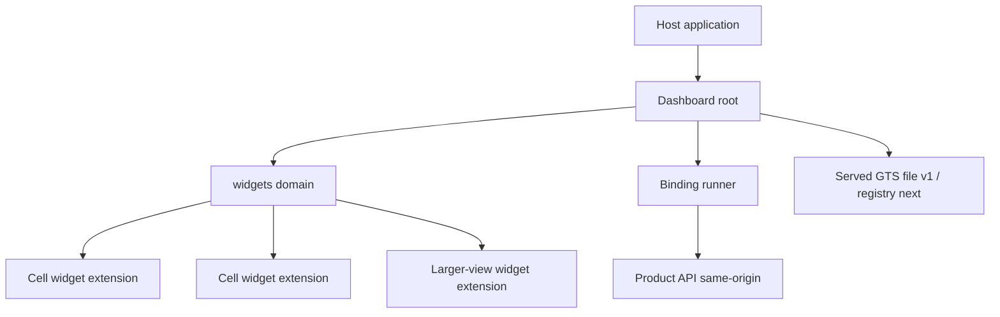
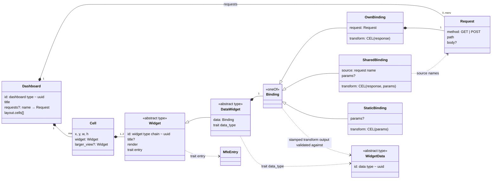
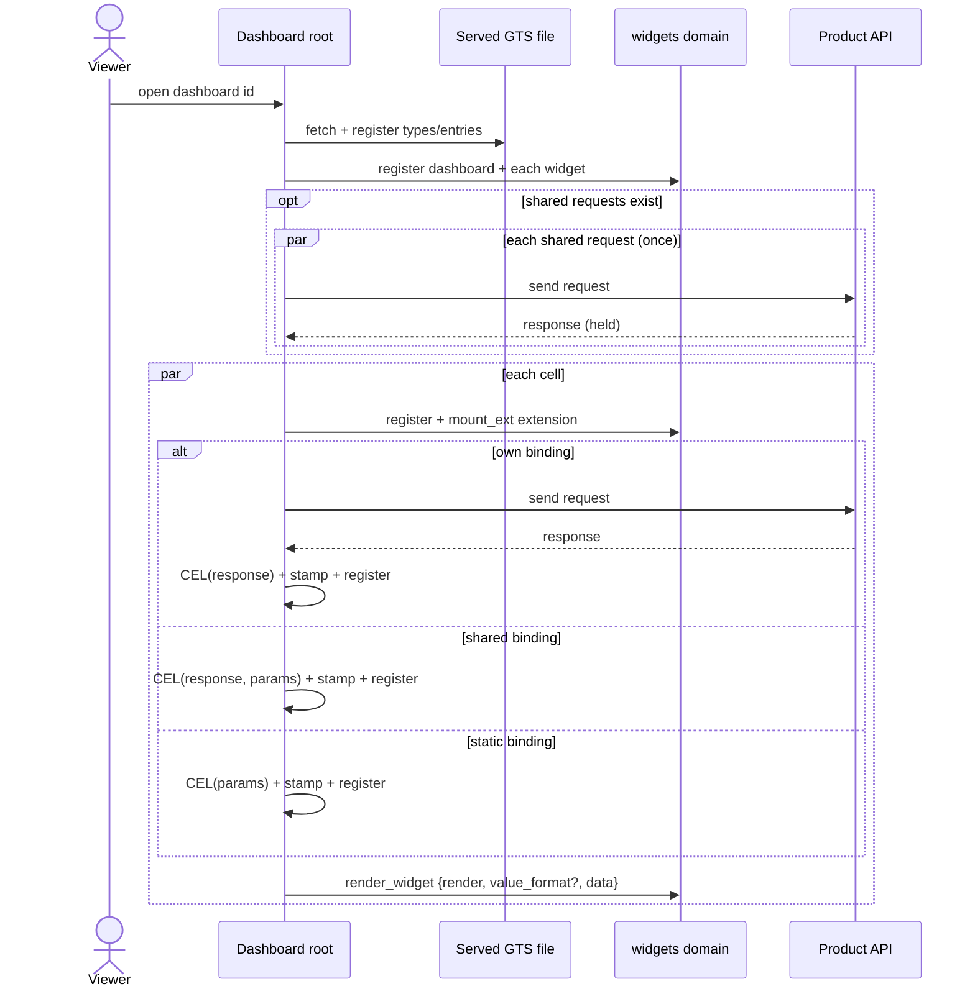

# Technical Design — Dashboard Template

- [ ] `p3` - **ID**: `cpt-frontx-dashboard-design-dashboard-template`

<!-- toc -->

- [1. Architecture Overview](#1-architecture-overview)
  - [1.1 Architectural Vision](#11-architectural-vision)
  - [1.2 Architecture Drivers](#12-architecture-drivers)
  - [1.3 Architecture Layers](#13-architecture-layers)
- [2. Principles & Constraints](#2-principles--constraints)
  - [2.1 Design Principles](#21-design-principles)
  - [2.2 Constraints](#22-constraints)
- [3. Technical Architecture](#3-technical-architecture)
  - [3.1 Domain Model](#31-domain-model)
  - [3.2 Component Model](#32-component-model)
  - [3.3 API Contracts](#33-api-contracts)
  - [3.4 Internal Dependencies](#34-internal-dependencies)
  - [3.5 External Dependencies](#35-external-dependencies)
  - [3.6 Interactions & Sequences](#36-interactions--sequences)
  - [3.7 Database schemas & tables](#37-database-schemas--tables)
- [4. Additional context](#4-additional-context)
  - [4.1 Budgets and NFR Realization](#41-budgets-and-nfr-realization)
  - [4.2 Operations, security and performance dispositions](#42-operations-security-and-performance-dispositions)
  - [4.3 Test approach](#43-test-approach)
  - [4.4 Open items](#44-open-items)
- [5. By Audience](#5-by-audience)
  - [5.1 Dashboard Author](#51-dashboard-author)
  - [5.2 Widget Author](#52-widget-author)
  - [5.3 Template Maintainer](#53-template-maintainer)
- [6. Worked Example](#6-worked-example)
  - [6.1 Types the example relies on](#61-types-the-example-relies-on)
  - [6.2 The dashboard instance](#62-the-dashboard-instance)
  - [6.3 What happens](#63-what-happens)
- [7. Traceability](#7-traceability)

<!-- /toc -->

## 1. Architecture Overview

### 1.1 Architectural Vision

`template-dashboard` is a declarative, backend-agnostic dashboard template. A **dashboard author** writes one JSON per dashboard. A **widget author** adds or fixes a widget type at runtime, without a product redeploy. A **dashboard viewer** reads a dashboard whose widgets map data through a binding the author wrote. The product writes no data code: the dashboard root runs each widget's binding against the product's same-origin API.

The dashboard root renders a dashboard from its JSON, owns the `widgets` domain, generates one FrontX extension per cell (and per larger view), runs each binding, stamps and validates the result, and sends `render_widget {render, value_format?, data?}` to the widget. Widgets are passive renderers: they render `render_widget`, including their own empty state, and make no requests. The template is hosting-agnostic: a product copies it into a single-page application or into a host that runs a screen, and it depends on FrontX packages only.

### 1.2 Architecture Drivers

**ADRs**: `cpt-frontx-dashboard-adr-frontend-framework`, `cpt-frontx-dashboard-adr-dashboard-layout-grid`, `cpt-frontx-dashboard-adr-shared-data-types-and-schemas`, `cpt-frontx-dashboard-adr-extension-domain-taxonomy`, `cpt-frontx-dashboard-adr-widget-type-and-mfe-realization`, `cpt-frontx-dashboard-adr-widget-data-binding`, `cpt-frontx-dashboard-adr-template-packages-and-host-contract`, `cpt-frontx-dashboard-adr-charting-library`, `cpt-frontx-dashboard-adr-data-grid-library`, `cpt-frontx-dashboard-adr-theme-distribution`, `cpt-frontx-dashboard-adr-subject-agnostic-widget-catalog`.

#### Functional Drivers

| Requirement | Design Response |
|-------------|------------------|
| `cpt-frontx-dashboard-fr-dashboard-root` | The root renders a dashboard from its JSON, owns the `widgets` domain, and generates one extension per cell/larger view. |
| `cpt-frontx-dashboard-fr-runtime-source` | Types and instances come from a served GTS file in v1; the bundle bases are registered first. |
| `cpt-frontx-dashboard-fr-per-cell-failure` | Each embedded widget and stamped data instance is registered on its own; a failure is attributed to its cell or larger view. |
| `cpt-frontx-dashboard-fr-no-product-data-code` | The root runs each binding (own, shared, or static); own and shared send requests against the product's same-origin API, static evaluates with no request. |
| `cpt-frontx-dashboard-fr-shared-data` | A shared request is sent once per dashboard load; every dependent widget shapes its part with its own transform. |
| `cpt-frontx-dashboard-fr-static-data` | A static binding builds the widget's data from the dashboard JSON alone, with no request. |
| `cpt-frontx-dashboard-fr-add-fix-widget` | A widget type points to its entry through the `entry` trait; a product changes the entry in its copy of the served file. |
| `cpt-frontx-dashboard-fr-grid-sort-page` | The grid sorts and pages client-side over the rows the transform delivered. The transform output is capped at 500 rows in total; an over-cap result fails data validation and is never truncated. The page size is a render choice up to 500. |
| `cpt-frontx-dashboard-fr-larger-view` | The larger view is an overlay inside the root's own container. |
| `cpt-frontx-dashboard-fr-theme` | The root publishes the host theme/language; a switch restyles only. |
| `cpt-frontx-dashboard-fr-safe-mappings` | The transform sees only its declared variables (`response` and/or `params`); the root caps the response size. |
| `cpt-frontx-dashboard-fr-states` | The root shows the loading and cannot-be-shown states per cell and at the dashboard level; a cell goes from loading to shown or cannot-be-shown. The widget renders one action and owns its empty state. |
| `cpt-frontx-dashboard-fr-widget-catalog` | The widget catalog ships 9 subject-agnostic types, each a GTS type and an entry, with a data type for the 8 data widget types (ADR-0009). |
| `cpt-frontx-dashboard-fr-markdown-safety` | The `markdown_card` renders CommonMark with HTML as text; links are active only for `http`, `https`, `mailto` and relative targets, and images load only from same-origin paths (ADR-0009). |
| `cpt-frontx-dashboard-fr-accessibility` | Widgets and the root's controls are keyboard-operable and usable with a screen reader: each control exposes its name, role and state, the loading, empty and cannot-be-shown states can be told apart, and charts and the heatmap offer a text alternative of their values. The larger-view overlay takes focus, keeps it inside, and returns it to its button. No widget conveys meaning by colour alone (§4.2 Accessibility, §5.2 Widget Author). |
| `cpt-frontx-dashboard-fr-isolation` | Each widget instance runs in its own isolated code (FrontX ADR-0011 (upstream)). |
| `cpt-frontx-dashboard-fr-dashboard-as-json` | A dashboard is one JSON of title, cells, and widget instances; the catalog documents each type (§5.1 Dashboard Author). |
| `cpt-frontx-dashboard-fr-same-origin-data` | Requests go to same-origin absolute paths with `GET` or `POST` only; the root rejects any other target. |
| `cpt-frontx-dashboard-fr-author-guides` | §5 By Audience outlines both author guides, the topics both must cover, and where they ship. |

#### NFR Allocation

| NFR ID | NFR Summary | Allocated To | Design Response | Verification |
|--------|-------------|--------------|-----------------|-------------|
| `cpt-frontx-dashboard-nfr-initial-render` | Under 3 s p95 | Binding runner, extension mount, evaluation | Parallel cells, deterministic ids reuse extensions, CEL parse/check before run | Measured on the reference dashboard |
| `cpt-frontx-dashboard-nfr-large-table` | No pause > 100 ms on a capped page | Grid widget, virtualizer | TanStack virtualizer renders only visible rows (ADR-0005) | Scrolling a capped page |
| `cpt-frontx-dashboard-nfr-bundle-budget` | Root < 500 KB, widget < 100 KB gzipped | Package split, shared deps | Shared deps fetched once by contentHash (ADR-0010) | Cold-load transfer measurement |
| `cpt-frontx-dashboard-nfr-visual-quality` | One look, both themes | ui-kit tokens per scope | Every widget styles itself with kit tokens (ADR-0006) | Design review in both scopes |
| `cpt-frontx-dashboard-nfr-no-persistence` | No browser storage, no server | Dashboard root, widgets | No storage use anywhere | Package inspection |
| `cpt-frontx-dashboard-nfr-accessibility` | Keyboard-operable, screen-reader usable, no colour-only meaning, both themes | widgets, cell frame, larger-view overlay | ARIA grid semantics, keyboard-operable controls, name, role and state on every control, text alternatives for charts and the heatmap, icon+label redundancy (§4.2 Accessibility) | Keyboard-only walkthrough and screen-reader walkthrough of the reference dashboard and its states variant (§4.1) in both themes |

### 1.3 Architecture Layers



- [ ] `p3` - **ID**: `cpt-frontx-dashboard-tech-dashboard-stack`

| Layer | Responsibility | Technology |
|-------|---------------|------------|
| Dashboard root | Render dashboard, own `widgets` domain, run bindings, cell frame, larger-view overlay | FrontX, TypeScript |
| Widget catalog | 9 widget types, each a GTS type + data type + entry | FrontX MFEs, ECharts, TanStack Table, markdown-it |
| Binding runner | Request via FrontX API package, CEL transform, stamp, validate | `@marcbachmann/cel-js` behind an internal interface |
| GTS source | Served JSON file of types and instances (v1); registry (next) | GTS v0.17, FrontX gts-plugin |

## 2. Principles & Constraints

### 2.1 Design Principles

When two principles conflict, the one earlier in this order wins: render-only root and passive widgets, per-instance isolation, and open bases with closed leaves last.

#### Render-only root, passive widgets

- [ ] `p2` - **ID**: `cpt-frontx-dashboard-principle-render-only`

The dashboard root renders what the dashboard JSON declares and runs the bindings; widgets render `render_widget` and make no requests. The root owns the cell frame (title, loader, cannot-be-shown state, larger-view button); the widget owns its empty state.

**ADRs**: `cpt-frontx-dashboard-adr-extension-domain-taxonomy`, `cpt-frontx-dashboard-adr-widget-data-binding`.

#### Per-instance isolation

- [ ] `p2` - **ID**: `cpt-frontx-dashboard-principle-per-instance-isolation`

Each widget instance runs in its own isolated code; widgets cannot couple through shared module state (FrontX ADR-0011 (upstream)). Isolation is per instance, not a sandbox.

**ADRs**: `cpt-frontx-dashboard-adr-frontend-framework`.

#### Open bases, closed leaves

- [ ] `p2` - **ID**: `cpt-frontx-dashboard-principle-open-bases-closed-leaves`

The widget base, `data_widget` and the widget-data base are abstract and open; every concrete type closes itself with `unevaluatedProperties: false`.

**ADRs**: `cpt-frontx-dashboard-adr-shared-data-types-and-schemas`.

### 2.2 Constraints

#### Sixty-column grid

- [ ] `p2` - **ID**: `cpt-frontx-dashboard-constraint-sixty-column-grid`

Layout is a fixed 60-column grid (`x` 0–59, `w` 1–60). The root checks bounds, overlaps, `x + w ≤ 60`, and unique widget ids. A failed check is a dashboard-level failure. Cells are read and reached by keyboard in row-major order (by `y`, then `x`), whatever their order in `cells`. The row-track height is the unit of `h`; the grid scales with the available width. On a narrow screen the grid may overflow horizontally and the host application decides whether to scroll or clip; device and screen-size support comes from the host application.

**ADRs**: `cpt-frontx-dashboard-adr-dashboard-layout-grid`.

#### Same-origin data, GET or POST only

- [ ] `p2` - **ID**: `cpt-frontx-dashboard-constraint-same-origin-data`

Requests go to same-origin absolute paths with `GET` or `POST` only; the root rejects any other target before sending. Sign-in is out of scope.

The same-origin check works on the resolved URL, not on the path text:

- The `path` must have a single leading `/` that is not followed by `/` or `\`, and no control characters (the request type's `path` pattern).
- The root resolves the `path` against the page origin. It sends the request only when the resolved URL has the page's origin.
- A response that was redirected to another origin is a failed request (§3.5), so the cell fails.

So `//other.example/x`, `/\other.example`, an absolute URL such as `https://other.example/x`, and any method other than `GET` or `POST` are rejected before sending.

**ADRs**: `cpt-frontx-dashboard-adr-widget-data-binding`.

#### Hosting-agnostic, FrontX-only deps

- [ ] `p2` - **ID**: `cpt-frontx-dashboard-constraint-hosting-agnostic`

The template depends on FrontX packages only, never on a host or shell template. The host supplies a container, a dashboard id, and the theme and language values. The host interface in §3.3 gives the technical form for each hosting form.

**ADRs**: `cpt-frontx-dashboard-adr-template-packages-and-host-contract`.

#### Permissive licences only

- [ ] `p2` - **ID**: `cpt-frontx-dashboard-constraint-permissive-licences`

Every third-party runtime library of the template uses a permissive licence: Apache-2.0 or MIT. A package-wide licence check enforces this, and it covers the CEL library too. A library under any other licence can't be added.

**ADRs**: `cpt-frontx-dashboard-adr-template-packages-and-host-contract`, `cpt-frontx-dashboard-adr-widget-data-binding`.

#### One GTS package

- [ ] `p2` - **ID**: `cpt-frontx-dashboard-constraint-one-gts-package`

All template types live under one GTS package `dashboard`.

**ADRs**: `cpt-frontx-dashboard-adr-shared-data-types-and-schemas`.

#### One root per registry

- [ ] `p2` - **ID**: `cpt-frontx-dashboard-constraint-one-root-per-registry`

The `widgets` domain id is fixed, so two dashboard roots in one registry would collide. In a single-page application one root is mounted at a time. Dashboards open at the same time each need their own registry, which is the MFE hosting form. The PRD's requirement that dashboards open at the same time each show only their own content (`cpt-frontx-dashboard-fr-dashboard-root`) is met in that form.

**ADRs**: `cpt-frontx-dashboard-adr-extension-domain-taxonomy`, `cpt-frontx-dashboard-adr-template-packages-and-host-contract`.

## 3. Technical Architecture

### 3.1 Domain Model



| Element | GTS form | Source |
|---|---|---|
| Dashboard | Type `…dashboard.dashboard.v1~`; instances `…~<uuid>`. Layout and cells are plain closed objects, no GTS types of their own. | Type: the root's bundle. Instances: the GTS file. |
| Dashboard `requests` | An optional object on the dashboard instance: a name maps to a request. Plain data, not GTS instances. | The dashboard author. |
| Request type | `gts.frontx.dashboard.widget.request.v1~`: `method`, `path`, `body?`. Referenced by every `requests` value and by an own binding's `request`; never registered as an instance. | The root's bundle. |
| Widget base | Abstract `…widget.widget.v1~`: `id`, `title?`, `render`. Trait schema `entry`. | The root's bundle. |
| Data widget | Abstract `…widget.widget.v1~…widget.data_widget.v1~`. Required `data` (the binding), trait schema `data_type`. | The root's bundle. |
| Widget type | A closed derived type, e.g. `…data_widget.v1~…widget.pie_chart.v1~`. Narrows `render`, sets traits. | The GTS file. |
| Widget instance | Embedded in a cell, id `<widget type>~<uuid>`. Registered on its own. | The dashboard author. |
| Binding | A `oneOf` of three closed forms (own, shared, static), each with `unevaluatedProperties: false`. A closed sub-schema of `data_widget`, not a GTS type. | The root's bundle. |
| Widget data type | Abstract `…widget_data.widget_data.v1~` plus one closed derived type per widget type. | Base: bundle. Derived: GTS file. |
| MFE entry | A plain FrontX instance of `…mfe.entry.v1~…mfe.entry_mf.v1~`, no derived type, no extra field. | Authored in the `widgets` package manifest file (`widgets/mfe.json`) and completed by the FrontX manifest pipeline. Carried at runtime by the served GTS file: the catalog's 9 entries and any entry a product adds or changes. |
| Widget extension | Generated per cell/larger view, an instance of the `widgets` domain's extension type `gts.frontx.mfes.ext.extension.v1~frontx.dashboard.mfe.widget_ext.v1~`. That type is the domain's `extensionsTypeId` and fixes `domain`. | Generated by the root. |

**Where entries and manifests travel.** One rule holds for every entry. `widgets/mfe.json`, the manifest file of the `widgets` package, is the authoring input for the 9 catalog entries and the `widgets` manifest; the FrontX manifest pipeline completes it. The served GTS file carries the 9 catalog entries, the `widgets` manifest, the widget types and the data types, and the entry and manifest of any widget a product adds or changes (§5.2). The root registers them from the served file. A product points a catalog widget type at another entry by changing the type's `entry` trait in its copy of the served file.

**Schema locations.** Full schemas live in the FEATURE docs under `template-dashboard/architecture/features/`: `feature-widget-contract` holds the base, action, extension, domain, and shared-property schemas, and `feature-widget-catalog` holds the widget and data type schemas. The served GTS file's name and envelope are tracked as an open item in §4.4.

The bundle also carries the request type, the `render_widget` action type `gts.frontx.mfes.comm.action.v1~frontx.dashboard.mfe.render_widget.v1~`, the `widgets` domain instance `gts.frontx.mfes.ext.domain.v1~frontx.dashboard.mfe.widgets.v1` and its extension type. The domain shares the FrontX theme and language properties, `gts.frontx.mfes.comm.shared_property.v1~frontx.mfes.comm.theme.v1~` and `…~frontx.mfes.comm.language.v1~`; the template refers to their ids and defines no schema for them.

**GTS rules.** GTS v0.17; 2020-12 dialect; `$id` of `gts://<type id>`; derived types use `allOf` with `$ref`. Combined anonymous ids with lowercase UUIDs; no separate `type` field; embedded instances carry no `$schema`; no GTS ids as object keys; every id starts at `v1` and is frozen from the first non-alpha release; an incompatible change after the freeze ships as a new version. Embedded `id` fields use literal base operands, never `/$id` (it resolves to the type being validated). Open bases (`x-gts-abstract: true`), closed leaves (`unevaluatedProperties: false`). Traits: `entry` on the widget base (`x-gts-instance-ref`), `data_type` on `data_widget` (`x-gts-type-ref`); neither trait schema is closed; values in `x-gts-traits` on the concrete type; the spec combines along the chain, merges root to leaf (RFC 7396), fills defaults; FrontX exposes no traits API, so the root resolves effective traits in its own code. `default` documents a default and fills nothing; the widget applies its `render` defaults itself. The data-widget binding is a `oneOf` of three closed forms (own, shared, static). The dashboard has an optional `requests` object for named shared requests. Embedded instances are not validated against their own type by the spec or gts-ts, so the root registers each embedded widget instance and each stamped data instance on its own. Bundle-schema guard: a served type whose id equals a bundle base is rejected before anything registers (dashboard-level failure). FrontX prerequisites (gts-plugin pins gts-ts 0.3.0): GTS v0.17 reference keywords, which FrontX's own schemas also need (they still use `x-gts-ref`, and its `mount_ext` and `unmount_ext` action types do not pass v0.17 derivation checks); type definitions for the theme and language shared properties, which FrontX refers to by id but does not define; validation with reference lookup off, so the root cross-checks `entry` and `data_type` exist. The root runs that cross-check for each cell and each larger view, after it resolves the widget type's effective traits and before it registers the generated extension (§3.6 step 5). A dangling `entry` or `data_type` fails only that cell or that larger view. The type store is shared across the realm, per compatible plugin copy.

**UUIDv5 namespace constant.** The template uses one fixed UUIDv5 namespace constant, `b3f7a1c2-4d6e-4f8a-9c1b-3e5d7f9a2b04`, the template's own, for both extension ids and stamped data ids. The name parts are joined with `|`, in UTF-8, with ids in lowercase: an extension id is `UUIDv5(namespace, widget id | role | entry id)` and a stamped data id is `UUIDv5(namespace, widget id | role)`. Ids are never persisted.

**API stability classification.** This design uses one stability vocabulary with three classes:

| Classification | Contracts | Policy |
|---|---|---|
| Experimental (stable from the first non-alpha release) | the `gts.frontx.dashboard.*` types, including the widget types, the data types, the request type, the `render_widget` action type, the `widgets` domain and its extension type; the identifiers of the entries | `v1` from the start; changes during alpha are listed in the release notes; frozen from the first non-alpha release; incompatible changes then ship as a new version |
| Internal | the id derivation of generated extensions, the GTS file loader, the diagnostics | may change in any release; coordinated inside the owning package |
| Product-supplied implementation | the product's API setup; the entry changes in the product's copy of the served file | added without changing the template's engine; during alpha, changes are listed in the release notes, and from the first non-alpha release breaking changes are controlled and announced |

**Versions after the freeze.** In GTS a new version is a new type id, such as `…pie_chart.v2~`. It is registered next to the old one, and both stay usable:

- **Coexistence.** The served file may hold several versions of a widget type or data type at once. Each widget instance names its version in its own id, so dashboards that use `v1` and `v2` render side by side.
- **Unknown version.** A widget instance whose type is not registered fails its own registration, so only its cell or larger view fails. A dashboard whose dashboard type is not registered fails at dashboard level.
- **The root's own types.** Each root release supports the versions of the bundle types it ships: the bases, the binding, the request type, `render_widget`, the `widgets` domain and its extension type. An entry that declares another version of `render_widget` is not admitted, so its cell fails.
- **Migration.** Existing dashboards keep their `v1` ids until their author changes them. A product takes a new template release by merging it into its copy (ADR-0010). It then adds the new types to its copy of the served file, keeping the old ones while any dashboard uses them. The release notes list every new version.

### 3.2 Component Model

**Packages.** The template has two code packages (ADR-0010). Their names match other things, so this design always says which one it means: the `dashboard` package or the `dashboard` GTS package, and the `widgets` package or the `widgets` domain.

| Code package | Contents | Release unit |
|---|---|---|
| the `dashboard` package | The bundle GTS types; the dashboard root with its binding runner, cell frame, larger-view overlay and trait helper; the served GTS file | Ships inside the product's build |
| the `widgets` package | One manifest file, `widgets/mfe.json`: the authoring input for the `widgets` manifest and the 9 catalog entries, completed by the FrontX manifest pipeline and carried at runtime by the served GTS file; the code of the 9 widget MFEs | One release unit, deployed as MFE builds |

The dependency runs one way: the `widgets` package imports only identifiers from the `dashboard` package, and the root reaches widgets only at run time.

The **trait helper** belongs to the root. Its input is a widget type id (a type chain). Its output is the effective traits: the trait values merged root to leaf, with defaults filled. Its algorithm is `cpt-frontx-dashboard-algo-widget-contract-effective-traits` in the widget contract FEATURE.

**Wiring.** The root gets each collaborator from one place. Tests replace only the parts named as test seams.

| Collaborator | Default | Test seam |
|---|---|---|
| Container, dashboard id, theme and language | The host, through the host interface (§3.3) | The test supplies them |
| Registry | In a single-page application, the application's own registry; in an MFE, the nested registry the root builds in its first mount | Each test file gets a new registry (§4.3) |
| Type system | The FrontX gts-plugin copy the registry uses | Each test file gets a new type store (§4.3) |
| API service | The FrontX API package copy the root runs with: the host's copy in a single-page application, the root's own copy in an MFE, set up by the product | The test stub API (§4.3) |
| Served GTS file and MFE builds | Served by the product (§3.5) | Served by the test stub API |
| Request timeout (30000 ms) and response-size cap (1 MiB) | Named constants of the binding runner | Tests read them and never change them; timeout tests use a fake clock |
| CEL library | The pinned library behind the runner's internal interface | Golden tests run through the same interface |

#### Dashboard root

- [ ] `p2` - **ID**: `cpt-frontx-dashboard-component-dashboard-root`

##### Why this component exists

It renders a dashboard from its JSON and owns the runtime: the `widgets` domain, the binding runner, the cell frame, the larger-view overlay, and failure attribution.

##### Responsibility scope

Register the bundle; register the `widgets` domain; load the served GTS file; register the dashboard instance and each embedded widget instance on its own; run the layout checks; for each cell, generate an extension, mount it, run the binding, stamp and register the result, send `render_widget`; own the larger-view overlay and its accessibility; publish theme and language; drop late results for unmounted extensions.

##### Responsibility boundaries

It does not author dashboards, does not sign in, does not carry credentials, and does not call third parties. Widgets make no requests.

##### Related components (by ID)

- `cpt-frontx-dashboard-component-binding-runner` — owns.
- `cpt-frontx-dashboard-component-widget-catalog` — renders types from.

#### Binding runner

- [ ] `p2` - **ID**: `cpt-frontx-dashboard-component-binding-runner`

##### Why this component exists

The product writes no data code; the runner turns a binding into validated widget data.

##### Responsibility scope

Run each binding by form: own — send the request and evaluate the transform on `response`; shared — start the shared request if not running, evaluate the transform on `response` and `params` when it answers; static — evaluate the transform on `params` at once, with no loader. Send every GET through the FrontX API package's endpoint descriptors, so the FrontX fetch cache can join identical in-flight GETs but never serves a completed response; send every POST directly, never through the cache. The runtime FEATURE names the exact calls. Send each shared request once per dashboard load, hold the response until teardown, and run every dependent transform on it. Enforce the same-origin check (§2.2) and GET/POST, with a timeout of 30000 ms; cap the response size at 1 MiB (§3.5); stamp the result with `<data type>~<UUIDv5(namespace, widget id | role)>` and register it, which validates it. Wrap the CEL library behind a small internal interface (parse, check, evaluate, convert to JSON).

##### Responsibility boundaries

It does not render, does not mount extensions, and does not expose the host, network, or shared state to the transform.

##### Related components (by ID)

- `cpt-frontx-dashboard-component-dashboard-root` — called by.

#### Widget catalog

- [ ] `p2` - **ID**: `cpt-frontx-dashboard-component-widget-catalog`

##### Why this component exists

The 9 widget types and their entries, with data types for the 8 data widget types, shipped ready to use.

##### Responsibility scope

The template's own widget types, data types, and MFE entries; the catalog widgets' libraries (ECharts via `echarts/core`, TanStack Table v8 + virtualizer, markdown-it); per-instance chart themes from ui-kit tokens; ARIA grid semantics; markdown safety.

##### Responsibility boundaries

It does not run bindings, does not own the cell frame, and does not define new types at runtime.

##### Related components (by ID)

- `cpt-frontx-dashboard-component-dashboard-root` — rendered by.

### 3.3 API Contracts

The template exposes one public surface, the dashboard and widget contract (`cpt-frontx-dashboard-interface-contract`), and one action, `render_widget`. The binding is the data contract a dashboard author writes; the `render_widget` action is the runtime contract between the root and a widget. The template also requires one interface from the host: the host interface below.

#### Binding

- [ ] `p2` - **ID**: `cpt-frontx-dashboard-interface-binding`

**Direction**: written by a dashboard author, run by the dashboard root.

**Protocol/Format**: JSON, part of the dashboard instance. The `data_widget` schema in the widget contract FEATURE (`cpt-frontx-dashboard-dod-widget-contract-data-widget`) is the normative definition of the binding. The dashboard type in the dashboard model FEATURE defines the `requests` object. On any difference, those schemas govern; ADR-0011 records the rationale. In short, a data widget's `data` has one of three forms:

- **own:** `{request, transform}` — the transform's single variable is `response`, the parsed JSON body.
- **shared:** `{source, params?, transform}` — `source` names a request in the dashboard's `requests` object; the transform's variables are `response` (the shared response) and `params`.
- **static:** `{params?, transform}` — the transform's single variable is `params`; no request is sent.

Binding `params` is the transform's input values; it is unrelated to the widget's `render` field.

JSON numbers arrive as CEL `double`, and a missing field is an error unless the transform tests it with `has()`.

**Variables a transform can see.** The runner wraps `@marcbachmann/cel-js`, pinned, behind a small internal interface (parse, check, evaluate, convert to JSON). It uses `homogeneousAggregateLiterals: false` and `unlistedVariablesAreDyn: true`. `env.check()` and its caret errors give authors feedback before anything runs. The runner enforces the declared variables at evaluation:

- The evaluation context holds only the form's variables: `response`, `params`, or both. Nothing else from the root, the host, the network or shared state is in it.
- `unlistedVariablesAreDyn: true` only lets `check()` type an unknown name as dynamic; it never gives that name a value. So an undeclared identifier fails evaluation with an unknown-variable error, and the cell shows its cannot-be-shown state.
- A golden test confirms that a transform using an undeclared identifier fails before any data reaches the widget.

#### render_widget action

- [ ] `p2` - **ID**: `cpt-frontx-dashboard-interface-render-widget`

**Direction**: sent by the dashboard root to a widget extension.

**Protocol/Format**: one FrontX action, `render_widget {render, value_format?, data?}`. The widget renders it, including its own empty state, and nothing more. The payload carries the widget instance's `render` object and, for a data widget, its `value_format` and the stamped data instance; all are validated before it is sent, the widget instance against its own type and the data against its data type. The widget gets no widget id, title or binding. The root sends it once `mount_ext` has finished and the data is valid; a `markdown_card` cell gets `render_widget {render}` at once, with no loader.

#### Host interface

- [ ] `p2` - **ID**: `cpt-frontx-dashboard-interface-host`

- **Contracts**: `cpt-frontx-dashboard-contract-host`
- **Direction**: required from the host application, used by the dashboard root.
- **Stability**: experimental, under the same policy as the `gts.frontx.dashboard.*` types (§3.1).

The host gives the root four inputs: a container, a dashboard id, a theme value and a language value. The form depends on the hosting form. Everything after start is the same in both forms.

| | MFE (screen extension) | Single-page application |
|---|---|---|
| **Root** | The FrontX MFE entry of a screen extension that the host registers in its screen domain. | Code copied into the application. |
| **Start** | FrontX mounts the screen extension. The entry's `mount` gets the container that the screen domain's mount strategy creates. | The application's code starts the root with a container element of its own. |
| **Dashboard id** | Comes from the screen extension's route. | Passed by the application, for example from its route. |
| **Theme and language** | The screen domain's FrontX theme and language shared properties. The root reads them through its bridge on mount and on each change. | Passed by the application on start and on each change. |
| **Change of dashboard id** | A route change gives the root a new id. The root starts a new load, which supersedes any load in progress. | The application passes the new id, with the same result. |
| **Change of theme or language** | The root republishes the new value on the `widgets` domain (§3.6 step 3). | The same. |
| **Stop** | FrontX unmounts the screen extension. The root runs teardown (§3.6 step 7) and keeps its nested registry. | The application stops the root when the dashboard area leaves the page. The root runs teardown. |
| **Registry** | The nested registry the root builds in its first mount. | The application's own registry. |

The host and the product also provide what the rest of the design needs: the product's API setup on the API service the root uses (§3.5), the served GTS file and the MFE builds it names (§3.5), and one root per registry (§2.2). The exact route shape that carries the dashboard id and the code signature for the single-page form are open (§4.4).

### 3.4 Internal Dependencies

| Dependency Module | Interface Used | Purpose |
|---|---|---|
| FrontX | FrontX packages (pinned) | MFE packaging, domains, actions, shared properties, gts-plugin |
| `@gears-frontx/ui-kit` | Shared dependency | Tokens and components, light/dark scopes |
| `@marcbachmann/cel-js` | Internal interface (parse/check/eval/toJSON) | The transform language |
| `echarts/core` | Shared dependency | Chart widget types (ADR-0004) |
| TanStack Table v8 + virtualizer | Shared dependency | The grid widget type (ADR-0005) |
| markdown-it (MIT) | Shared dependency | `markdown_card`: CommonMark, raw HTML off, link validation hook (ADR-0009) |
| GTS v0.17 | gts-ts via FrontX gts-plugin | Types, validation, registration (ADR-0003) |

Dependency rules: no circular build-time dependencies — the `widgets` package imports only identifiers from the `dashboard` package, and the root reaches widgets only at run time; only the binding runner talks to the product API; widgets never make requests; no host or shell template dependency.

### 3.5 External Dependencies

#### Product API

| Dependency Module | Interface Used | Purpose |
|---|---|---|
| Product API | Same-origin HTTP, `GET`/`POST` | Answers the requests a binding makes |

The product owns authentication, authorization, errors and access for every request. The template carries no credentials. Requests go to same-origin absolute paths only; the root rejects any other target before sending (§2.2).

**Request form.** A `GET` carries its query string in `path`. A `POST` sends its `body` as JSON. The root adds no credentials or headers beyond what the product's API setup adds.

**Success and failure.** A request succeeds when it answers with a 2xx status from the page's origin and a body that is valid JSON of at most 1 MiB (1,048,576 bytes, decoded). Any of these is a failed request:

- a network error;
- no complete answer within 30000 ms, counted from sending the request to the last byte of the body;
- a status outside 2xx, including 401 and 403;
- a redirect to another origin;
- a body that is not valid JSON, including an empty body;
- a body over 1 MiB, counted after decoding.

A failed request fails its cell; a failed shared request fails every dependent cell. The root does not retry and has no circuit breaker. The product's API owns errors, throttling and access.

The root does not retain the FrontX fetch cache; the product decides whether it is on. When the product turns it on, identical GETs across cells, dashboards and other runtimes are coalesced by FrontX. Named shared requests are the explicit way to share, and the only one for POST.

#### Served GTS file

This realizes the PRD's runtime-loaded JSON contract (`cpt-frontx-dashboard-contract-runtime-loaded-json`).

| Dependency Module | Interface Used | Purpose |
|---|---|---|
| Served GTS file | A JSON file of GTS types and instances, fetched with `GET` through the FrontX API package | The only runtime source of widget types, data types, entries, manifests and dashboards in v1; a type registry replaces it in the next version |

- **Location.** The template ships the file in the `dashboard` package and the product serves it. How the root learns the file's location is open (§4.4).
- **Fetch rules.** One `GET` per dashboard load, with the same 30000 ms timeout as a binding request and no retry. The root adds no credentials or headers beyond the product's API setup. The file has no size cap: it is trusted, product-controlled input, and its size is the product's concern.
- **Caching.** The template adds no cache of its own; HTTP caching follows the headers the product's server sends. A return to the dashboard already loaded reuses what is registered and does not fetch the file again. A type id that is already registered keeps its first content, so a changed type shows on the next page load.
- **Selecting the dashboard.** The root looks for the dashboard instance whose `id` equals the requested dashboard id. No match is a dashboard-level failure, with a diagnostic naming the id.
- **Failure.** A fetch that fails or times out, a served type whose id equals a bundle base, or any registry rejection of a served type, manifest or entry is a dashboard-level failure: the dashboard can't be shown.
- **Who can read it.** In v1 the file reaches every viewer who can load the application. Dashboard visibility is the product's job: it serves a per-viewer file, or keeps restricted dashboards out of the file.

#### Host application

| Dependency Module | Interface Used | Purpose |
|---|---|---|
| Host application | The host interface (`cpt-frontx-dashboard-interface-host`, §3.3) | Supplies the container, the dashboard id, and the theme and language values; starts and stops the root |

The template depends on no host or shell template; it names what it needs from the host by role (`cpt-frontx-dashboard-constraint-hosting-agnostic`).

### 3.6 Interactions & Sequences

#### Runtime flow

**ID**: `cpt-frontx-dashboard-seq-runtime-flow`

**Use cases**: `cpt-frontx-dashboard-usecase-view-dashboard`. **Actors**: `cpt-frontx-dashboard-actor-dashboard-viewer`, `cpt-frontx-dashboard-actor-host-application`, `cpt-frontx-dashboard-actor-consuming-backend`.

The runtime FEATURE holds the step-level flows and algorithms: open a dashboard (`cpt-frontx-dashboard-flow-dashboard-runtime-open`), open a larger view (`cpt-frontx-dashboard-flow-dashboard-runtime-larger-view`), switch theme (`cpt-frontx-dashboard-flow-dashboard-runtime-theme`), leave a dashboard (`cpt-frontx-dashboard-flow-dashboard-runtime-leave`), and the algorithms they call. This section states who talks to whom, which failure has which scope, and what stays after teardown.

1. **Start.** The host starts the root through the host interface (§3.3) with a container, a dashboard id, and the theme and language values. The root registers its bundle schemas.
2. **Registry and domain.** The root registers the `widgets` domain in a registry it can write to (`cpt-frontx-dashboard-algo-dashboard-runtime-register-domain`):
   - **In a single-page application:** the application's own registry.
   - **In an MFE:** a nested registry that the root builds synchronously in its first mount, once per runtime, with the FrontX MFE handler for `entry_mf` entries.
     - A child cannot register into an ancestor's registry, but FrontX advertises the nested registry's domains and extensions upward.
     - The nested registry and its registrations survive an unmount.

   The domain uses FrontX's concurrent mount strategy and the declaration of the `widgets` domain instance in the widget contract FEATURE. Every listed action has a handler. If the domain is rejected, the dashboard can't be shown. The domain's container hooks create each extension's container under the domain's one root element. Those hooks and CSS on the containers place the cells and the larger-view overlay; the root never mounts into arbitrary elements.
3. **Theme and language.** The root publishes them as the domain's shared properties on every mount, before any cell mounts, and republishes on change. Widgets read them on mount. A theme change never re-runs a binding or remounts anything (`cpt-frontx-dashboard-algo-dashboard-runtime-publish-theme`).
4. **Load.** The root loads the served GTS file (§3.5; the type registry in the next version; `cpt-frontx-dashboard-algo-dashboard-runtime-load-file`):
   - It fetches the file. If a served type id equals a bundle base, it rejects the whole file and registers nothing.
   - It registers the file's types, manifests and entries, and keeps its own index.
   - It looks up the dashboard instance whose `id` equals the requested id. It registers that instance, which validates it; embedded widgets are checked only against the open widget base, so an embedded widget that breaks the base, such as one with no `id`, fails the dashboard. It then registers each embedded widget instance (`widget` and `larger_view`) on its own.
   - It runs the layout checks. It collects the shared request names that any cell or larger view references, and marks each cell whose `source` is unknown as failed. A shared request is sent only when at least one cell or larger view names it in `source`.

   **Dashboard-level failures:** the file can't be fetched or times out; a served type id equals a bundle base; the registry rejects a served type, manifest or entry; no dashboard in the file matches the requested id; the dashboard instance fails validation, including an embedded widget that breaks the open widget base; a layout check fails. Each shows "This dashboard cannot be shown" and writes a diagnostic. One rejected item in the file fails every dashboard in it (§4.2 Reliability). A widget instance that fails its own registration against the type its `id` names fails only its cell, or only the larger view for a `larger_view` instance (`cpt-frontx-dashboard-algo-dashboard-model-failure-attribution`). A load superseded by a new dashboard id is discarded; the root checks for this after each step that waits.
5. **Each cell, in parallel.** (`cpt-frontx-dashboard-flow-dashboard-runtime-open`, `cpt-frontx-dashboard-algo-dashboard-runtime-run-binding`.)
   - **Traits.** The root resolves the widget type's effective traits with the trait helper (§3.2). It checks that `entry` names a registered entry and `data_type` a registered data type. A dangling reference fails this cell only, before anything mounts.
   - **Mount.** The root registers the cell's generated extension in the `widgets` domain, with the id of §3.1 (a reload reuses it), and mounts it with `mount_ext`. Its container is placed into the cell. For the own and shared forms the frame shows a loader.
   - **Data.** The root runs the binding by form (§3.3), stamps the result, and registers it, which validates it.
   - **Render.** The root sends `render_widget {render, value_format?, data}` once the mount has finished and the data is valid. A `markdown_card` cell has no binding and gets `render_widget {render}` at once, with no loader. An entry's `mount` resolves only after it has registered its handlers, a FrontX obligation on every entry. The widget's handler resolves as soon as it accepts the payload, before drawing, within the domain's default action timeout of 30000 ms. Starting an action chain returns nothing to wait on, so the root learns the outcome from the chain's success or fallback step.
   - **Cell-scope failures:** a dangling trait reference, a failed request (§3.5), a CEL error, a data validation error, a widget instance that fails its own registration against the type its `id` names, a rejected extension registration, a failed mount, or a `render_widget` chain that ends in fallback or times out. Each shows "This widget cannot be shown" in the cell and writes a diagnostic. A failed shared request does this in every dependent cell, and the diagnostic names the request. The other cells are unaffected.
   - **Drawing failures.** A widget that fails while drawing shows its own cannot-be-shown state in its area (a widget obligation, §5.2).
   - **Known limit.** A widget that crashes after it has accepted the payload, without showing anything, leaves its cell blank under the cell's title. The root cannot see inside the isolated widget, so it writes no diagnostic. This is an accepted limitation.
6. **Larger view.** The cell frame shows the button only when the cell has `larger_view`. A click opens the overlay inside the root's own container, then runs step 5 for the `larger_view` widget in the same extension domain, with its own binding (`cpt-frontx-dashboard-flow-dashboard-runtime-larger-view`). Own form: as for a cell. Shared form: evaluate the transform on the held response and the binding's `params`. Static: as for a cell. With the own and static forms the cell and its larger view are independent snapshots; with the shared form both show the same held response. A failure in the larger view fails only the larger view. Closing the overlay unmounts that extension.
7. **Teardown.** (`cpt-frontx-dashboard-flow-dashboard-runtime-leave`.)
   - **On leaving,** the root unmounts every extension, including an open larger view. It drops any result for an extension no longer mounted and never sends to an unmounted extension. It drops the held shared responses.
   - **Before another dashboard loads,** the root unregisters the generated extensions. A load superseded by a new dashboard id discards its shared responses as well.
   - **What stays registered.** The served file's types, manifests and entries, the dashboard and widget instances, and the stamped data instances stay registered for the life of the realm. This is intentional: FrontX's type store has no call that removes a registered type or instance. Stamped data ids are deterministic, one per widget and role, so the next load of a dashboard replaces their content. The total is bounded by the widgets in the served file. A page reload clears it all, and nothing is persisted. §3.7 lists every runtime holding.

**States and wordings** (default English, localized): "Loading dashboard", "This dashboard cannot be shown", "Loading", "This widget cannot be shown". The widget owns "No data to show". A widget's own cannot-be-shown state uses the cell's text, "This widget cannot be shown": static, with no error text. Loaders are announced as a status. Empty but valid data shows the widget's empty state, never the cannot-be-shown state.

#### Open a dashboard

**ID**: `cpt-frontx-dashboard-seq-open-dashboard`

**Use cases**: `cpt-frontx-dashboard-usecase-view-dashboard`. **Actors**: `cpt-frontx-dashboard-actor-dashboard-viewer`, `cpt-frontx-dashboard-actor-host-application`.



#### Open a larger view

**ID**: `cpt-frontx-dashboard-seq-open-larger-view`

**Use cases**: `cpt-frontx-dashboard-usecase-view-dashboard`. **Actors**: `cpt-frontx-dashboard-actor-dashboard-viewer`.

The viewer clicks the cell's larger-view button; the root opens the overlay in its own container, runs the cell flow for the `larger_view` widget with its own binding (own form: as for a cell; shared form: evaluate the transform on the held response and the binding's `params`; static: as for a cell), and closes with a close button, on Escape, a click outside, or a page refresh.

### 3.7 Database schemas & tables

- [ ] `p3` - **ID**: `cpt-frontx-dashboard-db-none`

The template has no database. It is a read-only frontend that persists nothing: no browser storage, no server (`cpt-frontx-dashboard-nfr-no-persistence`). Dashboards and widget data come from the served GTS file and the product's API; the template owns no data store.

**Runtime holdings.** The root holds these in memory only. A page reload clears every one of them.

| Holding | Content | Writer | Lifetime | Bound |
|---|---|---|---|---|
| FrontX type store (realm-shared) | Bundle types; the served file's types, manifests and entries; dashboard and widget instances | The root, through the registry | The life of the realm (no removal call in FrontX) | The bundle and the served file |
| FrontX type store (realm-shared) | Stamped data instances | The binding runner | The life of the realm; the next load of a dashboard replaces their content | One per widget and role in the served file |
| Registry | The `widgets` domain and the generated extensions | The root | The domain: the life of the registry. Generated extensions: until another dashboard loads | One extension per cell and per larger view of the loaded dashboard |
| The root's own index | What the root registered from the served file, and the generated extensions by widget id | The root | The life of the root | The served file |
| Held shared responses | The parsed body of each shared request | The binding runner | Until teardown or supersession | One per named request of the loaded dashboard, each at most 1 MiB |

Nothing is written to browser storage or sent to a server.

## 4. Additional context

### 4.1 Budgets and NFR Realization

Provisional budgets (confirmed by measurement):

- Initial render under 3 s p95, including evaluation of every widget.
- Dashboard root under 500 KB gzipped, CEL library included.
- Each widget entry under 100 KB, own code only.
- No pause longer than 100 ms on a capped grid page.

Counting rule: transferred gzipped bytes on a cold load of the reference dashboard. The root with the shared dependencies it fetches; each widget entry with its own code only; each shared dependency once in the page total (source text fetched once when every template widget publishes the same `contentHash`, FrontX ADR-0034/0035). Each widget instance still evaluates its own copy (FrontX ADR-0011 (upstream)), so evaluation cost counts against the initial-render budget.

**Reference dashboard.** One dashboard whose layout holds one widget of each of the 9 widget types, and in which every cell defines a larger-view widget. The grid's data has 500 rows, the cap: it spans many pages at the smaller page sizes and fills one page at the page size of 500. The chart widgets are sized to the largest expected charts. The other widget types have bounded data sizes, an assumption of every budget below. It is used for the initial-render measurement, the bundle measurement, the large-grid check and the accessibility walkthrough.

**States variant.** For the screen-reader walkthrough of the states, the test stub API also serves a variant of the reference dashboard and a second dashboard id. In the variant, one data widget gets valid empty data, so it shows its empty state; one cell's own request fails, so the root shows that cell's cannot-be-shown state; and the grid's `render` repeats a column `key`, so the grid's own check fails and the widget shows its own cannot-be-shown state. The second dashboard id fails its type, so the root shows the dashboard's cannot-be-shown state. The screen-reader walkthrough runs on these as well as on the reference dashboard.

**Test stub API.** All measurements use a test stub API that names no backend. It returns the reference dashboard and its types, and answers every binding from fixtures in memory. It answers every request after a fixed delay of 250 ms. The product's backend time is excluded from the initial-render budget; in production, the product's answer time adds to the measured time.

**Budget method.** The initial-render budget is p95 under 3 s from the moment the viewer opens the dashboard address to the moment every data widget presents its data. The served GTS file, the dashboard load, every binding, and the evaluation of every MFE and shared package are included. The measured window starts when the dashboard address opens and ends when the last data widget shows its data. The table fixes the remaining conditions.

| Condition | Value |
|---|---|
| Reference device | Business laptop with 4 physical CPU cores and 16 GB of memory, latest stable Chromium-based browser, no CPU throttling |
| Network profile | Browser network emulation of 100 Mbit/s downstream, 20 Mbit/s upstream and 20 ms round-trip time, applied to the template's files |
| Test stub API response time | The test stub API answers every request after a fixed delay of 250 ms |
| Load state | Template bundle files are already downloaded before the run; loading and evaluating each entry, the GTS file, the dashboard load and every binding are inside the measured window |
| Sample size | At least 30 runs per measurement; p95 is computed over those runs |

**Large grids.** A grid's transform output is capped at 500 rows in total (`maxItems` in the grid data type, ADR-0009). An over-cap result fails data validation, so the cell shows its cannot-be-shown state; rows are never truncated. The page size is a render choice up to 500. The `grid` widget always pages and renders the rows of a page virtualized, so the DOM holds only the rows in view. Under the reference conditions, scrolling through a 500-row page of the reference grid, shown in its cell, is checked against `cpt-frontx-dashboard-nfr-large-table`: the view never stops responding for longer than 100 ms (provisional). The 500-row bound applies to the grid only.

### 4.2 Operations, security and performance dispositions

**Operations.** The template is source code with no service of its own.

- **Residency:** not applicable because the template stores no data and runs no service. Its requests go only to the product's same-origin API; the product owns that API, its backend and their residency.
- **Resources:** not applicable because the template provisions no server, storage or network resource. The browser lays out and presents data; the product's API and backend compute every value. Dashboard size and data size are the product's concern. Download cost is bounded by the bundle budget, and evaluation cost by the initial-render budget.
- **Observability:** not applicable because the template runs no service and has no availability target. It writes diagnostics, including every cannot-be-shown cause, to the browser console; the product owns monitoring, telemetry and alerting.
- **Secrets:** not applicable because the template holds no secret and no backend configuration. The product's API owns the session and any credential, inside the product's code.
- **Cost:** not applicable because the template provisions no infrastructure. Its only costs are client-side download, memory and rendering. The bundle budget bounds download and the initial-render budget bounds evaluation and first rendering; memory has no budget (see Performance). Serving dashboards and data is a cost of the product.
- **Rollback:** the template holds no state to recover, so rollback has two paths and no data step.
  - *Template source:* a product rolls back by shipping its previous build, and opening a dashboard again restores the view.
  - *Runtime widget release* (MFE build, entry, manifest, types in the served file): the product restores the previous types, entry and manifest in its served file, or redeploys the previous MFE build. The change shows on the next page load, with no product redeploy.
- **Environment promotion:** the template provisions no environment and no infrastructure.
  - *Template source:* it ships as source inside the product's build, which the product promotes.
  - *Runtime widget release:* the product promotes the MFE build and its copy of the served file through its own environments, in the publish order of §5.2: the MFE build first, then the served file.
  - *Feature flags, canary, blue/green and health checks:* not applicable to the template; a product that wants them applies them to its served file and MFE builds with its own tooling.
- **Event architecture:** not applicable because the template neither publishes nor consumes events. It uses FrontX actions and shared properties.
- **Interface versioning:** covered by the API stability classification in §3.1. The template defines no backend interface.

**Security.** The template is browser code that presents what the product's API returns. It has no sign-in or session flow.

- **Trust boundaries:** the browser, where the dashboard root and the widget extensions run inside the host application; the product's API, which is the only path to a backend; the host application, which owns the session; and the served GTS file, which decides which widget code loads into the page. The template adds no boundary of its own.
- **Untrusted inputs:** the dashboard id from the address, and responses from the product's API with the widget data a transform builds from them. Responses are contained by the response-size cap (1 MiB), by transforms that see only their declared variables, and by data validation. None of these bounds evaluation time (see Reliability). The dashboard id only selects a dashboard.
- **Trusted inputs:** the dashboard JSON, including a generated one, and the served file are product-controlled and trusted; the product validates a generated dashboard before serving it, and the root still validates every dashboard and widget against its types.
- **Trusted executable inputs:** the served file names MFE entries and manifests, and FrontX runs that entry code in the page with full page privileges. Isolation is per instance, not a sandbox. So the served file and every entry it names are fully trusted, product-controlled code. The template adds no origin rule and no integrity check for entry code: the product decides where it serves MFE builds from, and its page policy, such as its content security policy, limits which origins may supply code. The no-request and same-origin rules are obligations on widget code, checked by review (§5.2).
- **Authorization:** the product's API and backend authorize every request. The template makes no access decision. In v1 the served GTS file reaches every viewer who can load the application, so it is not an access control: dashboard visibility is the product's job. The product serves a per-viewer file, or keeps restricted dashboards out of the file. Every viewer who may see a dashboard must be able to get its widgets' data. An identifier is not an authorization: holding a dashboard id or a widget id grants no access.
- **Output safety:** `markdown_card` renders CommonMark and shows embedded HTML as plain text, never rendered. Grid cells show values as text.
- **Supply chain:** third-party runtime libraries are limited to those listed in §3.4 under `cpt-frontx-dashboard-constraint-permissive-licences` and pass the package-wide licence check. Every runtime dependency is pinned to an exact published version: the FrontX packages, `@gears-frontx/ui-kit`, the CEL library, ECharts, TanStack Table and its virtualizer, and the CommonMark renderer. The template runs no dependency vulnerability scan of its own; a product scans its copy with its own pipeline.
- **Not applicable**, each for the reason given:
  - Authentication and session management, including multi-factor authentication, federated sign-in and session renewal: the template has no such flow; the host application and the product's API own the session.
  - Service-to-service authentication and credential storage: the template runs no service and holds no credential.
  - Roles and a permission matrix: the template makes no access decision.
  - Encryption at rest, key management and secure disposal: the template stores nothing.
  - Encryption in transit, network segmentation, firewall rules and a CORS policy: the template sends requests only to the product's same-origin API through the FrontX API package; that transport, its encryption and its policies belong to the product.
  - Data classification, personal data handling and masking: the template shows delivered data unchanged, and the product's API decides what it delivers.
  - Audit logging, log retention, security monitoring and incident response: the template runs no service and writes only diagnostics to the browser console.

**Performance.** Parallel cells; deterministic ids reuse extensions; CEL parse/check before run; virtualized grid rows; per-instance chart themes rebuilt only on theme change.

**Memory.** Memory has no budget, because dashboard size and data size are the product's concern. The main cost is per-instance isolation: each widget instance evaluates its own copy of its libraries (FrontX ADR-0011 (upstream)). The root holds the held shared responses (each at most 1 MiB) until teardown, and the type store holds the registrations listed in §3.7 until a page reload.

**Reliability.** Per-cell failure isolation; a request that never answers times out at 30000 ms; failed requests are not retried; late results for unmounted extensions are dropped.

- **Transform evaluation has no time limit.** Transforms are parsed and checked before any run, but evaluation runs synchronously in the root and nothing stops it; the 30000 ms timeout covers only the request. A slow transform, such as a comprehension over a large response, blocks the root and every cell. This is an accepted risk. It is bounded only indirectly: by the 1 MiB response cap, and by dashboard authors, who are trusted. No Worker is in scope.
- **CEL library maintenance.** The CEL library has a single maintainer. The mitigation is the pinned version behind the runner's internal interface, so the library can be swapped in one module.
- **The served file is one release unit.** Any registry rejection of a served type, manifest or entry fails every dashboard in the file at dashboard level, including dashboards that do not use the rejected item. This is accepted. The control is that the product validates the file against the registered types before publishing it.

**Accessibility.** Every control follows the host accessibility policy. The larger-view button, the larger-view overlay's close button, the grid's sort headers, pager, page-size choice and column resize handles are keyboard-operable. The grid exposes ARIA grid semantics, including row counts, positions and sort state for virtualized rows. No widget conveys meaning by colour alone: grid row colours carry an icon with an accessible name, and chart series are labelled or differ in another visible way. Cells are read and reached by keyboard in row-major order (by `y`, then `x`), whatever their order in `cells` (ADR-0002). Every control exposes its accessible name, role and state. The loaders are announced as a status. The dashboard's cannot-be-shown state, the cell's cannot-be-shown state (the same text whether the root or the widget draws it) and the widget's empty state are exposed as text; their three wordings differ from one another and from the loaders, so a screen reader can tell them apart. Charts and the heatmap offer a localized accessible name and a text alternative of their values. The larger-view overlay is a dialog: focus moves into it on open, stays inside it while it is open, and returns to the larger-view button on close (`cpt-frontx-dashboard-flow-dashboard-runtime-larger-view`). The accessibility check method is a keyboard-only walkthrough and a screen-reader walkthrough of the reference dashboard, in both themes: they open and close every larger view, and sort, page, resize and change the page size of every grid; the screen-reader walkthrough also checks every control's name, role and state, the loading states, the empty and cannot-be-shown states on the states variant of §4.1, and the text alternatives.

**Compliance/privacy:** not applicable because the template persists nothing, calls no third party, and adds no processing of personal data beyond showing what the product's API delivers. The product owns data classification and privacy.

**Licences:** only permissive licences (Apache-2.0 or MIT) are used (`cpt-frontx-dashboard-constraint-permissive-licences`).

**Usability, scalability, and deployment topology:** not applicable — read-only, host-embedded frontend; exclusions per PRD §6.2.

**Technical debt:** tracked as open items in §4.4; no separate debt register. **Documentation:** author guides (§5) and feature docs; no runbook (no service). **Data governance:** not applicable — the template owns no data store (§3.7).

### 4.3 Test approach

The template adds no test infrastructure of its own; it uses the test tooling of the repository that holds the template, and a product's copy uses the product's tooling. Every test that needs data uses a test stub API that names no backend.

**Test environments.**

| Test category | Environment |
|---|---|
| Unit and component tests: the binding runner and its CEL wrapper, the same-origin check, the layout checks, the trait helper, each catalog widget's rendering, the cell frame | A simulated DOM |
| Plugin conformance tests | No DOM: the FrontX gts-plugin directly |
| FrontX integration tests and end-to-end tests | A real browser (latest stable Chromium-based), once per hosting form: the root as a screen extension in an MFE host, and the root copied into a single-page application |
| Measurements and the accessibility walkthrough | The reference conditions of §4.1 |

In the browser tests, the test stub API serves the served GTS file, the MFE builds of the widget entries, and every binding response from the page's origin.

**Test stub API.** In a simulated DOM, the stub plugs into the API service as a FrontX API mock plugin. In a real browser, it is an HTTP server on the page's origin, so redirects, statuses and body sizes are real. Besides fixtures answered after a fixed delay, it can inject, per path:

- no answer (the request times out);
- a delay per path, including a slow shared response;
- an error status (4xx, 5xx);
- a redirect, to the same origin or to another origin;
- an empty, malformed or non-JSON body;
- a body just under and just over 1 MiB.

**Fixtures.** Besides the reference dashboard of §4.1 and its states variant, negative fixture families cover:

- layout: overlapping cells, out-of-range `x`, `w` or `y`, `x + w > 60`, repeated widget ids, cells listed out of row-major order (still read and reached in row-major order);
- the dashboard: an unknown dashboard id, a dashboard that fails its type, an embedded widget with no `id` (dashboard-level), an unknown `source`;
- the served file: a served type whose id equals a bundle base, a rejected type, manifest or entry;
- widgets: a dangling `entry` or `data_type`, a widget instance that fails its own type (cell-level), an entry without `render_widget`;
- data: a transform output that fails its data type, an over-cap grid, a transform that uses an undeclared identifier, a CEL error;
- requests: the same-origin rejection cases below.

**Test isolation.** The type store, the registry and the FrontX fetch cache keep state for the life of the realm (§3.7). So each test file starts with a new realm, a new gts-plugin copy and a new registry, and the type store and fetch cache start empty. A test that reuses a registry on purpose, such as repeated loads or id reuse, says so.


- **Plugin conformance tests:** validation with reference lookup off can be selected; combined anonymous ids (a type chain followed by a UUID) validate; for a type, the first registration of an id wins (register a type, register different content under the same id, confirm the first stays); for an instance, re-registering an id replaces its content (last write wins), which stamped data relies on; per-instance registration validates an embedded widget instance against its own type, while the dashboard's own validation checks it only against the open widget base; the reference keywords `x-gts-type-ref` and `x-gts-instance-ref` reject an id of the wrong kind (for example a type id as an `entry` trait).
- **FrontX integration tests:** domain registration with its `mount_ext`, `unmount_ext` and `render_widget` handlers; admission of widget entries (an entry lacking `render_widget` is rejected at admission); deterministic ids across repeated loads; a `render_widget` chain that ends in fallback or times out makes the cell cannot-be-shown; unregistration of generated extensions on a different dashboard; handlers that resolve on acceptance with a slow response; a served type whose id equals a bundle base is rejected before anything registers (dashboard-level failure); both cannot-show levels (dashboard and cell); opening and closing the larger view; nothing registered into a host's registry.
- **Same-origin tests:** `/a?b=1` is accepted; `//other.example/x`, `/\other.example`, `https://other.example/x`, a path with a control character, and a method other than `GET` or `POST` are rejected before sending; a response redirected to another origin fails the cell.
- **End-to-end test data:** the reference dashboard of §4.1 and the negative fixture families above.

### 4.4 Open items

1. **Served GTS file name, location and envelope.** The file name, how the root learns the file's location, and the JSON envelope that holds the types and instances served in v1 are open. Owner: template architect.
2. **Budget figures.** The provisional figures of §4.1, including the initial-render budget, the bundle figures, the reference dashboard and the large-grid figure: each is a measurement task under the conditions and counting rule of §4.1.
3. **Row track height.** The height of the row track, which is the unit of `h` (`cpt-frontx-dashboard-adr-dashboard-layout-grid`). Owner: template architect.
4. **Host entry form.** The route shape that carries the dashboard id in the MFE form, and the code signature that starts, updates and stops the root in the single-page form (§3.3 Host interface). Owner: template architect.

## 5. By Audience

**Both author guides.** The template ships a dashboard-author guide and a widget-author guide as Markdown in the template copy: the dashboard-author guide with the `dashboard` package, the widget-author guide with the `widgets` package. Besides their own topics below, both guides state:

- the product owns dashboard size and data size;
- every viewer who may see a dashboard must be able to get its widgets' data;
- the product's API owns errors and access;
- what the host must provide (§3.3 Host interface);
- the documented limitations: the limitations of PRD §6.3, and the DESIGN limits: transform evaluation has no time bound (§4.2 Reliability), one rejected item fails every dashboard in the served file (§4.2 Reliability), and one root per registry, so a single-page application mounts one root at a time (`cpt-frontx-dashboard-constraint-one-root-per-registry`).

A walkthrough with someone who did not build the template verifies each guide.

**Adopting the template.** The product developer (`cpt-frontx-dashboard-actor-product-developer`) adopts the template in a product (`cpt-frontx-dashboard-usecase-adopt-template`) by following the shipped guides: copy the template, configure the product's API setup, place the dashboard root with what the host must provide (§3.3 Host interface), serve the product's copy of the GTS file (§3.5), and, where the product needs its own widget, point a template widget type to that widget's entry in that copy. The widget contract FEATURE owns this procedure in the widget-author guide (`cpt-frontx-dashboard-dod-widget-contract-guide`).

### 5.1 Dashboard Author

This guide serves `cpt-frontx-dashboard-usecase-author-dashboard`. Write a dashboard instance: a title, cells on the 60-column grid, and in each cell a widget instance with `render` and, for data widgets, a binding (own, shared or static). The widget catalog documents each type's `render` schema and data shape. That is the whole surface. A product that generates dashboards validates them against the registered types and the layout checks before serving them. The template treats generated and hand-written dashboards the same.

### 5.2 Widget Author

1. Define the widget type: derive from `data_widget` (or the widget base for a type with no data); write a closed `render` schema (a data widget inherits `value_format` from `data_widget`); set the traits `entry` and `data_type`.
2. Define its data type: derive a closed type from the widget-data base.
3. Build a FrontX MFE entry: a plain `entry_mf` instance. The widget author writes `id`, `requiredProperties` (theme and language), `actions` [`render_widget`], `domainActions` [], `manifest` and `exposedModule`; the FrontX manifest pipeline adds `exposeAssets` at registration. Its `mount` resolves only after it has registered its `render_widget` handler. The entry renders `render` and `data` (including its own empty state), makes no requests, shows its own cannot-be-shown state in its area when drawing fails (static, with the same text as the cell placeholder and no error text), maps the host theme id to the ui-kit light or dark scope (unknown gives light), styles with ui-kit tokens only, formats numbers and dates for the host language, shows text never markup, never cuts content off, never conveys meaning by colour alone, and is keyboard-operable. It exposes each of its controls' name, role and state, exposes its empty and cannot-be-shown states as text, and offers a text alternative of any values it shows only as graphics, such as a chart or the heatmap.
4. Build against the template's pinned dependency set; list packages in `shared`.
5. Publish: deploy the MFE, then add the types, the entry and the manifest to the served GTS file (v1) or the type registry (next). For the template's own 9 entries and the `widgets` manifest, `widgets/mfe.json` is the authoring input; the FrontX manifest pipeline completes it, and the root registers them from the served file (§3.1). Existing dashboards can use a new type at once; a fix shows on the next page load. A fix keeps the `render` and data schemas compatible; an incompatible change ships as a new type version (§3.1). Rollback restores the previous types, entry and manifest in the served file, or redeploys the previous MFE build (§4.2).

### 5.3 Template Maintainer

- The dashboard root: registry, `widgets` domain, extension type and admission; generated ids and lifecycle; the binding runner (FrontX API service, CEL evaluator, stamping and validation); the cell frame and the larger-view overlay; failure attribution and diagnostics.
- The widget catalog: the template's own widget types, data types and MFE entries.
- Dependencies: FrontX packages pinned to exact versions, moved only after the template validates against a new release. Permissive licences only (Apache-2.0 or MIT), checked package-wide, including the CEL library.
- Library choices for the catalog widgets only: ECharts through `echarts/core`, with a per-instance `frontx-dashboard` theme built from ui-kit tokens and rebuilt on every theme change; TanStack Table v8 with the virtualizer and ARIA grid semantics; markdown-it for `markdown_card` (CommonMark; HTML as text, links active only for `http`, `https`, `mailto` and relative targets and opened with no opener, images only from same-origin paths).
- Nothing is persisted. No browser storage, no server. Column widths are local only.

## 6. Worked Example

> The following is a worked example. The template is backend-agnostic; normative text describes shapes only. The endpoint `/my-service/activity` is an example product endpoint.

The goal is "Repository activity": a donut of open PRs per repository and a line of commits per day. Both come from one shared request. A third widget has static data, with no request.

The product endpoint `GET /my-service/activity` returns:

```json
{
  "prs_by_repo": [ { "repo": "frontx", "open": 12 }, { "repo": "gts-ts", "open": 5 } ],
  "commits_by_day": [ { "day": "2026-10-29", "count": 14 }, { "day": "2026-10-30", "count": 9 } ]
}
```

### 6.1 Types the example relies on

The example uses these types, each specified in full in its FEATURE:

- the dashboard type, with `requests` and the layout ([dashboard model](features/feature-dashboard-model/FEATURE.md));
- the widget base, `data_widget` with the binding and `value_format`, the request type and the widget-data base ([widget contract](features/feature-widget-contract/FEATURE.md));
- the `pie_chart` and `cartesian_chart` widget types and their data types ([widget catalog](features/feature-widget-catalog/FEATURE.md)).

The donut is a `pie_chart` whose `render.radius` has two items; the static pie leaves `radius` at its default. The line is a `cartesian_chart` whose one series is drawn as a line.

### 6.2 The dashboard instance

```json
{
  "id": "gts.frontx.dashboard.dashboard.dashboard.v1~7f3c2a10-5b8e-4d21-9c6f-2e4a8b1d0c35",
  "title": "Repository activity",
  "requests": {
    "activity": { "method": "GET", "path": "/my-service/activity" }
  },
  "layout": {
    "cells": [
      {
        "x": 0, "y": 0, "w": 20, "h": 4,
        "widget": {
          "id": "gts.frontx.dashboard.widget.widget.v1~frontx.dashboard.widget.data_widget.v1~frontx.dashboard.widget.pie_chart.v1~0c9e4b72-3d1a-4f6e-8b25-91a7c4e0d6f3",
          "title": "Open PRs by repository",
          "render": { "radius": ["50%", "70%"], "legend_position": "right" },
          "data": {
            "source": "activity",
            "transform": "{'slices': response.prs_by_repo.map(r, {'label': r.repo, 'value': r.open})}"
          }
        }
      },
      {
        "x": 20, "y": 0, "w": 40, "h": 4,
        "widget": {
          "id": "gts.frontx.dashboard.widget.widget.v1~frontx.dashboard.widget.data_widget.v1~frontx.dashboard.widget.cartesian_chart.v1~5a2d8e14-9f07-4c3b-a6d1-2e8f0b7c4a59",
          "title": "Commits per day",
          "render": {
            "series": [{ "name": "Commits", "type": "line", "y_axis": "primary" }],
            "x_axis": { "type": "category" },
            "y_axis": { "type": "value", "label": "Commits" },
            "legend_position": "bottom"
          },
          "data": {
            "source": "activity",
            "transform": "{'series': [{'name': 'Commits', 'points': response.commits_by_day.map(p, {'x': p.day, 'y': p.count})}]}"
          }
        }
      },
      {
        "x": 0, "y": 4, "w": 20, "h": 4,
        "widget": {
          "id": "gts.frontx.dashboard.widget.widget.v1~frontx.dashboard.widget.data_widget.v1~frontx.dashboard.widget.pie_chart.v1~9b1f6c3e-2a47-4d8e-b5c0-7e3a1d9f4b62",
          "title": "Review capacity",
          "render": { "legend_position": "bottom" },
          "data": {
            "params": { "split": [ { "label": "frontx", "value": 3.0 }, { "label": "gts-ts", "value": 1.0 } ] },
            "transform": "{'slices': params.split}"
          }
        }
      }
    ]
  }
}
```

### 6.3 What happens

1. The root sees `activity` referenced twice and sends `GET /my-service/activity` once. If another runtime in the page is fetching the same URL with the same headers at that moment and the product has the FrontX fetch cache on, both join one network call.
2. The static pie gets its data at once: `{"slices": [{"label": "frontx", "value": 3.0}, {"label": "gts-ts", "value": 1.0}]}`, stamped and validated like any other data.
3. When `activity` answers, the root runs the donut's transform and the line's transform on the same response, stamps and validates each, and sends each `render_widget`.
4. If `activity` fails, both the donut and the line show "This widget cannot be shown"; the static pie is unaffected.

JSON numbers arrive as CEL `double`, so `r.open` and `p.count` need no conversion here.

**What the author wrote: one JSON. What the product wrote: nothing.**

## 7. Traceability

- **PRD**: [PRD.md](./PRD.md)
- **ADRs**: [ADR/](./ADR/)
- **Features**: [features/](./features/)

This design realizes the following ADRs: `cpt-frontx-dashboard-adr-frontend-framework` (ADR-0001), `cpt-frontx-dashboard-adr-dashboard-layout-grid` (ADR-0002), `cpt-frontx-dashboard-adr-shared-data-types-and-schemas` (ADR-0003), `cpt-frontx-dashboard-adr-charting-library` (ADR-0004), `cpt-frontx-dashboard-adr-data-grid-library` (ADR-0005), `cpt-frontx-dashboard-adr-theme-distribution` (ADR-0006), `cpt-frontx-dashboard-adr-extension-domain-taxonomy` (ADR-0007), `cpt-frontx-dashboard-adr-widget-type-and-mfe-realization` (ADR-0008), `cpt-frontx-dashboard-adr-subject-agnostic-widget-catalog` (ADR-0009), `cpt-frontx-dashboard-adr-template-packages-and-host-contract` (ADR-0010), `cpt-frontx-dashboard-adr-widget-data-binding` (ADR-0011).
