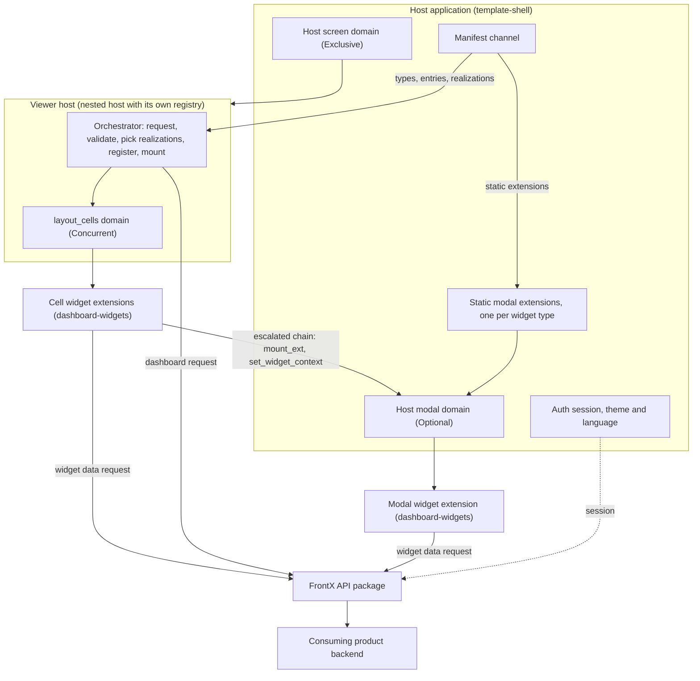
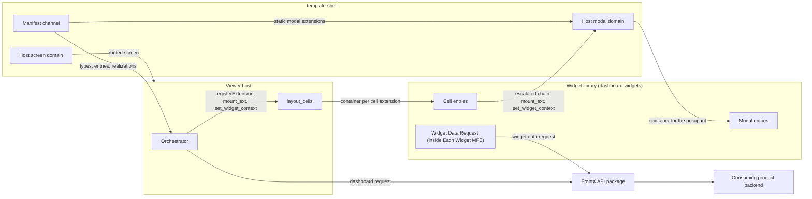
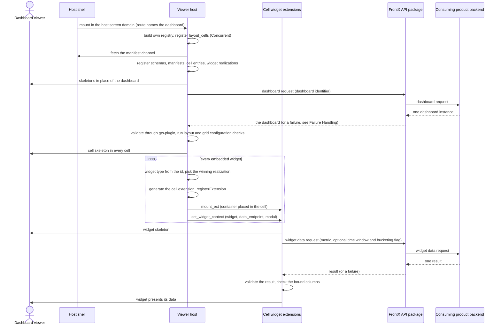
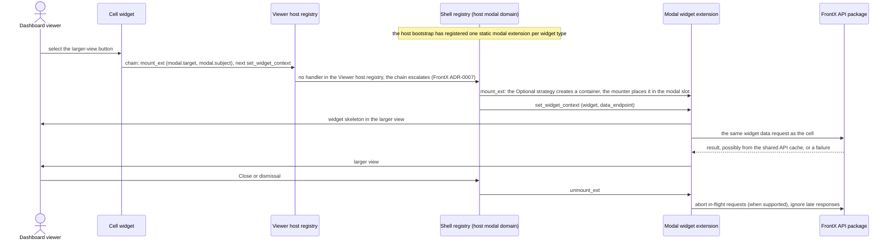
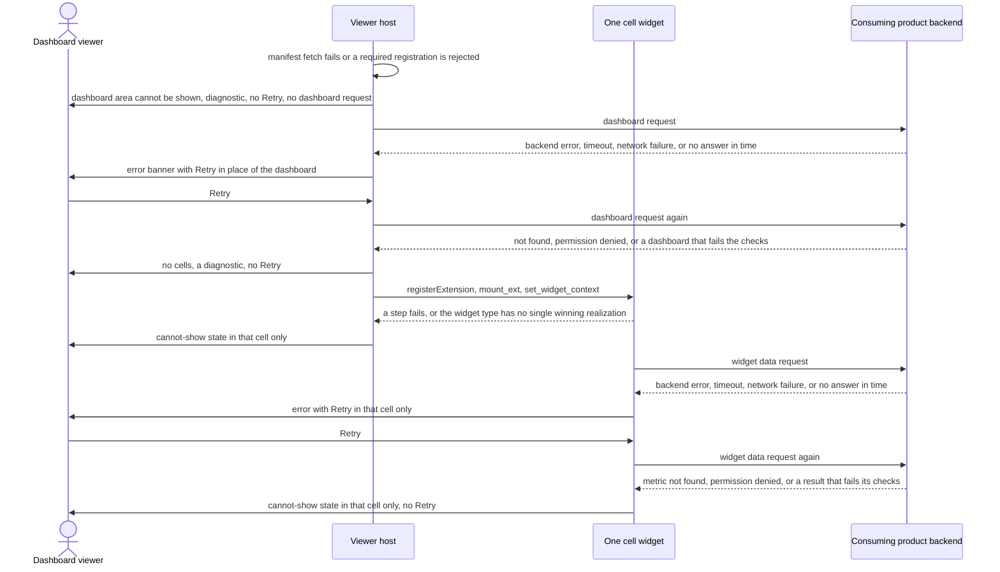
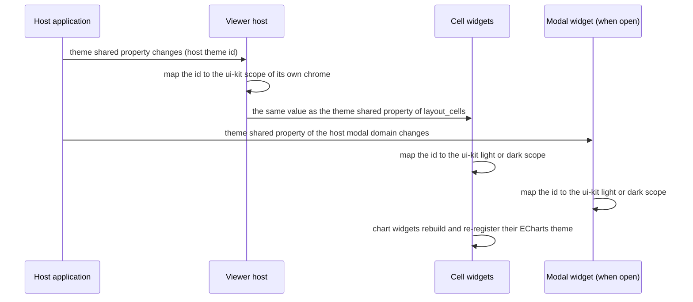
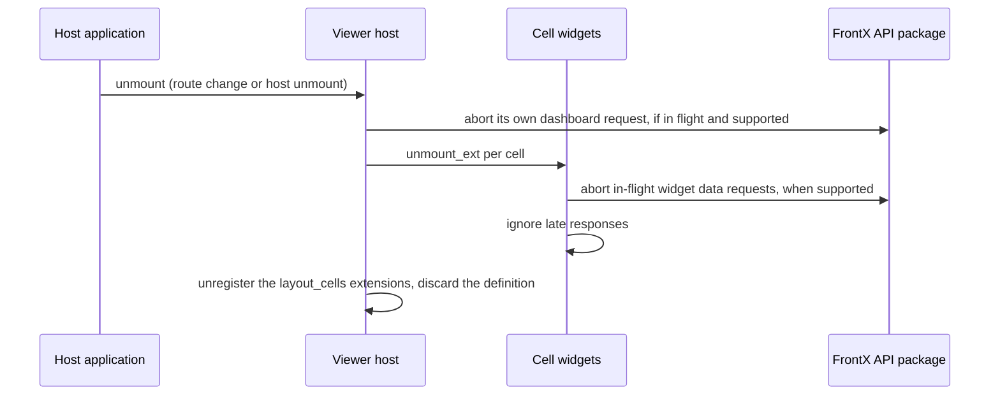
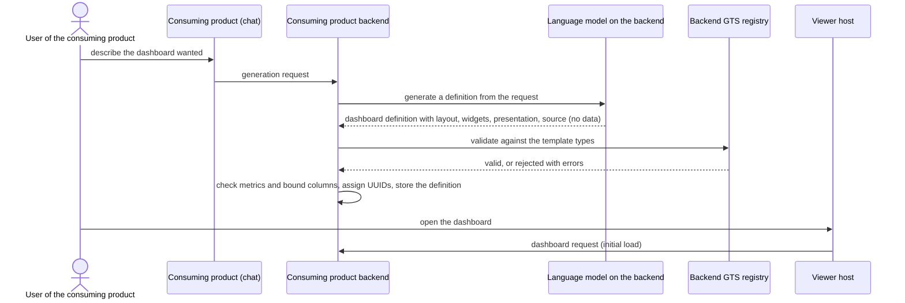

# Technical Design — FrontX Dashboard Template

This design describes how `template-dashboard` shows backend-delivered dashboards on FrontX. It covers the GTS domain model; GTS, the Global Type System, provides typed, versioned JSON schemas and identifiers. It also covers the Viewer host, which requests one dashboard and mounts its widgets, and the 9 template widget types with their larger view in the host modal domain. The backend interface, the host contract with `template-shell`, the main runtime sequences, and the budgets complete it.

- [ ] `p1` - **ID**: `cpt-frontx-dashboard-design-dashboard-template`

<!-- toc -->

- [1. Architecture Overview](#1-architecture-overview)
  - [1.1 Architectural Vision](#11-architectural-vision)
  - [1.2 Architecture Drivers](#12-architecture-drivers)
  - [1.3 Architecture Layers](#13-architecture-layers)
- [2. Principles & Constraints](#2-principles--constraints)
  - [2.1 Design Principles](#21-design-principles)
  - [2.2 Constraints](#22-constraints)
- [3. Technical Architecture](#3-technical-architecture)
  - [3.1 Domain Model](#31-domain-model)
  - [3.2 Component Model](#32-component-model)
  - [3.3 API Contracts](#33-api-contracts)
  - [3.4 Internal Dependencies](#34-internal-dependencies)
  - [3.5 External Dependencies](#35-external-dependencies)
  - [3.6 Interactions & Sequences](#36-interactions--sequences)
  - [3.7 Database schemas & tables](#37-database-schemas--tables)
  - [3.8 Deployment Topology](#38-deployment-topology)
  - [3.9 Budgets and NFR Realization](#39-budgets-and-nfr-realization)
- [4. Additional context](#4-additional-context)
- [5. Traceability](#5-traceability)

<!-- /toc -->

## 1. Architecture Overview

### 1.1 Architectural Vision

`template-dashboard` is a render-only Viewer host on FrontX. The consuming product's backend is the only source of what a dashboard shows. It returns dashboard definitions, and it computes widget data on request from its own metrics; the template stores no queries and no pre-computed data. One definition is one GTS dashboard instance with an `id`, a `name`, a `description`, and an embedded `layout`. Each layout cell embeds one widget instance. A widget instance is its presentation configuration plus a `source`: the name of a backend metric, with an optional time window and an optional bucketing flag. The definition carries no widget data and no theme. A consuming product may write its dashboards or generate them, for example from a chat request through a language model on its backend. Generation is the consuming product's job; the template supplies the GTS types that a definition is validated against (section 3.6, consumer-side generation). The template computes, aggregates, and narrows nothing. Once the widgets show their data, nothing changes until the dashboard is opened again.

The architecture has one orchestrator. The **Viewer host** is a nested host: an MFE (micro-frontend, an independently built and mounted UI unit) with its own FrontX registry. The host application mounts it as a routed screen. The Viewer host requests the dashboard that its route names, once, and validates it through the FrontX gts-plugin. It implements one extension domain, `layout_cells`. For each embedded widget it reads the widget type from the widget's `id`, picks the winning **widget realization** for that type, and generates one cell extension from it. It registers that extension in its own registry, mounts it, and sends the widget its context with `set_widget_context`. The template ships 9 widget types. Each is a presentation type, realized by one cell entry and one modal entry. Each cell widget sends its own widget data request through the FrontX API package, naming its metric. It gets back one generic tabular result, validates it, and checks that the columns its configuration names are present. Each widget shows its own skeleton, error, and Retry. After that, no request follows except Retry after a failure and the larger view's own request. Section 3.3 states the backend interface, and `cpt-frontx-dashboard-feature-backend-contract` specifies it exactly.

Every widget carries one button that opens it in a larger view, in the host's modal domain. For each widget type, the `dashboard-widgets` manifest declares one static extension of the host modal domain, and the host bootstrap registers it. The larger-view button runs a FrontX actions chain that escalates to the shell: it mounts that static extension and then sends it the same widget context as the cell. Static extensions are needed because FrontX admits an extension only through the registry that holds its domain, and a child cannot register into its host's registry (FrontX ADR-0008). The theme is the host's own theme shared property, forwarded unchanged; the look comes from `@gears-frontx/ui-kit` in every template MFE. The host must render its modal domain through a slot with modal chrome, focus trap, and dismissal, which current `template-shell` does not do yet (section 4, prerequisites). Every FrontX mechanism the template uses is the smallest one that the FrontX rules for isolation, admission, occupancy, and action routing allow.

A few FrontX terms recur in this design. An **occupant** is an extension that is currently mounted in an extension domain. Each domain has a named **mount strategy** that governs its occupants. **Concurrent** allows many occupants side by side. **Optional** allows zero or one occupant, which leaves only through an explicit unmount. **Exclusive** keeps exactly one occupant and swaps it when another one mounts. A **bridge** is the channel between a mounted MFE and the host that mounted it; the MFE sends actions and reads shared properties through it.

### 1.2 Architecture Drivers

The drivers are the PRD requirements and the template's eleven ADRs. Each table below maps a driver to the design element that answers it.

**ADRs**: `cpt-frontx-dashboard-adr-frontend-framework`, `cpt-frontx-dashboard-adr-dashboard-layout-grid`, `cpt-frontx-dashboard-adr-shared-data-types-and-schemas`, `cpt-frontx-dashboard-adr-charting-library`, `cpt-frontx-dashboard-adr-data-grid-library`, `cpt-frontx-dashboard-adr-theme-distribution`, `cpt-frontx-dashboard-adr-extension-domain-taxonomy`, `cpt-frontx-dashboard-adr-widget-type-and-mfe-realization`, `cpt-frontx-dashboard-adr-subject-agnostic-widget-catalog`, `cpt-frontx-dashboard-adr-template-packages-and-host-contract`, `cpt-frontx-dashboard-adr-backend-delivered-dashboard`

#### Functional Drivers

| Requirement | Design Response |
|-------------|------------------|
| `cpt-frontx-dashboard-fr-viewer-host` | The Viewer host is a routed extension in the host screen domain, and its route carries the dashboard's GTS identifier. It requests that dashboard once and validates it. For every embedded widget it generates one `layout_cells` extension from the winning widget realization and registers it in its own registry. Each open dashboard keeps its own loaded definition (`cpt-frontx-dashboard-component-viewer-host`, `cpt-frontx-dashboard-interface-template-domains`, `cpt-frontx-dashboard-principle-own-registry-registration`). |
| `cpt-frontx-dashboard-fr-backend-source` | The Viewer host requests one GTS dashboard by its identifier, written or generated by the consuming product, and validates it through the FrontX gts-plugin. Each cell widget requests its own backend metric once through the FrontX API package and shows the result as delivered. The consuming product checks metrics and columns when it authors a dashboard; the Viewer host checks types, layout, and grid configuration; each widget checks its bound columns at run time (`cpt-frontx-dashboard-interface-dashboard-payload`, `cpt-frontx-dashboard-component-viewer-host`, `cpt-frontx-dashboard-component-widget-data-request`, `cpt-frontx-dashboard-seq-initial-load`, `cpt-frontx-dashboard-seq-consumer-generation`). |
| `cpt-frontx-dashboard-fr-loading-error-states` | The dashboard area shows skeletons while the dashboard loads, a banner with Retry when the dashboard request fails, and a diagnostic with no cells when the dashboard or the Viewer host's startup cannot be shown. Each cell shows the Viewer host's cell skeleton until its widget mounts, and its own cannot-show state when its widget type has no single winning realization or its widget fails to mount. Each widget then shows its own skeleton, its error with Retry, its cannot-show state, or its empty state. A failing widget affects only its own cell (`cpt-frontx-dashboard-seq-failure-handling`, `cpt-frontx-dashboard-interface-dashboard-payload`). |
| `cpt-frontx-dashboard-fr-widget-catalog` | One widget package ships one manifest, 9 cell entries, 9 modal entries, 9 static modal extensions, and 9 widget realizations of weight 1, one set per subject-agnostic widget type. Each widget type names the result columns it uses for each role. The `grid` widget type shows frozen columns, grouped column headers, row coloring from kit tokens, and up to 5,000 rows without paging; `markdown_card` shows delivered markdown with its formatting; embedded HTML in a markdown card is shown as plain text, not rendered, the single exception to showing delivered content in full (`cpt-frontx-dashboard-component-widget-library`, `cpt-frontx-dashboard-component-widget-data-request`, `cpt-frontx-dashboard-interface-widget-realization`). |
| `cpt-frontx-dashboard-fr-widget-modal` | The shared widget chrome adds one larger-view button. It runs a chain that escalates to the shell: `mount_ext` of the widget type's static extension in the host modal domain, then `set_widget_context` with the same widget and data endpoint as the cell. The modal entry sends the same widget data request as the cell. The host modal domain owns its single occupant; Close and dismissal are the shell's `unmount_ext` (`cpt-frontx-dashboard-component-widget-library`, `cpt-frontx-dashboard-interface-host-actions`, `cpt-frontx-dashboard-interface-widget-realization`, `cpt-frontx-dashboard-seq-widget-modal-open`). |
| `cpt-frontx-dashboard-fr-theme` | The theme input is the host's theme shared property. The Viewer host forwards it unchanged on `layout_cells`, and the host modal domain gives it to modal entries. Every template MFE uses `@gears-frontx/ui-kit` and maps the host theme id to the kit's light or dark scope, so the template's look is the same in a cell and in the larger view. Chart widgets build their ECharts theme `frontx-dashboard` from kit tokens. A theme switch is a shared-property change only (`cpt-frontx-dashboard-seq-theme-switch`). |
| `cpt-frontx-dashboard-fr-domain-model` | The `gts.frontx.v.*` and `gts.frontx.m.*` types on GTS v0.17: a dashboard root with an embedded layout, the abstract widget base with its typed `source`, the 9 widget types with their column bindings, one generic widget data type, and the widget realization type. A consuming product validates the dashboards it writes or generates against these types. In v1 it configures each widget through its presentation configuration and `source`; consumer widget types and consumer widget settings are a later stage (section 3.1, `cpt-frontx-dashboard-seq-consumer-generation`, section 4). |
| `cpt-frontx-dashboard-fr-replacement-widget` | A consuming product ships a replacement widget realization in its own package, with its own cell entry, modal entry, static modal extension, and a weight above 1. By realization precedence the single highest-weight realization wins for that widget type, so the Viewer host mounts the replacement's cell entry for every widget of that type, and the larger-view button opens the replacement's static modal extension; the template's realizations keep serving the other widget types. The replacement receives `set_widget_context` like a template widget and keeps the per-widget states, the theme mapping, and the accessibility rules itself. It adds no widget type and no widget settings in v1 (`cpt-frontx-dashboard-interface-widget-realization`, `cpt-frontx-dashboard-component-viewer-host`, `cpt-frontx-dashboard-topology-overlay-packages`). |

#### NFR Allocation

| NFR ID | NFR Summary | Allocated To | Design Response | Verification Approach |
|--------|-------------|--------------|-----------------|----------------------|
| `cpt-frontx-dashboard-nfr-visual-quality` | One consistent look in light and dark | `@gears-frontx/ui-kit` in every template MFE, chart widgets, grid shell | Every color, font, and spacing value comes from ui-kit tokens in the light or dark scope chosen from the host theme id. Chart widgets build one ECharts theme from those tokens. Grid row coloring uses kit tokens. No widget carries manual styling. | Design inspection of all 9 widget types in both scopes, in a cell and in the larger view, against the design-system reference. |
| `cpt-frontx-dashboard-nfr-initial-render` | First full render p95 < 3 s (provisional), from the moment the dashboard viewer opens the dashboard address until every widget shows its data | Viewer host (dashboard request, parallel mount), widget library (parallel widget data requests) | One dashboard request per dashboard. After the dashboard resolves, the cell extensions mount in parallel, and each widget requests its data at once, in parallel with the others. This budget also covers the evaluation cost of every MFE and of the shared packages. Reference conditions are fixed in section 3.9. | Timed runs under the reference conditions; budget confirmed or revised from the results. |
| `cpt-frontx-dashboard-nfr-large-table` | A grid of up to 5,000 rows stays responsive while scrolling, without paging | Widget library: the grid shell of the `grid` widget type | The grid shell renders rows virtualized, so only the rows in view are in the DOM, whatever the delivered row count. It offers no paging. | Scrolling the 5,000-row reference grid in a cell under the reference conditions of section 3.9, with the longest pause recorded against the provisional threshold. |
| `cpt-frontx-dashboard-nfr-compatibility` | Works with the current stable FrontX release, depends on `template-shell` only | Packaging, host contract | Role-based host identifiers resolved from shell constants in code; manifest-declared extensions carry the current identifiers; FrontX packages pinned to exact published versions (section 3.5); no dependency on `template-mfe` or on any other template. | A build on a `template-shell` project that renders the modal-domain slot and gives the host modal domain theme and language, with a dependency check that finds only `template-shell` and the FrontX packages. |
| `cpt-frontx-dashboard-nfr-bundle-budget` | Download-size budget | Viewer host entry, every widget entry (cell and modal) | Provisional figures from section 3.9, counted as transferred gzipped bytes on a cold load of the reference dashboard. The Viewer host stays under 500 KB, including the shared packages it fetches. Each widget stays under 100 KB of its own code. Shared packages are counted once in an uncapped page total. Every MFE declares all its packages as shared. | Transferred bytes measured on a cold load of the reference dashboard against the provisional figures. |
| `cpt-frontx-dashboard-nfr-accessibility` | Host accessibility policy and keyboard operability | Widget chrome with larger-view button and Retry, grid shell, Viewer host chrome and Retry | Every control follows the host policy. The grid shell exposes ARIA grid semantics, also for virtualized rows. The larger-view button and both Retry actions are keyboard-operable. The host's modal-domain slot provides the modal frame, Close, focus trap, and dismissal (section 4, prerequisites). | Host accessibility checks in both scopes and a keyboard-only walkthrough of the reference dashboard (section 3.9) that opens and closes the larger view of every widget. |
| `cpt-frontx-dashboard-nfr-consumer-docs` | Shipped consumer guide | Consumer guide shipped with the template | The guide covers the backend interface that a consuming product backend implements: the dashboard request, the widget data request and result, the failure classes, and the viewer-access prerequisite (`cpt-frontx-dashboard-feature-backend-contract`). It also covers validation of dashboards against the template types, the column binding of each widget type with the authoring-time check of metrics and columns, replacement widget realizations, the form of the endpoint configuration, and the host contract. The guide states that the consuming product owns dashboard size and data size. | Walkthrough by a developer who did not build the template. |

#### Architecture Decision Records

| ADR | Effect on this design |
|-----|-----------------------|
| `cpt-frontx-dashboard-adr-frontend-framework` | FrontX with TypeScript and MFE packaging; per-instance isolation shapes every component boundary. |
| `cpt-frontx-dashboard-adr-dashboard-layout-grid` | 60-column integer cells rendered with CSS Grid in the Viewer host; layout checks in the Viewer host with no repair. |
| `cpt-frontx-dashboard-adr-shared-data-types-and-schemas` | GTS v0.17 on FrontX bases, vendor `frontx`, packages `v` and `m`, the ID-form convention with combined instance identifiers, `x-gts-type-ref`, `x-gts-instance-ref`, and `x-gts-pattern-ref` references, the abstract widget base with a typed `source` and no traits, one generic widget data type, validation through the FrontX gts-plugin, and the `v1` freeze. |
| `cpt-frontx-dashboard-adr-charting-library` | ECharts in each chart widget, with an ECharts theme built from ui-kit tokens and registered per widget instance; the library is evaluated per instance. |
| `cpt-frontx-dashboard-adr-data-grid-library` | TanStack Table behind one grid shell in the `grid` widget, used for rendering only, with virtualized row rendering for up to 5,000 rows and cell values shown as text. The grid shows the delivered rows in the delivered order, without sorting, grouping, pagination, filtering, or user-driven column resizing in the browser; column width and alignment are presentation hints in the configuration. |
| `cpt-frontx-dashboard-adr-theme-distribution` | The theme is the host's theme shared property, forwarded unchanged by the Viewer host on `layout_cells` and given by the host modal domain to modal entries. The look comes from `@gears-frontx/ui-kit` in every template MFE; the template defines no theme of its own. |
| `cpt-frontx-dashboard-adr-extension-domain-taxonomy` | One template domain, `layout_cells`, with the Concurrent strategy in the Viewer host's own registry, and one template action, `set_widget_context`. The larger view uses one static extension of the host modal domain per widget type, reached by an escalated chain. Each nested host registers extensions only in its own registry. |
| `cpt-frontx-dashboard-adr-widget-type-and-mfe-realization` | Widget types (package `m`) and widget MFE entries are joined by widget realization instances (package `v`) that name a widget type, a cell entry, a modal extension, and a weight. Widget entries are plain FrontX Module Federation entries. For each widget type the single highest-weight realization wins. |
| `cpt-frontx-dashboard-adr-subject-agnostic-widget-catalog` | The 9 template widget types are presentation types over one generic tabular result. Each names the result columns it uses for each role, and each widget names its backend metric in `source`. There are no consumer widget types in v1. |
| `cpt-frontx-dashboard-adr-template-packages-and-host-contract` | Two packages, `dashboard-viewer` and `dashboard-widgets`, on `template-shell`; host domains by role; a manifest channel that carries GTS types, MFE entries, widget realizations, and static extensions; a consumer replacement realization ships in its own package; every MFE declares all its packages as shared; the rendered modal-domain slot is a host requirement. |
| `cpt-frontx-dashboard-adr-backend-delivered-dashboard` | The backend returns the dashboard definition, with the layout and the widgets embedded, requested once by its identifier. Each cell widget requests its backend metric once through the FrontX API package and gets one generic tabular result. The modal entry repeats the same request. Nothing else is requested after render except Retry after a failure. |

### 1.3 Architecture Layers

- [ ] `p2` - **ID**: `cpt-frontx-dashboard-tech-frontx-stack`

| Layer | Responsibility | Technology |
|-------|---------------|------------|
| Host | Screen and modal domains with rendered slots, manifest channel, auth session, theme and language shared properties | `template-shell` on the current stable FrontX release |
| Presentation | Layout grid, widget presentation, larger-view button, per-widget loading, error, and empty states | React, `@gears-frontx/ui-kit`, CSS Grid, ECharts with echarts-for-react, TanStack Table v8 with the TanStack virtualizer |
| Orchestration | Dashboard request, validation, realization choice, cell extension registration, mount chains, theme and language forwarding | Viewer host (TypeScript strict), FrontX registry and actions chains |
| Data | One dashboard per dashboard request and one generic tabular result per widget data request, computed by the consuming product backend from the named metric | Requests through the FrontX API package under the host session |
| Contracts | Types and instances for dashboards, embedded layouts, widgets, widget data, widget realizations, the template domain, and the template action | GTS v0.17 on `gts.frontx.mfes.*` bases, validated through the FrontX gts-plugin |

## 2. Principles & Constraints

### 2.1 Design Principles

When two principles conflict, the one earlier in this order wins: render-only Viewer host, per-instance isolation, registration only in the own registry, contracts as GTS data, and Viewer host orchestration last.

#### Render-Only Viewer host

- [ ] `p1` - **ID**: `cpt-frontx-dashboard-principle-render-only-viewer`

The template shows what the backend delivers and nothing more. The dashboard definition carries the dashboard, its embedded layout, and every widget's configuration with its `source`. Each widget's data is the backend's result for that widget's own request, computed from the backend's own data for the named metric. The widget shows it as delivered: it does not compute, aggregate, narrow, hide, or cut off any part of it. The single exception is the markdown safety rule: embedded HTML in a markdown card (`markdown_card`) is shown as plain text, not rendered; the card's markdown formatting still applies (section 3.1). The layout, with the widget configuration that each cell carries, fully defines how the widgets are composed and presented. The Viewer host lays it out as given and does not sort, group, page, or re-arrange anything in the browser. There is no filter, no dashboard-level time range, and no user query. After the widgets show their data, nothing changes: no request follows except Retry after a failure and the larger view's own request, and no cell widget receives new data. Interactive exploration is later-stage work and needs a new decision.

**PRD**: `cpt-frontx-dashboard-fr-backend-source`, `cpt-frontx-dashboard-fr-viewer-host`

**ADRs**: `cpt-frontx-dashboard-adr-backend-delivered-dashboard`, `cpt-frontx-dashboard-adr-subject-agnostic-widget-catalog`

#### Per-Instance Isolation, No Shared Singletons

- [ ] `p1` - **ID**: `cpt-frontx-dashboard-principle-per-instance-isolation`

FrontX gives every MFE load its own module graph (FrontX ADR-0011). No library, store, or theme object of the template is shared between MFE instances. Each open dashboard owns its own loaded definition. Each chart widget registers its own ECharts theme. Each widget sends its own data request and holds the result itself. Every template MFE declares all its packages as shared, which FrontX allows also for stateful packages; sharing reuses a package's source text by content hash (FrontX ADR-0034) and saves fetches, while each instance still evaluates its own copy (section 3.9). Two FrontX packages keep realm-wide state by their own design, and the template relies on it without adding any: the FrontX API package shares its API cache across runtimes, and the FrontX gts-plugin shares one type store pair per compatible copy in a realm (FrontX gts-plugin ADR-0001). The template treats Module Federation only as the bundling format; FrontX resolves dependencies itself.

**PRD**: `cpt-frontx-dashboard-fr-viewer-host`, `cpt-frontx-dashboard-fr-loading-error-states`, `cpt-frontx-dashboard-nfr-initial-render`, `cpt-frontx-dashboard-nfr-bundle-budget`

**ADRs**: `cpt-frontx-dashboard-adr-frontend-framework`, `cpt-frontx-dashboard-adr-template-packages-and-host-contract`, `cpt-frontx-dashboard-adr-backend-delivered-dashboard`

#### Each Nested Host Registers Only in Its Own Registry

- [ ] `p1` - **ID**: `cpt-frontx-dashboard-principle-own-registry-registration`

FrontX admits an extension only through `registerExtension` on the registry that holds the extension's domain. A child's bridge exposes only `executeActionsChain`, `subscribeToProperty`, `getProperty`, and `registerActionHandler`, so a child cannot register anything into its host's registry (FrontX ADR-0008; FrontX mfe-registry FEATURE). The template follows this rule as a principle. The Viewer host registers only `layout_cells` extensions, only in its own registry, and only when it resolves a dashboard. It registers nothing when the larger view opens or on any other click. The larger view of each widget type is a static extension of the host modal domain, declared in the `dashboard-widgets` manifest and registered by the host bootstrap. Opening a larger view therefore only mounts and configures an extension that is already registered. A cell widget reaches the host modal domain by an actions chain that its own registry cannot resolve, so the chain escalates to the shell (FrontX ADR-0007). Per-instance modal extensions would need a FrontX change and are a later stage (section 4).

**PRD**: `cpt-frontx-dashboard-fr-viewer-host`, `cpt-frontx-dashboard-fr-widget-modal`, `cpt-frontx-dashboard-contract-host-areas`

**ADRs**: `cpt-frontx-dashboard-adr-extension-domain-taxonomy`, `cpt-frontx-dashboard-adr-widget-type-and-mfe-realization`, `cpt-frontx-dashboard-adr-template-packages-and-host-contract`

#### Viewer Host Orchestrates, Widgets Request and Present Their Own Data

- [ ] `p1` - **ID**: `cpt-frontx-dashboard-principle-viewer-host-orchestration`

The Viewer host requests and validates the dashboard, picks a widget realization for each widget, registers and mounts the cell extensions, and sends each widget its context. It holds no widget data and runs no queries. A widget receives `set_widget_context` with its widget instance, requests its own data with the `source` from that instance, validates the result, and presents it. Widgets never request anything but their own data and never reach the Viewer host's internals.

**PRD**: `cpt-frontx-dashboard-fr-viewer-host`, `cpt-frontx-dashboard-fr-backend-source`, `cpt-frontx-dashboard-fr-loading-error-states`

**ADRs**: `cpt-frontx-dashboard-adr-backend-delivered-dashboard`, `cpt-frontx-dashboard-adr-extension-domain-taxonomy`

#### Contracts Are GTS Data

- [ ] `p2` - **ID**: `cpt-frontx-dashboard-principle-gts-contracts`

Dashboards with their embedded layouts, widgets, widget data, widget realizations, the template domain, and the template action are GTS types chained from FrontX bases. The request forms of the backend interface are not GTS types; they are specified in `cpt-frontx-dashboard-feature-backend-contract`. Because dashboards and widgets are GTS-typed, a consuming product adds a dashboard as data, whether written or generated, and validates it against the registered template types before its backend serves it. In the browser, all schema validation goes through the FrontX gts-plugin; the template writes no validation code of its own. The manifest channel carries GTS types, MFE entries, widget realizations, and static extensions. Contracts that stay inside one runtime stay TypeScript-internal.

**PRD**: `cpt-frontx-dashboard-fr-domain-model`, `cpt-frontx-dashboard-contract-consuming-backend`

**ADRs**: `cpt-frontx-dashboard-adr-shared-data-types-and-schemas`, `cpt-frontx-dashboard-adr-widget-type-and-mfe-realization`, `cpt-frontx-dashboard-adr-backend-delivered-dashboard`

### 2.2 Constraints

#### Dependency on `template-shell` Only

- [ ] `p1` - **ID**: `cpt-frontx-dashboard-constraint-shell-only-dependency`

The template depends on `template-shell` and on the FrontX packages it pins, and on nothing else: it takes nothing from `template-mfe` or from any other template. It requires one host capability that current `template-shell` lacks: a rendered slot for the host modal domain with modal chrome, focus trap, and dismissal, through which the host modal domain gives theme and language to the modal entries (section 3.5). That capability is a prerequisite `template-shell` change, tracked outside `template-dashboard` (section 4). FrontX packages are pinned to exact published versions (section 3.5, FrontX Ecosystem).

**ADRs**: `cpt-frontx-dashboard-adr-template-packages-and-host-contract`, `cpt-frontx-dashboard-adr-frontend-framework`

#### Host Identifiers by Role

- [ ] `p1` - **ID**: `cpt-frontx-dashboard-constraint-role-based-host-ids`

Documents name host domains by role. The **host screen domain** is the host application's extension domain in which full screens are mounted; it realizes the PRD's host screen area. The **host modal domain** is the host application's extension domain in which one modal occupant is mounted; together with the host's rendered modal-domain slot it realizes the PRD's host modal area. TypeScript code resolves their current identifiers from `template-shell` framework constants and never writes them as literals; this includes the host modal domain identifier that the Viewer host puts into `set_widget_context`. Manifest-declared extensions in `mfe.json`, such as the Viewer host's routed extension and the static modal extensions of the widget types, are data. They carry the current identifiers, or are generated from the constants at build time. The host contract table in section 3.5 is the single place that maps roles to current identifiers.

**ADRs**: `cpt-frontx-dashboard-adr-template-packages-and-host-contract`

#### GTS Identifier Form and Freeze

- [ ] `p1` - **ID**: `cpt-frontx-dashboard-constraint-gts-id-convention`

The template targets GTS specification v0.17. Type identifiers end with `~` and instance identifiers do not. An instance identifier always carries its type chain and is never split into parts. A well-known instance ends in a named segment. A dashboard or widget instance uses the combined anonymous form: its type chain followed by a UUID that the consuming product backend generates. No instance carries a separate `type` field. A field that holds an identifier is constrained with `x-gts-type-ref`, `x-gts-instance-ref`, or `x-gts-pattern-ref`, according to whether it holds a type, an instance, or a pattern; `x-gts-ref` is not used. The template's own segments use vendor `frontx` and only the packages `v` and `m`. Every identifier starts at `v1` and is frozen from the first non-alpha release; after the freeze, an incompatible change ships as a new version.

**ADRs**: `cpt-frontx-dashboard-adr-shared-data-types-and-schemas`

#### Fixed 60-Column Layout

- [ ] `p2` - **ID**: `cpt-frontx-dashboard-constraint-sixty-column-grid`

The layout embedded in each dashboard uses 60 columns with integer cell coordinates `x`, `y`, `w`, `h` and one embedded widget per cell. The Viewer host repairs nothing at run time: a layout with out-of-range or overlapping cells makes the dashboard one that cannot be shown, with a diagnostic that names the failing cells.

**ADRs**: `cpt-frontx-dashboard-adr-dashboard-layout-grid`

#### One Viewer Host per Application Tree

- [ ] `p2` - **ID**: `cpt-frontx-dashboard-constraint-one-viewer-per-tree`

The `layout_cells` domain identifier and the cell extension identifiers are fixed instance identifiers, and the FrontX collision guard is tree-global (FrontX ADR-0007). The template's consequence of that guard is its supported topology: one mounted Viewer host per application tree, which the Exclusive host screen domain already guarantees. Switching dashboards happens through the Viewer host's route, and independent Viewer hosts run in separate application instances, such as two browser tabs.

**ADRs**: `cpt-frontx-dashboard-adr-extension-domain-taxonomy`, `cpt-frontx-dashboard-adr-template-packages-and-host-contract`

#### Licensing, Compliance, and Resource Dispositions

- [ ] `p2` - **ID**: `cpt-frontx-dashboard-constraint-licensing-compliance-resources`

- **Regulatory and privacy**: not applicable because the template is a read-only information UI that stores nothing. The dashboard definition and the widget data stay in browser memory while the dashboard is open and are released when it closes; processing of personal data belongs to the consuming product backend (PRD section 6.2).
- **Data residency**: not applicable because the template stores no data and runs no service. The Viewer host and the widgets read only from the consuming product's backend, whose residency the consuming product owns.
- **Licensing**: every third-party runtime library must carry a permissive license that allows distribution as source inside a consuming product, Apache-2.0 or MIT, as listed in section 3.5. The package-wide license check verifies every package that a template MFE declares, shared or not.
- **Resource constraints**: the browser only lays out and presents data; the consuming product backend computes every value the widgets show, and result size is the backend's concern. Download cost is bounded by the bundle budget, and evaluation cost by the initial-render budget, both in section 3.9. No server, storage, or network resource is provisioned by the template.
- **Legacy integration**: the template integrates with `template-shell` as it is today and itself changes nothing in it. The one host capability that is missing, the rendered modal-domain slot, is the prerequisite in section 4.
- **Team and schedule**: not applicable because the template has no delivery schedule or team constraint of its own.

**ADRs**: `cpt-frontx-dashboard-adr-template-packages-and-host-contract`, `cpt-frontx-dashboard-adr-backend-delivered-dashboard`

## 3. Technical Architecture

### 3.1 Domain Model

**Technology**: GTS (Global Type System) specification v0.17 types and instances chained from the FrontX `gts.frontx.mfes.*` bases, validated through the FrontX gts-plugin.

**Location**: type files in `src-app/mfe_packages/dashboard-viewer/` (engine `v` and `m` types, the template action, the `layout_cells` domain and its extension type, the widget realization type) and `src-app/mfe_packages/dashboard-widgets/` (manifest, cell and modal entries, static modal extensions, widget realizations). The concrete types are specified in the domain-model FEATURE documents named below.

**Instance source**: the dashboard instance, with its embedded layout and the widget instances embedded in its cells, is the dashboard definition that the consuming product writes or generates and its backend returns for one dashboard request. The backend generates the UUIDs of the dashboard and widget identifiers. Each widget's data comes from the backend's result for that widget's own request (`cpt-frontx-dashboard-fr-backend-source`, `cpt-frontx-dashboard-adr-backend-delivered-dashboard`). Package `mfe.json` files carry GTS types, MFE entries, widget realizations, and static extensions, which reach the registries through the manifest channel (section 3.5); no dashboard content travels through them.

**Core Entities**:

| Entity | Description | Schema |
|--------|-------------|--------|
| Dashboard definition | One per dashboard, written or generated by the consuming product and returned by its backend for the dashboard request: one dashboard instance with its embedded layout and each widget instance embedded in a layout cell; no widget data and no theme | the dashboard instance below; interface `cpt-frontx-dashboard-interface-dashboard-payload` (section 3.3) |
| Dashboard | Root: `id`, `name`, `description`, embedded `layout` | `gts.frontx.m.dashboard.dashboard.v1~` (FEATURE [dashboard-root-types](./features/feature-dashboard-root-types/FEATURE.md)) |
| Layout | Embedded object of the dashboard, without an own identifier: `columns` (always 60) and an ordered list of cells | `gts.frontx.m.layout.layout.v1~` (FEATURE [layout-types](./features/feature-layout-types/FEATURE.md)) |
| Layout cell | Embedded object of the layout: position `x`, `y`, `w`, `h` and one embedded widget instance | `gts.frontx.m.layout.cell.v1~` (FEATURE [layout-types](./features/feature-layout-types/FEATURE.md)) |
| Widget | Abstract base of the 9 template widget types: `id`, `title`, the typed `source`, and the widget type's presentation configuration with its column binding | `gts.frontx.m.widget.widget.v1~` (inline below; widget types in FEATURE [widget-catalog](./features/feature-widget-catalog/FEATURE.md)) |
| Widget data | One concrete type for the generic tabular result of every widget data request | `gts.frontx.v.widget_data.widget_data.v1~` (FEATURE [widget-data-catalog](./features/feature-widget-data-catalog/FEATURE.md)) |
| Widget realization | Binds one widget type to its cell entry, its static modal extension, and a weight | `gts.frontx.v.mfe.widget_realization.v1~` (FEATURE [mfe-entries](./features/feature-mfe-entries/FEATURE.md)) |
| Template action | `set_widget_context` | `gts.frontx.mfes.comm.action.v1~frontx.v.mfe.set_widget_context.v1~` (FEATURE [extension-domain-catalog](./features/feature-extension-domain-catalog/FEATURE.md)) |
| Domain and extension type | `layout_cells` and the type of its cell extensions | `gts.frontx.mfes.ext.domain.v1~frontx.v.layout.layout_cells.v1` and `gts.frontx.mfes.ext.extension.v1~frontx.v.layout.layout_cells.v1~` (FEATURE [extension-domain-catalog](./features/feature-extension-domain-catalog/FEATURE.md)) |

**Relationships**:

- Dashboard definition → Dashboard, Layout, Widget: one definition is one dashboard instance with its embedded layout and every widget instance embedded in a cell. It carries no widget data and no theme.
- Dashboard → Layout: the dashboard embeds one layout object, which has no identifier of its own. The layout embeds its cells, and each cell embeds one widget instance. Widgets are never referenced by identifier.
- Widget → Widget data: each widget instance names a backend metric in its `source`. The widget sends that request, and the result must validate against the single widget data type and contain every column that the widget's presentation configuration names.
- Widget type → Widget realization: each of the 9 template widget types is the `widget_type` of one template widget realization of weight 1. A consuming product may add a replacement realization with a higher weight.
- Widget realization → MFE entry and modal extension: a realization names the cell entry from which the Viewer host generates the cell extension, and the static extension of the host modal domain that shows the larger view.
- Domain → Widget: `layout_cells` mounts the cell extensions that the Viewer host generates from realizations. Theme and language are its shared properties.

#### Packages, Namespaces, and the Model–View Split

The template's own types sit in two packages under the `frontx` vendor. Package `m` (model) holds what describes a dashboard: dashboard, layout, cell, the widget base, and the 9 template widget types. Package `v` (view runtime) holds what the runtime exchanges: the widget data type, the template action, the domain, the extension type, and the widget realization type.

The split keeps one deliberate reference from `v` into `m` (`cpt-frontx-dashboard-adr-widget-type-and-mfe-realization`):

| From | To | Meaning |
|------|----|---------|
| `gts.frontx.v.mfe.widget_realization.v1~` field `widget_type` (`v` → `m`) | `gts.frontx.m.widget.widget.v1~` | A realization names the widget type it realizes; the field holds a type identifier and uses `x-gts-type-ref`. |

Package `m` holds no reference into `v`: a widget does not name its data type, because every widget validates its result against the one widget data type. The dashboard's embedded `layout` and the cell's embedded `widget` stay inside package `m`, so they are not cross-package references. The split lets the widget MFEs be released independently of the dashboards that use them.

**ID-form convention.** Identifiers with a trailing `~` are types; identifiers without it are instances. Every instance identifier carries its type chain (GTS v0.17, sections 2 and 3.7): a well-known instance ends in a named segment, and a combined anonymous instance ends in a UUID. The following table fixes the form for every family:

| Family | Form | Example |
|--------|------|---------|
| Template action (1) | type, derived from the FrontX action base | `gts.frontx.mfes.comm.action.v1~frontx.v.mfe.set_widget_context.v1~` |
| Extension type | type | `gts.frontx.mfes.ext.extension.v1~frontx.v.layout.layout_cells.v1~` |
| Widget realization type | type | `gts.frontx.v.mfe.widget_realization.v1~` |
| Engine schemas | type | `gts.frontx.m.widget.widget.v1~frontx.m.widget.grid.v1~`, `gts.frontx.v.widget_data.widget_data.v1~` |
| Dashboards | combined anonymous instance; UUID generated by the consuming product backend | `gts.frontx.m.dashboard.dashboard.v1~<uuid>` |
| Widgets embedded in a dashboard | combined anonymous instance of one of the 9 template widget types; UUID generated by the consuming product backend | `gts.frontx.m.widget.widget.v1~frontx.m.widget.grid.v1~<uuid>` |
| Widget data | no identifier; validated against the single widget data type | none |
| Domain | instance | `gts.frontx.mfes.ext.domain.v1~frontx.v.layout.layout_cells.v1` |
| Cell extensions | instance of the `layout_cells` extension type, generated by the Viewer host from the zero-based cell index | `gts.frontx.mfes.ext.extension.v1~frontx.v.layout.layout_cells.v1~frontx.v.layout.cell_2.v1` |
| Widget realizations (9 in the template) | instance | `gts.frontx.v.mfe.widget_realization.v1~frontx.v.mfe.grid.v1` |
| Widget cell entries (9) | instance of the FrontX `entry_mf` type | `gts.frontx.mfes.mfe.entry.v1~frontx.mfes.mfe.entry_mf.v1~frontx.v.mfe.grid.v1` |
| Widget modal entries (9) | instance of the FrontX `entry_mf` type; exact form in FEATURE `mfe-entries` | `gts.frontx.mfes.mfe.entry.v1~frontx.mfes.mfe.entry_mf.v1~frontx.v.mfe.grid_modal.v1` |
| Static modal extensions (9) | instance of the FrontX extension base, mounted in the host modal domain; exact form in FEATURE `mfe-entries` | `gts.frontx.mfes.ext.extension.v1~frontx.v.mfe.grid_modal.v1` |
| Viewer host entry | instance of the FrontX `entry_mf` type | `gts.frontx.mfes.mfe.entry.v1~frontx.mfes.mfe.entry_mf.v1~frontx.v.mfe.viewer.v1` |
| Viewer host routed extension | instance of the shell screen extension type | `gts.frontx.mfes.ext.extension.v1~frontx.screensets.layout.screen.v1~frontx.v.screens.viewer.v1` |
| Viewer host manifest | instance | `gts.frontx.mfes.mfe.mf_manifest.v1~frontx.v.viewer.manifest.v1` |
| Widget manifest | instance | `gts.frontx.mfes.mfe.mf_manifest.v1~frontx.v.widgets.manifest.v1` |

#### Abstract Bases and Concrete Types

The DESIGN carries the abstract widget base inline, plus the base-level shape of the other families that the component model depends on. Field-level schemas of concrete types are owned by the FEATURE documents.

**Widget base** `gts.frontx.m.widget.widget.v1~`. It is abstract (`x-gts-abstract: true`), so every widget instance belongs to one of the 9 concrete template widget types, `gts.frontx.m.widget.widget.v1~frontx.m.widget.<widget_type>.v1~`. Each widget instance carries its whole presentation configuration and its `source`; the data itself is not part of the definition. A widget instance is identified only by its GTS `id`; it has no unique name. The base declares no traits.

| Field | Required | Meaning |
|-------|----------|---------|
| `id` | yes | Combined anonymous instance identifier, constrained with `x-gts-instance-ref: "/$id"`, so it must be rooted at the widget's own type; the consuming product backend generates the UUID. The rightmost type of the chain is the widget type. |
| `title` | yes | Display title of the widget, shown as delivered. |
| `source` | yes | Typed object that names what the widget requests: `metric`, a required non-empty string that names a backend metric; `range`, an optional time window in the form the backend defines; and `bucket`, an optional boolean bucketing flag. The template passes these values through unchanged and gives them no meaning (section 3.3). |

`source.metric` is a plain string, not a GTS type or reference, because metrics are run-time data of the backend. The consuming product checks that each metric exists and returns the columns that the widget names when it authors the dashboard; the widget checks the same at run time (section 3.3).

**Widget types and column binding.** The 9 template widget types are `summary_card`, `metric_card`, `ranked_list_card`, `progress_list_card`, `grid`, `cartesian_chart`, `pie_chart`, `heatmap`, and `markdown_card`. Each is a presentation type: a presentation schema, and the target of a widget realization. Its presentation configuration names, for each role, the result column that fills it:

| Widget type | Bound columns |
|-------------|---------------|
| `grid` | `columns[].key`, one per displayed column, and optional `row_color_column`, which need not be displayed |
| `cartesian_chart` | `x`, and `series[].column` for each series |
| `pie_chart` | `label`, `value` |
| `metric_card` | `value`, optional `trend`, optional `sparkline` |
| `summary_card` | `label`, `value` |
| `ranked_list_card` | `label`, `value`, optional `secondary` |
| `progress_list_card` | `label`, `current`, `target` |
| `heatmap` | `x`, `y`, `value` |
| `markdown_card` | `body`, taken from the first row |

The `grid` widget type also carries presentation settings: for each column an optional width hint (`columns[].width`) and an optional alignment (`columns[].align`), frozen columns, grouped column headers, and row coloring by a result column with ui-kit tokens. The width and alignment are presentation hints; the grid offers no user-driven column resizing in the browser. Row coloring uses the optional `row_color_column`, which is a bound column when set, so a result that lacks it cannot be shown. Its values are the color meanings `success`, `warning`, `error`, and `info`, matched exactly; any other value, or null, leaves the row uncolored. Each meaning takes the ui-kit token of the same name, which adapts to the light and dark scopes, and a colored row also shows an icon of its meaning with an accessible name, so no meaning is conveyed by color alone. The layout fixes these settings, and they are not client-side operations on the rows. The Viewer host checks each `grid` widget's configuration together with the layout when it opens the dashboard; a failure makes the dashboard one that cannot be shown (section 3.6, Failure Handling). The settings and their checks are specified in FEATURE `widget-catalog` section 6.5. The backend supplies exactly what each widget shows, and no widget type hides or cuts off part of it. The single exception is the markdown safety rule: embedded HTML in a markdown card (`markdown_card`) is shown as plain text, not rendered; the card's markdown formatting still applies (FEATURE `widget-catalog` section 6.9). A markdown card shows its empty state when the result has no rows or when the `body` of the first row is null or empty. The larger-view button is part of the shared widget chrome, so the base declares no field for it.

**Widget data** `gts.frontx.v.widget_data.widget_data.v1~`. It is one concrete type with no identifier, and it mirrors the widget data result that section 3.3 describes: the ordered column names, the rows as positional value arrays aligned to the columns, and the names of the columns that hold percentages. It carries no column types. A result is computed per request, not stored. Every widget validates every result against this one type, whatever its widget type; the exact field names are specified in FEATURE `widget-data-catalog`.

**Layout and cell** `gts.frontx.m.layout.layout.v1~` and `gts.frontx.m.layout.cell.v1~`. Both are embedded object types: their objects live inside the dashboard and have no identifier of their own, and no layout is stored or referenced separately. A layout has `columns` (always 60) and ordered `cells`. A cell has integer coordinates `x`, `y`, `w`, `h` and one `widget` that embeds the cell's widget instance. Schema validation checks the bounds of each coordinate, the Viewer host checks that `x + w` is not greater than 60 and reports bounds and `x + w` failures together, and it checks overlap only when every cell passes both; a failing check makes the dashboard one that cannot be shown, with a diagnostic that names the failing cells. The coordinate ranges, the checks, and their diagnostics are specified in FEATURE `layout-types` sections 6.2 and 6.3.

**Dashboard root** `gts.frontx.m.dashboard.dashboard.v1~`. It has `id`, a combined anonymous instance identifier constrained with `x-gts-instance-ref: "/$id"` and generated by the consuming product backend, `name`, an optional `description`, and the embedded `layout`, and no other field. It references no theme. A consuming product may derive a dashboard subtype that adds dashboard-level fields; the Viewer host ignores them, and widget settings cannot be added in this version.

**Widget realization** `gts.frontx.v.mfe.widget_realization.v1~`. It binds a widget type to the MFE parts that show it:

| Field | Required | Meaning |
|-------|----------|---------|
| `id` | yes | Instance identifier of the realization. |
| `widget_type` | yes | The widget type it realizes, constrained with `x-gts-type-ref` to the widget base. |
| `entry` | yes | The cell entry, constrained with `x-gts-instance-ref` to the FrontX Module Federation entry type `gts.frontx.mfes.mfe.entry.v1~frontx.mfes.mfe.entry_mf.v1~`. |
| `modal_extension` | yes | The static extension of the host modal domain that shows this widget type's larger view, constrained with `x-gts-instance-ref`. Every realization, including a consumer replacement, brings its modal extension. |
| `weight` | no, default 1 | Integer of at least 1. For each widget type the single highest-weight realization wins (section 3.3). |

No other field is allowed.

Widget entries are plain instances of the FrontX Module Federation entry type; the template adds no entry type and no field to entries.

**Template action** `set_widget_context` derives from the FrontX action base `gts.frontx.mfes.comm.action.v1~`. Section 3.3 gives its target and payload.

**Extension type and domain.** `gts.frontx.mfes.ext.extension.v1~frontx.v.layout.layout_cells.v1~` derives from the FrontX extension base and adds no fields. The domain `layout_cells` is an instance of the FrontX domain base, so the template adds no domain type. The static modal extensions are instances of the FrontX extension base, because they carry no fields of their own.

**Theme.** The template defines no theme type and no theme instance. Its theme input is the host's theme shared property, whose value is the host theme id (section 3.5). Every template MFE maps that id to the light or dark scope of `@gears-frontx/ui-kit`.

#### Parts Summary and Ownership

The domain model (`cpt-frontx-dashboard-interface-domain-model`) has six parts, each owned by one domain-model FEATURE. The requests and results that carry these types are specified by `cpt-frontx-dashboard-feature-backend-contract`, which declares no type of its own.

| Package and namespace | Contents | Inline here | Owning FEATURE |
|-----------------------|----------|-------------|----------------|
| `frontx.m.dashboard` | Dashboard with embedded layout | base shape | [dashboard-root-types](./features/feature-dashboard-root-types/FEATURE.md) |
| `frontx.m.layout` | Layout, Cell, both embedded object types | base shape | [layout-types](./features/feature-layout-types/FEATURE.md) |
| `frontx.m.widget` | Abstract widget base and the 9 template widget types with their column bindings | Widget base | [widget-catalog](./features/feature-widget-catalog/FEATURE.md) |
| `frontx.v.widget_data` | The single widget data type | base shape | [widget-data-catalog](./features/feature-widget-data-catalog/FEATURE.md) |
| `frontx.v.mfe`, `frontx.v.layout` | 1 action type, 1 domain, 1 extension type, cell extension identifier rule | base shape | [extension-domain-catalog](./features/feature-extension-domain-catalog/FEATURE.md) |
| `frontx.v.mfe` | Widget realization type and instances, cell and modal entries, static modal extensions, manifests | Widget realization | [mfe-entries](./features/feature-mfe-entries/FEATURE.md) |

### 3.2 Component Model

#### Viewer Host

- [ ] `p1` - **ID**: `cpt-frontx-dashboard-component-viewer-host`

##### Why this component exists

A dashboard needs one place that requests it, validates it, and mounts each widget with its configuration. The Viewer host is that place: a nested host inside the consuming product's shell, which shows what the backend delivers without computing anything.

##### Responsibility scope

- Mounts as a routed extension (FrontX ADR-0036) in the host screen domain. It is an instance of the shell's screen extension type that uses that type's `route` field, and its route carries the dashboard's GTS identifier.
- Builds its own registry synchronously inside its first `mount` call (FrontX ADR-0008). It registers the `layout_cells` extension domain there with the Concurrent mount strategy and the actions listed in section 3.3, so the registry adopts the inbound bridge and advertises the domain to the shell. It publishes theme and language as shared properties of `layout_cells`, with the values it reads from its own host bridge.
- Fetches the aggregated manifests from the host's manifest channel and registers their schemas, manifests, entries, and widget realizations in its registry (section 3.5, manifest channel).
- Reads `dashboard_endpoint` and `data_endpoint` from the consuming product's configuration. It uses the first for its dashboard request and passes the second to every widget in `set_widget_context`. `data_endpoint` travels only in `set_widget_context`; it is not a shared property. The exact configuration form is in the consumer guide.
- Requests the dashboard that its route names once, by its identifier, through the FrontX API package under the host session, and again only when the user selects Retry after a failed request. Section 3.3 states the request, its failure classes, and the wait time.
- Validates the dashboard through the FrontX gts-plugin, which resolves each embedded widget polymorphically against the type its `id` names. It then runs the layout checks, which repair nothing (FEATURE `layout-types`), and the grid configuration checks of every `grid` widget (FEATURE `widget-catalog`). When any of these fails, the dashboard cannot be shown: the Viewer host mounts no cells and shows a diagnostic naming the failing instances, cells, or grid columns and groups, with no Retry.
- For every embedded widget, reads the widget type from the rightmost type of the widget's `id` chain and picks the single highest-weight registered widget realization for it (`cpt-frontx-dashboard-interface-widget-realization`). It generates the cell extension, with domain `layout_cells`, the identifier from the cell's zero-based index, and `entry` from the realization. It registers the extension with `registerExtension` in its own registry and runs `mount_ext`. The Concurrent strategy creates a container for the extension, and the domain's mounter places that container in the cell. The Viewer host then sends `set_widget_context` (section 3.3).
- Shows its cell skeleton in every cell until that cell's widget is mounted. A cell whose widget type has no realization, or a tie at the highest weight, or whose registration, `mount_ext`, or `set_widget_context` fails, shows its cannot-show state with a diagnostic and no Retry; the other cells are unaffected.
- Keeps the loaded definition for the lifetime of the dashboard. Each open dashboard keeps its own definition, and the definition is discarded when the dashboard closes.
- Places the cells on the 60-column grid with CSS Grid, at the positions the layout gives. FEATURE `layout-types` specifies the placement rule.
- Offers no responsive re-layout in v1: the 60-column grid scales with the available width. Device and screen-size support is inherited from the host application, and the consuming product owns small-screen use (PRD section 6.2). Offline use is not applicable, because the dashboard needs its backend.
- Shows skeletons in place of the dashboard while it loads, the dashboard-level error banner with Retry when the dashboard request fails, and the cannot-show diagnostic in place of the cells when the dashboard or its own startup cannot be shown. Its own chrome uses `@gears-frontx/ui-kit` in the scope that the host theme id maps to, and localizes its own text for the host language.
- On unmount, ends its own in-flight dashboard request, unmounts every cell, unregisters the cell extensions, and discards the definition (section 3.6, teardown). It aborts the request through the FrontX API package when the package accepts an abort signal, and in any case ignores a late response (section 4, open question 4).

##### Responsibility boundaries

- Does not request, hold, or deliver widget data; each widget requests its own.
- Does not cancel requests on behalf of widgets; each extension ends its own.
- Does not compute, aggregate, or narrow widget data; the backend does.
- Makes no request after the dashboard is shown, on a theme change, or when a widget's larger view opens.
- Registers nothing outside its own registry, and nothing after dashboard resolve; it does not touch the host modal domain.
- Does not present widget content or per-widget loading and error states; widgets do.
- Does not import ECharts or register ECharts themes; chart widgets do.
- Does not write host identifiers as literals in code.
- Handles no credential (section 3.5, Auth session).
- Does not persist anything; all state ends with the dashboard session.

##### Related components (by ID)

- `cpt-frontx-dashboard-component-widget-library` — generates cell extensions from its realizations and cell entries, mounts them into `layout_cells`, and sends them `set_widget_context`.

#### Widget Data Request (inside Each Widget MFE)

- [ ] `p1` - **ID**: `cpt-frontx-dashboard-component-widget-data-request`

##### Why this component exists: Widget Data Request

Each widget gets its own data from the backend, so that it loads, fails, and retries on its own (`cpt-frontx-dashboard-adr-backend-delivered-dashboard`). This component is the data-request logic inside every cell and modal entry of `dashboard-widgets`, shared through the widget chrome. It sends one widget data request and reports either a validated result or one failure class. It is not a separate client module or service.

##### Responsibility scope: Widget Data Request

- Is part of every widget entry, cell and modal, used by the shared widget chrome of every widget type. It is not an MFE of its own and is not mounted as an extension; every widget extension runs it for itself.
- In a cell, sends the widget data request once, after the widget has received `set_widget_context`, and again only when the user selects Retry after a failed request. In the larger view, sends the same request each time the modal widget receives `set_widget_context`.
- Builds the request from the widget instance's `source` and sends it to the `data_endpoint` from `set_widget_context` (section 3.3). It does not send the widget type, a tenant, or any user field.
- Sends every request through the FrontX API package, under the host session (section 3.5, Auth session).
- Validates the result through the FrontX gts-plugin against the single widget data type and checks that every column the widget's configuration binds is present. It maps every outcome to one failure class or to the widget's data, as section 3.3 states.
- When its extension unmounts, aborts its in-flight requests through the FrontX API package if the package accepts an abort signal, and in any case ignores any late response (section 4, open question 4).

##### Responsibility boundaries: Widget Data Request

- Makes no request on its own: it requests only after `set_widget_context` or on Retry.
- Requests only its own widget's data; it never requests the dashboard, data of another widget, a different metric, or paged, sorted, or filtered rows.
- Does not interpret `source` or transform the result.
- Handles no credential (section 3.5, Auth session).
- Fixes no request or result shape of its own; the interface is `cpt-frontx-dashboard-interface-dashboard-payload`, specified in `cpt-frontx-dashboard-feature-backend-contract`.

##### Related components (by ID): Widget Data Request

- `cpt-frontx-dashboard-component-widget-library` — the widget entries that contain it, through the shared widget chrome.

#### Widget Library

- [ ] `p1` - **ID**: `cpt-frontx-dashboard-component-widget-library`

##### Why this component exists: Widget Library

Dashboards need a fixed, domain-neutral set of widgets that consuming products can use without writing chart or grid code or their own data loading. The template ships the 9 template widget types as MFE entries that FrontX mounts in a layout cell and in the host modal domain, and that each get their own data from the backend.

##### Responsibility scope: Widget Library

- Ships one package, `dashboard-widgets`, with one manifest `gts.frontx.mfes.mfe.mf_manifest.v1~frontx.v.widgets.manifest.v1`. Per widget type it declares one cell entry, one modal entry, one static extension of the host modal domain whose `entry` is the modal entry, and one widget realization of weight 1 that names the cell entry and the static modal extension.
- Every cell and modal entry requires the theme and language shared properties and supports the action `set_widget_context`.
- On `set_widget_context` in a cell, stores the widget instance as its configuration, keeps `data_endpoint` and `modal`, shows its own skeleton, and sends its widget data request once. It then presents the result unchanged, or shows its error, cannot-show, or empty state.
- Shows per-widget states in the shared chrome: a skeleton while its data loads; an error with Retry when the request fails, where Retry sends the request again; a cannot-show state with a diagnostic when the result cannot be shown, with no Retry; and the widget type's empty state when the result has no rows, or, for `markdown_card`, when the `body` of the first row is null or empty. A widget in one of these states affects no other widget.
- Shares one widget chrome across all widget types. The chrome carries the widget title and, in every cell widget, one larger-view button. Every cell widget's context carries `modal`, so the button is always shown in a cell, in every state of the widget: skeleton, data, error, cannot-show, and empty. The button runs the chain `mount_ext` with target `modal.target` and subject `modal.subject`, with `next` set to `set_widget_context` for `modal.subject` with the same widget and `data_endpoint` (section 3.6, Widget Modal Open). The modal entry receives no `modal` in its context, so the chrome shows no larger-view button in the larger view.
- In the larger view, the modal entry sends the same widget data request as the cell, with the same validation, column binding, and failure mapping. It may present the result differently, with more room. It adds no paging, sorting, filtering, or other metric.
- Formats values for the host language, including the values of the result's percentage columns as percentages, and localizes its own wording. Titles and labels from the dashboard are shown as delivered.
- Maps the host theme id to the light or dark scope of `@gears-frontx/ui-kit`, the same approach as `kitThemeScopeFor` in `template-mfe`, and styles everything with kit tokens.
- Chart widget types (`cartesian_chart`, `pie_chart`, `heatmap`) use ECharts through `echarts/core` imports. They build their ECharts theme `frontx-dashboard` from the kit tokens of the active scope and register it per instance, again on every theme change.
- The `grid` widget type uses one grid shell on TanStack Table v8 for rendering only: columns with each value as text, the first `frozen_columns` columns kept visible during horizontal scrolling, grouped column headers from `column_groups`, row coloring from `row_color_column` with kit tokens and an icon of each row's meaning, ARIA grid semantics, and keyboard operation. It renders rows virtualized, so only the rows in view are in the DOM, and grids of up to 5,000 rows stay responsive without paging (`cpt-frontx-dashboard-adr-data-grid-library`, `cpt-frontx-dashboard-nfr-large-table`). It shows the delivered rows in the delivered order, without search, filtering, sorting, grouping, pagination, or user-driven column resizing in the browser. FEATURE `widget-catalog` section 6.5 specifies these rules.
- The `markdown_card` widget type shows the markdown of its bound `body` column from the first row, with its markdown formatting. Embedded HTML in a markdown card is shown as plain text, not rendered; the card's markdown formatting still applies. This is the single exception to showing delivered content in full. A link whose target is not among the link schemes that FEATURE `widget-catalog` section 6.9 allows shows its link text as plain text, and an image is not loaded and shows its alt text.

##### Responsibility boundaries: Widget Library

- Requests only its own data, never reads the meaning of `source`, and never narrows, recomputes, aggregates, re-orders, groups, pages, hides, or truncates the delivered result; the layout and the widget configuration fix the presentation. The one exception is the markdown safety rule: embedded HTML in a markdown card (`markdown_card`) is shown as plain text, not rendered; the card's markdown formatting still applies.
- Keeps every widget type subject-agnostic.
- Declares no shared singletons; each instance evaluates its own libraries (FrontX ADR-0011).
- Registers no extension: its static modal extensions are registered by the host bootstrap, and its cell extensions by the Viewer host.

##### Related components (by ID): Widget Library

- `cpt-frontx-dashboard-component-viewer-host` — picks its realizations, generates and mounts the cell extensions in `layout_cells`, and sends `set_widget_context`.
- `cpt-frontx-dashboard-component-widget-data-request` — the data-request logic inside each widget entry.

### 3.3 API Contracts

The template exposes one public contract to consumers, its domain model (`cpt-frontx-dashboard-interface-domain-model`), with the six parts listed in section 3.1. Two boundary interfaces connect it to its surroundings. The first is the backend interface that the consuming product backend implements (`cpt-frontx-dashboard-interface-dashboard-payload`, below), decided in `cpt-frontx-dashboard-adr-backend-delivered-dashboard` and required by the PRD contract `cpt-frontx-dashboard-contract-consuming-backend`. The second is the host domains (`cpt-frontx-dashboard-contract-host-areas`, section 3.5). The interfaces below give the architecture-level form of the backend interface, of widget realizations, and of the template's action and domain. Field-level schemas belong to the FEATURE documents.

#### Dashboard Definition and Widget Data

- [ ] `p1` - **ID**: `cpt-frontx-dashboard-interface-dashboard-payload`

- **Contracts**: `cpt-frontx-dashboard-fr-backend-source`, `cpt-frontx-dashboard-interface-domain-model`
- **Technology**: JSON over requests sent through the FrontX API package under the host session (`cpt-frontx-dashboard-adr-backend-delivered-dashboard`)
- **Location**: the dashboard endpoint and the widget data endpoint, both read from the consuming product's configuration (section 3.2); exact specification and conformance cases in `cpt-frontx-dashboard-feature-backend-contract`

The consuming product backend implements this interface; the template only consumes it. The backend returns dashboard definitions and computes widget data from its own metrics on request; it keeps no pre-computed widget data for the template. This section is the single statement of both requests; other sections refer to it.

**Dashboard request.** The Viewer host names one dashboard by its GTS instance identifier, the identifier that its route carries, for example `gts.frontx.m.dashboard.dashboard.v1~<uuid>`. The request goes to the dashboard endpoint. The result is that one dashboard instance: `id`, `name`, `description`, and the embedded `layout` with its `columns` and `cells`, each cell embedding one widget instance with its `id`, `title`, presentation configuration, and `source`. It carries no widget data and no theme. The Viewer host sends it once per open dashboard and again only on Retry after a failed request.

**Widget data request.** A widget names a backend metric by its name, from `source.metric`. It may add an optional time window from `source.range`, in the form the backend defines, and an optional bucketing flag from `source.bucket`. The backend computes the metric from its own data and returns one result. The request goes to the widget data endpoint that `set_widget_context` carries. It carries no widget type, no tenant, and no user field; the host session identifies the caller. A cell widget sends it once, after `set_widget_context`, and again only on Retry after a failed request. Widgets send it in parallel and independently. A modal widget sends the same request each time it receives `set_widget_context`.

**Widget data result.** One result has the same shape for every metric:

- the ordered column names;
- the rows, each a positional array of values aligned to the columns;
- the names of the columns that hold percentages.

A value in a percentage column is a fraction where 1 means 100%, so 0.385 is shown as 38.5%. Widgets format the values of the percentage columns as percentages, using the host language; they compute nothing, and nothing else in the result changes what is shown. The result carries no column types. The widget validates it against the single widget data type `gts.frontx.v.widget_data.widget_data.v1~`, then checks that the result is aligned: every row has as many values as there are column names, and every percentage column is among the column names. A misaligned result is widget data that cannot be shown, without Retry. The widget then checks that every column its presentation configuration binds is among the column names. A result with no rows shows the widget type's empty state, and so does a `markdown_card` result whose first-row `body` is null or empty; neither is a failure.

**API cache and conformance.** The FrontX API package shares its API cache across runtimes, so identical requests, such as those of a cell and of its larger view, may be served from the cache. Conformance therefore counts requests made through the FrontX API package, not network calls. A Retry must reach the backend.

**Consistency.** Each widget's data is an independent snapshot, taken when that widget requests it. There is no consistency guarantee across widgets. A cell and its larger view may show different values if the backend data changed between their requests, or the same values when the second request is served from the API cache.

**Failure classes and what the user sees.** The classes are named by meaning. Every failure has one visible place:

| Request | Failure class | Causes | What the user sees | Retry |
|---------|---------------|--------|--------------------|-------|
| Dashboard | Failed dashboard request | Backend error, backend timeout, network failure, or no answer within the wait time | An error banner in place of the dashboard | Sends the dashboard request again |
| Dashboard | Dashboard that cannot be shown | Request rejected as invalid, dashboard not found, permission denied, or a result that does not parse or fails validation of the dashboard or an embedded widget; also a failing layout or grid configuration check | No cells and a diagnostic naming the failing instances, cells, or grid columns and groups | Not offered |
| Widget data | Failed widget data request | Backend error, backend timeout, network failure, or no answer within the wait time | An error in that widget only | Sends that widget's request again |
| Widget data | Widget data that cannot be shown | Request rejected as invalid. Metric not found. Permission denied, shown with a "no permission" diagnostic. A result that does not parse, fails the widget data type, is misaligned (a row whose length differs from the column names, or a percentage column not among them), or lacks a bound column. | A cannot-show state with a diagnostic in that widget only, showing nothing of the result | Not offered |
| Either | Session expired | The host session is no longer valid | Handled by the host's session flow; the template shows nothing of its own | Not applicable |

**Wait time.** The Viewer host and every widget wait 35 seconds for an answer to the dashboard request and to every widget data request. The wait time is a template setting, not a contract term (`cpt-frontx-dashboard-feature-backend-contract`). No answer within it is a failed request.

**Prerequisite outside the template.** The consuming product's backend must let every dashboard viewer request the widget data of the dashboards they can open. Without that, a viewer sees permission-denied widgets on a dashboard they may open (section 4).

Authorization of dashboards and data, the distribution of the types to the backend, limits, and versioning are outside this interface. Failures inside the Viewer host, such as a widget type without a single winning realization or a cell that fails to mount, are not failures of this interface (section 3.6, Failure Handling). The stability class is given in the API Stability Classification below.

#### Widget Realization

- [ ] `p1` - **ID**: `cpt-frontx-dashboard-interface-widget-realization`

- **Contracts**: `cpt-frontx-dashboard-interface-domain-model`
- **Technology**: GTS instances of `gts.frontx.v.mfe.widget_realization.v1~` delivered through the manifest channel; static extensions of the host modal domain registered by the host bootstrap
- **Location**: template realizations, entries, and static modal extensions in the `dashboard-widgets` manifest; field-level schema in FEATURE `mfe-entries`

A widget realization tells the Viewer host which cell entry shows a widget type, and which static modal extension shows its larger view. Section 3.1 gives its fields.

**Precedence.** For each widget type, the Viewer host considers the realizations registered in its registry whose `widget_type` names that type. The single realization with the highest `weight` wins. A tie at the highest weight, or no realization at all, leaves every cell of that widget type in its cannot-show state, with a diagnostic that names the widget type, and the tied realizations for a tie. The template's 9 realizations have weight 1.

**Consumer replacement.** In v1 a consuming product cannot add widget types, but it can replace how a template widget type is shown. It ships a replacement realization in its own package, with its own identifier, its own cell and modal entries, its own static modal extension, and a weight above 1. Every realization, including a consumer replacement, brings its modal extension, so the larger-view button is always shown. The replacement wins for that widget type, and the template's realization stays registered but unused. A realization is a GTS instance, not an admitted extension: registering it admits nothing, and the Viewer host still registers each cell extension itself.

**Static modal extensions.** Each realization's `modal_extension` names one static extension of the host modal domain whose `entry` is that widget type's modal entry. The host bootstrap registers it from the manifest channel, together with the modal entry. FrontX admits an extension only through `registerExtension` on the registry that holds its domain, and the host modal domain lives in the shell's registry, which the Viewer host and the widgets cannot register into (FrontX ADR-0008). One static extension per widget type serves every widget of that type, because each open sends the widget's own context.

**Example: from widget instance to mounted extension.**

1. The widget instance in `layout.cells[2]` has `id` `gts.frontx.m.widget.widget.v1~frontx.m.widget.grid.v1~<uuid>`, the title "Orders by region", two grid columns with keys `region` and `orders`, and a `source` naming the metric `orders_by_region` with a time window.
2. The widget type is the rightmost type of the `id` chain: `gts.frontx.m.widget.widget.v1~frontx.m.widget.grid.v1~`.
3. The winning realization for that type, for example `gts.frontx.v.mfe.widget_realization.v1~frontx.v.mfe.grid.v1`, gives `entry` and `modal_extension`.
4. The Viewer host generates the extension `gts.frontx.mfes.ext.extension.v1~frontx.v.layout.layout_cells.v1~frontx.v.layout.cell_2.v1` with `entry` from the realization, registers it in its own registry, and runs `mount_ext`. FrontX loads the module, the Concurrent strategy creates a container, and the domain's mounter places it in cell 2.
5. The Viewer host sends `set_widget_context` with the widget instance, `data_endpoint`, and `modal`, whose `target` is the host modal domain and whose `subject` is the grid's static modal extension.
6. The widget sends its widget data request for `orders_by_region` with that time window. It validates the result against `gts.frontx.v.widget_data.widget_data.v1~`, checks that `region` and `orders` are among the column names, and presents the rows.
7. The larger-view button runs `mount_ext` of the grid's static modal extension in the host modal domain, then `set_widget_context` with the same widget and `data_endpoint`. The modal entry sends the same request, possibly served from the API cache, and presents the larger view.

#### Host Actions

- [ ] `p1` - **ID**: `cpt-frontx-dashboard-interface-host-actions`

- **Contracts**: `cpt-frontx-dashboard-interface-domain-model`, `cpt-frontx-dashboard-contract-host-areas`
- **Technology**: FrontX actions chains (mediator keyed by target and action type, FrontX ADR-0007)
- **Location**: action type under `gts.frontx.mfes.comm.action.v1~frontx.v.mfe.*` in `dashboard-viewer`

Every action is a type derived from the FrontX action base. A chain carries an action, an optional `next`, and an optional `fallback`; nothing comes back to the sender. An action that the sender's registry cannot resolve escalates to its ancestors (FrontX ADR-0007). Each action's timeout is its own or the domain default of 30 000 ms. No action carries widget data; each widget requests its own.

| Action | Target | Sender → receiver | Payload (summary) | Stability |
|--------|--------|-------------------|-------------------|-----------|
| `gts.frontx.mfes.comm.action.v1~frontx.v.mfe.set_widget_context.v1~` | a cell extension, or a static modal extension | Viewer host → cell widget; cell widget's modal chain → modal widget | `widget`: the widget instance; `data_endpoint`: the widget data endpoint, which travels only here and is not a shared property; `modal`, always present for a cell widget and absent for a modal widget: `target`, the host modal domain identifier, and `subject`, the realization's `modal_extension` | experimental |

The payload is closed: it allows only `widget`, `data_endpoint`, and `modal`, and `modal` allows only `target`, a domain identifier, and `subject`, an extension identifier. The `modal` field keeps the field names of FrontX `mount_ext`, so the cell widget's chain can use `target` and `subject` as they arrive. The larger view opens through the FrontX lifecycle actions on the host modal domain, which the template does not define.

#### Template Extension Domains

- [ ] `p1` - **ID**: `cpt-frontx-dashboard-interface-template-domains`

- **Contracts**: `cpt-frontx-dashboard-interface-domain-model`
- **Technology**: FrontX extension domains with named mount strategies (FrontX ADR-0009) and subset-rule admission (FrontX ADR-0010)
- **Location**: domain instance in `dashboard-viewer`

The Viewer host implements one extension domain. The larger view uses the host modal domain, which the shell implements (section 3.5).

| Property | `layout_cells` |
|----------|----------------|
| Identifier | `gts.frontx.mfes.ext.domain.v1~frontx.v.layout.layout_cells.v1` |
| Implemented by | Viewer host, in its own registry |
| Mount strategy | Concurrent |
| Domain actions | `load_ext`, `mount_ext`, `unmount_ext` |
| Extension actions | `set_widget_context` |
| Shared properties | theme and language, forwarded unchanged from the host |
| Extension type | `gts.frontx.mfes.ext.extension.v1~frontx.v.layout.layout_cells.v1~` |
| Extensions registered | one per cell whose widget type has a single winning realization, at dashboard resolve, by the Viewer host |
| Occupancy | one occupant per cell; `unmount_ext` only on dashboard teardown |
| Domain lifecycle stages | `init` |
| Extension lifecycle stages | `init`, `activated`, `deactivated`, `destroyed` |
| Default action timeout | 30 000 ms |

The lifecycle actions are `gts.frontx.mfes.comm.action.v1~frontx.mfes.ext.load_ext.v1~`, `gts.frontx.mfes.comm.action.v1~frontx.mfes.ext.mount_ext.v1~`, and `gts.frontx.mfes.comm.action.v1~frontx.mfes.ext.unmount_ext.v1~`. Code takes them from the FrontX constants. The domain declares only the `init` stage for itself, because it lives as long as its registry.

**Extension creation.** When the Viewer host resolves the dashboard, it takes each widget's type from the rightmost type of its `id` chain and picks the winning realization (Widget Realization, above). It generates one extension of the `layout_cells` extension type with that realization's `entry` and registers it with `registerExtension`. A widget whose type has no single winning realization, or whose registration the registry rejects, gets no extension, and its cell shows its cannot-show state. A layout with no cells registers nothing. The process is specified in FEATURE `extension-domain-catalog` section 3.

**Cardinality matrix check (FrontX ADR-0009).** The Concurrent strategy requires both a mount and an unmount action in the domain declaration.

| Domain | Strategy | Requires | Declares | Result |
|--------|----------|----------|----------|--------|
| `layout_cells` | Concurrent | `mount_ext`, `unmount_ext` | `mount_ext`, `unmount_ext` | admitted |

**Admission of entries (FrontX ADR-0010).** A cell entry requires theme and language, which `layout_cells` shares, and supports `set_widget_context`, which covers the domain's extension actions. A modal entry requires theme and language, which the host modal domain shares. The host modal domain declares no extension actions; under the subset rule, the extra action `set_widget_context` on the modal entry does not block its admission.

**Identifier uniqueness.** The Viewer host generates cell extension identifiers deterministically from the zero-based cell index, in the form `gts.frontx.mfes.ext.extension.v1~frontx.v.layout.layout_cells.v1~frontx.v.layout.cell_<c>.v1`. A cell without an extension leaves its index unused; the other cells keep their positions. The static modal extensions have fixed identifiers, one per widget type, registered once in the shell's registry. The two sets are disjoint, so no advertisement trips the tree-global collision guard (FrontX ADR-0007). The exact identifier forms are fixed in FEATURE `extension-domain-catalog` and FEATURE `mfe-entries`.

#### API Stability Classification

This design uses one stability vocabulary with three classes. `experimental` is the PRD label for the template's public contracts during alpha. These contracts become stable from the first non-alpha release, and from then on follow the PRD breaking change policy: breaking changes are controlled and announced. The `v1` identifier freeze of `cpt-frontx-dashboard-adr-shared-data-types-and-schemas` is how this design implements that step. `internal` means TS-internal and changeable in any release. `extension point` means a contract consumers implement or add to.

| Classification | Contracts | Policy |
|----------------|-----------|--------|
| Experimental (stable from the first non-alpha release) | `gts.frontx.m.*` types, the widget data type, the `set_widget_context` action type, the `layout_cells` domain and its extension type, the widget realization type, the identifiers of the template's realizations, entries, and static modal extensions | `v1` from the start; changes during alpha are listed in the release notes; frozen from the first non-alpha release; incompatible changes then ship as a new version |
| Internal | the endpoint configuration form, the data-request logic inside each widget entry, the cell extension identifier rule, the wait time | may change in any release; coordinated inside the owning package |
| Extension points | the dashboards and widget data a consuming product backend serves (`cpt-frontx-dashboard-interface-dashboard-payload`), replacement widget realizations with a weight above 1 | added without changing the template's engine; during alpha changes to the backend interface are listed in the release notes, and from the first non-alpha release breaking changes are controlled and announced |

### 3.4 Internal Dependencies

| Dependency Module | Interface Used | Purpose |
|-------------------|----------------|----------|
| `dashboard-viewer` → FrontX runtime (`@gears-frontx/react`, `@gears-frontx/mfes`) | registry, extension domain, mount strategies, bridge, actions chains | Nested host for cell widgets; routed screen; action escalation. |
| `dashboard-viewer` → FrontX gts-plugin | type store and validation | Validate the dashboard and its embedded widgets. |
| `dashboard-viewer` → `template-shell` framework constants | role constants listed in section 3.5 | Resolve host identifiers without literals. |
| `dashboard-viewer` → host manifest channel | aggregated manifests fetched at run time | Learn the domain model types, the widget entries, and the widget realizations. |
| `dashboard-viewer` → `dashboard-widgets` | widget realizations and cell entries resolved at run time | Generate cell extensions and mount widgets; no build-time import. |
| `dashboard-viewer`, `dashboard-widgets` → FrontX API package | requests under the host session, abort on unmount when the package accepts an abort signal | The dashboard request and every widget data request. |
| `dashboard-viewer`, `dashboard-widgets` → `@gears-frontx/ui-kit` | components and tokens in a light or dark scope | All template UI. |
| `dashboard-widgets` → FrontX gts-plugin | validation against the widget data type | Each widget checks its own result before it presents it. |
| `dashboard-widgets` → ECharts, echarts-for-react | `echarts/core` with selected charts | Chart widget types. |
| `dashboard-widgets` → TanStack Table v8 | headless column and row model | `grid` widget type. |
| `dashboard-widgets` → TanStack virtualizer | virtualized row rendering inside the grid shell (`cpt-frontx-dashboard-adr-data-grid-library`) | `grid` widget type with up to 5,000 rows. |
| `dashboard-widgets` → `dashboard-viewer` GTS types | type and instance identifiers only | Check `set_widget_context` payloads and widget data results. |

**Dependency Rules** (per project conventions):

- No circular build-time dependencies: `dashboard-widgets` depends only on GTS identifiers of `dashboard-viewer` and on FrontX packages; `dashboard-viewer` reaches widgets only at run time.
- Widgets communicate with the Viewer host and the shell only through FrontX actions and shared properties; they never import Viewer host modules.
- Only two parts request dashboard content: the Viewer host requests the dashboard, and each widget's data-request logic requests that widget's data. The Viewer host's fetch of the manifest channel loads types, manifests, entries, and realizations, not dashboard content.
- Every template MFE declares all its packages as shared (section 3.9).
- No package depends on `template-mfe`.
- No credential is passed between template parts (section 3.5, Auth session).

### 3.5 External Dependencies

#### Host Application (`template-shell`) and Host Contract

| Dependency Module | Interface Used | Purpose |
|-------------------|---------------|---------|
| `template-shell` | host screen domain, host modal domain and its rendered slot, manifest channel, theme and language shared properties, auth session | Mount the Viewer host and the larger views; register the static modal extensions; read theme, language, and session. |

**Host contract.** The template refers to host elements by role. The table maps each role to its current `template-shell` identifier and to the shell constant that code uses.

| Role | Current `template-shell` identifier | Resolved through | Requirement on the host |
|------|-------------------------------------|------------------|-------------------------|
| Host screen domain | `gts.frontx.mfes.ext.domain.v1~frontx.screensets.layout.screen.v1` | `FRONTX_SCREEN_DOMAIN`, `screenDomain` | Shares theme and language; accepts routed extensions of the screen extension type; mounts one screen at a time (Exclusive strategy); is rendered through an `ExtensionDomainSlot` (`MfeScreenContainer.tsx`). |
| Screen extension type | `gts.frontx.mfes.ext.extension.v1~frontx.screensets.layout.screen.v1~` | `FRONTX_SCREEN_EXTENSION_TYPE` | Requires a `route` and a `presentation` label. |
| Host modal domain | `gts.frontx.mfes.ext.domain.v1~frontx.screensets.layout.popup.v1` | `FRONTX_POPUP_DOMAIN`, `popupDomain` | Shares theme and language with its occupant; declares `load_ext`, `mount_ext`, `unmount_ext`; has no extension type constraint, so it accepts the template's static modal extensions as plain extensions; is registered with the Optional strategy, so it owns zero or one occupant. |
| Host modal-domain slot | no identifier; a rendering obligation of the host | none | Renders the host modal domain through a domain slot with modal chrome, Close, a focus trap, and dismissal; Close and dismissal run `unmount_ext` of the occupant. **Not met by current `template-shell`** (see below). |
| Manifest channel | the aggregated manifest file at the fixed location the shell bootstrap names | `MFE_MANIFESTS_URL`, module-local in the shell bootstrap; the nested-host reference uses the same location | Serves the aggregate built by `scripts/generate-mfe-manifests.ts` from every package's `mfe.json`; the shell bootstrap registers each package's schemas, manifest, domains, entries, and extensions in that order. |
| Theme shared property | `gts.frontx.mfes.comm.shared_property.v1~frontx.mfes.comm.theme.v1~` | `FRONTX_SHARED_PROPERTY_THEME` | Is provided with the host theme id, a non-empty string, and updated on every theme change. The template uses this value unchanged as its only theme input. |
| Language shared property | `gts.frontx.mfes.comm.shared_property.v1~frontx.mfes.comm.language.v1~` | `FRONTX_SHARED_PROPERTY_LANGUAGE` | Is provided; the Viewer host forwards it on `layout_cells`, and the host modal domain gives it to modal entries. |
| Module Federation entry type | `gts.frontx.mfes.mfe.entry.v1~frontx.mfes.mfe.entry_mf.v1~` | `FRONTX_MFE_ENTRY_MF` | Type of every template entry. |
| Lifecycle actions | `load_ext`, `mount_ext`, `unmount_ext` under `gts.frontx.mfes.comm.action.v1~frontx.mfes.ext.*` | `FRONTX_ACTION_LOAD_EXT`, `FRONTX_ACTION_MOUNT_EXT`, `FRONTX_ACTION_UNMOUNT_EXT` | Supplied by the FrontX runtime. |
| Auth session | shell auth provider | none; the template does not call it | Offers the session under which the FrontX API package sends the dashboard request and every widget data request; handles an expired session. |

**Modal-domain slot prerequisite.** Current `template-shell` registers the host modal domain in its MFE bootstrap but renders no slot for it. The only rendered `ExtensionDomainSlot` is the screen domain's in `MfeScreenContainer.tsx`, and `Popup.tsx` renders a separate redux popup stack with no focus trap and no dismissal. Until `template-shell` renders the modal domain as required above, and the domain gives theme and language to its occupant, a mounted modal widget has no place on screen. On such a host, opening a larger view fails at the modal chain's `mount_ext`: no larger view appears, and the cell is unchanged (section 3.6, Widget Modal Open). This is a prerequisite `template-shell` change, tracked outside `template-dashboard` (section 4).

**Manifest channel.** The shell serves one aggregated manifest file, generated before each build from the `mfe.json` of every package. Each `mfe.json` carries GTS types, MFE entries, widget realizations, and static extensions; dashboard content never travels through it. The shell bootstrap registers the non-action schemas of all packages first, then per package its manifest, domains, entries, and extensions. This registers the Viewer host's routed extension, every modal entry, and every static modal extension in the shell's registry. The Viewer host's own registry fetches the same file, as the `template-mfe` nested-host reference does, and registers the schemas, manifests, cell entries, and widget realizations it needs. It registers its cell extensions only after `layout_cells` exists, the entries and realizations are registered, and the dashboard has been resolved.

**Identifier changes.** A change to a host identifier is absorbed by the constant lookup in TypeScript code. Manifest-declared extensions in `mfe.json` are data: they carry the current identifiers and are updated with the host, unless they are generated from the constants at build time. A host that stops exposing these constants, stops serving the manifest channel, or stops accepting plain extensions in its modal domain breaks the contract.

#### FrontX Ecosystem

| Dependency Module | Interface Used | Purpose |
|-------------------|---------------|---------|
| `@gears-frontx/*` packages | MFE runtime, gts-plugin, routing port, API package, ui-kit | Runtime: loading and isolation (FrontX ADR-0011), action routing and escalation (FrontX ADR-0007), and bridges and nested registries (FrontX ADR-0008). Domains: mount strategies and occupancy (FrontX ADR-0009), admission (FrontX ADR-0010), and routing (FrontX ADR-0036). Packages: shared-dependency source reuse (FrontX ADR-0034), validation through gts-plugin, requests with a shared API cache through the API package, and the template's look through ui-kit. |

**Pin rule.** The template works with the current stable FrontX release and pins every `@gears-frontx/*` package it uses to an exact published version. The pinned versions live in the package manifests, not in this design, so a FrontX release changes no design text.

#### Consuming Product Backend

| Dependency Module | Interface Used | Purpose |
|-------------------|---------------|---------|
| Dashboard endpoint | the dashboard request of `cpt-frontx-dashboard-interface-dashboard-payload` (section 3.3), sent by the Viewer host through the FrontX API package; location from the consuming product's configuration; decided in `cpt-frontx-dashboard-adr-backend-delivered-dashboard` and specified in `cpt-frontx-dashboard-feature-backend-contract` | One GTS dashboard per request, written or generated by the consuming product, with its embedded layout and widget instances. |
| Widget data endpoint | the widget data request of the same interface (section 3.3), sent by each widget through the FrontX API package; location from the consuming product's configuration, passed in `set_widget_context` | One generic tabular result per request, computed by the backend from the named metric. |

**Consumer responsibilities.** The consuming product backend generates the UUIDs of dashboard and widget identifiers. It registers the template types in its own GTS registry and validates every dashboard it serves, written or generated, against them (GTS OP#6 for instances). Its check before showing a dashboard also covers the layout and grid configuration checks of `cpt-frontx-dashboard-feature-backend-contract` section 6.1. When it authors a dashboard, it checks that each `source.metric` exists and returns every column that the widget's configuration binds. It lets every dashboard viewer request the widget data of the dashboards they can open (section 4, prerequisites).

#### Third-Party Libraries

| Dependency Module | Interface Used | Purpose |
|-------------------|---------------|---------|
| React with React DOM (MIT) | component model and rendering | UI of the Viewer host and of every cell and modal widget entry. |
| Apache ECharts (Apache-2.0), echarts-for-react (MIT) | chart rendering, theme registration | Chart widget types. |
| TanStack Table v8 (MIT) | headless column and row model | Grid shell. |
| TanStack virtualizer (MIT), chosen with TanStack Table in `cpt-frontx-dashboard-adr-data-grid-library` | virtualized row rendering | Grid shell. |
| gts-ts (Apache-2.0), the GTS community library under the FrontX gts-plugin | polymorphic resolution of embedded objects against their derived types | Validation of dashboards, embedded widgets, and widget data results, reached only through gts-plugin. |

The React and gts-ts licenses are the ones recorded for these packages in the `template-shell` lockfile. The package-wide license check covers every library above, and every MFE that uses a library declares it as a shared package (section 3.9).

**Dependency Rules** (per project conventions):

- Only the Viewer host and the widget entries talk to the consuming product backend: the Viewer host for the dashboard, each widget for its own data, both through the FrontX API package.
- The template adds no runtime service and no endpoint of its own.
- In TypeScript code, host identifiers come only from shell constants; manifest-declared extensions carry the current identifiers.

### 3.6 Interactions & Sequences

All sequences run inside one open dashboard. "Chain" means a FrontX actions chain whose steps run in order, with `next` on success and `fallback` on failure. The dashboard is requested once per open dashboard, and each cell widget requests its data once. After the initial load, no sequence requests anything except Retry after a failed request and the larger view's own request.

#### Initial Load and Viewing

- [ ] `p1` - **ID**: `cpt-frontx-dashboard-seq-initial-load`

**Use cases**: `cpt-frontx-dashboard-usecase-view-dashboard`

**Actors**: `cpt-frontx-dashboard-actor-dashboard-viewer`, `cpt-frontx-dashboard-actor-host-application`, `cpt-frontx-dashboard-actor-consuming-backend`

**Description**: The dashboard opens, it is requested once, every cell mounts its widget extension with its context, and every widget requests its own data once and presents it.

1. The host bootstrap has registered the Viewer host's routed extension, every modal entry, and every static modal extension from the manifest channel. The host mounts the Viewer host in the host screen domain for the route that names the dashboard. In its first mount the Viewer host builds its own registry synchronously and registers `layout_cells` with the Concurrent strategy, sharing theme and language.
2. The Viewer host fetches the manifest channel and registers the schemas, manifests, cell entries, and widget realizations it needs. A failure of this step is a startup failure (Failure Handling, below).
3. It shows skeletons in place of the dashboard and sends the dashboard request once (section 3.3). A failure follows the failure-handling sequence.
4. It validates the dashboard through the FrontX gts-plugin, which resolves each embedded widget against the type its `id` names. It then runs the layout checks and the grid configuration checks. When any of these fails, the dashboard cannot be shown: it shows a diagnostic in place of the cells and stops.
5. It shows its cell skeleton in every cell. For each embedded widget, it reads the widget type from the rightmost type of the `id` chain and picks the winning widget realization. It generates the cell extension with `entry` from the realization, registers it in its own registry, and runs `mount_ext`. FrontX loads the module; the Concurrent strategy creates a container, and the domain's mounter places it in the cell. A cell without a single winning realization, or whose registration or mount fails, shows its cannot-show state; the other cells continue.
6. It sends each mounted widget `set_widget_context` with the widget instance, `data_endpoint`, and `modal`, with the host modal domain as `target` and the realization's `modal_extension` as `subject`.
7. Each widget shows its own skeleton and sends its widget data request once (section 3.3). The widgets request in parallel and independently. Each widget validates its result, checks that it is aligned, and checks its bound columns, then presents the rows unchanged, or shows its empty state when there are none. A failure stays in that cell (Failure Handling, below).
8. After that nothing changes: neither the Viewer host nor any cell widget makes a further request except Retry after a failure, nothing is refreshed in the background, and the widgets neither compute nor narrow their data. The larger view's own request belongs to the widget-modal-open sequence.

#### Widget Modal Open

- [ ] `p1` - **ID**: `cpt-frontx-dashboard-seq-widget-modal-open`

**Use cases**: `cpt-frontx-dashboard-usecase-view-dashboard`

**Actors**: `cpt-frontx-dashboard-actor-dashboard-viewer`, `cpt-frontx-dashboard-actor-host-application`

**Description**: The larger-view button of a widget opens that widget's larger view in the host modal domain. Nothing is registered on the way.

1. The user selects the larger-view button in a cell widget's chrome. Every cell widget's context carries `modal`, so the button is always shown in a cell, in every state of the widget.
2. The widget runs one chain through its bridge: `mount_ext` with `target` set to `modal.target` and `subject` set to `modal.subject`, with `next` set to `set_widget_context` for `modal.subject` with the same widget instance and `data_endpoint`. The `set_widget_context` step carries the fallback `unmount_ext` of the same extension, so a failed context closes the modal.
3. The Viewer host's registry has no handler for the host modal domain, so the chain escalates to the shell (FrontX ADR-0007). The static modal extension was registered by the host bootstrap, so `mount_ext` finds an admitted extension.
4. The host modal domain's Optional strategy keeps at most one occupant. It creates a container for the static modal extension, and the domain's mounter places it in the host's modal slot. When that extension is already mounted, the mount completes at once without change (FrontX ADR-0009), and the new context replaces the widget it shows.
5. The shell delivers `set_widget_context` to the modal widget. The modal widget shows its own skeleton and sends the same widget data request as the cell, with the same validation, column binding, and failure mapping (section 3.3). The FrontX API package may serve it from its shared cache. The modal widget presents the result in its larger view, and may present it differently from the cell; it adds no paging, sorting, filtering, or other metric. A failure is shown in the larger view by the same classes as in a cell.
6. Close and host dismissal are the shell's `unmount_ext` of the occupant. The modal widget unmounts and aborts its in-flight requests when the FrontX API package accepts an abort signal; in any case it ignores late responses (section 4, open question 4). The dashboard is unchanged.
7. Failure: if `mount_ext` fails, no larger view appears, and the cell and the rest of the dashboard are unchanged. This is also the outcome on a host whose modal domain is not rendered (section 3.5, modal-domain slot prerequisite): the larger view cannot be opened there. If `set_widget_context` fails, its fallback unmounts the modal widget. A chain reports nothing to its sender (FrontX ADR-0007), so the cell widget and the Viewer host are not notified; the next button selection starts a new open.

#### Failure Handling

- [ ] `p1` - **ID**: `cpt-frontx-dashboard-seq-failure-handling`

**Use cases**: `cpt-frontx-dashboard-usecase-view-dashboard`

**Actors**: `cpt-frontx-dashboard-actor-dashboard-viewer`, `cpt-frontx-dashboard-actor-consuming-backend`

**Description**: A startup failure, a failed dashboard request, and a dashboard that cannot be shown affect the whole dashboard area. A cell without a single winning realization, a cell whose widget fails to mount, and every widget data failure stay in their own cell. Every failure has one visible place. The diagram shows the failure paths one after another; each can occur on its own.

1. **The Viewer host cannot start.** The manifest fetch fails, or the registry rejects a required registration: the schemas, the manifests, the cell entries, or the `layout_cells` domain. The dashboard area shows that it cannot be shown, with a diagnostic and no Retry, and the Viewer host sends no dashboard request. A widget realization that the registry rejects is not a startup failure: it is left out with a diagnostic, and only the cells of its widget type can be affected.
2. **The dashboard request fails.** A backend error, a backend timeout, a network failure, or no answer within the wait time is one failed dashboard request (section 3.3). The Viewer host shows a dashboard-level error banner with Retry in place of the dashboard. Retry sends the dashboard request again; a retry is classified like the first request: success removes the banner and continues the initial load, a further temporary failure shows the banner with Retry again, and a permanent outcome shows that the dashboard cannot be shown, without Retry (item 3).
3. **The dashboard cannot be shown.** The request is rejected as invalid, the dashboard is not found, permission is denied, or the result does not parse or fails validation. Or the layout fails a layout check, or a `grid` widget fails a grid configuration check. The Viewer host mounts no cells and shows a diagnostic naming the failing instances, the failing cells by their zero-based index, or the failing grid columns and groups (`cpt-frontx-dashboard-adr-backend-delivered-dashboard`). Retry is not offered, because the same dashboard would fail again.
4. **A widget type has no single winning realization.** No realization names the widget type, or two or more share the highest weight. Every cell of that widget type shows its cannot-show state with a diagnostic that names the widget type, and the tied realizations for a tie, and no Retry; the other cells are unaffected.
5. **A cell's widget fails to register, load, or mount.** The registry rejects the cell extension, or its `mount_ext` or `set_widget_context` fails, for example because the widget bundle does not load. The cell shows its cannot-show state with a diagnostic and no Retry; `mount_ext` is never retried. The other cells are unaffected. Before the mount, the cell shows the Viewer host's cell skeleton; after it, the widget's own skeleton until its widget data request settles.
6. **A widget's data request fails.** A backend error, a backend timeout, a network failure, or no answer within the wait time is one failed widget data request. The widget shows an error with Retry in its own cell. Retry sends that widget's request again through the FrontX API package and must reach the backend; a retry is classified like the first request: success presents the data, a further temporary failure shows the error with Retry again, and a permanent outcome shows the cannot-show state without Retry (item 7).
7. **A widget's data cannot be shown.** The request is rejected as invalid, the metric is not found, permission is denied, or the result does not parse, fails the widget data type, is misaligned (a row whose length differs from the column names, or a percentage column not among them), or lacks a bound column. The widget shows a cannot-show state with a diagnostic in its own cell and presents nothing of the result. Permission denied carries a "no permission" diagnostic. Retry is not offered, because the same request would fail again. A result with no rows, or a `markdown_card` result whose first-row `body` is null or empty, is not a failure: the widget shows its widget type's empty state.
8. **The session expires.** The host's session flow handles it; the template shows no state of its own.
9. **Opening a larger view fails.** The widget-modal-open sequence describes it; the dashboard stays unchanged.

Every loading, error, empty, and cannot-show state has a default English wording, specified in `cpt-frontx-dashboard-feature-backend-contract` section 6.3. The Viewer host and every widget localize their own wording and value formatting for the host language.

#### Theme Switch

- [ ] `p2` - **ID**: `cpt-frontx-dashboard-seq-theme-switch`

**Use cases**: `cpt-frontx-dashboard-usecase-view-dashboard`

**Actors**: `cpt-frontx-dashboard-actor-dashboard-viewer`, `cpt-frontx-dashboard-actor-host-application`

**Description**: A host theme change reaches the Viewer host, every mounted widget, and the open larger view as a shared-property change only, without a request.

1. The host updates its theme shared property with the new host theme id.
2. The Viewer host maps the id to the light or dark scope of `@gears-frontx/ui-kit` for its own chrome, and publishes the same value, unchanged, as the theme shared property of `layout_cells`.
3. When a larger view is open, the host modal domain gives the new value to its occupant directly.
4. Each widget maps the id to the kit's light or dark scope, the way `template-mfe` does; the mapping is specified in FEATURE `widget-catalog` and FEATURE `mfe-entries`. Chart widgets rebuild their `frontx-dashboard` ECharts theme from the kit tokens and re-register it; grid row coloring follows the kit tokens. Nothing is fetched, and no widget requests its data again.

#### Dashboard Teardown

- [ ] `p2` - **ID**: `cpt-frontx-dashboard-seq-teardown`

**Use cases**: `cpt-frontx-dashboard-usecase-view-dashboard`

**Actors**: `cpt-frontx-dashboard-actor-dashboard-viewer`, `cpt-frontx-dashboard-actor-host-application`

**Description**: Closing a dashboard, by route change or by unmount of the Viewer host, releases everything it holds. A route change to another dashboard tears the Viewer host down fully.

1. Every request belongs to the extension that sent it. In its unmount, the Viewer host aborts its own in-flight dashboard request through the FrontX API package when the package accepts an abort signal, and in any case ignores a late response (section 4, open question 4). It does not cancel anything on the widgets' behalf.
2. It runs `unmount_ext` of every cell; this is the only use of `unmount_ext` in `layout_cells`. In its `unmount()`, each widget aborts its in-flight requests in the same conditional way, ignores late responses, and releases the data it holds.
3. It unregisters the `layout_cells` extensions and discards the loaded definition.
4. The Viewer host sends nothing to the host modal domain, which owns its occupant. An open larger view stays until the shell's Close or dismissal unmounts it, and its modal widget then ends its own requests in the same way.

#### Consumer-Side Dashboard Generation (Context)

- [ ] `p2` - **ID**: `cpt-frontx-dashboard-seq-consumer-generation`

**Use cases**: `cpt-frontx-dashboard-usecase-provide-dashboard`, `cpt-frontx-dashboard-usecase-view-dashboard`

**Actors**: `cpt-frontx-dashboard-actor-consuming-backend`, `cpt-frontx-dashboard-actor-dashboard-viewer`

**Description**: This sequence runs outside the template and is shown only as context for what the template's types must support. A consuming product may generate dashboards, for example when a user types a request in a chat and a language model on the consuming product backend produces the definition: the layout and the widgets with their presentation configuration and `source`. The model never produces data. Generation belongs to the consuming product backend, not to the template.

1. The consuming product backend has registered the template's GTS types in its own GTS registry.
2. The generator produces one definition: a dashboard with its embedded layout, whose cells embed widget instances of the 9 template widget types, each with its presentation configuration and `source`.
3. The backend validates the definition against the registered types (GTS OP#6 for instances, with the abstract-type and reference rules) and rejects a definition that fails. Its check before showing a dashboard also covers the layout and grid configuration checks of `cpt-frontx-dashboard-feature-backend-contract` section 6.1. It also checks that each `source.metric` exists and returns every column the widget binds.
4. The backend assigns the UUIDs of the dashboard and widget identifiers and stores the definition. It stores no data.
5. When a user opens the dashboard, the initial load runs unchanged (`cpt-frontx-dashboard-seq-initial-load`): the Viewer host cannot tell a generated dashboard from a written one, and each widget requests its metric, which the backend computes from its own data.

### 3.7 Database schemas & tables

Not applicable. The template persists nothing: there is no database, no browser storage, and no server component. The Viewer host holds the loaded dashboard definition in memory for one dashboard session and releases it on teardown; each widget holds its own result while it is mounted. Their shapes are defined by the types of section 3.1.

### 3.8 Deployment Topology

- [ ] `p2` - **ID**: `cpt-frontx-dashboard-topology-overlay-packages`

The template ships as source, not as a service, into a consuming product's FrontX application built on `template-shell`. Its code lives in two package subtrees:

| Subtree | Content |
|---------|---------|
| `src-app/mfe_packages/dashboard-viewer/` | engine `v` and `m` types, the template action, the `layout_cells` domain and its extension type, the widget realization type, Viewer host manifest, Viewer host entry and routed screen extension, reading of the endpoint configuration |
| `src-app/mfe_packages/dashboard-widgets/` | one manifest, 9 cell entries, 9 modal entries, 9 static modal extensions, 9 widget realizations of weight 1, the shared widget chrome with the widget data request logic |

A consuming product that replaces a widget type's presentation adds its own package with a replacement realization, its entries, and its static modal extension (section 3.3). The template's consumer guide ships with its source (`cpt-frontx-dashboard-nfr-consumer-docs`). At run time the host bootstrap fetches the manifest channel and registers the Viewer host's routed extension, the modal entries, and the static modal extensions. The Viewer host fetches the same channel for the cell entries, the widget realizations, and the domain model types, and requests each open dashboard once; each mounted widget requests its own data. All requests go through the FrontX API package to the consuming product backend. The host must render its modal domain through a modal slot (section 3.5). Every template MFE declares all its packages as shared (section 3.9). The documents under `template-dashboard/architecture/` are not shipped.

**Operations dispositions.** The template is source code with no service of its own, so the following are not applicable (PRD section 6.2):

- **Observability, SLOs, and alerting**: not applicable because the template runs no service and has no availability target. It writes development diagnostics to the browser console; the consuming product owns monitoring, telemetry, and alerting.
- **Secret management**: not applicable because the template holds no secret. The Viewer host and the widgets send their requests under the host session, and no credential appears in a configuration, an action, a widget configuration, or a document.
- **Cost estimation**: not applicable because the template provisions no infrastructure. Its only costs are client-side download, memory, and rendering, which the budgets in section 3.9 bound; computing and serving the dashboards and the widget data is a cost of the consuming product backend.
- **Recovery and rollback**: not applicable because the template holds no state to recover. A consuming product rolls back by shipping its previous build, and opening a dashboard again restores the view.
- **Environment promotion and infrastructure as code**: not applicable because the template provisions no environment and no infrastructure. It ships as source inside the consuming product's build, which the consuming product promotes.

**Performance, integration, and business dispositions.**

- **Scaling, latency allocation, and content delivery network**: not applicable because the template runs no service to scale and serves no files itself. The consuming product hosts the built bundles and the backend. The only latency budget is the end-to-end initial-render budget in the browser (section 3.9).
- **Event architecture**: not applicable because the template neither publishes nor consumes events. It sends the dashboard request and the widget data requests, and otherwise uses only FrontX actions and shared properties.
- **Backend interface versioning beyond section 3.3**: not applicable because the template defines none of its own. The backend interface is an extension point, and its changes follow the API Stability Classification in section 3.3.
- **Time to market**: not applicable because the template has no release date or market commitment of its own; its consuming products set those.

**Security dispositions.** The template is browser code that presents what the consuming product backend returns. The template has no sign-in or session-expiry flow.

- **Trust boundaries**: the browser, where the Viewer host and the widget extensions run inside the host application; the host session, which the host application owns and under which every request runs (section 3.5, Auth session); and the consuming product backend, which answers the dashboard request and every widget data request. The template adds no boundary of its own.
- **Untrusted inputs**: the dashboard identifier in the route, the dashboard definition, including a generated one, the `source` values it carries, and every widget data result. The Viewer host validates the definition against the GTS types before it mounts any widget, and each widget validates its result and its bound columns before it presents anything; whatever fails is shown as a cannot-show state (section 3.6, Failure Handling). The template never interprets `source`; it only passes its values to the backend.
- **Authorization**: the consuming product backend authorizes every dashboard request and every widget data request. The template makes no access decision, and an identifier is not an authorization: holding a dashboard identifier or a metric name grants no access. Permission denied is shown as a dashboard or widget that cannot be shown.
- **Output safety**: `markdown_card` shows delivered markdown under the rules of FEATURE `widget-catalog` section 6.9: embedded HTML in a markdown card is shown as plain text, not rendered, and no image is loaded.
- **Supply chain**: third-party runtime libraries are limited to those listed in section 3.5 under the licensing constraint and pass the package-wide license check, and FrontX packages are pinned to exact published versions (section 3.5, pin rule).
- **Not applicable**, each for the reason given:
  - Authentication and session management, including multi-factor authentication, federation, and session renewal: the template has no such flow; its requests run under the host session, and the host handles an expired session.
  - Service-to-service authentication and credential storage: the template runs no service and holds no credential (secret management above).
  - Roles and a permission matrix: the template makes no access decision.
  - Encryption at rest, key management, and secure disposal: the template stores nothing (section 3.7); the definition and the widget data stay in browser memory and are released on teardown.
  - Encryption in transit, network segmentation, firewall rules, and a CORS policy: the template sends its requests only to the endpoints the consuming product configures, whose transport and network the consuming product owns.
  - Data classification, personal data handling, and masking: the template shows delivered data unchanged, and the consuming product backend decides what it delivers (`cpt-frontx-dashboard-constraint-licensing-compliance-resources`).
  - Audit logging, log retention, security monitoring, and incident response: the template runs no service and writes only development diagnostics to the browser console.

### 3.9 Budgets and NFR Realization

**Reference dashboard.** One dashboard whose layout holds one widget of each of the 9 template widget types, with one widget data result per widget, sized to the largest expected grid and chart widgets, including a `grid` result of 5,000 rows. It is used for the initial-render measurement, the bundle measurement, the large-grid check, and the accessibility walkthrough. Provisional assumption, not sourced; fixed together with the first measurement.

**Initial render (provisional).** The budget is p95 under 3 seconds from the moment the dashboard viewer opens the dashboard address to the moment every widget presents its widget data. The dashboard request, every widget data request, and the evaluation of every MFE and shared package are included. The reference conditions are:

| Condition | Value |
|-----------|-------|
| Reference device | Business laptop with 4 physical CPU cores and 16 GB of memory, latest stable Chromium-based browser, no CPU throttling |
| Network profile | Browser network emulation of 100 Mbit/s downstream, 20 Mbit/s upstream, and 20 ms round-trip time |
| Reference responses | The reference dashboard and its widget data results, served by a local server. |
| Wire format | JSON with gzip content encoding; the measured response sizes and compression ratios are recorded with the results. |
| Backend response time | The local server answers the dashboard request and each widget data request with a server time to first byte of 250 ms. Provisional assumption, not sourced; re-measured together with the provisional initial-render budget. |
| Load state | Template bundle files are already downloaded before the run; loading and evaluating each entry, the dashboard request, and every widget's data request are inside the measured window. |
| Sample size | At least 30 runs per measurement; p95 is computed over those runs. Provisional assumption, not sourced; re-measured together with the provisional initial-render budget. |

The budget is re-measured under these conditions and then confirmed or revised.

**Large grids.** The `grid` widget renders rows virtualized, so the DOM holds only the rows in view, whatever the delivered row count. Under the reference conditions, scrolling through all rows of the 5,000-row reference grid, shown in its cell, is checked against `cpt-frontx-dashboard-nfr-large-table`: the view never stops responding for longer than 100 ms (provisional). Keyboard operation of the grid is left to `cpt-frontx-dashboard-nfr-accessibility` (Accessibility, below). The measured figures are recorded with the initial-render results.

**Bundle budget (provisional).** The budget measures transferred gzipped bytes on a cold load of the reference dashboard, with an empty browser cache. Every figure is re-measured on production builds and confirmed or revised.

| Unit | Provisional budget | Counting rule |
|------|--------------------|---------------|
| Viewer host | under 500 KB gzipped | Its own entry code plus every shared package that the Viewer host itself fetches on the cold load. |
| Each widget entry, cell or modal | under 100 KB gzipped | Its own code only, including the shared widget chrome and the data-request logic it bundles; shared packages are excluded. |
| Page total | no cap | Every byte transferred on the cold load; each shared package, such as ECharts, TanStack Table, the virtualizer, and the FrontX packages, is counted once. Recorded with the results. |

Evaluation cost is not part of the bundle budget. Each MFE instance evaluates its own copy of every package it uses, and that cost is covered by the initial-render budget above.

**Dependency sharing rules.** Every template MFE, the Viewer host screen extension and every cell and modal widget entry, declares all its packages as shared; FrontX allows this also for stateful packages. FrontX reuses the source text of a shared package across MFE loads by content hash (FrontX ADR-0034), so a shared package is fetched once per realm. FrontX still gives every MFE load its own module graph (FrontX ADR-0011), so each instance evaluates its own copy. Source reuse saves fetches, not evaluation, and is never counted as a reduction of per-instance cost. Every declared package passes the package-wide license check.

**Visual quality.** All styling comes from `@gears-frontx/ui-kit` tokens in the light or dark scope that the host theme id maps to. Chart widgets build one ECharts theme from the same tokens, grid row coloring uses kit tokens, and no widget adds manual styling.

**Accessibility.** Every control follows the host accessibility policy. The widget chrome with its larger-view button and its Retry, the grid shell with its virtualized rows, and the dashboard error banner with Retry are keyboard-operable. No widget conveys meaning by color alone: grid row colors and chart series are also labelled or differ in another visible way. The modal frame, Close, focus trap, and dismissal come from the host's modal-domain slot, a host requirement that current `template-shell` does not meet yet (section 3.5); the template does not supply them itself. The keyboard-only walkthrough uses the reference dashboard.

## 4. Additional context

**PRD open questions answered here.**

| Question | Resolution | Status |
|----------|------------|--------|
| Q1 bundle budget | Section 3.9 counting rule and provisional figures | open: measurement task (open question 1 below) |
| Q2 host modal support | Section 3.5, modal-domain slot prerequisite; prerequisite (b) below | open: prerequisite `template-shell` change |

The PRD tracks two questions (Q1 and Q2). Design-level questions are owned by this design and its FEATURE documents; the open ones are listed under "Open questions" below.

**Handoffs to the FEATURE documents.**

- `extension-domain-catalog`: the one template domain `layout_cells` with the Concurrent strategy, theme and language as shared properties forwarded unchanged, and per-domain lifecycle stages; the action type `set_widget_context` with its payload `widget`, `data_endpoint`, and `modal` with `target` and `subject`, present for every cell widget and absent for a modal widget; the cell extension identifier rule; the generation and registration at dashboard resolve of one cell extension per cell whose widget type has a single winning realization, with the cases of no realization, a tie, a rejected registration, and a failed mount; per-widget data load and failure in the action-chain summary.
- `widget-catalog`: the abstract widget base with `id` (`x-gts-instance-ref: "/$id"`), `title`, and the typed `source` with `metric`, optional `range`, and optional `bucket`, and no traits; the 9 template widget types as presentation types; the column binding of each widget type and the run-time check that every bound column is present; the empty state of each widget type; the `grid` widget type's presentation settings, with columns that show values as text, frozen columns, column groups, row coloring from `row_color_column` with ui-kit tokens, up to 5,000 rows without paging (`cpt-frontx-dashboard-nfr-large-table`), and the grid configuration checks; the rendering safety of `markdown_card`, where embedded HTML is shown as plain text, links show their text, and an image is not loaded and shows its alt text; no field that hides or cuts off delivered content; no widget type that conveys meaning by color alone; the shared chrome with its larger-view button shown in every cell widget in every state, and the per-widget loading, error, empty, and cannot-show states.
- `widget-data-catalog`: the single concrete widget data type `gts.frontx.v.widget_data.widget_data.v1~` with its exact field names, mirroring the widget data result of section 3.3, without an identifier and without column types; percentage values as fractions where 1 means 100%; and the alignment rules whose breach makes a result misaligned.
- `dashboard-root-types`: the dashboard root with `id` (`x-gts-instance-ref: "/$id"`), `name`, `description`, and the embedded `layout`, without `theme`; no theme type.
- `mfe-entries`: the widget realization type with its required `modal_extension`, and the 9 template realizations of weight 1; the widget manifest with 9 cell entries and 9 modal entries as plain FrontX Module Federation entries, each requiring theme and language and supporting `set_widget_context`; the 9 static extensions of the host modal domain; the Viewer host manifest and entry; the routed extension.
- `layout-types`: the shapes summarized in section 3.1 as embedded object types without an own identifier, with the cell's widget instance embedded in the dashboard and no layout reference, validation of embedded widgets through gts-plugin, and the layout checks with their diagnostics by cell index.
- All domain-model FEATURE documents: every identifier-valued field uses `x-gts-type-ref`, `x-gts-instance-ref`, or `x-gts-pattern-ref` (GTS v0.17); no `x-gts-ref` and no separate `type` field; "widget type" as the only term for the 9 template widget types.
- `backend-contract`: the exact specification of `cpt-frontx-dashboard-interface-dashboard-payload`: the dashboard request and its result, the widget data request and its result, the failure classes with what the user sees, the wait time, the API cache and Retry rule, the viewer-access prerequisite, and the conformance cases, counted as requests made through the FrontX API package.

**Prerequisites outside the template.** The owner of each is the template architect.

- **(a) Viewer access to widget data.** The consuming product's backend must let every dashboard viewer request the widget data of the dashboards they can open (section 3.3). The template has no workaround.
- **(b) Modal support in `template-shell`.** `template-shell` must render the host modal domain through a slot with modal chrome, Close, focus trap, and dismissal, and the host modal domain must provide theme and language to the modal entries (section 3.5). Current `template-shell` registers the domain but renders no slot for it, and `Popup.tsx` renders a separate redux stack. Until this lands, no widget's larger view can be shown, while the rest of the dashboard works.

**Test approach.** The template adds no test infrastructure of its own; it uses the test tooling the repository already has.

- **Unit tests per widget type**: the column binding check, the empty state, and the mapping of outcomes to failure classes.
- **Integration tests of the Viewer host with FrontX**: realization precedence, the generation of cell extensions, and the registry order of open question 2.
- **Contract tests**: the request and result shapes of section 3.3, checked against the conformance cases in FEATURE `backend-contract`.
- **End-to-end test data**: the reference dashboard of section 3.9.

**Open questions.** The owner of each is the template architect.

1. **Budget figures.** PRD Q1 and the provisional figures of section 3.9, including the initial-render budget, the bundle figures, the reference dashboard, and the large-grid figure of `cpt-frontx-dashboard-nfr-large-table`: each is a measurement task under the conditions and counting rule of section 3.9.
2. **Registry-order integration test.** A test must confirm the registration order for `layout_cells` and the static modal extensions. The Viewer host builds its registry and registers `layout_cells` synchronously in its first mount. The domain is advertised to the shell before the manifest fetch completes. Cell extensions are registered only after their entries and realizations. The host bootstrap registers the static modal extensions before the first modal open.
3. **Routed extension details.** The route pattern and the presentation label of the Viewer host's routed extension, and the Viewer host entry's module name (`./viewer`).
4. **Abort signal.** Whether the FrontX API package accepts an abort signal. If it does not, widgets and the Viewer host only ignore late responses after unmount.
5. **Retry and the shared cache.** That a Retry is never served a cached failure by the FrontX API package's shared cache, to be confirmed against FrontX.

**Later stages.**

- A larger view with paged and sorted rows, or with a separate detail metric.
- Consumer widget types: they need a backend endpoint for registering widget types, and traits that the backend uses to generate instances.
- Dynamic per-instance modal extensions: they need a FrontX change that lets a child register an extension in its host's registry.
- Behavior FEATURE documents for the Viewer host and the host integration.
- Several Viewer hosts in one application tree.
- A preset that bundles `template-shell` with the dashboard.

## 5. Traceability

- **PRD**: [PRD.md](./PRD.md)
- **ADRs**: [ADR/](./ADR/)
- **Decomposition**: [DECOMPOSITION.md](./DECOMPOSITION.md)
- **Features**: the seven FEATURE documents under [features/](./features/): the six domain-model features `dashboard-root-types`, `layout-types`, `widget-catalog`, `widget-data-catalog`, `extension-domain-catalog`, and `mfe-entries`, and `backend-contract`.

**Allocation to features.** The DECOMPOSITION assigns the design elements to the seven features. `cpt-frontx-dashboard-nfr-large-table` is covered by the widget catalog. `cpt-frontx-dashboard-fr-viewer-host` and `cpt-frontx-dashboard-component-viewer-host` are shared by the extension domain catalog, for the generation of the cell extensions at dashboard resolve, and the MFE entries, for the Viewer host entry and manifest; the backend contract covers the Viewer host's contract side. `cpt-frontx-dashboard-interface-widget-realization` and `cpt-frontx-dashboard-principle-own-registry-registration` are shared by the MFE entries, for the realization type, the entries, and the static modal extensions, and the extension domain catalog, for the registration of cell extensions. `cpt-frontx-dashboard-component-widget-data-request` is assigned to no feature: its runtime request logic inside each widget entry is later behavior that relies on the backend contract.

| Source ID | Realized in |
|-----------|-------------|
| `cpt-frontx-dashboard-nfr-compatibility` | `cpt-frontx-dashboard-constraint-shell-only-dependency`, `cpt-frontx-dashboard-constraint-role-based-host-ids`, `cpt-frontx-dashboard-topology-overlay-packages`, section 3.5 (pin rule) |
| `cpt-frontx-dashboard-fr-viewer-host` | `cpt-frontx-dashboard-component-viewer-host`, `cpt-frontx-dashboard-interface-template-domains`, `cpt-frontx-dashboard-interface-widget-realization`, `cpt-frontx-dashboard-principle-own-registry-registration`, `cpt-frontx-dashboard-principle-render-only-viewer`, `cpt-frontx-dashboard-seq-initial-load`, `cpt-frontx-dashboard-seq-teardown` |
| `cpt-frontx-dashboard-fr-backend-source` | `cpt-frontx-dashboard-interface-dashboard-payload`, `cpt-frontx-dashboard-feature-backend-contract`, `cpt-frontx-dashboard-component-viewer-host`, `cpt-frontx-dashboard-component-widget-data-request`, `cpt-frontx-dashboard-seq-initial-load`, `cpt-frontx-dashboard-seq-consumer-generation`, section 3.5 |
| `cpt-frontx-dashboard-fr-loading-error-states` | `cpt-frontx-dashboard-seq-failure-handling`, `cpt-frontx-dashboard-seq-initial-load`, `cpt-frontx-dashboard-component-viewer-host`, `cpt-frontx-dashboard-component-widget-library`, `cpt-frontx-dashboard-interface-dashboard-payload` |
| `cpt-frontx-dashboard-fr-widget-catalog` | `cpt-frontx-dashboard-component-widget-library`, `cpt-frontx-dashboard-component-widget-data-request`, `cpt-frontx-dashboard-interface-widget-realization` |
| `cpt-frontx-dashboard-nfr-large-table` | `cpt-frontx-dashboard-component-widget-library`, section 3.9 (Large grids) |
| `cpt-frontx-dashboard-fr-widget-modal` | `cpt-frontx-dashboard-component-widget-library`, `cpt-frontx-dashboard-seq-widget-modal-open`, `cpt-frontx-dashboard-interface-host-actions`, `cpt-frontx-dashboard-interface-widget-realization`, `cpt-frontx-dashboard-principle-own-registry-registration`, `cpt-frontx-dashboard-interface-dashboard-payload` (the larger view's request) |
| `cpt-frontx-dashboard-fr-theme`, `cpt-frontx-dashboard-nfr-visual-quality` | `cpt-frontx-dashboard-seq-theme-switch`, `cpt-frontx-dashboard-component-viewer-host`, `cpt-frontx-dashboard-component-widget-library`, section 3.9 (Visual quality) |
| `cpt-frontx-dashboard-fr-domain-model`, `cpt-frontx-dashboard-interface-domain-model` | Section 3.1, `cpt-frontx-dashboard-constraint-gts-id-convention`, `cpt-frontx-dashboard-interface-widget-realization`, `cpt-frontx-dashboard-seq-consumer-generation` |
| `cpt-frontx-dashboard-fr-replacement-widget` | `cpt-frontx-dashboard-interface-widget-realization` (precedence and consumer replacement), `cpt-frontx-dashboard-component-viewer-host`, `cpt-frontx-dashboard-topology-overlay-packages` |
| `cpt-frontx-dashboard-contract-host-areas` | Host contract in section 3.5, `cpt-frontx-dashboard-constraint-role-based-host-ids` |
| `cpt-frontx-dashboard-contract-consuming-backend` | `cpt-frontx-dashboard-interface-dashboard-payload`, `cpt-frontx-dashboard-feature-backend-contract`, section 3.3 |
| `cpt-frontx-dashboard-nfr-initial-render`, `cpt-frontx-dashboard-nfr-bundle-budget`, `cpt-frontx-dashboard-nfr-accessibility` | Section 3.9 |
| `cpt-frontx-dashboard-nfr-consumer-docs` | `cpt-frontx-dashboard-topology-overlay-packages` (consumer guide) |
| `cpt-frontx-dashboard-adr-frontend-framework`, `cpt-frontx-dashboard-adr-template-packages-and-host-contract` | `cpt-frontx-dashboard-principle-per-instance-isolation`, `cpt-frontx-dashboard-principle-own-registry-registration`, `cpt-frontx-dashboard-constraint-shell-only-dependency`, `cpt-frontx-dashboard-topology-overlay-packages`, `cpt-frontx-dashboard-constraint-licensing-compliance-resources`, section 3.5 |
| `cpt-frontx-dashboard-adr-dashboard-layout-grid` | `cpt-frontx-dashboard-constraint-sixty-column-grid`, `cpt-frontx-dashboard-component-viewer-host` |
| `cpt-frontx-dashboard-adr-shared-data-types-and-schemas`, `cpt-frontx-dashboard-adr-widget-type-and-mfe-realization`, `cpt-frontx-dashboard-adr-subject-agnostic-widget-catalog` | Section 3.1, `cpt-frontx-dashboard-interface-widget-realization`, `cpt-frontx-dashboard-component-widget-library` |
| `cpt-frontx-dashboard-adr-charting-library`, `cpt-frontx-dashboard-adr-data-grid-library` | `cpt-frontx-dashboard-component-widget-library`, section 3.9 |
| `cpt-frontx-dashboard-adr-theme-distribution` | `cpt-frontx-dashboard-seq-theme-switch`, `cpt-frontx-dashboard-component-viewer-host`, `cpt-frontx-dashboard-component-widget-library` |
| `cpt-frontx-dashboard-adr-extension-domain-taxonomy` | `cpt-frontx-dashboard-interface-template-domains`, `cpt-frontx-dashboard-interface-host-actions`, `cpt-frontx-dashboard-principle-own-registry-registration`, `cpt-frontx-dashboard-seq-widget-modal-open` |
| `cpt-frontx-dashboard-adr-backend-delivered-dashboard` | `cpt-frontx-dashboard-interface-dashboard-payload`, `cpt-frontx-dashboard-component-widget-data-request`, `cpt-frontx-dashboard-component-viewer-host`, `cpt-frontx-dashboard-component-widget-library`, `cpt-frontx-dashboard-principle-render-only-viewer`, `cpt-frontx-dashboard-seq-initial-load`, `cpt-frontx-dashboard-seq-failure-handling`, `cpt-frontx-dashboard-seq-consumer-generation` |
