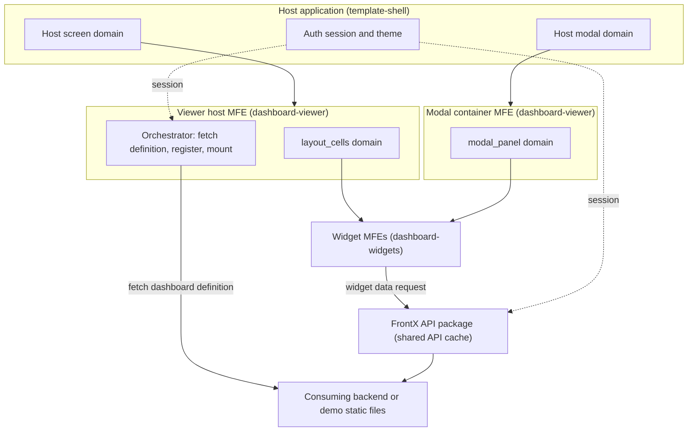
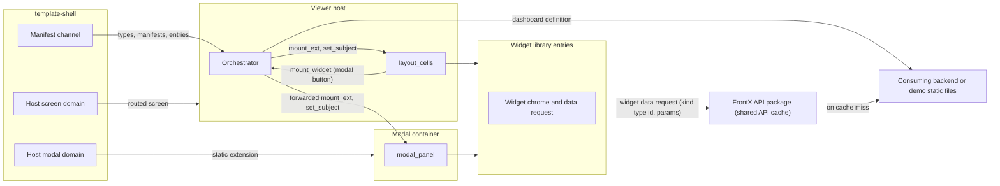
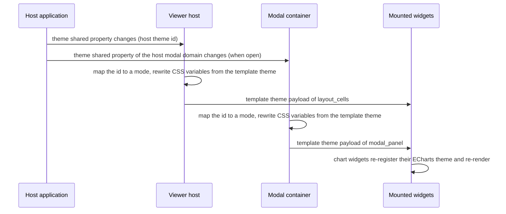
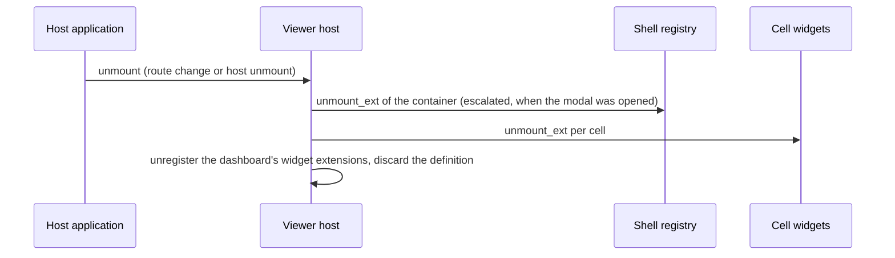
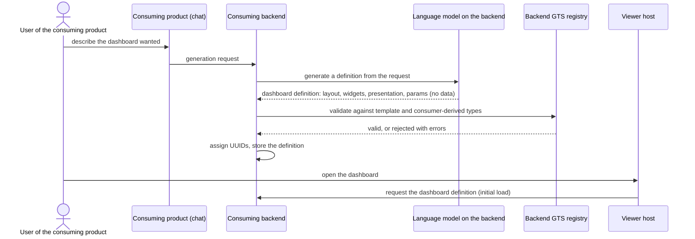

# Technical Design — FrontX Dashboard Template

This design describes how `template-dashboard` renders backend-delivered dashboards on FrontX: the GTS type catalog, the Viewer host that fetches one dashboard definition and renders it, the 9 widget MFEs that request their own data, the modal container, the host contract with `template-shell`, the main runtime sequences, and the budgets.

- [ ] `p1` - **ID**: `cpt-frontx-dashboard-design-dashboard-template`

<!-- toc -->

- [1. Architecture Overview](#1-architecture-overview)
  - [1.1 Architectural Vision](#11-architectural-vision)
  - [1.2 Architecture Drivers](#12-architecture-drivers)
  - [1.3 Architecture Layers](#13-architecture-layers)
- [2. Principles & Constraints](#2-principles--constraints)
  - [2.1 Design Principles](#21-design-principles)
  - [2.2 Constraints](#22-constraints)
- [3. Technical Architecture](#3-technical-architecture)
  - [3.1 Domain Model](#31-domain-model)
  - [3.2 Component Model](#32-component-model)
  - [3.3 API Contracts](#33-api-contracts)
  - [3.4 Internal Dependencies](#34-internal-dependencies)
  - [3.5 External Dependencies](#35-external-dependencies)
  - [3.6 Interactions & Sequences](#36-interactions--sequences)
  - [3.7 Database schemas & tables](#37-database-schemas--tables)
  - [3.8 Deployment Topology](#38-deployment-topology)
  - [3.9 Budgets and NFR Realisation](#39-budgets-and-nfr-realisation)
- [4. Additional context](#4-additional-context)
- [5. Traceability](#5-traceability)

<!-- /toc -->

## 1. Architecture Overview

### 1.1 Architectural Vision

`template-dashboard` is a render-only dashboard viewer on FrontX. The consuming project's backend is the only source of what a dashboard shows. It stores and returns only dashboard definitions: no stored queries and no pre-computed widget data. One definition is one GTS dashboard instance with an `id`, a `name`, a `description`, and an embedded `layout` whose `columns` and `cells` each embed one widget instance; a widget instance is its presentation configuration plus its `params`. The definition carries no widget data and no theme. A consuming product may also generate definitions, for example from a user's chat request through a language model on its backend; generation is the consuming backend's job, and the template supplies the GTS types that a generated definition is validated against (section 3.6, consumer-side generation). The template computes, aggregates, and narrows nothing, and once the widgets render, nothing changes until the dashboard is opened again. It adds no authoring, no generation pipeline, and no server component.

The architecture has one orchestrator. The **Viewer host** is a nested-host MFE (micro-frontend: an independently built and mounted UI unit) that the host application mounts as a routed screen. It requests the routed dashboard's definition once, registers its instances and the dashboard's widget extensions, mounts the layout cells, and sends each widget its instance with `set_subject`. The template ships one MFE per widget kind, 9 in all. Each widget instance requests its own data once: it sends its widget kind's type id and its `params` to the consuming backend's widget data endpoint, through the FrontX API package, whose API cache is shared across MFE entries, and receives one widget data instance of its kind's data type, which the backend computes from its own data for that request. Each widget shows its own loading skeleton, error, and Retry. After render no widget requests data again.

Every widget carries one button that opens the same widget in a modal. The modal reuses the host's own modal domain. That domain gives its occupants no custom actions, so the template ships a static **modal container**. The container occupies the host modal domain and hosts a new instance of the widget, with the same configuration, in its own inner `modal_panel` domain. That instance sends the same kind type id and the same `params`, so the shared API cache serves it the same data as the cell. The widget's modal extension is registered when the dashboard is resolved, so opening the modal only mounts it, and the Viewer host reaches it through FrontX forwarding across nested hosts. The theme lives on the frontend: the template owns its theme instance, and the backend does not supply it. The host must render its modal domain through a domain slot with modal chrome, focus trap, and dismissal; current `template-shell` does not do this yet, so it is a prerequisite shell change tracked outside the template (section 3.5). Every FrontX-specific change is the smallest one that the FrontX rules (isolation, occupancy, forwarding) force.

### 1.2 Architecture Drivers

The drivers are the PRD requirements and the template's eleven ADRs. Each table below maps a driver to the design element that answers it.

**ADRs**: `cpt-frontx-dashboard-adr-frontend-framework`, `cpt-frontx-dashboard-adr-dashboard-layout-grid`, `cpt-frontx-dashboard-adr-shared-data-types-and-schemas`, `cpt-frontx-dashboard-adr-charting-library`, `cpt-frontx-dashboard-adr-data-grid-library`, `cpt-frontx-dashboard-adr-theme-distribution`, `cpt-frontx-dashboard-adr-extension-domain-taxonomy`, `cpt-frontx-dashboard-adr-widget-kind-and-mfe-realization`, `cpt-frontx-dashboard-adr-subject-agnostic-widget-catalog`, `cpt-frontx-dashboard-adr-template-packages-and-host-contract`, `cpt-frontx-dashboard-adr-backend-delivered-dashboard`

#### Functional Drivers

| Requirement | Design Response |
|-------------|------------------|
| `cpt-frontx-dashboard-fr-overlay-install` | The template is an add-only overlay with its own manifest and three packages under exclusive subtrees; its code resolves host identifiers from `template-shell` constants and it changes no shell file; it requires a rendered modal-domain slot from the host (`cpt-frontx-dashboard-topology-overlay-packages`, `cpt-frontx-dashboard-constraint-shell-only-dependency`). |
| `cpt-frontx-dashboard-fr-demo-opt-in` | `dashboard-demo` is marked `templateExample: true` and holds the `gts.frontx.demo.*` types, a static JSON dashboard definition, and static JSON widget data responses that the dev server serves, so the demo dashboard follows the same request paths as a consumer backend (`cpt-frontx-dashboard-component-demo-package`). |
| `cpt-frontx-dashboard-fr-viewer-host` | The Viewer host is a routed extension in the host screen domain; the route carries the dashboard instance; the Viewer host requests that dashboard's definition once and each open dashboard keeps its own loaded definition (`cpt-frontx-dashboard-component-viewer-host`). |
| `cpt-frontx-dashboard-fr-backend-source` | The Viewer host fetches one GTS-typed dashboard definition, with its embedded layout and widget instances, from the consuming backend with the shell's cookie session on a same-origin request and registers its instances; each widget instance requests its own data once, with its kind's type id and its `params`, through the FrontX API package, and renders the returned widget data as delivered; the backend computes that data on the request from its own data and stores nothing but definitions; nothing is requested again after render (`cpt-frontx-dashboard-interface-dashboard-payload`, `cpt-frontx-dashboard-component-viewer-host`, `cpt-frontx-dashboard-component-backend-client`, `cpt-frontx-dashboard-seq-initial-load`). |
| `cpt-frontx-dashboard-fr-loading-error-states` | Skeletons in place of the dashboard while the definition loads, then a dashboard banner with Retry when that fetch fails; after the cells mount, each widget shows its own skeleton, its own error with Retry when its data request fails, and a cannot-show state when its data does not match its kind; a failing widget affects only its own cell (`cpt-frontx-dashboard-seq-failure-handling`). |
| `cpt-frontx-dashboard-fr-widget-catalog` | One widget-library package ships one `mf_manifest` and 9 MFE entries, one per subject-agnostic kind, each with `realizes:`; every entry requests its own data with its kind type id and its `params` (`cpt-frontx-dashboard-component-widget-library`, `cpt-frontx-dashboard-component-backend-client`). |
| `cpt-frontx-dashboard-fr-widget-modal` | Shared widget chrome adds one modal button; the static modal container occupies the host modal domain and mounts a new instance of the same, already-registered widget in its `modal_panel` domain with the same configuration; that instance requests its data with the same kind type id and `params`, which form the same API cache key, so it is served from the shared API cache and shows the same data, normally without a new backend request (`cpt-frontx-dashboard-component-modal-container`, `cpt-frontx-dashboard-interface-host-actions`). |
| `cpt-frontx-dashboard-fr-grid-presentation` | The grid shell renders columns with each cell's value as text, frozen columns, grouped column headers, and row coloring as set by the `grid` widget's configuration, shows the delivered rows in the delivered order with one heading row per row group when the data supplies groups, and renders rows virtualized so that up to 5,000 rows stay responsive without paging; it offers no sorting, grouping, or pagination in the browser (`cpt-frontx-dashboard-component-widget-library`, `cpt-frontx-dashboard-principle-render-only-viewer`). |
| `cpt-frontx-dashboard-fr-theme` | The template owns its theme instance on the frontend; the Viewer host and the modal container each map the host theme id to a mode through the template's theme-mode map, project the matching palette of that theme to CSS variables and the theme shared property of their domains; chart widgets register the ECharts theme `frontx-dashboard` (`cpt-frontx-dashboard-seq-theme-switch`). |
| `cpt-frontx-dashboard-fr-domain-model` | The `gts.frontx.v.*` and `gts.frontx.m.*` catalogs on GTS v0.17: a trimmed dashboard root with an embedded layout, the abstract widget base with `params` and a `data_type` trait, and the abstract widget-data base with 9 derived data shapes; a consuming backend validates its stored or generated definitions against these types, and a consumer may derive widget types that close `params`; demo types live under `gts.frontx.demo.*` (section 3.1, `cpt-frontx-dashboard-seq-consumer-generation`). |

#### NFR Allocation

| NFR ID | NFR Summary | Allocated To | Design Response | Verification Approach |
|--------|-------------|--------------|-----------------|----------------------|
| `cpt-frontx-dashboard-nfr-visual-quality` | One consistent look in light and dark | Viewer host theme projection, modal container, chart widgets, grid shell | Every color, font, and spacing value comes from the template's theme instance and the host design-system tokens; chart widgets use one ECharts theme builder; no widget carries manual styling. | Design inspection of all 9 kinds in both modes, in a cell and in the modal, against the design-system reference. |
| `cpt-frontx-dashboard-nfr-initial-render` | First full render p95 < 3 s (provisional), from definition request | Viewer host (definition fetch, parallel mount), widget library (parallel per-widget data requests) | One definition request per dashboard; widget bundles load in parallel with the definition fetch; each cell receives `set_subject` as soon as it is mounted and the definition has arrived, and every widget requests its data at once, in parallel with the others. Reference conditions, including the reference definition and widget data responses, are fixed in section 3.9. | Timed runs under the reference conditions; budget confirmed or revised from the results. |
| `cpt-frontx-dashboard-nfr-compatibility` | Works on the FrontX develop line, depends on `template-shell` only | Packaging, host contract | Role-based host identifiers resolved from shell constants in code; manifest-declared extensions carry the current identifiers; exact pins of FrontX packages; no reference to other templates. | Clean install and demo opt-in install both build on a `template-shell` project that provides the rendered modal-domain slot, with no shell file changed by the template. |
| `cpt-frontx-dashboard-nfr-bundle-budget` | Isolation-aware bundle budget | Viewer host entry, modal container entry, widget entries | Provisional figures from section 3.9; heavy libraries counted per instance; the modal container entry counted separately; FrontX ADR-0034 source reuse as mitigation. | Measured production bundle sizes per instance against the provisional figures. |
| `cpt-frontx-dashboard-nfr-accessibility` | Host accessibility policy and keyboard operability | Widget chrome with modal button and Retry, grid shell, modal container, Viewer host chrome and Retry | Every control follows the host policy; the grid shell exposes ARIA grid semantics, also for virtualized rows and group heading rows; the modal button, Close, and both Retry actions are keyboard-operable; the host's modal-domain slot provides the focus trap and dismissal (host requirement in section 3.5). | Host accessibility checks in both themes and a keyboard-only walkthrough of the demo that opens and closes every widget in the modal. |
| `cpt-frontx-dashboard-nfr-consumer-docs` | Shipped consumer guide | AI guidance subtree and package guides | The template ships a guide for the dashboard definition and widget data request contracts that a project backend serves, the validation of stored or generated definitions against the template types, the derivation of widget types that close `params`, the host contract, the theme instance and theme-mode map, and the demo opt-in. | Walkthrough by a developer who did not build the template. |

#### Architecture Decision Records

| ADR | Effect on this design |
|-----|-----------------------|
| `cpt-frontx-dashboard-adr-frontend-framework` | FrontX develop with TypeScript and MFE packaging; per-instance isolation shapes every component boundary. |
| `cpt-frontx-dashboard-adr-dashboard-layout-grid` | 60-column integer cells rendered with CSS Grid in the Viewer host; viewer-side overlap and range check. |
| `cpt-frontx-dashboard-adr-shared-data-types-and-schemas` | GTS v0.17 on FrontX bases, vendor `frontx`, packages `v`, `m`, `demo`, the ID-form convention with combined instance identifiers, `x-gts-type-ref`, `x-gts-instance-ref`, and `x-gts-pattern-ref` references, abstract bases and traits, registry validation, and the `v1` freeze. |
| `cpt-frontx-dashboard-adr-charting-library` | ECharts in each chart widget, theme registered per widget instance. |
| `cpt-frontx-dashboard-adr-data-grid-library` | TanStack Table behind one grid shell in the `grid` widget, used for rendering only, with virtualized row rendering for large grids and cell values shown as text; the grid shows the delivered rows and row groups as given, without search, filtering, sorting, grouping, or pagination in the browser. |
| `cpt-frontx-dashboard-adr-theme-distribution` | The theme lives on the frontend as the template's own theme instance; mode from the template's theme-id map; CSS variables plus the theme shared property, projected by the Viewer host for `layout_cells` and by the modal container for `modal_panel` from the same theme. |
| `cpt-frontx-dashboard-adr-extension-domain-taxonomy` | Two template domains (`layout_cells`, `modal_panel`), two host actions (`set_subject`, `mount_widget`), static modal container; every widget extension, including the one the modal mounts, is registered at dashboard resolve, and opening the modal only mounts. |
| `cpt-frontx-dashboard-adr-widget-kind-and-mfe-realization` | Parallel `m` and `v` hierarchies joined by `realizes:`; one widget package with 9 entries. |
| `cpt-frontx-dashboard-adr-subject-agnostic-widget-catalog` | 9 rendering-primitive kinds, each tied to one widget data type through its `data_type` trait; `params` semantics belong to the consumer, which may derive widget types that close the `params` schema; the backend supplies the data. |
| `cpt-frontx-dashboard-adr-template-packages-and-host-contract` | Add-only overlay, three packages, host domains by role, a manifest channel that carries only GTS types and MFE entries, the demo's static definition and widget data, and the rendered modal-domain slot as a host requirement. |
| `cpt-frontx-dashboard-adr-backend-delivered-dashboard` | The backend stores and returns only the dashboard definition, with the layout embedded, fetched once by the Viewer host; each widget MFE requests its own data once when it mounts, with its kind type id and its `params`; no stored queries and no pre-computed data; nothing is fetched again after render. |

### 1.3 Architecture Layers



- [ ] `p2` - **ID**: `cpt-frontx-dashboard-tech-frontx-stack`

| Layer | Responsibility | Technology |
|-------|---------------|------------|
| Host | Screen and modal domains with rendered slots, manifest channel, auth session, host theme and language | `template-shell` on FrontX develop |
| Presentation | Layout grid, widget rendering, widget modal button, per-widget loading and error states, modal chrome | React, shadcn/ui, CSS Grid, ECharts with echarts-for-react, TanStack Table v8 |
| Orchestration | Definition fetch, instance and extension registration, mount chains, theme projection | Viewer host (TypeScript strict), FrontX actions chains |
| Data | One dashboard definition per dashboard and one widget data response per widget, computed by the consuming backend from a widget's kind type id and `params` | Same-origin HTTP requests with the shell's cookie session; widget data requests through the FrontX API package, whose API cache is shared across MFE entries |
| Contracts | Types and instances for dashboards, embedded layouts, widgets, widget data, themes, domains, actions | GTS v0.17 on `gts.frontx.mfes.*` bases |

## 2. Principles & Constraints

### 2.1 Design Principles

#### Render-Only Viewer

- [ ] `p1` - **ID**: `cpt-frontx-dashboard-principle-render-only-viewer`

The template renders what the backend delivers and nothing more. The dashboard definition carries the dashboard, its embedded layout, and every widget's configuration with its `params`; each widget's data is the backend's response to that widget's own data request, computed from the backend's own data for the widget's kind and `params`, and the widget shows it as delivered: it does not compute, aggregate, narrow, hide, or cut off any part of it. The layout, with the widget configuration that each cell carries, fully defines how the widgets are composed and presented; the viewer renders it as given and does not sort, group, page, or otherwise re-arrange anything in the browser. After the widgets render, nothing changes: no request follows except Retry after a failure, no widget receives new data, and the modal shows the same widget with the same data. Interactive exploration is later-stage work and needs a new decision.

**ADRs**: `cpt-frontx-dashboard-adr-backend-delivered-dashboard`, `cpt-frontx-dashboard-adr-subject-agnostic-widget-catalog`

#### Per-Instance Isolation, No Shared Singletons

- [ ] `p1` - **ID**: `cpt-frontx-dashboard-principle-per-instance-isolation`

FrontX gives every MFE load its own module graph (FrontX ADR-0011), so no library, store, or theme object of the template is shared between MFE instances. Each open dashboard owns its own loaded definition. Each chart widget registers its own ECharts theme. Widget data requests are the one place where the template relies on shared state: they go through the FrontX API package, whose API cache is shared across MFE entries, so identical data requests, those with the same widget kind type id and the same canonical `params`, such as the modal instance's, are served from one cache entry. That Module Federation serves only as the bundling format, with FrontX resolving dependencies itself, is a template assumption from the product owner, not a statement of FrontX ADR-0011.

**ADRs**: `cpt-frontx-dashboard-adr-frontend-framework`, `cpt-frontx-dashboard-adr-theme-distribution`, `cpt-frontx-dashboard-adr-backend-delivered-dashboard`

#### Extensions Are Registered Only at Dashboard Resolve

- [ ] `p1` - **ID**: `cpt-frontx-dashboard-principle-no-extension-on-click`

Extensions are registered at one moment: when the Viewer host resolves the dashboard from its definition. It then registers one extension per cell and, for every widget of the dashboard, the extension that the modal mounts in `modal_panel`. The modal container is a static extension declared in a manifest. Opening the modal and every other click only mount, unmount, and configure extensions that already exist.

**ADRs**: `cpt-frontx-dashboard-adr-extension-domain-taxonomy`, `cpt-frontx-dashboard-adr-backend-delivered-dashboard`

#### Viewer Host Orchestrates, Widgets Load and Render

- [ ] `p1` - **ID**: `cpt-frontx-dashboard-principle-viewer-host-orchestration`

The Viewer host fetches the dashboard definition, registers it, and mounts and configures the widgets; it holds no widget data and runs no queries. A widget receives `set_subject` with its widget instance, requests its own data once with its kind type id and the `params` from that instance, and renders the response. Widgets never request anything but their own data and never reach the Viewer host's internals.

**ADRs**: `cpt-frontx-dashboard-adr-backend-delivered-dashboard`, `cpt-frontx-dashboard-adr-extension-domain-taxonomy`

#### Contracts Are GTS Data

- [ ] `p2` - **ID**: `cpt-frontx-dashboard-principle-gts-contracts`

Every contract that crosses an MFE boundary or the backend boundary is a GTS type chained from a FrontX base. Dashboards with their embedded layouts, widgets, widget data, and themes are GTS-typed, so a consumer adds a dashboard as data, whether stored or generated, and validates it against the registered template types before it serves it. Dashboard definitions and widget data responses come from the consuming backend, or from the demo package's static files; the Viewer host registers the definition's instances with the type system, and each widget checks its data response against its kind's `data_type`. The theme instance ships with the template. The manifest channel carries only types and MFE entries. Contracts that stay inside one runtime stay TypeScript-internal.

**ADRs**: `cpt-frontx-dashboard-adr-shared-data-types-and-schemas`, `cpt-frontx-dashboard-adr-widget-kind-and-mfe-realization`, `cpt-frontx-dashboard-adr-backend-delivered-dashboard`

### 2.2 Constraints

#### Dependency on `template-shell` Only

- [ ] `p1` - **ID**: `cpt-frontx-dashboard-constraint-shell-only-dependency`

The template depends on `template-shell` and the FrontX packages it pins. It takes nothing from `template-mfe` or the demo MFE, and it changes no `template-shell` file. It does require one host capability that current `template-shell` lacks: a rendered slot for the host modal domain with modal chrome, focus trap, and dismissal (section 3.5). That capability is a prerequisite `template-shell` change, tracked outside `template-dashboard`, not part of this overlay. FrontX ecosystem packages are pinned to exact published versions.

**ADRs**: `cpt-frontx-dashboard-adr-template-packages-and-host-contract`, `cpt-frontx-dashboard-adr-frontend-framework`

#### Host Identifiers by Role

- [ ] `p1` - **ID**: `cpt-frontx-dashboard-constraint-role-based-host-ids`

Documents name host domains by role. The **host screen domain** is the host application's extension domain in which full screens are mounted; it realizes the PRD's host screen area. The **host modal domain** is the host application's extension domain in which a modal occupant is mounted; together with the host's rendered modal-domain slot it realizes the PRD's host modal area. TypeScript code resolves their current identifiers from `template-shell` framework constants and never writes them as literals. Manifest-declared extensions in `mfe.json`, such as the Viewer host's routed extension and the modal container's static extension, are data and carry the current identifiers, or are generated from the constants at build time. The host contract table in section 3.5 is the single place that maps roles to current identifiers.

**ADRs**: `cpt-frontx-dashboard-adr-template-packages-and-host-contract`

#### GTS Identifier Form and Freeze

- [ ] `p1` - **ID**: `cpt-frontx-dashboard-constraint-gts-id-convention`

The template targets GTS specification v0.17. Type identifiers end with `~` and instance identifiers do not. An instance identifier always carries its type chain: a well-known instance ends in a named segment, and a dashboard or widget instance uses the combined anonymous form, its type chain followed by a UUID that the consuming backend generates; no instance carries a separate `type` field. A field that holds an identifier is constrained with `x-gts-type-ref`, `x-gts-instance-ref`, or `x-gts-pattern-ref`, according to whether it holds a type, an instance, or a pattern; the removed `x-gts-ref` is not used. The template's own segments use vendor `frontx` and only the packages `v`, `m`, and `demo`. Every identifier starts at `v1` and is frozen from the first non-alpha release; after the freeze, an incompatible change ships as a new version.

**ADRs**: `cpt-frontx-dashboard-adr-shared-data-types-and-schemas`

#### Fixed 60-Column Layout

- [ ] `p2` - **ID**: `cpt-frontx-dashboard-constraint-sixty-column-grid`

The layout embedded in each dashboard uses 60 columns with integer cell coordinates `x`, `y`, `w`, `h` and one embedded widget per cell. The viewer repairs nothing at run time: overlapping or out-of-range cells block the dashboard with a diagnostic.

**ADRs**: `cpt-frontx-dashboard-adr-dashboard-layout-grid`

#### One Viewer Host per Application Tree

- [ ] `p2` - **ID**: `cpt-frontx-dashboard-constraint-one-viewer-per-tree`

Template domain identifiers are fixed instance identifiers, and the FrontX collision guard is tree-global (FrontX ADR-0007). The supported topology is therefore one mounted Viewer host per application tree, which the exclusive host screen domain already guarantees. Switching dashboards happens through the Viewer host's route, and independent viewers run in separate application instances, such as two browser tabs.

**ADRs**: `cpt-frontx-dashboard-adr-extension-domain-taxonomy`, `cpt-frontx-dashboard-adr-template-packages-and-host-contract`

#### Licensing, Compliance, and Resource Dispositions

- [ ] `p2` - **ID**: `cpt-frontx-dashboard-constraint-licensing-compliance-resources`

- **Regulatory and privacy**: not applicable because the template is a read-only information UI that stores nothing. The dashboard definition and the widget data stay in browser memory, the latter in the FrontX API cache, and are released when the dashboard closes or the cache entries expire; demo data is synthetic, and processing of personal data belongs to the consuming backend (PRD section 6.2).
- **Data residency**: not applicable because the template stores no data and runs no service. The Viewer host and the widgets read only from the consuming project's same-origin backend, whose residency the consuming project owns.
- **Licensing**: every third-party runtime library must carry a permissive license that allows distribution as source inside a consumer project, Apache-2.0 or MIT, as listed in section 3.5.
- **Resource constraints**: the browser only renders; the consuming backend computes every value the widgets show, and response size is the backend's concern. Download and evaluation cost is bounded by the bundle budget in section 3.9. No server, storage, or network resource is provisioned by the template.

**ADRs**: `cpt-frontx-dashboard-adr-template-packages-and-host-contract`, `cpt-frontx-dashboard-adr-backend-delivered-dashboard`

## 3. Technical Architecture

### 3.1 Domain Model

**Technology**: GTS (Global Type System) specification v0.17 types and instances chained from the FrontX `gts.frontx.mfes.*` bases.

**Location**: type files in `src-app/mfe_packages/dashboard-viewer/` (engine `v` and `m` types, the template's theme instance, modal container), `src-app/mfe_packages/dashboard-widgets/` (manifest and entries), and `src-app/mfe_packages/dashboard-demo/` (demo types and the static demo definition and widget data). The concrete catalogs are specified in the type-catalog FEATURE documents named below.

**Instance source**: the dashboard instance, with its embedded layout and the widget instances embedded in its cells, is the dashboard definition that the consuming backend stores, or generates, and returns for one dashboard; the backend generates the UUIDs of the dashboard and widget identifiers. Each widget's data instance comes from the backend's response to that widget's own data request, computed for the widget's kind type id and `params` (`cpt-frontx-dashboard-fr-backend-source`, `cpt-frontx-dashboard-adr-backend-delivered-dashboard`). The theme instance is template-owned frontend content that ships in `dashboard-viewer`; the backend does not supply it. The demo package serves the definition and the widget data responses as static JSON files. Package `mfe.json` files carry only GTS types and MFE entries, which reach every registry through the manifest channel (section 3.5); no content instance travels through them.

**Core Entities**:

| Entity | Description | Schema |
|--------|-------------|--------|
| Dashboard definition | One per dashboard, stored or generated and returned by the consuming backend: one dashboard instance with its embedded layout and each widget instance embedded in a layout cell; no widget data and no theme | the dashboard instance below; interface `cpt-frontx-dashboard-interface-dashboard-payload` (section 3.3) |
| Dashboard | Trimmed root: `id`, `name`, `description`, embedded `layout` | `gts.frontx.m.dashboard.dashboard.v1~` (FEATURE `dashboard-root-types`) |
| Theme | Light and dark palettes, typography, chart defaults, spacing; one template-owned instance on the frontend | `gts.frontx.m.dashboard.theme.v1~` (FEATURE `dashboard-root-types`) |
| Layout | Embedded object of the dashboard, without an own identifier: `columns` (always 60) and an ordered list of cells | `gts.frontx.m.layout.layout.v1~` (FEATURE `layout-types`) |
| Layout cell | Embedded object of the layout: position `x`, `y`, `w`, `h` and one embedded widget instance | `gts.frontx.m.layout.cell.v1~` (FEATURE `layout-types`) |
| Widget | Abstract base of the 9 widget kinds: `id`, `title`, the open `params` object, the kind's presentation configuration, and the `data_type` trait that names the kind's widget data type | `gts.frontx.m.widget.widget.v1~` (inline below; kinds in FEATURE `widget-catalog`) |
| Widget data | Abstract base and one derived data type per widget kind, the response to a widget's data request | `gts.frontx.v.widget_data.widget_data.v1~` and `gts.frontx.v.widget_data.widget_data.v1~frontx.v.widget_data.<kind>.v1~` (FEATURE `widget-data-catalog`) |
| Host actions | Two template actions | `gts.frontx.mfes.comm.action.v1~frontx.v.mfe.<name>.v1~` (FEATURE `extension-domain-catalog`) |
| Domains and extension types | `layout_cells`, `modal_panel` | `gts.frontx.mfes.ext.domain.v1~frontx.v.layout.<name>.v1` (FEATURE `extension-domain-catalog`) |
| MFE entry | Entry type that adds `realizes:` | `gts.frontx.mfes.mfe.entry.v1~frontx.mfes.mfe.entry_mf.v1~frontx.v.mfe.entry.v1~` (FEATURE `mfe-entries`) |

**Relationships**:

- Dashboard definition → Dashboard, Layout, Widget: one definition is one dashboard instance with its embedded layout and every widget instance embedded in a cell. It carries no widget data and no theme.
- Dashboard → Layout: the dashboard embeds one layout object, which has no identifier of its own; the layout embeds its cells, and each cell embeds one widget instance.
- Widget → Widget data: each widget instance carries `params`; the widget sends its kind type id and its `params` in its data request, and the response is one widget data instance, which must validate against the data type named by its kind's `data_type` trait.
- Widget kind → Widget data: each widget kind sets its `data_type` trait to one data type derived from the widget-data base.
- Consumer widget type → Widget kind: a consumer may derive a widget type from a kind that closes or specifies the `params` schema, for example `gts.frontx.m.widget.widget.v1~frontx.m.widget.grid.v1~acme.gh.widget.pr_list.v1~`; a definition that uses it validates against it, and its instances keep the kind's MFE, presentation, and `data_type`.
- MFE entry → Widget: each widget entry instance points with `realizes:` to one widget kind; definitions carry widget instances, never entry identifiers.
- Domain → Widget: a domain mounts widget extensions whose entries realize widget kinds; theme is the only shared property of the template domains.
- Theme → Dashboard: none; the template applies its own theme instance to every dashboard.

#### Packages, Namespaces, and the Model–View Split

The template's own types sit in two packages under the `frontx` vendor. Package `m` (model) holds what describes a dashboard: dashboard, theme, layout, cell, and widget kinds. Package `v` (view runtime) holds what the runtime exchanges: widget data shapes, host actions, domains, extension types, and the MFE entry type. Package `demo` holds any types of the demo sample, which ship with the demo package.

The split keeps one deliberate reference from `m` into `v` and one from `v` into `m`, inherited from the prototype (ADR-0008):

| From | To | Meaning |
|------|----|---------|
| `gts.frontx.m.widget.widget.v1~frontx.m.widget.<kind>.v1~` trait `data_type` (`m` → `v`) | `gts.frontx.v.widget_data.widget_data.v1~frontx.v.widget_data.<kind>.v1~` | Each kind names its one data type; the widget base declares the trait with `x-gts-type-ref` to the widget-data base. |
| `gts.frontx.mfes.mfe.entry.v1~frontx.mfes.mfe.entry_mf.v1~frontx.v.mfe.entry.v1~` field `realizes` (`v` → `m`) | `gts.frontx.m.widget.widget.v1~` | An MFE entry realizes one widget kind; the field holds a type identifier and uses `x-gts-type-ref`. |

The dashboard's embedded `layout` and the cell's embedded `widget` stay inside package `m`, so they are not cross-package references.

The prototype's backend report generator no longer exists, so the split is kept for continuity and for independent MFE releases, not for a current consumer.

**ID-form convention.** Identifiers with a trailing `~` are types; identifiers without it are instances. Every instance identifier carries its type chain (GTS v0.17, sections 2 and 3.7): a well-known instance ends in a named segment, and a combined anonymous instance ends in a UUID. The following table fixes the form for every family:

| Family | Form | Example |
|--------|------|---------|
| Host actions (2) | type, derived from the FrontX action base | `gts.frontx.mfes.comm.action.v1~frontx.v.mfe.set_subject.v1~` |
| Extension types | type | `gts.frontx.mfes.ext.extension.v1~frontx.v.layout.layout_cells.v1~` |
| MFE entry type | type | `gts.frontx.mfes.mfe.entry.v1~frontx.mfes.mfe.entry_mf.v1~frontx.v.mfe.entry.v1~` |
| Engine and demo schemas | type | `gts.frontx.m.widget.widget.v1~frontx.m.widget.grid.v1~`, `gts.frontx.v.widget_data.widget_data.v1~frontx.v.widget_data.grid.v1~` |
| Consumer-derived widget types | type, derived from a template kind | `gts.frontx.m.widget.widget.v1~frontx.m.widget.grid.v1~acme.gh.widget.pr_list.v1~` |
| Dashboards | combined anonymous instance; UUID generated by the consuming backend | `gts.frontx.m.dashboard.dashboard.v1~<uuid>` |
| Widgets embedded in a dashboard | combined anonymous instance of the kind or of a consumer-derived type; UUID generated by the consuming backend | `gts.frontx.m.widget.widget.v1~frontx.m.widget.grid.v1~<uuid>` |
| Widget data | no identifier; validated against the `data_type` of the requesting widget's kind | none |
| Domains | instance | `gts.frontx.mfes.ext.domain.v1~frontx.v.layout.layout_cells.v1` |
| Widget MFE entries (9) | instance | `gts.frontx.mfes.mfe.entry.v1~frontx.mfes.mfe.entry_mf.v1~frontx.v.mfe.entry.v1~frontx.v.summary_card.v1` |
| Viewer and container entries | instance of the FrontX `entry_mf` type | `gts.frontx.mfes.mfe.entry.v1~frontx.mfes.mfe.entry_mf.v1~frontx.v.mfe.modal_container.v1` |
| Viewer host routed extension | instance of the shell screen extension type | `gts.frontx.mfes.ext.extension.v1~frontx.screensets.layout.screen.v1~frontx.v.screens.viewer.v1` |
| Modal container extension | instance of the FrontX extension base | `gts.frontx.mfes.ext.extension.v1~frontx.v.layout.modal_container.v1` |
| Viewer manifest | instance | `gts.frontx.mfes.mfe.mf_manifest.v1~frontx.v.viewer.manifest.v1` |
| Widget manifest | instance | `gts.frontx.mfes.mfe.mf_manifest.v1~frontx.v.widgets.manifest.v1` |
| Template theme | instance | the template's theme instance in `dashboard-viewer`, under `frontx.m.dashboard` |
| Sample dashboard and widget instances | combined anonymous instance, with fixed UUIDs | the demo's static definition; its widget data files carry no identifier |

#### Abstract Bases

The DESIGN carries the abstract widget base inline, plus the base-level shape of the other families that the component model depends on. Field-level schemas of concrete types are owned by the FEATURE documents.

**Widget base** `gts.frontx.m.widget.widget.v1~`. It is abstract (`x-gts-abstract: true`), so every widget instance belongs to a concrete kind, `gts.frontx.m.widget.widget.v1~frontx.m.widget.<kind>.v1~`, or to a type derived from one. Each widget instance carries its whole presentation configuration and its `params`; the data itself is not part of the definition.

| Field or keyword | Required | Meaning |
|------------------|----------|---------|
| `id` | yes | Combined anonymous instance identifier, constrained with `x-gts-instance-ref: "/$id"`, so it must be rooted at the widget's own type; the consuming backend generates the UUID. |
| `title` | yes | Display title of the widget. |
| `params` | yes | Open object that the widget sends, with its kind type id, in its data request. Its meaning belongs to the consumer; the template does not read it (`cpt-frontx-dashboard-adr-subject-agnostic-widget-catalog`). A consumer may derive a widget type that closes or specifies its schema. |
| `x-gts-traits-schema` | type level | Declares the required trait `data_type`, a type identifier constrained with `x-gts-type-ref` to the widget-data base `gts.frontx.v.widget_data.widget_data.v1~`. Each kind sets it with `x-gts-traits`, so the registry rejects a concrete kind without a data type. |

The 9 kinds are `summary_card`, `metric_card`, `ranked_list_card`, `progress_list_card`, `grid`, `cartesian_chart`, `pie_chart`, `heatmap`, and `markdown_card`. The `grid` kind also carries `columns`, `frozen_columns`, `column_groups` (grouped column headers), and `row_color_by_field`; these are presentation settings fixed by the layout, not client-side operations on the rows. Each grid cell shows its value as text. Presentation keys such as `columns[].key` must name fields that the data computed for the widget's `params` contains; keeping them consistent is the responsibility of whoever writes or generates the definition (section 4). The backend supplies exactly what each widget shows, and no kind hides or cuts off part of it. The modal button is part of the shared widget chrome of every kind, so the base declares no field for it.

**Widget data** `gts.frontx.v.widget_data.widget_data.v1~`. It is abstract (`x-gts-abstract: true`), and the 9 data types derive from it as `gts.frontx.v.widget_data.widget_data.v1~frontx.v.widget_data.<kind>.v1~`, one per kind. A data instance is what the consuming backend computes for one widget's data request and what the widget renders, unchanged. It is computed per request, not stored, so it carries no identifier; the widget validates it against the data type named by its kind's `data_type` trait. The `grid` shape carries the rows and, optionally, `groups`: each group has a label and its rows, in the order supplied. With `groups`, the grid renders one group heading row before each group's rows, with no collapsing and no reordering; without `groups`, it renders a flat list.

**Layout and cell** `gts.frontx.m.layout.layout.v1~` and `gts.frontx.m.layout.cell.v1~`. Both are embedded object types: their objects live inside the dashboard and have no identifier of their own, and no layout is stored or referenced separately. A layout has `columns` (always 60) and ordered `cells`. A cell has integer `x` (0 to 59), `y` (0 or more), `w` (1 to 60), `h` (1 or more), and one `widget` that embeds the cell's widget instance; the `layout-types` schema checks it against the widget base. Schema validation checks each coordinate; the Viewer host checks overlaps and `x + w` greater than 60.

**Dashboard root (trimmed)** `gts.frontx.m.dashboard.dashboard.v1~`. It has `id`, a combined anonymous instance identifier constrained with `x-gts-instance-ref: "/$id"` and generated by the consuming backend, `name`, `description`, and the embedded `layout`. It references no theme. The prototype's default time window, visibility, short link, publication, enablement, and audience fields are dropped; a consumer may derive a subtype that adds fields. The prototype's report type is dropped as well.

**Theme** `gts.frontx.m.dashboard.theme.v1~`. It holds `light_palette` and `dark_palette`, each with `primary`, `secondary`, `accent`, `background`, `foreground`, `muted`, `destructive`, `chart_categorical`, and `chart_sequential`, `typography`, `chart_defaults`, and optional `spacing`. The template owns one instance of it, which ships as frontend source in `dashboard-viewer` and is used by both the Viewer host and the modal container; a consumer changes the look by editing that instance in its project. The active mode always follows the host: the host's theme shared property carries only the host theme id, and the template maps that id to `light` or `dark` through its theme-mode map (section 3.2, Viewer host). The template's theme instance supplies the palette for that mode.

**Host actions** derive from the FrontX action base `gts.frontx.mfes.comm.action.v1~`. Section 3.3 lists their targets and payloads.

**Theme shared-property payload.** All domains use the FrontX theme shared property `gts.frontx.mfes.comm.shared_property.v1~frontx.mfes.comm.theme.v1~`, whose value differs by publisher:

| Publisher | Domains | Value | Stability | Owning FEATURE |
|-----------|---------|-------|-----------|----------------|
| Host | host screen and modal domains | the host theme id only | not template-owned (host contract, section 3.5) | none (host contract, section 3.5) |
| Viewer host | `layout_cells` | the host theme id, the mode from the theme-mode map, and the active palette of the template's theme | stable | `extension-domain-catalog` |
| Modal container | `modal_panel` | the same shape: host theme id from the theme shared property of the host modal domain, the mode from the theme-mode map, and the active palette of the same template theme | stable | `extension-domain-catalog` |

Widgets read only the template payload; they never map a host theme id themselves.

**Extension types and domains.** `gts.frontx.mfes.ext.extension.v1~frontx.v.layout.layout_cells.v1~` and `gts.frontx.mfes.ext.extension.v1~frontx.v.layout.modal_panel.v1~` derive from the FrontX extension base and add no fields. Both domains are instances of the FrontX domain base, so the template adds no domain type. The modal container is an instance of the FrontX extension base, `gts.frontx.mfes.ext.extension.v1~frontx.v.layout.modal_container.v1`, because it carries no fields of its own.

**MFE entry** `gts.frontx.mfes.mfe.entry.v1~frontx.mfes.mfe.entry_mf.v1~frontx.v.mfe.entry.v1~`. It extends the FrontX Module Federation entry with one required field, `realizes:`, which holds a widget kind's type identifier (`x-gts-type-ref` to the widget base). The 9 widget entries are its instances. The viewer entry `gts.frontx.mfes.mfe.entry.v1~frontx.mfes.mfe.entry_mf.v1~frontx.v.mfe.viewer.v1` and the container entry `gts.frontx.mfes.mfe.entry.v1~frontx.mfes.mfe.entry_mf.v1~frontx.v.mfe.modal_container.v1` realize no widget kind, so they are plain FrontX entry instances.

#### Catalog Summary and Ownership

The type catalog (`cpt-frontx-dashboard-interface-domain-model`) has six catalogs, each owned by one FEATURE.

| Package and namespace | Contents | Inline here | Owning FEATURE |
|-----------------------|----------|-------------|----------------|
| `frontx.m.dashboard` | Dashboard (trimmed, with embedded layout), Theme | base shape | `dashboard-root-types` |
| `frontx.m.layout` | Layout, Cell, both embedded object types | base shape | `layout-types` |
| `frontx.m.widget` | Abstract widget base and 9 kinds | Widget base | `widget-catalog` |
| `frontx.v.widget_data` | Abstract widget-data base and 9 derived data types | base shape | `widget-data-catalog` |
| `frontx.v.mfe`, `frontx.v.layout` | 2 action types, 2 domains, 2 extension types, theme shared-property payload | base shape | `extension-domain-catalog` |
| `frontx.v.mfe` | MFE entry type, entries, manifests | base shape | `mfe-entries` |
| `frontx.demo` | static JSON dashboard definition (sample dashboard with its embedded layout and widget instances) and the static widget data response of every widget | none | none (demo package, section 3.2) |

**Demo package summary.** The demo ships one sample dashboard as a static JSON dashboard definition with its embedded layout and widget instances, and one static JSON widget data response per widget, prepared in advance in place of a backend computation. It covers seven widget kinds; `metric_card` and `markdown_card` are not shown in the demo dashboard.

### 3.2 Component Model



#### Viewer Host

- [ ] `p1` - **ID**: `cpt-frontx-dashboard-component-viewer-host`

##### Why this component exists

A dashboard needs one place that fetches its definition, registers what it contains, and mounts each widget with its configuration. The Viewer host is that place. It is the FrontX counterpart of the prototype's Dashboard Viewer Shell, now a nested-host MFE inside a consumer's shell instead of an application of its own, and it renders what the backend delivers without computing anything.

##### Responsibility scope

- Mounts as a routed extension (`Extension.route`, FrontX ADR-0036) of the screen extension type in the host screen domain; the dashboard instance identifier is part of its route.
- Builds its nested registry synchronously inside its first `mount` call (FrontX ADR-0008) and registers `layout_cells` there with the concurrent mount strategy and the actions listed in section 3.3, so the registry adopts the inbound bridge and advertises its domain to the shell.
- Fetches the aggregated manifests from the host's manifest channel, as the `template-mfe` nested-host reference does, and registers their schemas, manifests, and entries in its registry, so the widget entries and the catalog types are known (section 3.5, manifest channel).
- Requests the routed dashboard's definition once, from the endpoint in its definition configuration (a TS-internal setting documented in the consumer guide), as a same-origin request that carries the shell's session cookie and no other credential; again only when the user selects Retry after a failure. When template examples are included in the run, by the same switch that puts `dashboard-demo` into the manifest channel, the endpoint resolves to the demo's static definition served by the dev server. Every failure of that request, including an HTTP error status, an authentication failure or expired session, a network error, and an unparsable body, is one definition fetch failure.
- Registers the definition's GTS instances, so the type system validates the dashboard and each embedded widget against the type that its `id` names, a template kind or a consumer-derived type, with the GTS v0.17 rules for abstract types, traits, and references; whether embedded widgets are registered as instances of their own or validated in place is an open item (section 4). It validates the layout (schema bounds, then overlap and `x + w` not greater than 60) and shows a diagnostic instead of the grid when a check fails.
- Registers extensions only when it resolves the dashboard: one `layout_cells` extension per cell and, for every widget, the extension that the modal mounts in `modal_panel`. It resolves each widget's type, through its kind in the type chain, to an MFE entry through `realizes:`. How the registrations made at dashboard resolve reach `modal_panel`, whose registry exists only after the container's first mount, is an open item (section 4). It never registers on a click or on a modal open.
- Mounts the cells and sends each widget `set_subject` with its widget instance from the definition. It sends no widget data; each widget requests its own.
- Keeps the loaded definition for the lifetime of the dashboard; each open dashboard keeps its own definition, and the definition is discarded when the dashboard closes.
- Handles `mount_widget` on `layout_cells`: runs one `mount_ext` of the modal container into the host modal domain, then `mount_ext` of the widget's modal extension into `modal_panel` through FrontX forwarding, and sends that new widget instance the same `set_subject` its cell received. It makes no request.
- Renders the layout as a CSS Grid with 60 equal columns; a cell spans the column range from `x + 1` over `w` columns and the row range from `y + 1` over `h` rows.
- Owns the theme-mode map: a table from host theme id to `light` or `dark`, with an unknown id resolving to `light`. Consumers extend it at one documented extension point when they register further host themes, the same approach as `kitThemeScope.ts` in `template-mfe`.
- Takes the mode from the theme-mode map, projects the matching palette of the template's theme instance to CSS variables on its root, and publishes the template theme payload as the theme shared property of `layout_cells`.
- Renders skeletons in place of the dashboard while the definition loads, and the dashboard-level error banner with Retry when the definition fetch fails.

##### Responsibility boundaries

- Does not request, hold, or deliver widget data; each widget requests its own.
- Does not compute, aggregate, or narrow widget data; the backend does.
- Does not fetch after render, on a theme change, or when the modal opens.
- Does not render widget content or per-widget loading and error states; widgets do.
- Does not import ECharts or register ECharts themes; chart widgets do.
- Does not change `template-shell`, and does not write host identifiers as literals in code.
- Does not register an extension on a click; it only mounts, unmounts, and configures registered extensions.
- Does not read or pass credentials; its definition request relies on the same-origin session cookie.
- Does not persist anything; all state ends with the dashboard session.

##### Related components (by ID)

- `cpt-frontx-dashboard-component-widget-library` — mounts its entries into `layout_cells` and, through forwarding, into `modal_panel`; receives on `layout_cells` the `mount_widget` that a widget's modal button sends.
- `cpt-frontx-dashboard-component-modal-container` — mounts it into the host modal domain and drives its `modal_panel` through forwarding.
- `cpt-frontx-dashboard-component-demo-package` — renders the demo's static definition when the demo is installed.

#### Widget Data Request (inside Each Widget MFE)

- [ ] `p1` - **ID**: `cpt-frontx-dashboard-component-backend-client`

##### Why this component exists

Each widget gets its own data from the backend, so that it loads, fails, and retries on its own (`cpt-frontx-dashboard-adr-backend-delivered-dashboard`). Every widget MFE knows how to get its data: it asks the backend for the data of its kind and its `params`, and the backend computes that data from its own data on the request. The modal instance of a widget must get the same data as its cell without a second load. This component is the data-request logic inside each of the 9 widget MFEs, shared through the widget chrome; it reports the result as either one widget data instance or one failure. It is not a separate client module or service.

##### Responsibility scope

- Is part of every widget MFE of `dashboard-widgets`, used by the shared widget chrome of every kind; it is not an MFE of its own and is not mounted as an extension. Every widget MFE instance runs it for itself.
- Requests the widget's data once, when the widget has received its widget instance, and again only when the user selects Retry in that widget after a failure. The request carries the widget's kind type id and the `params` from the widget instance and goes to the consuming backend's widget data endpoint, whose location comes from configuration, like the definition endpoint; the exact path and request form are an open item (section 4).
- Sends every request through the FrontX API package, whose API cache is shared across MFE entries. The cache key is the widget kind's type id plus the canonical form of `params`, so identical widgets share one request and the same widget's modal instance hits the same cache entry.
- Sets per-request options that turn off staleness and background refetch for these requests, because the shell's query defaults (stale time 30 s, cache time 5 min, refetch on window focus) would otherwise refresh data after render; the exact options, and whether reopening a dashboard requests the data again, are an open item (section 4).
- Uses the host application's existing sign-in: the request is same-origin and carries the shell's session cookie and no other credential. Bearer tokens, other session kinds, and cross-origin cookie sessions are out of scope.
- Maps every failure, including an HTTP error status, an authentication failure or expired session, a network error, and an unparsable body, to one data failure of that widget.
- Hands the response to the widget, which validates it against the data type named by its kind's `data_type` trait and renders it, or shows its cannot-show state when the check fails.

##### Responsibility boundaries

- Makes no request on its own: it requests only when its widget has received its widget instance or the user selects Retry in that widget.
- Requests only its own widget's data; it never requests the dashboard definition and never data of another widget.
- Does not interpret, merge, or transform `params` or the response.
- Does not read the shell auth provider and receives no credential; the browser attaches the same-origin cookie.
- Fixes no request or response shape of its own; the contract is `cpt-frontx-dashboard-interface-dashboard-payload`.

##### Related components (by ID)

- `cpt-frontx-dashboard-component-widget-library` — the widget MFEs that contain it, through the shared widget chrome.
- `cpt-frontx-dashboard-component-demo-package` — serves the static widget data responses that it requests in a demo run.

#### Widget Library

- [ ] `p1` - **ID**: `cpt-frontx-dashboard-component-widget-library`

##### Why this component exists

Dashboards need a fixed, domain-neutral set of widgets that consumers can use without writing chart or grid code or their own data loading. The template ships the 9 kinds as MFEs that mount the same way in a layout cell and in the modal and that each get their own data from the backend.

##### Responsibility scope

- Ships one package, `dashboard-widgets`, with one manifest `gts.frontx.mfes.mfe.mf_manifest.v1~frontx.v.widgets.manifest.v1` and 9 entry instances of the template entry type, one MFE per widget kind, each exposing its own module and carrying `realizes:` for its kind.
- Each entry requires only the theme shared property and receives `set_subject`.
- On `set_subject`, stores the widget instance as its configuration and requests its data once through its data-request logic with its kind type id and the instance's `params`. It shows its own loading skeleton until the response arrives, then renders the delivered widget data unchanged. An instance of a consumer-derived widget type is rendered by the MFE of the kind it derives from.
- Shows per-widget states in the shared chrome: a skeleton while its data loads; an error with Retry when the data request fails, where Retry requests that widget's data again; and a cannot-show state with a diagnostic when the response does not validate against its kind's data type, where Retry does not apply. A widget in one of these states affects no other widget.
- Shares one widget chrome across all kinds. The chrome carries the widget title and one modal button; the button sends `mount_widget` to `layout_cells` and names the widget's own cell as the origin, using the extension identifier its bridge exposes (FrontX ADR-0008). `modal_panel` does not declare `mount_widget`, so a widget in the modal cannot open another modal; the chrome does not show the button there (`widget-catalog` FEATURE).
- Chart kinds (`cartesian_chart`, `pie_chart`, `heatmap`) use ECharts through `echarts/core` imports and register their own ECharts theme `frontx-dashboard` from the theme shared property, again on every change.
- The `grid` kind uses one grid shell on TanStack Table v8 for rendering only: columns with each cell's value as text, frozen columns, grouped column headers, and row coloring as set in the widget's configuration, one heading row per row group when the data carries `groups`, ARIA grid semantics, and keyboard operation. It renders rows virtualized, so only the rows in view are in the DOM and grids of 500 to 5,000 rows stay responsive without paging (`cpt-frontx-dashboard-adr-data-grid-library`). It shows the delivered rows in the delivered order, without search, filtering, sorting, grouping, or pagination in the browser.

##### Responsibility boundaries

- Requests only its own data, once, never reads the meaning of `params`, and never narrows, recomputes, aggregates, re-orders, groups, pages, hides, or truncates the delivered widget data; the layout and the widget configuration it carries fix the presentation.
- Never depends on demo types; every kind is subject-agnostic.
- Declares no shared singletons; each instance loads its own libraries. The only shared state it uses is the API cache of the FrontX API package.
- Renders the same view with the same data in a cell and in the modal.

##### Related components (by ID)

- `cpt-frontx-dashboard-component-viewer-host` — mounts and configures the widgets in `layout_cells` and `modal_panel`; receives on `layout_cells` the `mount_widget` that the modal button sends.
- `cpt-frontx-dashboard-component-backend-client` — the data-request logic inside each widget MFE.
- `cpt-frontx-dashboard-component-modal-container` — hosts the widget instance shown in `modal_panel`.

#### Modal Container

- [ ] `p1` - **ID**: `cpt-frontx-dashboard-component-modal-container`

##### Why this component exists

The host modal domain declares no extension actions, so a widget mounted there could never receive `set_subject`. The container occupies the host modal domain as a plain extension and gives the widget opened in the modal a template-owned domain inside it. It needs no change to the host modal domain's declaration; it does need the host to render that domain through a modal slot (section 3.5).

##### Responsibility scope

- Is a static extension `gts.frontx.mfes.ext.extension.v1~frontx.v.layout.modal_container.v1` of the host modal domain, declared in the `dashboard-viewer` manifest. Its entry `gts.frontx.mfes.mfe.entry.v1~frontx.mfes.mfe.entry_mf.v1~frontx.v.mfe.modal_container.v1` exposes `./modal-container`, requires theme and language, and declares no custom actions.
- Builds its own registry synchronously inside its first `mount` call and registers `modal_panel` there, so `modal_panel` is advertised to the shell during that first mount (FrontX ADR-0008).
- Holds exactly one widget in `modal_panel`: a new instance of the widget whose modal button was selected, mounted by the Viewer host through forwarding with the same configuration as its cell. That instance requests its data with the same kind type id and `params`, so it hits the same API cache entry and is served from the shared API cache.
- Reads the host theme id through the theme shared property of the host modal domain, like any domain, maps it through the template's theme-mode map, takes the matching palette from the same template-owned theme instance that the Viewer host uses, projects it to CSS variables on its root, and publishes the template theme payload as the theme shared property of `modal_panel`, again on every theme change.
- Renders the modal content area: the title area and Close. Close sends `unmount_ext` of itself to the host modal domain and leaves the dashboard unchanged.
- Closes itself when a later step of the open chain fails: every step after the container's mount carries the fallback `unmount_ext` of the container (section 3.6).

##### Responsibility boundaries

- Carries no per-widget data in its extension fields: no subject and no widget data.
- Never requests data itself; the widget instance in `modal_panel` requests its own.
- Registers no extension when the modal opens; the widget's modal extension is registered at dashboard resolve.
- Offers no navigation to other widgets or items.
- Does not provide the outer modal frame, focus trap, or dismissal; the host's modal-domain slot does.

##### Related components (by ID)

- `cpt-frontx-dashboard-component-viewer-host` — mounts it and drives `modal_panel` through forwarding.
- `cpt-frontx-dashboard-component-widget-library` — the widget instance mounted in `modal_panel`.

#### Demo Package

- [ ] `p2` - **ID**: `cpt-frontx-dashboard-component-demo-package`

##### Why this component exists

Evaluators need a working dashboard at once, and consumers who bring their own data must not receive example code. The demo package serves the first group and stays out of a normal install for the second.

##### Responsibility scope

- Is the package `dashboard-demo`, marked `templateExample: true`, included only with the opt-in.
- Ships a static JSON dashboard definition for the sample dashboard (the dashboard with its embedded layout and widget instances) and one static JSON widget data response per widget, prepared in advance in place of a backend computation.
- Has the dev server serve those files in place of a project backend, so the demo dashboard follows the same request paths as a consumer backend.
- Contributes any `gts.frontx.demo.*` types through the `schemas` of its own `mfe.json`; it ships no content instances through `mfe.json`.

##### Responsibility boundaries

- Adds no engine type and changes no engine behavior.
- Covers seven widget kinds; `metric_card` and `markdown_card` are not shown in the demo dashboard.
- Is never required by `dashboard-viewer` or `dashboard-widgets` at build time; the Viewer host and the widgets reach its files only at run time.

##### Related components (by ID)

- `cpt-frontx-dashboard-component-viewer-host` — requests its static definition in a demo run and renders the sample dashboard.
- `cpt-frontx-dashboard-component-backend-client` — the widget MFEs request its static widget data responses in a demo run.

### 3.3 API Contracts

The template exposes one public contract to consumers, the type catalog (`cpt-frontx-dashboard-interface-domain-model`), with its six catalogs listed in section 3.1. Two boundary interfaces connect it to its surroundings: the dashboard definition and widget data that the consuming backend serves (`cpt-frontx-dashboard-interface-dashboard-payload`, below, decided in `cpt-frontx-dashboard-adr-backend-delivered-dashboard`) and the host domains (`cpt-frontx-dashboard-contract-host-domains`, section 3.5). The interfaces below give the technical form of the backend interface and of the template's internal action and domain contracts. Field-level schemas belong to the `extension-domain-catalog` and `mfe-entries` FEATURE documents.

#### Dashboard Definition and Widget Data

- [ ] `p1` - **ID**: `cpt-frontx-dashboard-interface-dashboard-payload`

- **Contracts**: `cpt-frontx-dashboard-fr-backend-source`, `cpt-frontx-dashboard-interface-domain-model`
- **Technology**: JSON documents of GTS instances over same-origin HTTP requests that carry the shell's session cookie; widget data requests go through the FrontX API package and its shared API cache (`cpt-frontx-dashboard-adr-backend-delivered-dashboard`)
- **Location**: the definition endpoint from the Viewer host's definition configuration (section 3.2, Viewer Host); the widget data endpoint from the widget MFEs' configuration (section 3.2, Widget Data Request); in a demo run, the static files of `dashboard-demo`

The consuming backend implements this interface; the template only consumes it. The backend stores, or generates, and returns only dashboard definitions; it keeps no stored queries and no pre-computed widget data. The interface has two parts.

- **Dashboard definition.** One definition is one dashboard instance: `id`, `name`, `description`, and the embedded `layout` with its `columns` and `cells`, each cell embedding one widget instance with its `id`, presentation configuration, and `params`; every typed object follows a type from section 3.1. It carries no widget data and no theme. The Viewer host registers the instances with the type system; a definition that fails validation is not rendered and produces a diagnostic (`cpt-frontx-dashboard-seq-failure-handling`). The definition is requested once per open dashboard and again only on Retry. Whoever produces the definition, a stored record or a generator such as a language model on the consuming backend, validates it against the registered template types and any consumer-derived widget types before serving it (`cpt-frontx-dashboard-seq-consumer-generation`).
- **Widget data request.** Each widget instance sends its kind's type id and its `params` and receives one widget data instance of the data type named by its kind's `data_type` trait, which the backend computes from its own data on that request; the widget validates it and renders it unchanged. Each widget requests once, when it mounts, and again only on Retry in that widget. The modal instance of a widget sends the same kind type id and `params`, which form the same API cache key, and is served from the shared API cache.

The exact path and request and response form of both endpoints, including how the kind type id and `params` are encoded in a widget data request, is an open item (section 4). Its stability class is given in the API Stability Classification below.

#### Host Actions

- [ ] `p1` - **ID**: `cpt-frontx-dashboard-interface-host-actions`

- **Contracts**: `cpt-frontx-dashboard-interface-domain-model`, `cpt-frontx-dashboard-contract-host-domains`
- **Technology**: FrontX actions chains (mediator keyed by target and action type, FrontX ADR-0007)
- **Location**: action types under `gts.frontx.mfes.comm.action.v1~frontx.v.mfe.*` in `dashboard-viewer`

Every action is a type derived from the FrontX action base. A chain carries an action, an optional `next`, and an optional `fallback`; nothing comes back to the sender. Each action's timeout is its own or the domain default of 30 000 ms. No action carries widget data; each widget requests its own.

| Action | Target | Sender → receiver | Payload (summary) | Stability |
|--------|--------|-------------------|-------------------|-----------|
| `gts.frontx.mfes.comm.action.v1~frontx.v.mfe.set_subject.v1~` | widget extension | Viewer host → widget | the widget instance, with its `id`, presentation configuration, and `params` | stable |
| `gts.frontx.mfes.comm.action.v1~frontx.v.mfe.mount_widget.v1~` | `layout_cells` domain | widget modal button → Viewer host | the origin cell, named by the extension identifier of the widget that sends it | stable |

`mount_widget` is declared on `layout_cells` only, because that domain lives in the Viewer host's own registry and always exists. `modal_panel` does not declare it, so a widget in the modal cannot open another modal. The Viewer host is therefore the single receiver of modal requests and answers each one by opening the modal with a new instance of the same widget. FrontX tracks no chain origin (FrontX ADR-0007), so the widget names itself as the origin, using the extension identifier its bridge exposes (FrontX ADR-0008).

#### Template Extension Domains

- [ ] `p1` - **ID**: `cpt-frontx-dashboard-interface-template-domains`

- **Contracts**: `cpt-frontx-dashboard-interface-domain-model`
- **Technology**: FrontX extension domains with named mount strategies (FrontX ADR-0009) and subset-rule admission (FrontX ADR-0010)
- **Location**: domain instances in `dashboard-viewer`

| Property | `layout_cells` | `modal_panel` |
|----------|----------------|---------------|
| Identifier | `gts.frontx.mfes.ext.domain.v1~frontx.v.layout.layout_cells.v1` | `gts.frontx.mfes.ext.domain.v1~frontx.v.layout.modal_panel.v1` |
| Registered by | Viewer host | modal container |
| Mount strategy | concurrent | concurrent |
| Domain actions | `load_ext`, `mount_ext`, `unmount_ext`, `mount_widget` | `load_ext`, `mount_ext`, `unmount_ext` |
| Extension actions | `set_subject` | `set_subject` |
| Shared properties | theme (template payload) | theme (template payload) |
| Extension type | `gts.frontx.mfes.ext.extension.v1~frontx.v.layout.layout_cells.v1~` | `gts.frontx.mfes.ext.extension.v1~frontx.v.layout.modal_panel.v1~` |
| Occupancy | one occupant per cell; `unmount_ext` only on dashboard teardown | the one widget shown in the open modal |
| Domain lifecycle stages | `init` | `init` |
| Extension lifecycle stages | `init`, `activated`, `deactivated`, `destroyed` | `init`, `activated`, `deactivated`, `destroyed` |
| Default action timeout | 30 000 ms | 30 000 ms |

The lifecycle actions are `gts.frontx.mfes.comm.action.v1~frontx.mfes.ext.load_ext.v1~`, `gts.frontx.mfes.comm.action.v1~frontx.mfes.ext.mount_ext.v1~`, and `gts.frontx.mfes.comm.action.v1~frontx.mfes.ext.unmount_ext.v1~`. Code takes them from the FrontX constants. Each domain declares only the `init` stage for itself, as in the prototype, because a domain lives as long as its registry. Extensions in both domains declare `init`, `activated`, `deactivated`, and `destroyed`, because both domains unmount occupants: cells on teardown and the modal widget when the modal closes.

**Cardinality matrix check (FrontX ADR-0009).** The concurrent strategy requires both a mount and an unmount action in the domain declaration.

| Domain | Strategy | Requires | Declares | Result |
|--------|----------|----------|----------|--------|
| `layout_cells` | concurrent | `mount_ext`, `unmount_ext` | `mount_ext`, `unmount_ext` | admitted |
| `modal_panel` | concurrent | `mount_ext`, `unmount_ext` | `mount_ext`, `unmount_ext` | admitted |

**Admission of entries (FrontX ADR-0010).** A widget entry requires theme, which every template domain provides. It supports `set_subject`, which covers the extension actions of every template domain. It requires no domain actions. The container entry requires theme and language, which the host modal domain provides, and the host modal domain requires no extension actions.

**Identifier uniqueness.** The Viewer host generates widget extension identifiers deterministically from the surface and the cell index, under the template's `frontx.v.layout` namespace. `layout_cells` and `modal_panel` use disjoint identifier sets, so no advertisement trips the tree-global collision guard (FrontX ADR-0007), and each modal extension identifier maps to exactly one widget of the open dashboard. The exact identifier form is fixed in the `extension-domain-catalog` FEATURE.

#### API Stability Classification

This design uses one stability vocabulary with three classes. `stable` means experimental during alpha and stable from the first non-alpha release; it matches the PRD label "experimental" with its freeze policy. `internal` means TS-internal and changeable in any release. `extension point` means a contract consumers implement or add to.

| Classification | Contracts | Policy |
|----------------|-----------|--------|
| Stable (experimental during alpha, stable from the first non-alpha release) | `gts.frontx.m.*` types, the `gts.frontx.v.widget_data.*` base and data types, the two action types, the two domains, the two extension types, the template theme payload, the MFE entry type | `v1` from the start; changes during alpha are listed in the release notes; frozen from the first non-alpha release; incompatible changes then ship as a new version |
| Internal | the Viewer host's definition configuration, the widget data endpoint configuration and the data-request logic inside each widget MFE, the cache-key canonicalization, the identifier generation rule | may change in any release; coordinated inside the owning package |
| Extension points | the dashboard definition and widget data a consumer backend serves (`cpt-frontx-dashboard-interface-dashboard-payload`), consumer-derived widget types that close `params`, the theme-mode map, the template's theme instance, new widget kinds with entries in separate packages | added or edited without changing the template's engine; during alpha changes to the backend contract are listed in the release notes, and after the first stable release a change needs a major version bump |

### 3.4 Internal Dependencies

| Dependency Module | Interface Used | Purpose |
|-------------------|----------------|----------|
| `dashboard-viewer` → FrontX runtime (`@gears-frontx/react`, `@gears-frontx/mfes`) | registry, domains, mount strategies, bridge, actions chains | Nested host for widgets; routed screen; forwarding. |
| `dashboard-viewer` → `template-shell` framework constants | role constants listed in section 3.5 | Resolve host identifiers without literals. |
| `dashboard-viewer` → host manifest channel | `/generated-mfe-manifests.json` fetched at run time | Learn the catalog types, the widget entries, and their manifest. |
| `dashboard-viewer` → `dashboard-widgets` | MFE entries resolved through `realizes:` at run time | Mount widgets; no build-time import. |
| `dashboard-viewer` → `dashboard-demo` (run time only) | static dashboard definition served by the dev server | Run the demo dashboard; no build-time import. |
| `dashboard-widgets` → FrontX API package | data requests and the API cache shared across MFE entries | Request each widget's data with its kind type id and `params`; serve identical requests, keyed by kind type id plus canonical `params`, such as the modal instance's, from the cache. |
| `dashboard-widgets` → `dashboard-demo` (run time only) | static widget data responses served by the dev server | Run the demo widgets; no build-time import. |
| `dashboard-widgets` → ECharts, echarts-for-react | `echarts/core` with selected charts | Chart kinds. |
| `dashboard-widgets` → TanStack Table v8 | headless table state and virtualized row rendering | `grid` kind. |
| `dashboard-widgets` → `dashboard-viewer` GTS types | type and instance identifiers only | Check `set_subject` payloads and widget data responses. |
| `dashboard-demo` → `dashboard-viewer` | engine types | Demo instances of the catalog types. |

**Dependency Rules** (per project conventions):
- No circular build-time dependencies: `dashboard-demo` depends on `dashboard-viewer`; `dashboard-widgets` depends only on GTS identifiers and the FrontX API package; `dashboard-viewer` reaches widgets and the demo only at run time.
- Widgets communicate with the Viewer host and the container only through FrontX actions; they never import Viewer host modules.
- Only two parts request dashboard data: the Viewer host requests the dashboard definition, and each widget MFE's data-request logic requests that widget's data. The Viewer host's fetch of the manifest channel loads types, manifests, and entries, not dashboard data.
- No package depends on `template-mfe` or the demo MFE.
- No credential is passed between template parts; the shell's same-origin cookie session is the only security context of every backend request.

### 3.5 External Dependencies

#### Host Application (`template-shell`) and Host Contract

| Dependency Module | Interface Used | Purpose |
|-------------------|---------------|---------|
| `template-shell` | host screen domain, host modal domain and its rendered slot, manifest channel, theme and language shared properties, auth session | Mount the Viewer host and the modal container; learn types, entries, and extensions; read theme, language, and session. |

**Host contract.** The template refers to host elements by role. The table maps each role to its current `template-shell` identifier and to the shell constant that code uses.

| Role | Current `template-shell` identifier | Resolved through | Requirement on the host |
|------|-------------------------------------|------------------|-------------------------|
| Host screen domain | `gts.frontx.mfes.ext.domain.v1~frontx.screensets.layout.screen.v1` | `FRONTX_SCREEN_DOMAIN`, `screenDomain` | Shares theme and language; accepts routed extensions of the screen extension type; mounts one screen at a time (exclusive strategy); is rendered through an `ExtensionDomainSlot` (`MfeScreenContainer.tsx`). |
| Screen extension type | `gts.frontx.mfes.ext.extension.v1~frontx.screensets.layout.screen.v1~` | `FRONTX_SCREEN_EXTENSION_TYPE` | Requires a `route` and a `presentation` label. |
| Host modal domain | `gts.frontx.mfes.ext.domain.v1~frontx.screensets.layout.popup.v1` | `FRONTX_POPUP_DOMAIN`, `popupDomain` | Shares theme and language; declares `load_ext`, `mount_ext`, `unmount_ext`; has no extension type constraint, so it accepts plain extensions; is registered with `OptionalMountStrategy` (zero or one occupant). |
| Host modal-domain slot | no identifier; a rendering obligation of the host | none | Renders the host modal domain through a domain slot with modal chrome, a focus trap, and dismissal; dismissal runs `unmount_ext` of the occupant. **Not met by current `template-shell`** (see below). |
| Manifest channel | `/generated-mfe-manifests.json` | fixed URL (`MFE_MANIFESTS_URL`, module-local in the shell bootstrap; the nested-host reference uses the same path) | Serves the aggregate built by `scripts/generate-mfe-manifests.ts` from every package's `mfe.json`, with `templateExample` packages only when `FRONTX_INCLUDE_TEMPLATE_EXAMPLES=1`; registers each package's schemas, manifest, domains, entries, and extensions in that order. |
| Theme shared property | `gts.frontx.mfes.comm.shared_property.v1~frontx.mfes.comm.theme.v1~` | `FRONTX_SHARED_PROPERTY_THEME` | Is provided with the host theme id and updated on every theme change. The id is the only theme input; the template derives the mode from its own theme-mode map. |
| Language shared property | `gts.frontx.mfes.comm.shared_property.v1~frontx.mfes.comm.language.v1~` | `FRONTX_SHARED_PROPERTY_LANGUAGE` | Is provided; the template formats text, numbers, and dates for it. |
| Module Federation entry type | `gts.frontx.mfes.mfe.entry.v1~frontx.mfes.mfe.entry_mf.v1~` | `FRONTX_MFE_ENTRY_MF` | Base of all template entries. |
| Lifecycle actions | `load_ext`, `mount_ext`, `unmount_ext` under `gts.frontx.mfes.comm.action.v1~frontx.mfes.ext.*` | `FRONTX_ACTION_LOAD_EXT`, `FRONTX_ACTION_MOUNT_EXT`, `FRONTX_ACTION_UNMOUNT_EXT` | Supplied by the FrontX runtime. |
| Auth session | shell auth provider | none; the template does not call it | Offers a same-origin cookie session that the browser attaches to the Viewer host's definition request and to every widget data request. Bearer tokens, other session kinds, and cross-origin cookie sessions are not supported. |

**Modal-domain slot prerequisite.** Current `template-shell` registers the host modal domain in its MFE bootstrap but renders no slot for it: the only rendered `ExtensionDomainSlot` is the screen domain's in `MfeScreenContainer.tsx`, and `Popup.tsx` renders a separate redux popup stack with no focus trap and no dismissal. Until `template-shell` renders the modal domain as required above, a mounted modal container has no place on screen. This is a prerequisite `template-shell` change, tracked outside `template-dashboard` (section 4).

**Manifest channel.** The shell serves one aggregated `/generated-mfe-manifests.json`, generated before each build from the `mfe.json` of every package. Each `mfe.json` carries only GTS types and MFE entries; dashboard content never travels through it. The shell bootstrap registers the non-action schemas of all packages first, then per package its manifest, domains, entries, and extensions; this registers the Viewer host's routed extension and the container's static extension. The Viewer host's nested registry fetches the same file, as the `template-mfe` nested-host reference does, and registers the schemas, manifests, and entries it needs, so it learns the catalog types, the widget entries, and their manifest. It registers its widget extensions only after its domain exists, the entries are registered, and the dashboard definition has been resolved.

**Identifier changes.** A change to a host identifier is absorbed by the constant lookup in TypeScript code. Manifest-declared extensions in `mfe.json` are data: they carry the current identifiers and are updated with the host, unless they are generated from the constants at build time. A host that stops exposing these constants, stops serving the manifest channel, or stops accepting plain extensions in its modal domain breaks the contract.

#### FrontX Ecosystem (develop line)

| Dependency Module | Interface Used | Purpose |
|-------------------|---------------|---------|
| `@gears-frontx/*` packages pinned to exact versions | MFE runtime, type system plugin, routing port, API package | Loading, isolation (FrontX ADR-0011), forwarding (FrontX ADR-0007, ADR-0008), occupancy (FrontX ADR-0009), admission (FrontX ADR-0010), routing (FrontX ADR-0036), shared source reuse (FrontX ADR-0034), widget data requests with the API cache shared across MFE entries. |

#### Consuming Project Backend

| Dependency Module | Interface Used | Purpose |
|-------------------|---------------|---------|
| Backend dashboard definition endpoint | same-origin HTTPS request from the Viewer host with the session cookie; endpoint from the Viewer host's definition configuration; contract `cpt-frontx-dashboard-interface-dashboard-payload`, decided in `cpt-frontx-dashboard-adr-backend-delivered-dashboard` (ADR-0011) | One GTS-typed dashboard definition per dashboard, stored or generated by the backend: the dashboard with its embedded layout and its widget instances with their presentation configurations and `params`. |
| Backend widget data endpoint | same-origin HTTPS request from each widget MFE through the FrontX API package, with the session cookie, carrying the widget's kind type id and `params`; endpoint from the widget data endpoint configuration; same contract and decision | One widget data instance per request, of the kind's data type, computed by the backend from its own data. |

**Consumer responsibilities.** The consuming backend generates the UUIDs of dashboard and widget identifiers; registers the template types and any widget types it derives in its own GTS registry; validates every definition it serves, stored or generated, against those types (GTS OP#6 for instances, OP#13 for the traits of derived types); and keeps each widget's presentation keys, such as grid `columns[].key`, consistent with the data it computes for that widget's `params`. How that last check is made is not fixed by the template (section 4).

#### Third-Party Libraries

| Dependency Module | Interface Used | Purpose |
|-------------------|---------------|---------|
| Apache ECharts (Apache-2.0), echarts-for-react (MIT) | chart rendering, theme registration | Chart widget kinds. |
| TanStack Table v8 (MIT) | headless table state, virtualized row rendering | Grid shell. |
| shadcn/ui on the host design system | components reading CSS variables | All template UI. |

**Dependency Rules** (per project conventions):
- Only the Viewer host and the widget MFEs talk to the consuming backend: the Viewer host for the dashboard definition, each widget MFE for its own data.
- The template adds no runtime service and no endpoint of its own.
- In TypeScript code, host identifiers come only from shell constants; manifest-declared extensions carry the current identifiers.

### 3.6 Interactions & Sequences

All sequences run inside one open dashboard. "Chain" means a FrontX actions chain whose steps run in order, with `next` on success and `fallback` on failure. The dashboard definition is requested once per open dashboard, and each widget instance requests its data once; no sequence after the initial load requests data, except Retry after a failed request, and the modal instance's data request, which the shared API cache serves.

#### Initial Load and Viewing

- [ ] `p1` - **ID**: `cpt-frontx-dashboard-seq-initial-load`

**Use cases**: `cpt-frontx-dashboard-usecase-explore-dashboard`

**Actors**: `cpt-frontx-dashboard-actor-dashboard-viewer`, `cpt-frontx-dashboard-actor-host-application`, `cpt-frontx-dashboard-actor-consuming-backend`

```mermaid
sequenceDiagram
    actor U as Dashboard viewer
    participant SH as Host shell
    participant VH as Viewer host
    participant BE as Consuming backend
    participant CW as Cell widgets
    participant API as FrontX API package

    SH->>VH: mount in the host screen domain (route names the dashboard)
    VH->>VH: build registry, register layout_cells
    VH->>SH: fetch the manifest channel; register schemas, manifests, entries
    VH->>U: skeletons in place of the dashboard
    VH->>BE: request the dashboard definition (same-origin, session cookie)
    BE-->>VH: dashboard definition (or one fetch failure, see failure handling)
    VH->>VH: register instances, validate layout, project the template theme
    VH->>VH: register cell and modal extensions (dashboard resolve)
    VH->>CW: load_ext, mount_ext per cell
    VH->>CW: set_subject per widget
    CW->>U: per-widget skeleton
    CW->>API: request widget data with kind type id and params (each widget, in parallel)
    API->>BE: widget data request on a cache miss (same-origin, session cookie)
    BE-->>API: widget data computed for kind and params
    API-->>CW: widget data (or one data failure)
    CW->>U: rendered widget
```

**Description**: The dashboard opens, its definition is fetched once, every cell mounts its widget with its configuration, and every widget fetches its own data once and renders it.

1. The host bootstrap has registered the Viewer host's routed extension from the manifest channel. The host mounts the Viewer host in the host screen domain for the route that names the dashboard instance. In its first mount the Viewer host builds its registry synchronously and registers `layout_cells`.
2. The Viewer host fetches the manifest channel and registers the schemas, manifests, and entries it needs, including the widget entries and the catalog types.
3. It shows skeletons in place of the dashboard and requests the dashboard definition once. A failed request follows the failure-handling sequence.
4. It registers the definition's GTS instances: the dashboard with its embedded layout and the widget instances embedded in its cells, each validated against the type its `id` names. When instances fail validation, it shows a diagnostic and stops. It then validates the layout; on failure it shows a diagnostic and stops.
5. It takes the mode from the theme-mode map, projects the matching palette of the template's theme instance to CSS variables, and publishes the template theme payload on `layout_cells`.
6. It registers the extensions while it resolves the dashboard: one `layout_cells` extension per cell and, for every widget, the extension that the modal later mounts in `modal_panel`. It resolves each widget's kind to an MFE entry through `realizes:`. How the modal extensions reach `modal_panel` is an open item (section 4).
7. It runs `load_ext` and `mount_ext` for every cell, then sends each widget `set_subject` with its widget instance. The dashboard skeletons are replaced by the cells.
8. Each widget shows its own skeleton and requests its data once with its kind type id and its `params`, through the FrontX API package; widgets with the same kind type id and canonical `params` share one cache entry and one backend request. The backend computes each response from its own data. The widgets request in parallel and independently. Each widget validates its response against its kind's data type and renders it unchanged; a failed request or a non-matching response is handled in that cell only (failure handling).
9. After render nothing changes: neither the Viewer host nor any widget makes a further request, nothing is refreshed in the background, and the widgets neither compute nor narrow their data.

#### Widget Modal Open

- [ ] `p1` - **ID**: `cpt-frontx-dashboard-seq-widget-modal-open`

**Use cases**: `cpt-frontx-dashboard-usecase-explore-dashboard`

**Actors**: `cpt-frontx-dashboard-actor-dashboard-viewer`, `cpt-frontx-dashboard-actor-host-application`

```mermaid
sequenceDiagram
    actor U as Dashboard viewer
    participant CW as Cell widget
    participant VH as Viewer host
    participant SH as Shell registry
    participant MC as Modal container registry
    participant MW as Modal widget
    participant API as FrontX API package

    U->>CW: Select the modal button
    CW->>VH: mount_widget to layout_cells (origin)
    VH->>VH: take the widget instance from the loaded definition
    VH->>SH: chain escalated (later steps: fallback unmount_ext of the container)
    SH->>MC: mount_ext of the container in the host modal domain
    MC->>MC: first mount: build registry, register modal_panel, project the template theme
    SH->>MC: hand down the remaining steps
    MC->>MW: mount_ext of the widget's modal extension (registered at dashboard resolve)
    MC->>MW: set_subject (same as its cell)
    MW->>API: request widget data with the same kind type id and params
    API-->>MW: widget data from the same cache entry
    alt a step after the mount fails
        MC->>SH: fallback unmount_ext of the container (escalated)
        SH->>MC: unmount; the modal closes
    end
```

**Description**: The modal button of a widget opens a new instance of the same widget, with the same configuration and the same data, in the modal container.

1. The user selects the modal button in a widget's chrome. The widget dispatches `mount_widget` to `layout_cells` and names its own extension identifier as the origin.
2. The Viewer host takes the origin widget's instance from the loaded definition. It makes no request.
3. It dispatches one chain. Every step after the container's mount carries the fallback `unmount_ext` of the container in the host modal domain. The chain escalates through the Viewer host's inbound bridge to the shell, where its first step runs: `mount_ext` of the container into the host modal domain. When the container is still mounted, that mount completes at once without change (FrontX ADR-0009).
4. The container's first mount builds its registry synchronously and registers `modal_panel`, so the registry is linked to the shell; a later open reuses the same runtime and registry (FrontX ADR-0008). When the container's registry admits `modal_panel` and its extensions, it advertises these targets upward through the container's inbound bridge, and the shell holds a downward forwarding entry for each of them (FrontX ADR-0007). The container reads the host theme id through the theme shared property of the host modal domain, maps it to a mode, takes the matching palette from the template's theme instance, and publishes the template theme payload on `modal_panel`.
5. The remaining steps have no handler in the Viewer host's registry, which is why the chain escalated. The shell hands them down along those forwarding entries to the container's registry, where they are admitted because `modal_panel` declares them, and that registry executes them; nothing comes back to the shell or the Viewer host (FrontX ADR-0007). The steps are `mount_ext` of the widget's modal extension into `modal_panel`, then `set_subject` with the same widget instance that its cell received. The modal extension was registered when the dashboard resolved, so opening the modal registers nothing.
6. The new widget instance requests its data with the same kind type id and `params` through the FrontX API package. They form the same cache key, so the shared API cache serves the response that its cell already received, so the modal shows the same data, normally without a new backend request. If the cell's request had failed, the modal instance shows its own skeleton, error, and Retry like a cell.
7. Failure: if the container's mount fails, no modal appears. If a later step fails, the container's registry runs the fallback `unmount_ext` of the container, which escalates to the shell and closes the modal. The Viewer host is not notified, because a chain reports nothing to its sender (FrontX ADR-0007); the dashboard stays usable, and the next button selection starts a new open.
8. Close sends `unmount_ext` of the container to the host modal domain; the dashboard is unchanged. Closing deactivates the container's inbound bridge and keeps the forwarding entries; the next open reactivates the same bridge, and targets re-stated over that live edge do not trip the collision guard (FrontX ADR-0007).

#### Failure Handling

- [ ] `p1` - **ID**: `cpt-frontx-dashboard-seq-failure-handling`

**Use cases**: `cpt-frontx-dashboard-usecase-explore-dashboard`

**Actors**: `cpt-frontx-dashboard-actor-dashboard-viewer`, `cpt-frontx-dashboard-actor-consuming-backend`

```mermaid
sequenceDiagram
    actor U as Dashboard viewer
    participant VH as Viewer host
    participant W as One widget
    participant BE as Consuming backend

    VH->>BE: request the dashboard definition
    BE-->>VH: error status, authentication failure, or no usable response
    VH->>U: error banner with Retry in place of the dashboard
    U->>VH: Retry
    VH->>BE: request the dashboard definition again
    BE-->>VH: dashboard definition
    VH->>U: banner removed; the initial load continues
    W->>BE: request its widget data (through the FrontX API package)
    BE-->>W: error status, authentication failure, or no usable response
    W->>U: error with Retry in that cell only
    U->>W: Retry
    W->>BE: request its widget data again
    BE-->>W: widget data
    W->>U: widget rendered
```

**Description**: The definition fetch fails for the whole dashboard; widget data failures stay in their own cell. Every failure has one visible place.

1. **The definition fetch fails.** Every failure of the definition request, including an HTTP error status, an authentication failure or expired session, a network error, and an unparsable body, is one fetch failure. The Viewer host shows a dashboard-level error banner with a Retry action in place of the dashboard. Retry requests the definition again, and the browser attaches the current session cookie; success removes the banner and continues the initial load from instance registration.
2. **The definition is invalid.** The definition parses, but the dashboard or one or more of its embedded widgets fail validation against the types their identifiers name. The Viewer host renders no cells and shows a diagnostic naming the failing instances (`cpt-frontx-dashboard-adr-backend-delivered-dashboard`). Retry does not apply, because the same definition would fail again.
3. **The layout is invalid.** The Viewer host renders no cells and shows a diagnostic naming the overlapping or out-of-range cells.
4. **A widget's data request fails.** The widget's data-request logic maps every failure of that request to one data failure. The widget shows an error with a Retry action in its own cell; the other widgets are not affected. Retry requests that widget's data again; success renders the widget.
5. **A widget's data cannot be shown.** The response arrives but does not validate against the data type named by the widget kind's `data_type` trait. The widget shows a cannot-show state in its own cell, with a diagnostic, and renders nothing of the response; the other widgets are not affected. Retry does not apply, because the same response would fail again.
6. **A modal chain step fails.** The step's fallback `unmount_ext` of the container closes the modal, as described in the widget-modal-open sequence; the Viewer host is not notified and the dashboard stays unchanged.

The default English wording, localized through the host language, is "Loading dashboard" for the dashboard skeletons and "Couldn't load dashboard" with "Retry" for the banner; per widget it is "Loading data" for the skeleton, "Couldn't load data" with "Retry" for the error, and "This content can't be shown" for the cannot-show state.

#### Theme Switch

- [ ] `p2` - **ID**: `cpt-frontx-dashboard-seq-theme-switch`

**Use cases**: `cpt-frontx-dashboard-usecase-explore-dashboard`

**Actors**: `cpt-frontx-dashboard-actor-dashboard-viewer`, `cpt-frontx-dashboard-actor-host-application`



**Description**: A host theme change reaches the Viewer host, every mounted widget, and the open modal without a request.

1. The host updates its theme shared property with the new host theme id. The Viewer host looks the id up in the template's theme-mode map to get the new mode; an id that is not in the map resolves to `light` and surfaces a diagnostic.
2. It selects the palette for that mode from the template's theme instance, rewrites its CSS variables, and updates the template theme payload of `layout_cells`.
3. When the modal is open, the container receives the new host theme id through the theme shared property of the host modal domain, maps it through the theme-mode map, selects the palette for that mode from the same template theme instance, rewrites its CSS variables, and updates the template theme payload of `modal_panel`.
4. Each mounted chart widget registers its `frontx-dashboard` ECharts theme again and re-renders; other widgets follow the CSS variables. Nothing is fetched, and no widget requests its data again.

#### Dashboard Teardown

- [ ] `p2` - **ID**: `cpt-frontx-dashboard-seq-teardown`

**Use cases**: `cpt-frontx-dashboard-usecase-explore-dashboard`

**Actors**: `cpt-frontx-dashboard-actor-dashboard-viewer`, `cpt-frontx-dashboard-actor-host-application`



**Description**: Closing a dashboard, by route change or by unmount of the Viewer host, releases everything it holds.

1. First, in its unmount hook, the Viewer host dispatches `unmount_ext` of the container in the host modal domain, escalated to the shell, whenever it has opened the modal in this session. It does not await the chain, which reports nothing anyway; when the container is not mounted, the unmount succeeds without change.
2. It runs `unmount_ext` of every cell; this is the only use of `unmount_ext` in `layout_cells`. Each unmounted widget releases the data it holds.
3. It unregisters the dashboard's widget extensions, for the cells and for the modal, and discards the loaded definition.
4. A modal that is still open after teardown, for example because the escalated unmount did not arrive, receives nothing further; Close and host dismissal still close it.

#### Consumer-Side Dashboard Generation (Context)

- [ ] `p2` - **ID**: `cpt-frontx-dashboard-seq-consumer-generation`

**Use cases**: `cpt-frontx-dashboard-usecase-adopt-template`, `cpt-frontx-dashboard-usecase-explore-dashboard`

**Actors**: `cpt-frontx-dashboard-actor-consuming-backend`, `cpt-frontx-dashboard-actor-dashboard-viewer`



**Description**: This sequence runs outside the template and is shown only as context for what the template's types must support. A consuming product may generate dashboards, for example when a user types a request in a chat and a language model on the consuming backend produces the dashboard definition: the layout and the widgets with their presentation configuration and `params`. The model never produces data. Generation belongs to the consuming backend, not to the template.

1. The consuming backend has registered the template's GTS types, and any widget types it derives from them to close `params`, in its own GTS registry.
2. The generator produces one definition: a dashboard with its embedded layout, whose cells embed widget instances of template kinds or consumer-derived types, each with its presentation configuration and `params`.
3. The backend validates the definition against the registered types (GTS OP#6 for instances, with the abstract-type and reference rules; OP#13 for the traits of derived types) and rejects a definition that fails. Whether each widget's presentation keys, such as grid `columns[].key`, match the data that its `params` produce is the consumer's responsibility; how it is checked is open (section 4).
4. The backend assigns the UUIDs of the dashboard and widget identifiers and stores the definition. It stores no query and no data.
5. When a user opens the dashboard, the initial load runs unchanged (`cpt-frontx-dashboard-seq-initial-load`): the Viewer host cannot tell a generated definition from a hand-written one, and each widget requests its data with its kind type id and `params`, which the backend computes from its own data.

### 3.7 Database schemas & tables

Not applicable. The template persists nothing: there is no database, no browser storage, and no server component. The Viewer host holds the loaded dashboard definition in memory for one dashboard session and releases it on teardown; each widget holds its own data while it is mounted, and the FrontX API package keeps its responses in its in-memory API cache. Their shapes are defined by the types of section 3.1.

### 3.8 Deployment Topology

- [ ] `p2` - **ID**: `cpt-frontx-dashboard-topology-overlay-packages`

The template ships as source, not as a service. `template-dashboard/` is an add-only overlay with its own `frontx-template.json` (`@gears-frontx/frontx-template-dashboard`, version `0.1.0-alpha.0`, no references). A consumer applies it with `frontx add` to a project that already contains `template-shell`. It writes only into its exclusive subtrees:

| Subtree | Content | Install |
|---------|---------|---------|
| `src-app/mfe_packages/dashboard-viewer/` | engine `v` and `m` types, the template's theme instance, viewer manifest, Viewer host entry and routed screen extension with its definition configuration, modal container entry and static extension | always |
| `src-app/mfe_packages/dashboard-widgets/` | one manifest, the 9 widget MFE entries, the shared widget chrome with the widget data request logic and its endpoint configuration | always |
| `src-app/mfe_packages/dashboard-demo/` | demo types through its `mfe.json` (no content instances), the static JSON dashboard definition and widget data responses of the sample dashboard, and the dev-server setting that serves them | only with `templateExample` opt-in; served and registered at run time only with `FRONTX_INCLUDE_TEMPLATE_EXAMPLES=1` |
| `.frontx/ai/@gears-frontx/frontx-template-dashboard/` | AI guidance and the consumer guide | always |

At run time the host bootstrap fetches the manifest channel and registers the Viewer host's routed extension and the container's static extension. The Viewer host fetches the same channel for the widget entries and the catalog types and requests each open dashboard's definition once; each mounted widget requests its own data once through the FrontX API package. Both go to the consuming backend or, with template examples included, to the demo's static files served by the dev server. The host must render its modal domain through a modal slot (section 3.5). The documents under `template-dashboard/architecture/` are not shipped.

**Operations dispositions.** The template is a source overlay with no service of its own, so the following are not applicable (PRD section 6.2):

- **Observability, SLOs, and alerting**: not applicable because the template runs no service and has no availability target. It writes development diagnostics to the browser console; the consuming application owns monitoring, telemetry, and alerting.
- **Secret management**: not applicable because the template holds no secret. The Viewer host and the widget MFEs rely on the same-origin session cookie that the browser attaches, and no credential appears in a configuration, an action, a widget configuration, or a document.
- **Cost estimation**: not applicable because the template provisions no infrastructure. Its only costs are client-side download, memory, and rendering, which the budgets in section 3.9 bound; computing and serving the definition and the widget data is a cost of the consuming backend.

### 3.9 Budgets and NFR Realisation

**Initial render (provisional).** The budget is p95 under 3 seconds from the moment the Viewer host requests the dashboard definition to the moment every visible cell shows its widget rendered from its widget data. The definition fetch and every visible widget's data request are included. The reference conditions are:

| Condition | Value |
|-----------|-------|
| Reference device | Business laptop with 4 physical CPU cores and 16 GB of memory, latest stable Chromium-based browser, no CPU throttling |
| Network profile | Browser network emulation of 100 Mbit/s downstream, 20 Mbit/s upstream, and 20 ms round-trip time |
| Reference responses | A generated dashboard definition for the demo dashboard layout, and one generated widget data response per widget, sized to the largest expected grid and chart widgets, including a `grid` response of 5,000 rows, all served over HTTP by a local server. Provisional assumption, not sourced; fixed together with the first measurement. |
| Wire format | JSON with gzip content encoding; the measured response sizes and compression ratios are recorded with the results. |
| Backend response time | The endpoint answers the definition request and each widget data request with a server time to first byte of 250 ms, simulated by the local server. Provisional assumption, not sourced; re-measured together with the provisional initial-render budget. |
| Dashboard | The demo dashboard layout with the reference responses, with a warm browser cache for template bundles and a cold cache for the definition and the widget data |
| Sample size | At least 30 runs per measurement; p95 is computed over those runs. Provisional assumption, not sourced; re-measured together with the provisional initial-render budget. |

The budget is re-measured under these conditions and then confirmed or revised.

**Large grids.** The `grid` widget renders rows virtualized, so the DOM holds only the rows in view and the group heading rows among them, whatever the delivered row count. Under the reference conditions, scrolling and keyboard navigation in the 5,000-row reference grid are checked for responsiveness in a cell and in the modal; the measured figures are recorded with the initial-render results.

**Bundle budget (provisional).** Every figure is re-measured on production builds and confirmed or revised.

| Unit | Provisional budget | Counting rule |
|------|--------------------|---------------|
| Viewer host MFE | under 500 KB gzipped | Includes the Viewer host entry, its definition request, and the template's theme instance. Excludes the modal container entry. |
| Modal container entry | counted separately; no provisional figure | Loads on demand at the first modal open, so it is measured and reported on its own and not added to the Viewer host figure. |
| Each widget MFE | under 100 KB gzipped | Includes the shared widget chrome and the data-request logic. Excludes ECharts and TanStack Table. |
| ECharts | about 300 KB minified and gzipped (size anchor from `cpt-frontx-dashboard-adr-charting-library`) | Counted separately, once per chart widget instance, because each instance evaluates its own copy. |
| TanStack Table | about 15 KB gzipped (from `cpt-frontx-dashboard-adr-data-grid-library`) | Counted separately, once per `grid` instance. |

FrontX ADR-0034 reuses shared-dependency source text across loads when content hashes match. It saves repeated fetches but not repeated evaluation, so it is a mitigation and not a reduction of the per-instance figures.

**Visual quality.** All styling comes from the template's theme instance and the host design-system tokens through CSS variables and one ECharts theme builder; no widget adds manual styling.

**Accessibility.** Every control follows the host accessibility policy. The widget chrome with its modal button and its Retry, the grid shell with its virtualized rows and group heading rows, the dashboard error banner with Retry, and the modal chrome are keyboard-operable. Focus trap and dismissal of the modal come from the host's modal-domain slot, a host requirement that current `template-shell` does not meet yet (section 3.5); the template does not supply them itself.

## 4. Additional context

**PRD open questions answered here.**

| Question | Resolution | Status |
|----------|------------|--------|
| Q1 bundle budget | Section 3.9 table | provisional, re-measured |
| Q2 loading UX states | Skeletons in place of the dashboard and a dashboard error banner with Retry for the definition; per-widget skeleton, error with Retry, and cannot-show state; default wording (`cpt-frontx-dashboard-seq-failure-handling`) | resolved |

The PRD tracks only these two questions. Its former design-level questions are owned by this design: widget-modal extension registration is the open item "Modal extension registration path" below, and the others are answered in sections 3.2 and 3.6 and by the ADR set.

**Handoffs to the type-catalog FEATURE documents.**

- `extension-domain-catalog`: the two domains `layout_cells` and `modal_panel`; the action types `set_subject` and `mount_widget`, with the `set_subject` payload carrying the widget instance with its `id`, presentation configuration, and `params`, and the `mount_widget` payload naming the origin cell; `modal_panel` without `mount_widget`; per-domain lifecycle stages; the template theme payload of the theme shared property, published by the Viewer host and the modal container from the same template theme; the container as an instance of the FrontX extension base with no derived type; the widget extension identifier rule; per-widget data load and failure in the action-chain summary.
- `widget-catalog`: the abstract widget base with `id` (`x-gts-instance-ref: "/$id"`), `title`, the open `params` object, and the required `data_type` trait (`x-gts-traits-schema` with `x-gts-type-ref` to the widget-data base), each kind setting `data_type` with `x-gts-traits`; how a consumer derives a widget type that closes `params`; the `grid` kind's presentation settings as layout-defined configuration, with columns that show values as text and no client-side sorting, grouping, or pagination; no field that hides or cuts off delivered content; the shared chrome with its modal button, how the chrome presents the button inside `modal_panel`, and the per-widget loading, error, and cannot-show states.
- `widget-data-catalog`: the abstract widget-data base `gts.frontx.v.widget_data.widget_data.v1~` and the 9 data types derived from it as the response of a widget's data request, without an identifier, including the optional `groups` of the `grid` type.
- `dashboard-root-types`: the trimmed dashboard root with `id` (`x-gts-instance-ref: "/$id"`), `name`, `description`, and the embedded `layout`, without `theme`, and the theme type with its template-owned frontend instance.
- `mfe-entries`: the single widget manifest with the 9 template widget MFE entries, each of which requests its own data with its kind type id and `params`, `realizes:` with `x-gts-type-ref`, the viewer manifest, and the viewer and container entries.
- All type-catalog FEATURE documents: every identifier-valued field uses `x-gts-type-ref`, `x-gts-instance-ref`, or `x-gts-pattern-ref` (GTS v0.17); no `x-gts-ref` and no separate `type` field.
- `layout-types`: the shapes summarized in section 3.1 as embedded object types without an own identifier, with the cell's widget instance embedded in the dashboard definition and no layout reference.
- `widget-data-catalog` and `widget-catalog`: "no demo coverage" for `metric_card` and `markdown_card`.

**Prerequisites outside the template.**

- **Rendered modal-domain slot in `template-shell`.** The host must render the modal domain through a domain slot with modal chrome, focus trap, and dismissal (section 3.5). Current `template-shell` registers the domain but renders no slot for it, and `Popup.tsx` renders a separate redux stack. This `template-shell` change is tracked outside `template-dashboard`; until it lands, the widget modal cannot be shown, while the rest of the dashboard works.

**Remaining open items.**

- **Widget data request form.** Decided: each widget MFE sends its kind's type id and its `params` to the consuming backend's widget data endpoint, whose location comes from configuration like the definition endpoint, and receives one widget data instance of its kind's data type. Open: the exact path and the request and response form, including how the kind type id and `params` are encoded and the canonical form of `params` used in the cache key. This item is the single owner of these questions for `cpt-frontx-dashboard-interface-dashboard-payload`, `cpt-frontx-dashboard-adr-backend-delivered-dashboard`, and the FEATURE documents.
- **API cache options.** Decided: requests go through the FrontX API package, whose cache is shared across MFE entries; the cache key is the kind type id plus canonical `params`; identical widgets share one request and the modal instance hits the cell's entry; per-request options turn off staleness and background refetch. Open: the exact options against the shell's query defaults (stale time 30 s, cache time 5 min, refetch on window focus, in `template-shell/packages/framework/src/plugins/queryCache.ts`); how long an entry stays valid so that the modal instance is served from it while the dashboard is open; whether reopening a dashboard requests the data again; and that Retry after a failure reaches the backend. The FrontX API package behavior behind these answers is not verified yet.
- **Consumer-derived widget types in the browser.** Decided: a consumer may derive widget types that close or specify `params`, and the definitions that use them validate against them. Open: how those consumer types reach the Viewer host's registry so that the browser can validate such widgets, and whether embedded widgets are registered as instances of their own or validated in place inside the dashboard instance.
- **Presentation keys and `params`.** Decided: presentation keys that a widget references, such as grid `columns[].key`, must be producible from its `params`, and this is the responsibility of whoever writes or generates the definition. Open: whether the template offers any means to check it, such as a trait or schema convention on consumer-derived types; the template does not define one now.
- **Modal extension registration path.** This design owns the widget-modal extension registration question that the PRD no longer tracks. Decided: the Viewer host registers each widget's modal extension when it resolves the dashboard, and opening the modal only mounts (`cpt-frontx-dashboard-principle-no-extension-on-click`, `cpt-frontx-dashboard-seq-widget-modal-open`). Open: `modal_panel` exists only after the container's first mount, and FrontX has no action that registers an extension in another registry, so how those registrations reach `modal_panel` is not chosen yet.
- The initial render budget, the bundle figures, and the large-grid responsiveness figures stay provisional until measured under the conditions in section 3.9.
- An integration test for the registry order: the Viewer host and the container build their registries and register their domains synchronously in the first mount, the domains are advertised to the shell before the manifest fetch completes, widget extensions are registered only after their entries, and the first modal open finds `modal_panel` and the widget's modal extension.
- The exact form of the definition configuration and of the widget data endpoint configuration, including how the demo switch selects the static definition and maps each widget's kind type id and `params` to its static widget data response, and the request and response form of the definition endpoint (`cpt-frontx-dashboard-interface-dashboard-payload`), all documented in the consumer guide.

**Closed in this version.** Widget-to-data linking: the definition carries no widget data, and each widget requests its data with its kind type id and `params`; `data_ref` is gone. The layout is embedded in the dashboard and has no own identifier or separate instance. An invalid widget data response blocks only its own cell (`cpt-frontx-dashboard-seq-failure-handling`). The modal container takes its palette from the same template-owned theme instance as the Viewer host.

**Later stages.**

- Demo coverage for `metric_card` and `markdown_card`.
- Behavior FEATURE documents for the Viewer host, the container, and the host integration.
- Several Viewer hosts in one application tree.
- A preset that bundles `template-shell` with the dashboard.

## 5. Traceability

- **PRD**: [PRD.md](./PRD.md)
- **ADRs**: [ADR/](./ADR/)
- **Decomposition**: [DECOMPOSITION.md](./DECOMPOSITION.md)
- **Features**: the 6 type-catalog FEATURE documents under [features/](./features/): `dashboard-root-types`, `layout-types`, `widget-catalog`, `widget-data-catalog`, `extension-domain-catalog`, and `mfe-entries`.

| Source ID | Realized in |
|-----------|-------------|
| `cpt-frontx-dashboard-fr-overlay-install`, `cpt-frontx-dashboard-fr-demo-opt-in`, `cpt-frontx-dashboard-nfr-compatibility` | `cpt-frontx-dashboard-topology-overlay-packages`, `cpt-frontx-dashboard-constraint-shell-only-dependency`, `cpt-frontx-dashboard-component-demo-package` |
| `cpt-frontx-dashboard-fr-viewer-host` | `cpt-frontx-dashboard-component-viewer-host`, `cpt-frontx-dashboard-principle-render-only-viewer`, `cpt-frontx-dashboard-seq-initial-load`, `cpt-frontx-dashboard-seq-teardown` |
| `cpt-frontx-dashboard-fr-backend-source` | `cpt-frontx-dashboard-interface-dashboard-payload`, `cpt-frontx-dashboard-component-viewer-host`, `cpt-frontx-dashboard-component-backend-client`, `cpt-frontx-dashboard-seq-initial-load`, section 3.5 |
| `cpt-frontx-dashboard-fr-loading-error-states` | `cpt-frontx-dashboard-seq-failure-handling`, `cpt-frontx-dashboard-seq-initial-load`, `cpt-frontx-dashboard-component-viewer-host`, `cpt-frontx-dashboard-component-widget-library` |
| `cpt-frontx-dashboard-fr-widget-catalog`, `cpt-frontx-dashboard-fr-grid-presentation` | `cpt-frontx-dashboard-component-widget-library` |
| `cpt-frontx-dashboard-fr-widget-modal` | `cpt-frontx-dashboard-component-modal-container`, `cpt-frontx-dashboard-seq-widget-modal-open`, `cpt-frontx-dashboard-interface-host-actions`, `cpt-frontx-dashboard-interface-template-domains`, `cpt-frontx-dashboard-principle-no-extension-on-click` |
| `cpt-frontx-dashboard-fr-theme`, `cpt-frontx-dashboard-nfr-visual-quality` | `cpt-frontx-dashboard-seq-theme-switch`, `cpt-frontx-dashboard-component-viewer-host`, `cpt-frontx-dashboard-component-modal-container` |
| `cpt-frontx-dashboard-fr-domain-model`, `cpt-frontx-dashboard-interface-domain-model` | Section 3.1, `cpt-frontx-dashboard-constraint-gts-id-convention`, `cpt-frontx-dashboard-seq-consumer-generation` |
| `cpt-frontx-dashboard-contract-host-domains` | Host contract in section 3.5, `cpt-frontx-dashboard-constraint-role-based-host-ids` |
| `cpt-frontx-dashboard-nfr-initial-render`, `cpt-frontx-dashboard-nfr-bundle-budget`, `cpt-frontx-dashboard-nfr-accessibility` | Section 3.9 |
| `cpt-frontx-dashboard-nfr-consumer-docs` | `cpt-frontx-dashboard-topology-overlay-packages` (AI guidance subtree) |
| `cpt-frontx-dashboard-adr-frontend-framework`, `cpt-frontx-dashboard-adr-template-packages-and-host-contract` | `cpt-frontx-dashboard-principle-per-instance-isolation`, `cpt-frontx-dashboard-topology-overlay-packages`, `cpt-frontx-dashboard-constraint-licensing-compliance-resources`, section 3.5 |
| `cpt-frontx-dashboard-adr-dashboard-layout-grid` | `cpt-frontx-dashboard-constraint-sixty-column-grid`, `cpt-frontx-dashboard-component-viewer-host` |
| `cpt-frontx-dashboard-adr-shared-data-types-and-schemas`, `cpt-frontx-dashboard-adr-widget-kind-and-mfe-realization`, `cpt-frontx-dashboard-adr-subject-agnostic-widget-catalog` | Section 3.1, `cpt-frontx-dashboard-component-widget-library` |
| `cpt-frontx-dashboard-adr-charting-library`, `cpt-frontx-dashboard-adr-data-grid-library` | `cpt-frontx-dashboard-component-widget-library`, section 3.9 |
| `cpt-frontx-dashboard-adr-theme-distribution` | `cpt-frontx-dashboard-seq-theme-switch`, `cpt-frontx-dashboard-component-viewer-host`, `cpt-frontx-dashboard-component-modal-container` |
| `cpt-frontx-dashboard-adr-extension-domain-taxonomy` | `cpt-frontx-dashboard-interface-template-domains`, `cpt-frontx-dashboard-interface-host-actions`, `cpt-frontx-dashboard-component-modal-container`, `cpt-frontx-dashboard-seq-widget-modal-open` |
| `cpt-frontx-dashboard-adr-backend-delivered-dashboard` | `cpt-frontx-dashboard-interface-dashboard-payload`, `cpt-frontx-dashboard-component-backend-client`, `cpt-frontx-dashboard-component-viewer-host`, `cpt-frontx-dashboard-component-widget-library`, `cpt-frontx-dashboard-principle-render-only-viewer`, `cpt-frontx-dashboard-seq-initial-load`, `cpt-frontx-dashboard-seq-failure-handling`, `cpt-frontx-dashboard-seq-consumer-generation` |
